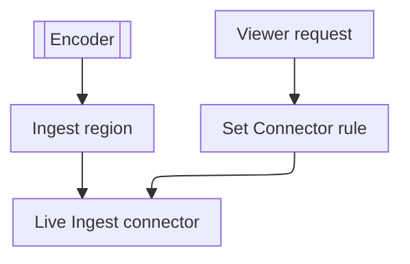

import DocButton from '~/components/webkit/DocButton.vue'
import DocCardGroup from '@aziontech/webkit/doc-card-group'
import DocCard from '@aziontech/webkit/doc-card'

A live broadcast is watched while it is produced. An encoder captures the audio and video and pushes the stream to an ingest point as it is captured. The ingest point packages the stream into files that a player fetches over HTTP. Viewers never connect to the encoder: servers that received the stream deliver those files to every viewer.

**Live Ingest** takes in the live stream that your encoder pushes over Real-Time Messaging Protocol (RTMP), in the region of a [connector](/en/documentation/platform/connectors/) of type `live_ingest`. It converts the stream to HTTP Live Streaming (HLS). An [application](/en/documentation/platform/applications/) delivers the stream to viewers: a rule whose _Set Connector_ behavior names that connector sends their requests to the stream. Use Live Ingest to deliver live events, e-sports matches, and educational broadcasts to their audience.

<DocButton href="/en/documentation/guides/media-and-streaming/streaming/deliver-a-live-stream-from-live-ingest/" label="Deliver a live stream" size="medium" />
<DocButton href="/en/documentation/platform/connectors/live-ingest/ingestion-and-delivery/" label="Live Ingest reference" kind="secondary" size="medium" />

---

## Live Ingest connector structure

Live Ingest acts through a connector of type `live_ingest`, which carries one attribute: the region where Live Ingest receives your stream. This body creates one in `us-east-1`, sent as the body of `POST /v4/workspace/connectors`:

```json
{
  "name": "my-connector",
  "type": "live_ingest",
  "attributes": { "region": "us-east-1" }
}
```

- `type` set to `live_ingest` gives the connector no addresses and no connection options, so it takes neither [Load Balancer](/en/documentation/platform/connectors/load-balancer/) nor [Origin Shield](/en/documentation/platform/connectors/origin-shield/).
- `attributes.region` is required, and it takes a region such as `us-east-1` or `us-east-2`. A request without it is refused with `10059`, and a value that [Azion API](https://api.azion.com/) does not accept, with `10039`. For the field and its errors, refer to [Connector settings](/en/documentation/platform/connectors/settings/#live-ingest).
- The API answers `202` with `"state": "pending"`, and the connector reads back with `"attributes": {"region": "us-east-1"}`. A `bucket` sent with this type is accepted and not stored.
- [Azion Console](https://console.azion.com/) offers the type as the _Live Ingest_ card of **Connector Type**, with **Region** as a required field.

---

## Request path

Live Ingest acts at the connector a viewer's request reaches. When you select a Live Ingest source in a rule, Azion adds the _Enforce HLS cache_ behavior to that Request Phase rule. The behavior bypasses the application's cache rules and applies the cache policy Azion defines for live HLS transmissions.

This diagram follows the stream in from the encoder and a viewer's request to it:



1. The encoder pushes the live stream to Live Ingest in the region of the connector.
2. A viewer requests the stream from a hostname of the [workload](/en/documentation/platform/workloads/) whose deployment names the application.
3. A rule's _Set Connector_ behavior names the connector of type `live_ingest`, and the _Enforce HLS cache_ behavior applies the live HLS cache policy.
4. The connector serves the stream, and the viewer receives it.

For how Live Ingest takes a stream in and delivers it, refer to [Ingestion and delivery](/en/documentation/platform/connectors/live-ingest/ingestion-and-delivery/).

---

## Scope and limits

- **Encoder**: Live Ingest receives the stream over RTMP, so the encoder must support RTMP with username and password authentication. Azion provides the credentials and the ingestion URLs of a primary and a backup endpoint, and it may require supported or approved encoders, configurations, and endpoints. The encoder needs no HLS output of its own.
- **Region**: a connector of type `live_ingest` takes one of five regions. The region decides where the stream enters Azion, not where viewers connect, so choose the one with the shortest path from the encoder.
- **Cache**: _Enforce HLS cache_ caches each playlist, `.m3u8`, for 5 seconds and each segment, `.ts`, for 60 seconds. A cache setting of the application has no effect on these requests. While a copy is valid, it answers every viewer who requests it, so a large audience does not send each of its requests to Live Ingest.
- **Interfaces**: you create the connector in Azion Console, through the API at `/v4/workspace/connectors`, or with `azion create connector --type live_ingest --file connector.json` of [Azion CLI](/en/documentation/devtools/cli/). To create the connector and its delivery rule from each one, refer to [Deliver a live stream from Live Ingest](/en/documentation/guides/media-and-streaming/streaming/deliver-a-live-stream-from-live-ingest/).
- **Observability**: the `connectedUsersMetrics` dataset of the [Real-Time Metrics](/en/documentation/platform/real-time-metrics/) GraphQL API carries aggregated data on the users connected to your live streams.
- **Limits**: the [bounds of every connector](/en/documentation/platform/connectors/limits/#connectors) apply to a connector of type `live_ingest`, such as a `name` of 1 to 255 characters. For how Live Ingest is billed, refer to [Connectors limits](/en/documentation/platform/connectors/limits/#live-ingest), and for the rates, to [Pricing](/en/documentation/fundamentals/pricing/#live-ingest).
- **HLS from your origin**: for an HLS stream your own origin produces, give its playlists and segments their own cache settings, as [Enforce HLS cache for live streaming](/en/documentation/guides/media-and-streaming/streaming/enforce-hls-cache/) describes.
- **Terms**: the [Connectors glossary](/en/documentation/platform/connectors/glossary/) defines the words the Live Ingest pages give a specific meaning, such as ingestion region and connector type.

---

## Next steps

<DocCardGroup cols={2}>
  <DocCard title="Deliver a live stream from Live Ingest" href="/en/documentation/guides/media-and-streaming/streaming/deliver-a-live-stream-from-live-ingest/" label="Create the connector in your encoder's region, and send viewers' requests to it." />
  <DocCard title="Ingestion and delivery" href="/en/documentation/platform/connectors/live-ingest/ingestion-and-delivery/" label="Follow the stream from the encoder to a viewer's player, and see how its cache works." />
  <DocCard title="Guides and tutorials" href="/en/documentation/platform/connectors/guides/" label="Complete a specific task with a connector, such as delivering a live stream." />
  <DocCard title="Limits" href="/en/documentation/platform/connectors/limits/#live-ingest" label="See how Live Ingest is billed, and the bounds every connector takes." />
  <DocCard title="Best practices" href="/en/documentation/platform/connectors/best-practices/#live-ingest" label="Plan redundant endpoints, encoder settings, player fallback, alerts, and a load test." />
  <DocCard title="Troubleshooting" href="/en/documentation/platform/connectors/troubleshooting/#live-ingest" label="Find the cause when a Live Ingest connector is refused without a region." />
</DocCardGroup>
