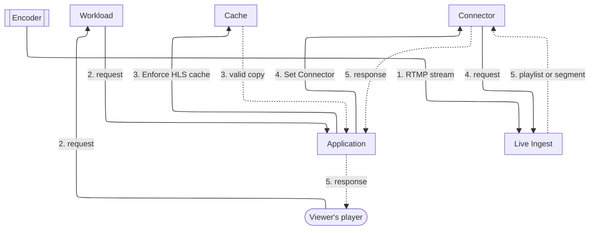

import DocButton from '~/components/webkit/DocButton.vue'
import DocCardGroup from '@aziontech/webkit/doc-card-group'
import DocCard from '@aziontech/webkit/doc-card'

**Live Ingest** is a Platform Resource that takes in the stream your encoder pushes and converts it for delivery to viewers, on Azion's distributed infrastructure. An ingest point is a server that receives a live broadcast from an encoder and packages it into files that players fetch over HTTP. Use Live Ingest to deliver live events, e-sports matches, and educational broadcasts to their audience through an [Application](/en/documentation/platform/applications/).

<DocButton href="/en/documentation/platform/connectors/live-ingest/ingestion-and-delivery/" label="Ingestion and delivery" size="medium" />
<DocButton href="/en/documentation/platform/connectors/live-ingest/reference/" label="Live Ingest reference" kind="outlined" size="medium" />

---

## Request path

Viewers never connect to Live Ingest: their requests reach it only through an Application rule that sets a [Connector](/en/documentation/platform/connectors/) of type `live_ingest`. That Connector holds one setting, the region where your encoder pushes the stream.

The diagram follows the stream from your encoder and a viewer's request for it. Solid arrows carry the stream or a request, and dotted arrows carry a response. Each label starts with the number of its step in the list that follows the diagram.

1. Your encoder pushes the stream over Real-Time Messaging Protocol (RTMP) to Live Ingest, in the region of the Connector. Live Ingest converts it to HTTP Live Streaming (HLS): a playlist, `.m3u8`, and the segments it lists, `.ts`.
2. A viewer's player requests the playlist or a segment from a domain of a [Workload](/en/documentation/platform/workloads/). The Application that the Workload's deployment sets receives the request.
3. Azion adds the _Enforce HLS cache_ behavior to the Request Phase rule that sets the Connector. The behavior applies the live HLS cache policy in place of the Application's cache settings. When [Cache](/en/documentation/platform/applications/cache/) holds a valid copy of the file, that copy answers the player.
4. Otherwise, the request goes to the Connector that the rule sets with _Set Connector_, and the Connector routes it to Live Ingest.
5. Live Ingest answers with the playlist or the segment. Cache keeps a copy under the live HLS cache policy, and the response reaches the player.

For the cache time of each file type, refer to [Rules Engine for Applications](/en/documentation/platform/applications/rules-engine/#enforce-hls-cache).

---

## Next steps

<DocCardGroup cols={2}>
  <DocCard title="Ingestion and delivery" href="/en/documentation/platform/connectors/live-ingest/ingestion-and-delivery/" label="See what the encoder needs, how the region works, and how the cache serves a large audience." />
  <DocCard title="Deliver a live stream from Live Ingest" href="/en/documentation/guides/media-and-streaming/streaming/deliver-a-live-stream-from-live-ingest/" label="Create the Connector in your encoder's region, and send the viewers' requests to it with a rule." />
  <DocCard title="Connector settings" href="/en/documentation/platform/connectors/settings/#live-ingest" label="Look up the regions a Live Ingest Connector takes and the errors a wrong region returns." />
  <DocCard title="Best practices" href="/en/documentation/platform/connectors/best-practices/#live-ingest" label="Prepare backup endpoints, encoder settings, and a player fallback before the event." />
  <DocCard title="Limits" href="/en/documentation/platform/connectors/limits/" label="Look up the bounds of a Connector and where Live Ingest stops." />
  <DocCard title="Troubleshooting" href="/en/documentation/platform/connectors/troubleshooting/#live-ingest" label="Find out why the API refuses a Live Ingest Connector." />
  <DocCard title="Pricing" href="/en/documentation/fundamentals/pricing/#live-ingest" label="See how Live Ingest is billed." />
  <DocCard title="Glossary" href="/en/documentation/platform/connectors/glossary/" label="Look up a word that the Live Ingest pages use with a specific meaning." />
</DocCardGroup>
