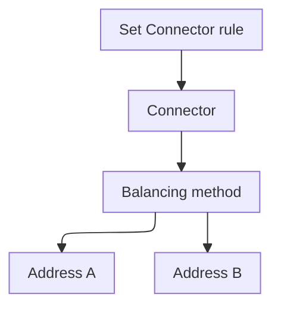

import DocButton from '~/components/webkit/DocButton.vue'
import DocCardGroup from '@aziontech/webkit/doc-card-group'
import DocCard from '@aziontech/webkit/doc-card'

A load balancer stands in front of several servers that hold the same content. For each request, it chooses the server that receives it, by a policy called a balancing method. The servers share the load, so no single server carries all of it, and the site keeps answering when one of them fails.

**Load Balancer** spreads the requests of one [connector](/en/documentation/platform/connectors/) of type `http` across up to 15 addresses instead of one. It acts inside the connector, on each request that an [application](/en/documentation/platform/applications/) rule with the _Set Connector_ behavior sends there. A balancing method, _Round Robin_, _Least Connections_, or _IP Hash_, chooses the address, and the weight and server role of each address shape that choice. Use Load Balancer to keep serving when a server fails, favor a larger server, keep a standby origin, or hold each client IP on one server.

<DocButton href="/en/documentation/platform/connectors/load-balancer/quickstart/" label="Quickstart" size="medium" />
<DocButton href="/en/documentation/platform/connectors/load-balancer/balancing-methods/" label="Load Balancer reference" kind="secondary" size="medium" />

---

## Load Balancer configuration structure

Load Balancer acts through the configuration of one connector: a switch and a method on the connector, and a role and a weight on each address. This body turns Load Balancer on with _Round Robin_ for two addresses weighted 2 and 1, sent as the body of `PATCH /v4/workspace/connectors/<connector-id>`:

```json
{
  "attributes": {
    "addresses": [
      {
        "address": "httpbin.org",
        "modules": { "load_balancer": { "server_role": "primary", "weight": 2 } }
      },
      {
        "address": "httpbingo.org",
        "modules": { "load_balancer": { "server_role": "primary", "weight": 1 } }
      }
    ],
    "connection_options": {
      "transport_policy": "force_http",
      "host": "${host}"
    },
    "modules": {
      "load_balancer": { "enabled": true, "config": { "method": "round_robin" } }
    }
  }
}
```

- `modules.load_balancer` under `attributes` turns Load Balancer on, and its `config` names the `method`: `round_robin`, the default, `least_conn`, or `ip_hash`. With `enabled` set to `true`, `config` must carry at least one key, or [Azion API](https://api.azion.com/) refuses the request with `28014`.
- `modules.load_balancer` on each address holds its `server_role`, `primary` by default or `backup`, and its `weight`, a whole number from 1 to 100 that defaults to `1`.
- `config` also takes `max_retries`, `connection_timeout`, and `read_write_timeout`. Each key this body leaves out takes its API default: `0` retries, `60` seconds, and `120` seconds. For every field and its range, refer to [Connector settings](/en/documentation/platform/connectors/settings/#load-balancer).
- [Azion Console](https://console.azion.com/) writes the same fields. In a connector, the **Load Balancer** switch of the **Modules** section shows **Method** and the retry and timeout fields. **Address Management** holds the **Server Role** and **Weight** of each address.

The model transfers from other load balancers: a pool is a connector with Load Balancer on, and its steering policy is the balancing method.

---

## Request path

Load Balancer acts inside the connector, after a rule names it and before a connection to the origin opens. It changes which address receives the request, not how the request is addressed.

This diagram follows a request from the rule to one of two addresses:



1. A rule's _Set Connector_ behavior names a connector that has Load Balancer on.
2. The balancing method of the connector chooses one of its active addresses, using each address's weight and server role.
3. The connector opens the connection to that address, with the same `Host` header, path prefix, and protocol as for every other address.
4. When the connection fails, the connector retries as many times as **Max Retries** allows.

For how Round Robin, Least Connections, and IP Hash choose an address, refer to [Balancing methods](/en/documentation/platform/connectors/load-balancer/balancing-methods/).

---

## Scope and limits

- **Connector type**: Load Balancer works on a connector of type `http` alone, since a connector of type `storage` or `live_ingest` holds no addresses. It is off on a new connector, and [Origin Shield](/en/documentation/platform/connectors/origin-shield/) can be on beside it.
- **Balanced requests**: rules still decide which requests reach the connector, so any criterion of [Rules Engine for Applications](/en/documentation/platform/applications/rules-engine/), such as the path, decides which requests are balanced.
- **Methods**: the three methods are the whole list, and none steers a request by the visitor's location or by a measured latency. Load Balancer carries no health check in its configuration: no probe, no probe protocol, and no interval. A backup address receives requests only when every primary address fails, and _IP Hash_ refuses a backup address with `28005`.
- **Retries and timeouts**: they exist only while Load Balancer is on, and a connector without it follows the platform defaults in [How Connectors works](/en/documentation/platform/connectors/how-it-works/#connection-reuse-and-timeouts). When you turn Load Balancer on in Azion Console, the form fills in `3` retries and timeouts of `30` and `60` seconds. Through the API, `max_retries` defaults to `0`, so the connector does not retry a failed connection until you raise it.
- **Maintenance**: turning off **Active** takes an address out of rotation without deleting it, and the address keeps its ports, role, and weight. For when it stops receiving requests, refer to [Active addresses](/en/documentation/platform/connectors/load-balancer/balancing-methods/#active-addresses).
- **Interfaces**: you turn Load Balancer on in the connector form of Azion Console, or through the API at `/v4/workspace/connectors`. [Azion CLI](/en/documentation/devtools/cli/) reads the whole connector from a file, with `azion update connector --connector-id <connector-id> --type http --file connector.json`. In [azion.config.js](/en/documentation/devtools/cli/azion-config-js/#connector-modules), a connector declares it in `attributes.modules.loadBalancer`.
- **Observability**: [Data Stream](/en/documentation/platform/data-stream/) records in `$upstream_addr` the address and port of each server a request was sent to, in the *Applications + WAF Event Collector* preset. When Load Balancer chooses another origin for a request, the `$upstream_*` variables hold one value per connection, as [Several values in one field](/en/documentation/platform/data-stream/data-sources-and-variables/#several-values-in-one-field) shows.
- **Limits**: with Load Balancer on, a connector holds up to 15 addresses, and a 16th is refused with `28011`. For every bound, the error past it, and what each plan includes, refer to [Connectors limits](/en/documentation/platform/connectors/limits/#load-balancer), and for the rates, to [Pricing](/en/documentation/fundamentals/pricing/#load-balancer).
- **Neighbors**: Load Balancer chooses among the addresses of one connector, after the request reaches Azion. Weighted DNS records that split traffic between IP addresses at resolution time belong to [Edge DNS](/en/documentation/platform/edge-dns/).
- **Terms**: the [Connectors glossary](/en/documentation/platform/connectors/glossary/) defines the words the Load Balancer pages give a specific meaning, such as balancing method, server role, and weight.

---

## Next steps

<DocCardGroup cols={2}>
  <DocCard title="Quickstart" href="/en/documentation/platform/connectors/load-balancer/quickstart/" label="Spread requests across two addresses, then take one out of rotation." />
  <DocCard title="Balancing methods" href="/en/documentation/platform/connectors/load-balancer/balancing-methods/" label="Compare the three methods, and see how weight, server role, and retries shape the choice." />
  <DocCard title="Guides and tutorials" href="/en/documentation/platform/connectors/guides/" label="Complete a specific task, from adding a backup origin to shifting traffic by weight." />
  <DocCard title="Limits" href="/en/documentation/platform/connectors/limits/#load-balancer" label="Look up a bound on addresses, weight, retries, or timeouts, and the error past it." />
  <DocCard title="Best practices" href="/en/documentation/platform/connectors/best-practices/#load-balancer" label="Keep a backup address ready, and take an address out before maintenance." />
  <DocCard title="Troubleshooting" href="/en/documentation/platform/connectors/troubleshooting/#load-balancer" label="Find the cause when an address is refused, or an inactive one still receives requests." />
</DocCardGroup>
