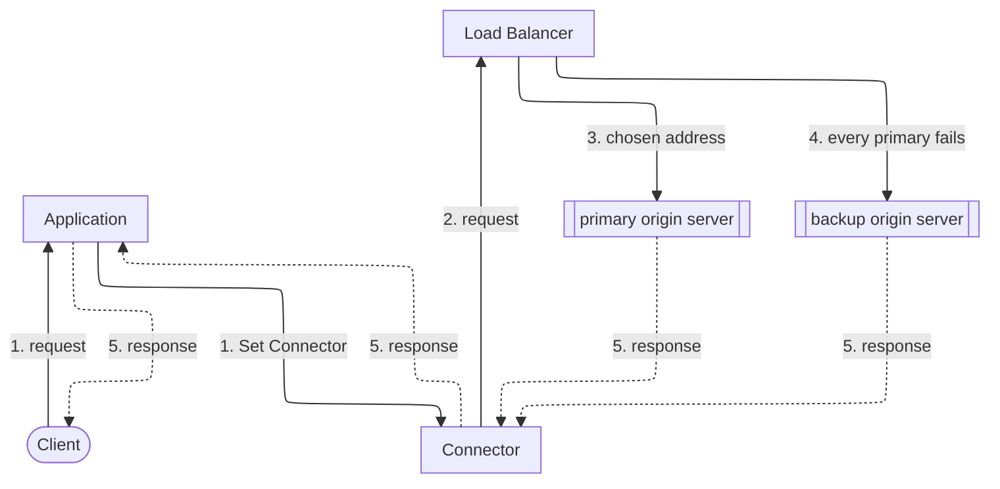

import DocButton from '~/components/webkit/DocButton.vue'
import DocCardGroup from '@aziontech/webkit/doc-card-group'
import DocCard from '@aziontech/webkit/doc-card'

**Load Balancer** is a Platform Resource that balances requests across the addresses of a [Connector](/en/documentation/platform/connectors/) of type `http`, on Azion's distributed infrastructure. A [load balancer](https://www.azion.com/en/learning/performance/what-is-load-balancing/) is a proxy in front of servers with the same content, and its balancing method picks the server for each request. Use Load Balancer to stay available when an origin fails, favor larger servers, keep a standby origin, or pin each client IP to one server.

<DocButton href="/en/documentation/platform/connectors/load-balancer/quickstart/" label="Quickstart" size="medium" />
<DocButton href="/en/documentation/platform/connectors/load-balancer/reference/" label="Load Balancer reference" kind="secondary" size="medium" />

---

## Request path

Turning on Load Balancer changes no rule: a Connector still receives only the requests of the [Application](/en/documentation/platform/applications/) rules that set it. Load Balancer then chooses which address of that Connector receives each one.

The diagram follows a request that a rule sends to a Connector of type `http` with Load Balancer on. Solid arrows carry the request, and dotted arrows carry the response. Each label starts with the number of its step in the list after the diagram.

1. An Application receives the client request, which goes to the Connector that a _Set Connector_ rule sets. The criteria of that rule, such as the path, decide which requests are balanced.
2. Load Balancer takes the request and considers only the active addresses of the Connector. An inactive address, with `active` set to `false`, stays on the Connector and leaves the rotation.
3. The balancing method, _Round Robin_, _Least Connections_, or _IP Hash_, chooses a primary address, and the weight of each address shapes that choice. The Connector sends the request there with the same `Host` header, path prefix, and protocol as for every address.
4. When the connection fails, the Connector tries again as many times as `max_retries` allows. A backup address receives requests only when every primary address fails.
5. The origin server answers the Connector, and the response returns through the Application to the client.

For how each method chooses an address, and how the weight and the server role change the result, refer to [Balancing methods](/en/documentation/platform/connectors/load-balancer/balancing-methods/).

---

## Next steps

<DocCardGroup cols={2}>
  <DocCard title="Quickstart" href="/en/documentation/platform/connectors/load-balancer/quickstart/" label="Balance a Connector across two servers, then take one server out of rotation." />
  <DocCard title="Balancing methods" href="/en/documentation/platform/connectors/load-balancer/balancing-methods/" label="Pick a method, and plan the weight and server role of each address." />
  <DocCard title="Connector settings" href="/en/documentation/platform/connectors/settings/#load-balancer" label="Look up a Load Balancer field, its default in each interface, and the values it takes." />
  <DocCard title="Guides and tutorials" href="/en/documentation/platform/connectors/guides/" label="Find the procedure for a task, from a backup origin to a traffic shift by weight." />
  <DocCard title="Limits" href="/en/documentation/platform/connectors/limits/#load-balancer" label="Look up the bound on addresses, weight, retries, or timeouts, and the error past it." />
  <DocCard title="Best practices" href="/en/documentation/platform/connectors/best-practices/#load-balancer" label="Keep a backup address ready, and take an address out before maintenance." />
  <DocCard title="Troubleshooting" href="/en/documentation/platform/connectors/troubleshooting/#load-balancer" label="Find the cause when an address is refused, or an inactive one still receives requests." />
  <DocCard title="Glossary" href="/en/documentation/platform/connectors/glossary/" label="Look up a word the Load Balancer pages use with a specific meaning, such as server role." />
</DocCardGroup>
