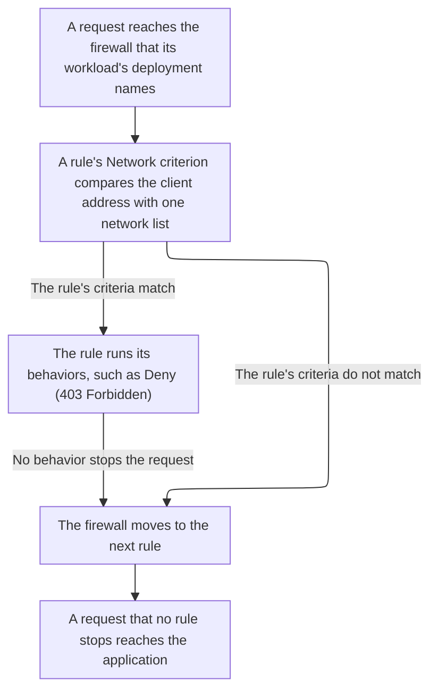

import DocButton from '~/components/webkit/DocButton.vue'
import DocCardGroup from '@aziontech/webkit/doc-card-group'
import DocCard from '@aziontech/webkit/doc-card'

Blocking by origin judges a request by where it comes from, not by what it asks for. The check compares the client address of each request with a list of addresses, networks, or countries. A request from a listed source is refused before the application sees it. The list can change as often as the threats do, while the rule that reads it stays the same.

**Network Shield** adds that comparison to a [firewall](/en/documentation/platform/firewall/) as one rule criterion, _Network_, `${network}` in [Azion API](https://api.azion.com/). The criterion matches the client address of a request against a [network list](/en/documentation/platform/firewall/network-shield/network-lists/) of IP addresses and CIDR ranges, Autonomous System Numbers (ASNs), or countries. Use Network Shield to block known-bad addresses, restrict access by country, allow only your own networks, rate-limit a set of clients, or block Tor exit nodes.

<DocButton href="/en/documentation/platform/firewall/network-shield/quickstart/" label="Quickstart" size="medium" />
<DocButton href="/en/documentation/platform/firewall/network-shield/network-lists/" label="Network Shield reference" kind="secondary" size="medium" />

---

## Network list structure

Network Shield matches through a network list, which holds items of one type, fixed when the list is created. This list holds an IPv4 address, an IPv4 range, and an IPv6 range, sent as the body of `POST /v4/workspace/network_lists`:

```json
{
  "name": "Blocked addresses",
  "type": "ip_cidr",
  "items": ["192.0.2.10", "198.51.100.0/24", "2001:db8::/32"]
}
```

- `type` sets the format of every item and never changes after creation. `ip_cidr` takes IPv4 and IPv6 addresses and ranges, `asn` takes Autonomous System Numbers as digits, and `countries` takes two-letter ISO 3166-1 alpha-2 codes such as `DE`.
- `items` holds the entries a rule matches, and exact duplicates are removed. An `ip_cidr` item can also carry a due date, `--LT` and a UTC date and time, and a `#` comment.
- A firewall rule references the list by ID with the _Network_ criterion, `{ "variable": "${network}", "conditional": "if", "operator": "is_in_list", "argument": <network-list-id> }`. The ID is a JSON integer, and the same ID sent as a string is refused with `25042`.
- [Azion Console](https://console.azion.com) keeps lists on the **Network Lists** page, Azion API serves them at `/v4/workspace/network_lists`, and [Azion CLI](/en/documentation/devtools/cli/) manages them under the `network-list` noun.

---

## Request path

Creating a network list blocks no request. A list decides nothing on its own: it matches traffic only once a rule references it, on a firewall that a [workload](/en/documentation/platform/workloads/)'s deployment names. What happens to a request that matches is the rule's behavior, which [Rules Engine for Firewall](/en/documentation/platform/firewall/rules-engine/) defines and Network Shield does not change.

This diagram follows a request from the firewall that receives it to the decision of a rule with the _Network_ criterion:



1. A workload's deployment names one firewall, and each request to the workload reaches that firewall before the application.
2. A rule's _Network_ criterion names one network list by its ID and compares the client address of the request with the list's items. An `asn` or `countries` list matches when the address belongs to a listed network or country.
3. The criterion is true for a client in the list under _matches_ (`is_in_list`), and for a client outside the list under _does not match_ (`is_not_in_list`).
4. When the rule's criteria match, the rule runs its behaviors. A behavior that stops the request, such as _Deny (403 Forbidden)_, answers the client with `403`, and no later rule runs.
5. When the criteria do not match, or no behavior stops the request, the firewall moves to the next rule. A request that no rule stops reaches the application.

For how a list matches a client address, when its items expire, and the lists Azion maintains, refer to [List matching](/en/documentation/platform/firewall/network-shield/list-matching/).

---

## Scope and limits

- **Firewall**: Network Shield adds one thing to a firewall, the _Network_ criterion, and a new firewall starts with it on. The Console switch defaults to on, and the API returns `modules.network_protection.enabled` as `true`. While Network Shield is off, the API refuses a rule that uses `${network}` with `25047 Missing Required Modules`, and Azion Console shows the option disabled, as _Network - required Network Shield_. Once a rule uses the criterion, turning Network Shield off is refused with `24005`, whose detail lists the IDs of the rules. The switch sits in **Main Settings** › **Modules**, and the _Network_ option becomes selectable after you save the firewall with it on. For why to leave it on, refer to [Firewall best practices](/en/documentation/platform/firewall/best-practices/#network-shield).
- **Behaviors**: every behavior a matching rule runs belongs to Firewall, so _Deny (403 Forbidden)_, _Drop (Close Without Response)_, and _Set Rate Limit_ are enforced with Network Shield off. A rule can chain the _Network_ criterion with any other criterion the firewall offers, such as _Request Uri_ to limit a block to one path.
- **Moving rules**: a _Network_ rule recreated on a firewall where Network Shield is off is refused until Network Shield is on there. On the firewall the rule came from, Network Shield turns off only after every _Network_ rule there is deleted or changed.
- **Lists**: one list can back many rules on many firewalls, so one change to its items changes what all of them match, with no change to the rules. That change reaches traffic sooner than a new rule. Every account also holds `Azion IP Tor Exit Nodes`, list `2`, which Azion keeps current, and any write to it is refused with `22004`. For the propagation times, refer to [List matching](/en/documentation/platform/firewall/network-shield/list-matching/#one-list-behind-many-rules).
- **Countries and ASNs**: Azion resolves the country and the ASN of an address from databases kept by external suppliers. Access control by country or ASN is therefore applied on a best-effort basis. For which list type suits each case, refer to [Firewall best practices](/en/documentation/platform/firewall/best-practices/#match-the-list-type-to-what-you-are-blocking).
- **Limits**: a rule that uses the _Network_ criterion counts toward the [rules each plan includes](/en/documentation/platform/firewall/limits/#included-usage-per-plan) per firewall, like any other rule. Each list holds up to 20,000 items by default, a ceiling Azion can raise on request, based on the plan. For every bound, the answer past it, and what each plan includes, refer to [Firewall limits](/en/documentation/platform/firewall/limits/#network-shield), and for the rates, to [Pricing](/en/documentation/fundamentals/pricing/#network-shield).
- **Interfaces**: you create and manage lists on the **Network Lists** page of Azion Console and through the API at `/v4/workspace/network_lists`. Azion CLI manages them with commands such as `azion create network-list` and `azion update network-list --add-item`. The _Network_ criterion belongs to a firewall rule, created with `azion create firewall-rule` or at `/v4/workspace/firewalls/<firewall-id>/request_rules`. `azion.config.js` declares a list in its `networkList` entry and turns Network Shield on with a firewall's `networkProtection`, as [azion.config.js](/en/documentation/devtools/cli/azion-config-js/#networklist) documents. [Azion Terraform Provider](/en/documentation/devtools/terraform/security/) manages lists with the `azion_network_list` resource. A function on a firewall checks an address against a list with `Azion.networkList.contains()`, documented on [Network List API](/en/documentation/devtools/runtime/api-reference/network-list/).
- **Observability**: a request that _Deny (403 Forbidden)_ refuses receives Azion's default error page. The page shows the matched address and the request ID that `x-azion-request-id` carries, and it names neither the firewall, the rule, nor the list. With the firewall's **Debug Rules** setting on, [Real-Time Events](/en/documentation/platform/real-time-events/) and [Data Stream](/en/documentation/platform/data-stream/) show the rules a request ran, in the `$traceback` field. [Real-Time Metrics](/en/documentation/platform/real-time-metrics/) breaks requests down by address, network, and country.
- **Neighbors**: Network Shield reads where a request comes from, and nothing about what it carries. To refuse an attack that a request carries, use [WAF](/en/documentation/platform/firewall/waf/), and to tell scripts from people, use [Bot Manager](/en/documentation/platform/firewall/bot-manager/).
- **Terms**: the [Firewall glossary](/en/documentation/platform/firewall/glossary/) defines the words the Network Shield pages give a specific meaning, such as network list, allowlist, blocklist, and due date.

---

## Next steps

<DocCardGroup cols={2}>
  <DocCard title="Quickstart" href="/en/documentation/platform/firewall/network-shield/quickstart/" label="Deny your own address on one test path, and read the refusal." />
  <DocCard title="List matching" href="/en/documentation/platform/firewall/network-shield/list-matching/" label="See how a list matches a client address, and when its items expire." />
  <DocCard title="Network Lists" href="/en/documentation/platform/firewall/network-shield/network-lists/" label="Look up a field, a list type, an item annotation, or an error." />
  <DocCard title="Guides and tutorials" href="/en/documentation/platform/firewall/guides/" label="Complete a specific task, from a country block to an allowlist." />
  <DocCard title="Limits" href="/en/documentation/platform/firewall/limits/#network-shield" label="Look up a bound on a list, the answer past it, or what a plan includes." />
  <DocCard title="Troubleshooting" href="/en/documentation/platform/firewall/troubleshooting/#network-shield" label="Find the cause when a listed client gets through, or a list or a rule is refused." />
</DocCardGroup>
