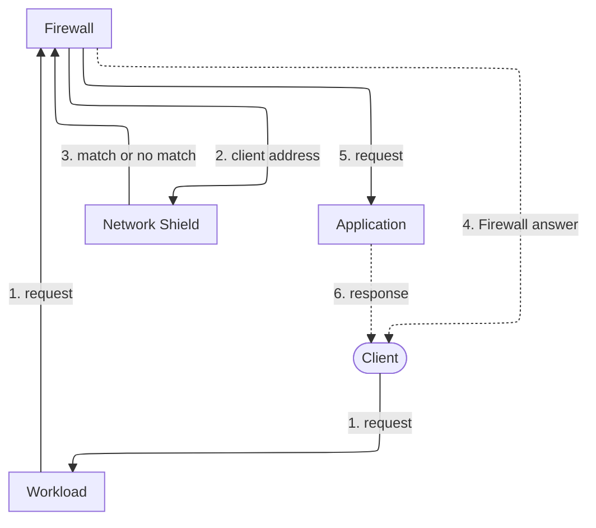

import DocButton from '~/components/webkit/DocButton.vue'
import DocCardGroup from '@aziontech/webkit/doc-card-group'
import DocCard from '@aziontech/webkit/doc-card'

**Network Shield** is a Platform Resource nested in [Firewall](/en/documentation/platform/firewall/) that matches the requests to your [Workloads](/en/documentation/platform/workloads/) by client address, before your [Application](/en/documentation/platform/applications/) receives them. A network-layer filter compares each client's address with lists of addresses, networks, or countries, and refuses the clients a policy excludes. Use Network Shield to block abusive addresses and networks, refuse countries you do not serve, or keep out every client outside your own networks.

Network Shield compares the client with one entity of its own:

- [Network Lists](/en/documentation/platform/firewall/network-shield/network-lists/) hold the IP addresses and ranges, Autonomous System Numbers (ASNs), or countries that a rule compares with the client. Keep each set of clients in one list, so that one change to its items reaches every rule that uses it.

<DocButton href="/en/documentation/platform/firewall/network-shield/quickstart/" label="Quickstart" size="medium" />
<DocButton href="/en/documentation/platform/firewall/network-shield/reference/" label="Network Shield reference" kind="secondary" size="medium" />

---

## Request path

A Network List blocks nothing by itself. A Firewall rule uses the list through the _Network_ criterion, and the behaviors of that rule decide what happens to a client the list matches. That Firewall inspects only the requests to the Workloads whose deployments set it.

The diagram traces one request through a rule with the _Network_ criterion. Solid arrows carry the request, dotted arrows carry the response, and each label opens with its step number.

1. The request of a client reaches a Workload, whose deployment sets the Firewall and the Application. The Firewall inspects the request before the Application.
2. The Firewall runs its rules in order. A rule with the _Network_ criterion has Network Shield compare the client address with one Network List.
3. Network Shield reports whether the client is in the list. Under _matches_, the criterion is true for a listed client, and under _does not match_, it is true for a client outside the list.
4. When the criteria of the rule match, the rule applies its behaviors. _Deny (403 Forbidden)_, for example, answers the client with a refusal, and the rules after it never run.
5. When the criteria do not match, or no behavior ends the request, the Firewall moves to the next rule. The Application receives only the requests that every rule let through.
6. The Application answers, and its response reaches the client.

To see how one list becomes a blocklist or an allowlist, refer to [List matching](/en/documentation/platform/firewall/network-shield/list-matching/#client-address-comparison).

---

## Next steps

<DocCardGroup cols={2}>
  <DocCard title="Quickstart" href="/en/documentation/platform/firewall/network-shield/quickstart/" label="Create a Network List, deny your own address on a test path, and read the refusal." />
  <DocCard title="List matching" href="/en/documentation/platform/firewall/network-shield/list-matching/" label="See how a list compares a client address, when its items expire, and which lists Azion keeps." />
  <DocCard title="Guides and tutorials" href="/en/documentation/platform/firewall/guides/" label="Do a specific task, from a country block to an allowlist or a temporary block." />
  <DocCard title="Best practices" href="/en/documentation/platform/firewall/best-practices/#network-shield" label="Choose a list type for each source, and decide who owns each list." />
  <DocCard title="Limits" href="/en/documentation/platform/firewall/limits/#network-shield" label="Look up a bound on a Network List and the answer a call receives past it." />
  <DocCard title="Troubleshooting" href="/en/documentation/platform/firewall/troubleshooting/#network-shield" label="Find out why a listed client gets through, or why a rule with a Network List is refused." />
  <DocCard title="Network List API" href="/en/documentation/devtools/runtime/api-reference/network-list/" label="Check an address against a list from a Function on a Firewall." />
  <DocCard title="Glossary" href="/en/documentation/platform/firewall/glossary/" label="Look up a word such as allowlist, blocklist, or due date." />
</DocCardGroup>
