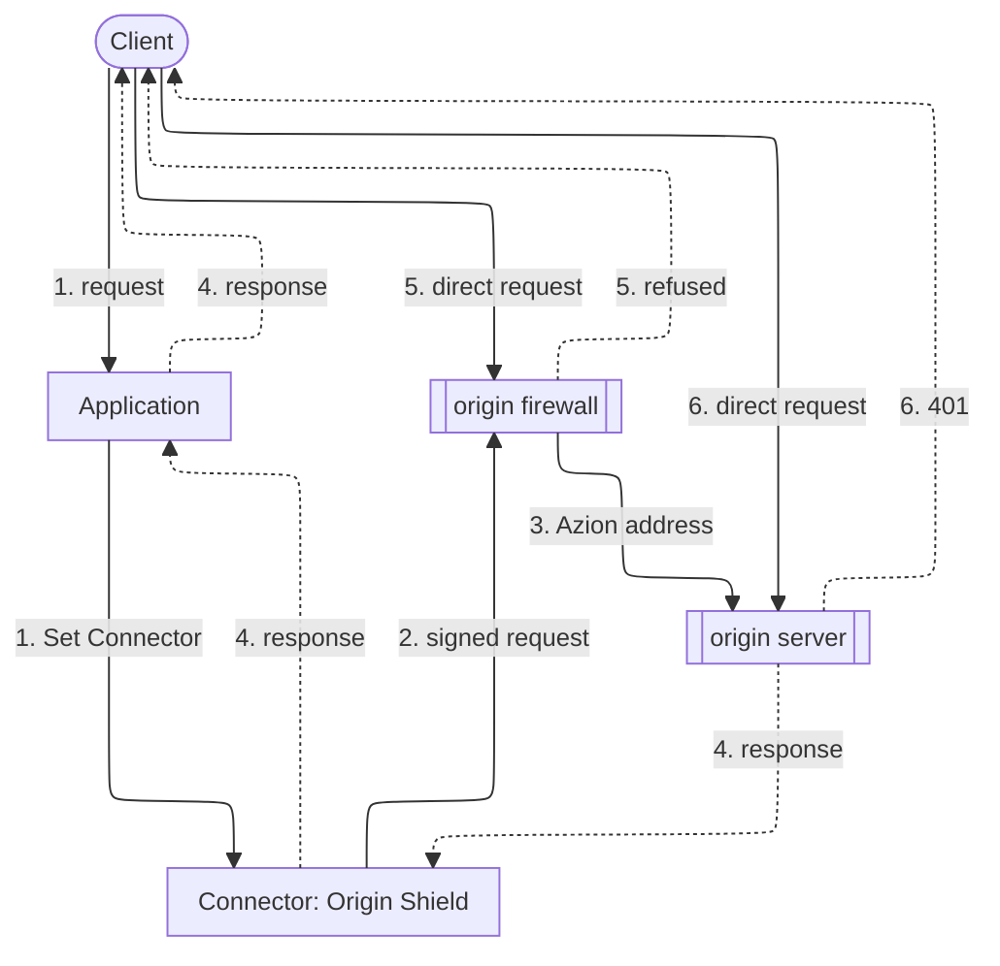

import DocButton from '~/components/webkit/DocButton.vue'
import DocCardGroup from '@aziontech/webkit/doc-card-group'
import DocCard from '@aziontech/webkit/doc-card'

**Origin Shield** is a Platform Resource that lets your origin accept only the requests a [Connector](/en/documentation/platform/connectors/) sends from Azion's distributed infrastructure. An origin shield is a set of checks at the origin that accept only a proxy's traffic, by its source address, its signature, or both. Use Origin Shield to keep clients from reaching your origin directly, or to serve a private bucket of an S3-compatible provider through an [Application](/en/documentation/platform/applications/).

Origin Shield gives a Connector of type `http` two features, which you turn on separately:

- [HMAC](/en/documentation/platform/connectors/origin-shield/origin-ip-acl-and-hmac/#hmac-authentication), a hash-based message authentication code, lets a Connector sign each request with your S3-compatible provider's credentials, so a private bucket answers it. The signature protects only an origin that verifies it, as S3-compatible storage does.
- [Origin IP ACL](/en/documentation/platform/connectors/origin-shield/origin-ip-acl-and-hmac/#origin-ip-acl) is a good fit for a server behind your firewall, whose access control list (ACL) then accepts only connections from Azion's addresses. Your firewall applies a copy of the `Azion Origin Shield` network list, which you keep current as Azion changes it.

<DocButton href="/en/documentation/platform/connectors/origin-shield/origin-ip-acl-and-hmac/" label="Origin IP ACL and HMAC" size="medium" />
<DocButton href="/en/documentation/platform/connectors/origin-shield/reference/" label="Origin Shield reference" kind="outlined" size="medium" />

---

## Request path

Turning on Origin Shield blocks no client at Azion: your origin enforces each check you turn on. With HMAC, the Connector signs each request, and with Origin IP ACL, your origin's firewall accepts only connections from listed addresses. Origin Shield acts only on the requests of a Connector that an Application rule sets with the _Set Connector_ behavior.

The diagram follows a request to a shielded origin, and two requests that try to bypass Azion. Solid arrows carry the request, and dotted arrows carry the response. Each label starts with the number of its step.

1. The Application receives a client's request, and a rule with the _Set Connector_ behavior sets a Connector that has Origin Shield on.
2. With HMAC on, the Connector signs the request with the credentials it holds, then connects to your origin from an address of Azion's infrastructure.
3. With Origin IP ACL, your origin's firewall accepts the connection, because its source address is on the `Azion Origin Shield` list.
4. Your origin checks the signature when HMAC is on, then answers, and the response returns through the Connector and the Application to the client.
5. A client that connects to your origin's address directly comes from an address outside the list, so the firewall refuses the connection.
6. Without Origin IP ACL, a direct request reaches your origin unsigned. A private bucket that expects the signature answers `401`, not `403`.

---

## Next steps

<DocCardGroup cols={2}>
  <DocCard title="Restrict an origin to Azion" href="/en/documentation/guides/application-security/bots-and-network/restrict-an-origin-to-azion-with-origin-ip-acl/" label="Turn on Origin IP ACL, and let your origin's firewall accept only Azion's prefixes." />
  <DocCard title="Sign origin requests with HMAC" href="/en/documentation/guides/application-development/getting-started/sign-origin-requests-with-hmac/" label="Serve a private S3-compatible bucket through a Connector that signs each request." />
  <DocCard title="Allow Azion's IP ranges at your origin" href="/en/documentation/support/retrieve-azion-ip-ranges/" label="Read the Azion Origin Shield list, and automate the update of the copy at your origin." />
  <DocCard title="Connector settings" href="/en/documentation/platform/connectors/settings/#origin-shield" label="Look up an Origin Shield field, its default, or the error that guards it." />
  <DocCard title="Limits" href="/en/documentation/platform/connectors/limits/#origin-shield" label="Look up the bounds on HMAC credentials, and what a shielded Connector covers." />
  <DocCard title="Best practices" href="/en/documentation/platform/connectors/best-practices/#origin-shield" label="Keep your origin's allowlist current, and scope HMAC credentials to one bucket." />
  <DocCard title="Troubleshooting" href="/en/documentation/platform/connectors/troubleshooting/#origin-shield" label="Find the cause when your origin refuses Azion, or the HMAC credentials are gone." />
  <DocCard title="Glossary" href="/en/documentation/platform/connectors/glossary/" label="Look up a word that the Origin Shield pages use with a specific meaning." />
</DocCardGroup>
