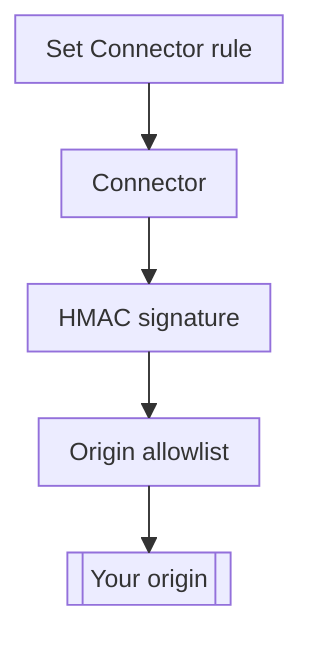

import DocButton from '~/components/webkit/DocButton.vue'
import DocCardGroup from '@aziontech/webkit/doc-card-group'
import DocCard from '@aziontech/webkit/doc-card'

An origin on the public internet answers anyone who finds its address, so a client can bypass a proxy and every protection in front of it. Two checks close that path. The origin accepts connections only from the proxy's addresses, and it refuses any request that does not carry a signature made with a secret only the proxy holds. With both in place, a request reaches the origin only through the proxy.

**Origin Shield** gives a [connector](/en/documentation/platform/connectors/) of type `http` both checks, for each request that an [application](/en/documentation/platform/applications/) rule with the _Set Connector_ behavior sends to it. A hash-based message authentication code (HMAC) signs each request the connector sends with AWS Signature Version 4 credentials, so an S3-compatible origin authenticates it. Origin IP ACL lets your origin's firewall allow only the IPv4 and IPv6 prefixes of the `Azion Origin Shield` network list, at layers 3 and 4. Use Origin Shield to keep clients from reaching your origin directly, or to serve a private bucket through an application.

<DocButton href="/en/documentation/guides/application-security/bots-and-network/restrict-an-origin-to-azion-with-origin-ip-acl/" label="Restrict an origin to Azion" size="medium" />
<DocButton href="/en/documentation/platform/connectors/origin-shield/origin-ip-acl-and-hmac/" label="Origin Shield reference" kind="secondary" size="medium" />

---

## Origin Shield configuration structure

Origin Shield acts through the configuration of a connector: one switch for Origin Shield, one switch per defense, and the HMAC credentials. This body creates a connector that reads a private bucket through the S3 endpoint of [Object Storage](/en/documentation/platform/object-storage/) and signs each request, sent as the body of `POST /v4/workspace/connectors`:

```json
{
  "name": "my-bucket-connector",
  "type": "http",
  "attributes": {
    "addresses": [{ "address": "s3.us-east-005.azionstorage.net" }],
    "connection_options": {
      "transport_policy": "force_https",
      "host": "s3.us-east-005.azionstorage.net",
      "path_prefix": "/<bucket-name>"
    },
    "modules": {
      "origin_shield": {
        "enabled": true,
        "config": {
          "origin_ip_acl": { "enabled": false },
          "hmac": {
            "enabled": true,
            "config": {
              "type": "aws4_hmac_sha256",
              "attributes": {
                "region": "us-east-005",
                "service": "s3",
                "access_key": "<access-key>",
                "secret_key": "<secret-key>"
              }
            }
          }
        }
      }
    }
  }
}
```

- `modules.origin_shield.enabled` turns Origin Shield on, and its `config` holds one switch per defense, `origin_ip_acl.enabled` and `hmac.enabled`. All three are `false` on a new connector, and this body turns on HMAC alone.
- `hmac.config` carries the credentials. `type` is `aws4_hmac_sha256`, `region` is a region the provider supports, `service` defaults to `s3`, and the access key and secret key come from your object storage provider.
- With `enabled` set to `true`, `config` must carry at least one key, and with `hmac.enabled` set to `true`, `hmac.config` must be present, or [Azion API](https://api.azion.com/) refuses the request with `28014`. For every field and the error that guards it, refer to [Connector settings](/en/documentation/platform/connectors/settings/#origin-shield).
- [Azion Console](https://console.azion.com/) writes the same fields. The **Origin Shield** switch of the connector form shows the **Origin IP ACL** switch and the **HMAC** section, where **Type** is read-only.

If you sign requests to S3 with AWS Signature Version 4, the credentials transfer: HMAC takes the same region, service, access key, and secret key.

---

## Request path

Origin Shield acts on the leg between the connector and the origin. HMAC adds the signature when the connector sends the request, and Origin IP ACL takes effect at your origin, which checks where the connection comes from.

This diagram follows a request from the rule to a shielded origin:



1. A rule's _Set Connector_ behavior names a connector that has Origin Shield on.
2. With HMAC on, the connector signs the request with the credentials it holds.
3. The connection reaches your origin from an Azion address. With Origin IP ACL, your origin's firewall accepts it because the address is on the `Azion Origin Shield` list.
4. The origin checks the signature, and answers the request.

For how Origin IP ACL and HMAC protect the origin, refer to [Origin IP ACL and HMAC](/en/documentation/platform/connectors/origin-shield/origin-ip-acl-and-hmac/).

---

## Scope and limits

- **Connector type**: Origin Shield applies to a connector of type `http` alone, and a connector of type `storage` or `live_ingest` takes no Origin Shield settings. On a connector of type `http`, Origin Shield and [Load Balancer](/en/documentation/platform/connectors/load-balancer/) can both be on.
- **Origin IP ACL**: your origin's firewall enforces the allowlist, not Azion, and it refuses a client that connects to the origin's address directly. The `Azion Origin Shield` list appears in [Network Lists](/en/documentation/platform/firewall/network-shield/network-lists/) once at least one connector of the account has Origin IP ACL on. It holds IPv6 prefixes beside the IPv4 ones, and an allowlist with only the IPv4 prefixes refuses the connections Azion opens over IPv6.
- **List updates**: the list can change often. Azion emails every account with Origin Shield each time it changes, and Azion Console keeps a history of the prefixes each change added and removed. The servers behind an added prefix go into production 7 days after Azion publishes the list, which is your window to update the copy at your origin. To read the list and automate that update, refer to [Allow Azion's IP ranges at your origin](/en/documentation/support/retrieve-azion-ip-ranges/).
- **HMAC**: one set of credentials signs the requests to every address of the connector, and turning HMAC off removes them. The signature protects only an origin that verifies it. With HMAC off, a private bucket on the S3 endpoint of Object Storage answers `401`, not `403`. For the steps, refer to [Sign origin requests with HMAC](/en/documentation/guides/application-development/getting-started/sign-origin-requests-with-hmac/).
- **What each defense proves**: an address on the list proves that the connection came from Azion's infrastructure, not from your connector. When the signature is valid, it proves that the request carries your credentials. Turn both on when the origin must accept only requests that come through Azion and carry your credentials, as [What each mechanism proves](/en/documentation/platform/connectors/origin-shield/origin-ip-acl-and-hmac/#what-each-mechanism-proves) explains.
- **Propagation**: a change to these switches reaches traffic over several minutes, at a different moment in each data center. For example, right after you turn HMAC off, some data centers still sign requests while others already send them unsigned.
- **Interfaces**: you turn Origin Shield on in the connector form of Azion Console, or through the API at `/v4/workspace/connectors`. [Azion CLI](/en/documentation/devtools/cli/) creates the connector from a JSON file, with `azion create connector --type http --file connector.json`. In [azion.config.js](/en/documentation/devtools/cli/azion-config-js/#connector-modules), a connector declares it in `attributes.modules.originShield`.
- **Limits**: HMAC takes one credential set per connector, and each of its attributes takes 1 to 255 characters. For every bound and what each plan includes, refer to [Connectors limits](/en/documentation/platform/connectors/limits/#origin-shield), and for the rates, to [Pricing](/en/documentation/fundamentals/pricing/#origin-shield).
- **Neighbors**: Origin Shield protects the origin with an allowlist and request signing. A second cache layer between Azion's cache and your origin, which cuts the requests that reach it, is [Tiered Cache](/en/documentation/platform/applications/cache/tiered-cache/).
- **Terms**: the [Connectors glossary](/en/documentation/platform/connectors/glossary/) defines the words the Origin Shield pages give a specific meaning, such as Origin IP ACL, HMAC, and Azion Origin Shield list.

---

## Next steps

<DocCardGroup cols={2}>
  <DocCard title="Restrict an origin to Azion" href="/en/documentation/guides/application-security/bots-and-network/restrict-an-origin-to-azion-with-origin-ip-acl/" label="Turn on Origin IP ACL, and let your origin's firewall accept only Azion's prefixes." />
  <DocCard title="Origin IP ACL and HMAC" href="/en/documentation/platform/connectors/origin-shield/origin-ip-acl-and-hmac/" label="See what each defense proves, and how the address list is updated." />
  <DocCard title="Guides and tutorials" href="/en/documentation/platform/connectors/guides/" label="Complete a specific task, from an allowlist at your origin to a signed bucket origin." />
  <DocCard title="Limits" href="/en/documentation/platform/connectors/limits/#origin-shield" label="Look up the bounds on HMAC credentials, and what a plan includes." />
  <DocCard title="Best practices" href="/en/documentation/platform/connectors/best-practices/#origin-shield" label="Keep your origin's allowlist current, and scope HMAC credentials to one bucket." />
  <DocCard title="Troubleshooting" href="/en/documentation/platform/connectors/troubleshooting/#origin-shield" label="Find the cause when your origin refuses Azion, or a bucket answers 401." />
</DocCardGroup>
