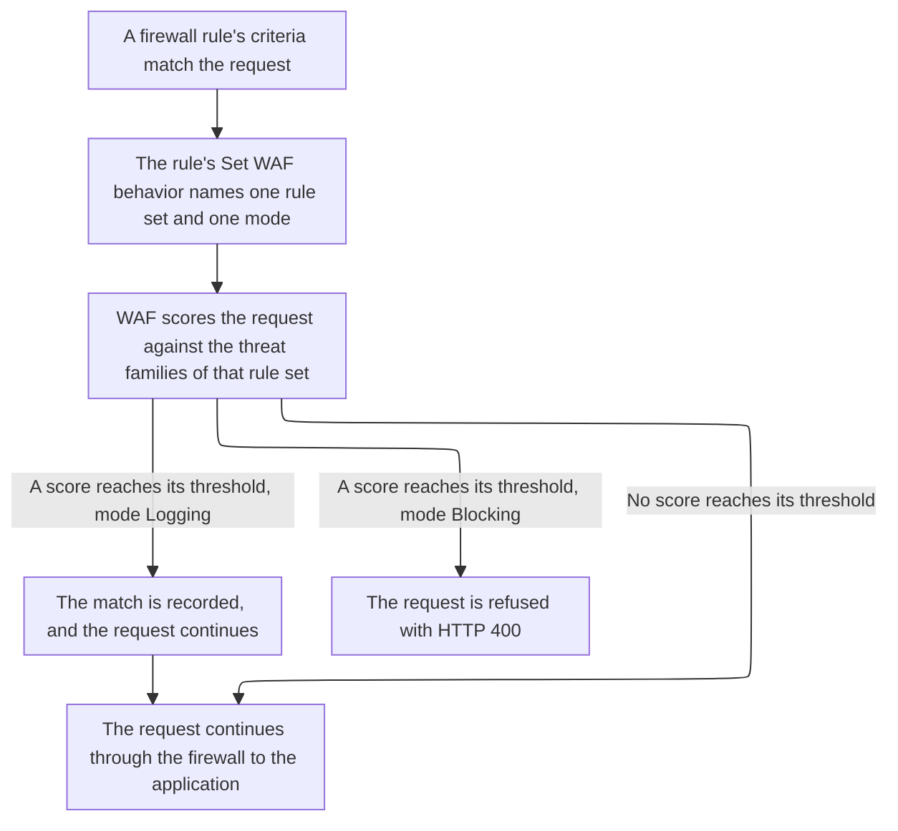

import DocButton from '~/components/webkit/DocButton.vue'
import DocCardGroup from '@aziontech/webkit/doc-card-group'
import DocCard from '@aziontech/webkit/doc-card'

A [web application firewall](https://www.azion.com/en/learning/websec/what-is-web-application-firewall/) reads a request before the application does. It weighs the parts that can carry an attack, such as the path, the query string, the headers, the cookies, and the body, against known attack patterns. When the evidence adds up, it refuses the request, so the application never handles it. Otherwise the request reaches the application unchanged.

**Web Application Firewall (WAF)** scores each request that a [firewall](/en/documentation/platform/firewall/) rule hands it against eight threat families, at layer 7, the application layer. It refuses or records each request whose score reaches a threshold. On a firewall that has WAF turned on, it runs for the requests whose rule carries a _Set WAF_ behavior. Use WAF to refuse requests that carry threats of the [OWASP Top 10](https://www.azion.com/en/learning/websec/what-is-the-owasp-top-10-list-of-web-application-security-threats/) and others, such as SQL injection, cross-site scripting, and remote file inclusion.

<DocButton href="/en/documentation/platform/firewall/waf/quickstart/" label="Quickstart" size="medium" />
<DocButton href="/en/documentation/platform/firewall/waf/rules-set/" label="WAF reference" kind="secondary" size="medium" />

---

## Rule set structure

WAF acts through a rule set, which holds the threat families to detect and the sensitivity chosen for each. This rule set scores all eight families at the default sensitivity, sent as the body of `POST /v4/workspace/wafs`:

```json
{
  "name": "storefront-waf",
  "active": true,
  "product_version": "1.0",
  "engine_settings": {
    "engine_version": "2021-Q3",
    "type": "score",
    "attributes": {
      "rulesets": [1],
      "thresholds": [
        { "threat": "cross_site_scripting", "sensitivity": "medium" },
        { "threat": "directory_traversal", "sensitivity": "medium" },
        { "threat": "evading_tricks", "sensitivity": "medium" },
        { "threat": "file_upload", "sensitivity": "medium" },
        { "threat": "identified_attack", "sensitivity": "medium" },
        { "threat": "remote_file_inclusion", "sensitivity": "medium" },
        { "threat": "sql_injection", "sensitivity": "medium" },
        { "threat": "unwanted_access", "sensitivity": "medium" }
      ]
    }
  }
}
```

- `thresholds` holds one entry per threat family. `sensitivity` takes one of five levels: `highest`, `high`, `medium`, `low`, or `lowest`. A higher sensitivity blocks at a lower score: `highest` blocks at 4, `medium` at 16, and `lowest` at 40.
- `rulesets`, `engine_version`, and `type` accept one value each, the ones shown. A create that sends no `engine_settings` produces the same rule set.
- A rule set scores nothing on its own. A firewall rule applies it with a _Set WAF_ behavior, `{ "type": "set_waf", "attributes": { "waf_id": <rule-set-id>, "mode": "blocking" } }`, which names the rule set and the mode.
- Azion Console lists rule sets on the **WAF Rules** page, and [Azion API](https://api.azion.com/) and [Azion CLI](/en/documentation/devtools/cli/) call the same object a `waf`.

If you configured a managed rule set elsewhere, the model transfers. You choose categories, which are the threat families here, and a strictness for each, which is its sensitivity. The individual rules stay with the platform.

---

## Request path

Creating a rule set inspects nothing. A rule set is a configuration object that carries no domain, no path, and no method, so it scores exactly the requests a rule's criteria hand it. A rule carries one _Set WAF_ behavior at most, so one rule decides one rule set and one mode for the requests it matches.

This diagram follows a request from the rule that matches it to the WAF decision:



1. A rule on the firewall matches the request, and its _Set WAF_ behavior names one rule set and one mode, `logging` or `blocking`.
2. WAF scores the request against the threat families configured in that rule set.
3. A score that reaches its family's threshold makes the request a match.
4. A match is refused with `400` in _Blocking_ and recorded and served in _Logging_.
5. A request that reaches no threshold continues through the firewall's rules to the application.

For how WAF scores a request, what each mode does, and how exceptions and tuning narrow a rule set, refer to [Scoring and modes](/en/documentation/platform/firewall/waf/scoring-and-modes/).

---

## Scope and limits

- **Firewall**: WAF is off in a new firewall, and it is the only Product that starts off. `modules.waf.enabled` reads `false` until you turn it on in the firewall's **Main Settings** › **Modules**, and a rule set applied on a firewall without WAF never runs. For where that switch is, refer to [Set a firewall's main settings](/en/documentation/guides/application-security/firewall-and-waf/firewall-configure-main-settings/).
- **Modes**: _Blocking_ answers a match with `400` and Azion's default error page, headed **Bad Request**, and nothing in the response names WAF, the rule, or the score. _Logging_ records the match and serves the request. [Real-Time Events](/en/documentation/platform/real-time-events/), [Data Stream](/en/documentation/platform/data-stream/), and `azion.config.js` call _Logging_ learning, while the API refuses `learning` as a mode. For why production starts in _Logging_, refer to [Firewall best practices](/en/documentation/platform/firewall/best-practices/#waf).
- **Request body**: on a `POST`, WAF parses a body sent as `application/x-www-form-urlencoded`, `multipart/form-data`, `application/json`, `application/vnd.api+json`, or `application/csp-report`. It inspects up to 131,072 bytes, which is 128 KiB, and refuses a larger body with `400`.
- **Exceptions**: an exception takes one part of a request out of scoring for one internal rule, or for every rule when its rule ID is `0`, the default. Azion Console calls it an allowed rule and keeps it on the rule set's **Allowed Rules** tab. The **Tuning** tab turns selected matches of the last 3 days into allowed rules. For every field, refer to [Exceptions](/en/documentation/platform/firewall/waf/custom-allowed-rules/).
- **Several firewalls**: Azion keeps one _Set WAF_ configuration for each set of rule criteria. When rules on two firewalls carry the same criteria and name different rule sets, only the most recent behavior runs. The other rule set does not run, although its rule stays active and its firewall reports no error. For the details, refer to [How Set WAF resolves across firewalls](/en/documentation/platform/firewall/how-it-works/#how-set-waf-resolves-across-firewalls).
- **Neighbors**: WAF scores what a request carries. To block a request by where it comes from, use [Network Shield](/en/documentation/platform/firewall/network-shield/), and to tell scripts from people, use [Bot Manager](/en/documentation/platform/firewall/bot-manager/).
- **Interfaces**: you create rule sets on the **WAF Rules** page of [Azion Console](https://console.azion.com), through the API at `/v4/workspace/wafs`, and with Azion CLI commands such as `azion create waf`. The _Set WAF_ behavior belongs to a firewall rule, created with `azion create firewall-rule` or at `/v4/workspace/firewalls/<firewall-id>/request_rules`. `azion.config.js` declares a rule set and the rule that applies it, as [Bind a rule set in azion.config.js](/en/documentation/guides/application-security/firewall-and-waf/config-file-binding/) shows. [Azion Terraform Provider](/en/documentation/devtools/terraform/security/) manages WAF with the `azion_waf` and `azion_waf_rule_set` resources.
- **Observability**: a match leaves nothing in the response. [Real-Time Metrics](/en/documentation/platform/real-time-metrics/secure-dashboards/#waf) counts requests processed and blocked. Real-Time Events shows the internal rules a request matched and the score each family reached, and Data Stream sends those events outside Azion. A blocked request is found by its `x-azion-request-id` header.
- **Limits**: a rule set `name` takes up to 250 characters, and `thresholds` holds 1 to 8 entries. For every bound, the answer past it, and what each plan includes, refer to [Firewall limits](/en/documentation/platform/firewall/limits/#waf), and for the rates, to [Pricing](/en/documentation/fundamentals/pricing/#web-application-firewall).
- **Terms**: the [Firewall glossary](/en/documentation/platform/firewall/glossary/) defines the words the WAF pages give a specific meaning, such as rule set, threshold, and sensitivity level.

---

## Next steps

<DocCardGroup cols={2}>
  <DocCard title="Quickstart" href="/en/documentation/platform/firewall/waf/quickstart/" label="Score your first request, and refuse an injection-shaped one." />
  <DocCard title="Scoring and modes" href="/en/documentation/platform/firewall/waf/scoring-and-modes/" label="See how a score reaches its threshold, and what each mode does with a match." />
  <DocCard title="Rule sets" href="/en/documentation/platform/firewall/waf/rules-set/" label="Look up a field, a threat family, a sensitivity level, or an internal rule." />
  <DocCard title="Guides and tutorials" href="/en/documentation/platform/firewall/guides/" label="Complete a specific task, from tuning a rule set to exempting one parameter." />
  <DocCard title="Limits" href="/en/documentation/platform/firewall/limits/#waf" label="Look up a bound, the answer past it, or what a plan includes." />
  <DocCard title="Troubleshooting" href="/en/documentation/platform/firewall/troubleshooting/#waf" label="Find the cause when WAF refuses a request it should serve, or a rule is refused." />
</DocCardGroup>
