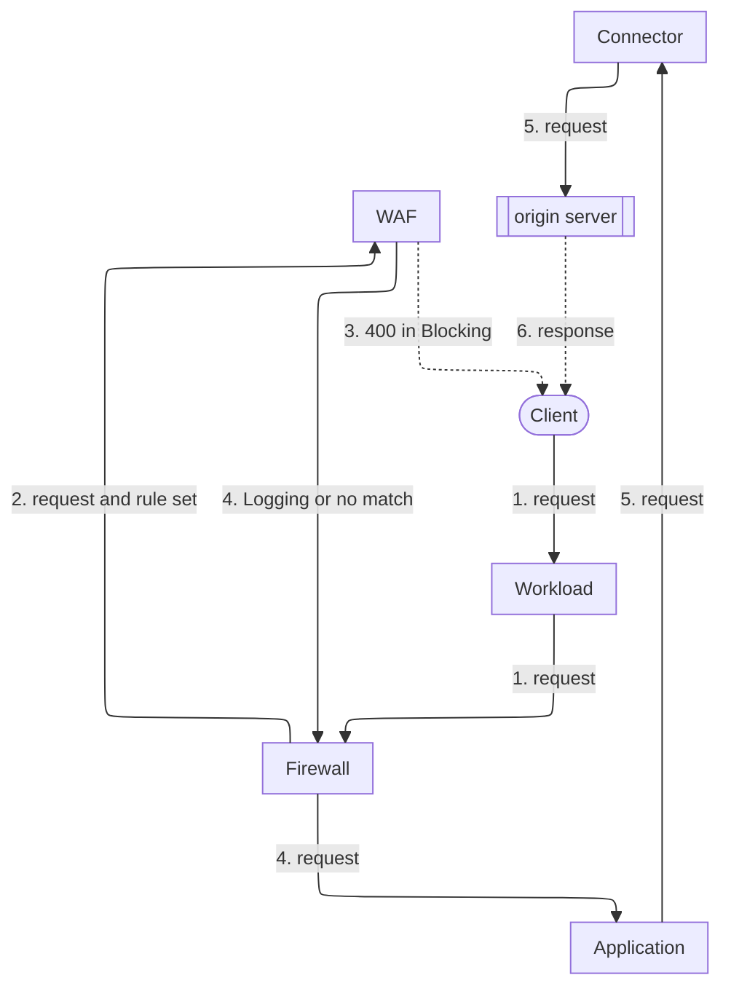

import DocButton from '~/components/webkit/DocButton.vue'
import DocCardGroup from '@aziontech/webkit/doc-card-group'
import DocCard from '@aziontech/webkit/doc-card'

**Web Application Firewall (WAF)** is a Platform Resource nested in [Firewall](/en/documentation/platform/firewall/) that detects attacks in the requests to your [Workloads](/en/documentation/platform/workloads/) and refuses or records them. A [web application firewall](https://www.azion.com/en/learning/websec/what-is-web-application-firewall/) compares the query string, headers, cookies, and body of each request with known attack patterns, and stops the requests that match. Use WAF to refuse SQL injection, cross-site scripting, and command injection in query strings, cookies, and request bodies, or record them while you tune.

WAF works with two entities of its own:

- [Rule sets](/en/documentation/platform/firewall/waf/rules-set/) set the threat families WAF scores and the sensitivity of each, which decides how much evidence a match needs. If you used a managed rule set elsewhere, its categories are the families, its strictness is the sensitivity, and Azion keeps the internal rules.
- [Exceptions](/en/documentation/platform/firewall/waf/custom-allowed-rules/) exempt one part of a request, such as a cookie or a query string value, from one internal rule. Write one for a legitimate request that a rule mistakes for an attack, rather than lower a family's sensitivity for every request.

<DocButton href="/en/documentation/platform/firewall/waf/quickstart/" label="Quickstart" size="medium" />
<DocButton href="/en/documentation/platform/firewall/waf/reference/" label="WAF reference" kind="outlined" size="medium" />

---

## Request path

Turning WAF on and creating a rule set leave every request unscored. WAF scores a request only when a matching Firewall rule carries a _Set WAF_ behavior. That behavior applies one rule set in one mode, _Logging_ or _Blocking_.

The diagram follows one request through a rule with a _Set WAF_ behavior. Solid arrows carry the request, and dotted arrows carry the response. Each label starts with the number of its step.

1. A client requests a domain of a Workload, whose deployment sets the Firewall and the [Application](/en/documentation/platform/applications/). The Firewall inspects the request first.
2. The Firewall runs its rules in order. When a rule with a _Set WAF_ behavior matches, WAF scores the request against each threat family of the rule set, one score per family.
3. In _Blocking_, a request whose score reaches the threshold of its family receives `400` and Azion's default error page, headed **Bad Request**. Nothing in the response names WAF, and the Application never receives the request.
4. In _Logging_, that request goes on, and its event in [Real-Time Events](/en/documentation/platform/real-time-events/) records the match. One internal rule still refused a malformed multipart body under _Logging_ in tests, as [Scoring and modes](/en/documentation/platform/firewall/waf/scoring-and-modes/#modes) shows. A request that reaches no threshold goes on in either mode, through the later rules, to the Application.
5. The Application sends the request to a [Connector](/en/documentation/platform/connectors/), whose origin server answers. In tests, WAF scored no request on an Application with no Connector.
6. The response of the origin server reaches the client.

To see how a score reaches its threshold, and what each sensitivity level trades, refer to [Scoring and modes](/en/documentation/platform/firewall/waf/scoring-and-modes/#scoring-and-sensitivity).

---

## Next steps

<DocCardGroup cols={2}>
  <DocCard title="Quickstart" href="/en/documentation/platform/firewall/waf/quickstart/" label="Create a rule set, apply it with a rule, and see WAF block a request." />
  <DocCard title="Scoring and modes" href="/en/documentation/platform/firewall/waf/scoring-and-modes/" label="See how WAF scores a request, what each mode does with a match, and which Set WAF applies." />
  <DocCard title="Rules Engine for Firewall" href="/en/documentation/platform/firewall/rules-engine/#set-waf" label="Look up the fields of the Set WAF behavior and the errors a rule receives." />
  <DocCard title="Guides and tutorials" href="/en/documentation/platform/firewall/guides/" label="Do a specific task, from a check of the WAF mode to an exception for one query string value." />
  <DocCard title="Best practices" href="/en/documentation/platform/firewall/best-practices/#waf" label="Keep one rule set per environment, and treat each exception as temporary." />
  <DocCard title="Limits" href="/en/documentation/platform/firewall/limits/#waf" label="Look up a bound on a rule set or an exception, and the answer a call receives past it." />
  <DocCard title="Troubleshooting" href="/en/documentation/platform/firewall/troubleshooting/#waf" label="Find out why WAF refuses a legitimate request, or why no request is blocked." />
  <DocCard title="Glossary" href="/en/documentation/platform/firewall/glossary/" label="Look up a word such as rule set, threshold, or false positive." />
</DocCardGroup>
