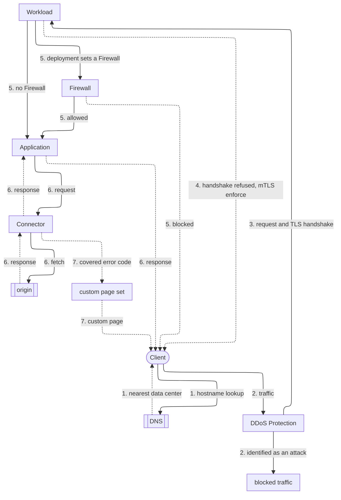
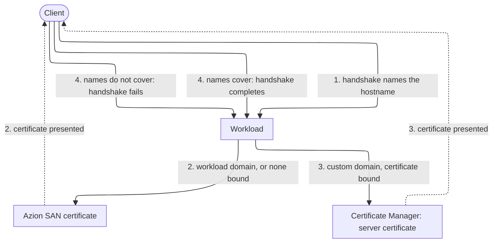
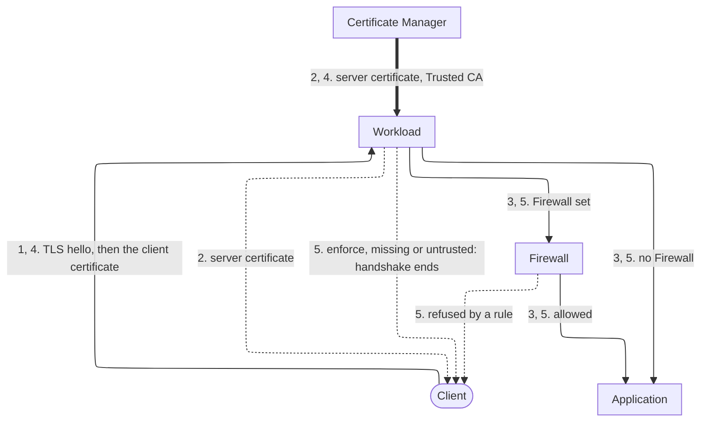
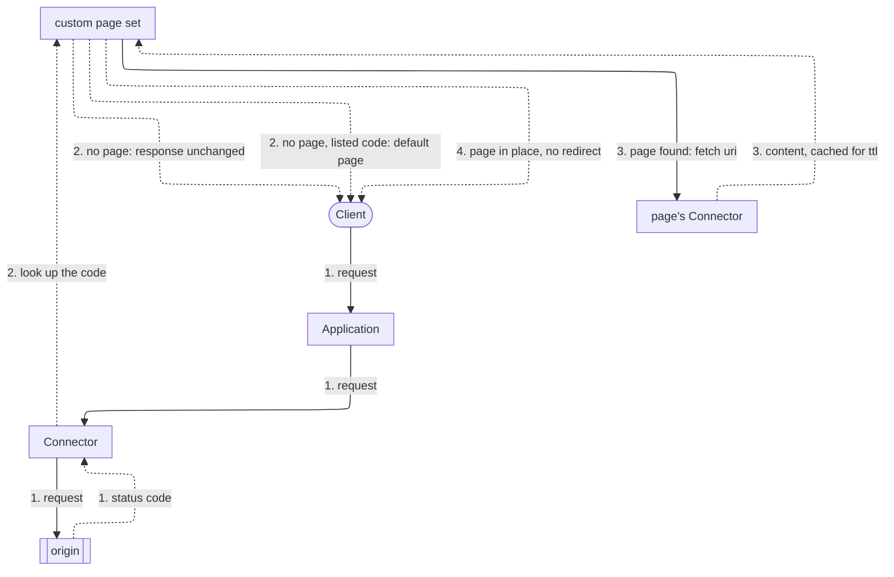
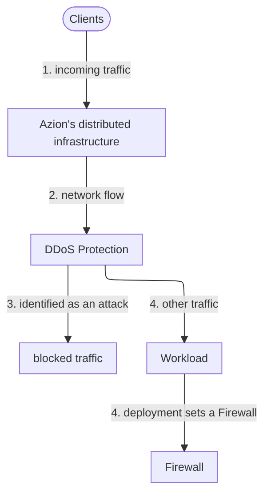

import FrameBox from '@aziontech/webkit/frame-box'
import ItemList from '@aziontech/webkit/item-list'
import DocItem from '@aziontech/webkit/doc-item'

Before a website answers a request, three things happen:

1. A Domain Name System (DNS) lookup turns the hostname into an address.
2. The client opens a secure connection, in which the server proves it holds a certificate for that name.
3. The server picks the configuration that answers the hostname. That configuration is the website's entry point.

Only then does any application code run.

On Azion, that entry point is a Workload. [Workloads](/en/documentation/platform/workloads/) is a Platform Resource that receives the requests sent to your domains on Azion's distributed infrastructure. A Workload holds the hostnames a request can arrive on, the TLS settings of the connection, and the ports and HTTP versions it accepts. The Workload's deployment sets the [Application](/en/documentation/platform/applications/) that answers, and optionally the [Firewall](/en/documentation/platform/firewall/) that inspects requests first and the custom page set that replaces error responses. On API v3, a Domains object carried the hostnames and the certificate, and an Application's Main Settings held the protocol and TLS settings. On API v4, the Workload and its deployment replace them, and [API v4 Migration](/en/documentation/fundamentals/api-v4-migration/) maps the two models.

This page covers the mechanisms rather than the fields: every field is on [Workload settings](/en/documentation/platform/workloads/settings/), and every bound is on [Workloads limits](/en/documentation/platform/workloads/limits/). The sections cover, in order, the path a request travels, the workload domain and custom domains, the infrastructure, TLS and HTTP versions, the deployment, and propagation. Certificate Manager, Custom Pages, and DDoS Protection close the page, in that order.

---

## The path a request travels

A request reaches a Workload through the hostname the client asks for. That hostname is the workload domain that Azion generates or a hostname in the Workload's domains. Before the Application receives the request, the Workload completes the TLS handshake and, with [mutual TLS (mTLS)](/en/documentation/platform/workloads/mtls/) on, checks the client certificate. When the Workload's deployment sets a Firewall, the rules of that Firewall run next. The Application receives only the requests that passed each of these checks.

This diagram follows one request from the DNS lookup to the response. Solid arrows carry the request, and dotted arrows carry what goes back to the client. Each label starts with the number of the step it belongs to.



1. The client looks up the hostname. For a custom domain that points to the workload domain, DNS returns the address of the nearest data center of Azion's distributed infrastructure.
2. The client connects to that data center. DDoS Protection inspects the traffic there before the Workload sees it, and Azion mitigates the traffic it identifies as an attack.
3. The Workload that lists the hostname receives the request. It completes the TLS handshake with its certificate, its minimum TLS version, and its cipher suite.
4. With mTLS on, the Workload also checks the client's certificate. In `enforce` mode, a client cannot complete the handshake without a certificate that the certificate authority (CA) you trust signed.
5. When the deployment sets a Firewall, the Firewall's rules evaluate the request before the Application and can block it. With no Firewall, the request goes straight to the Application.
6. The Application that the deployment sets runs its rules on the request. When a rule sets a [Connector](/en/documentation/platform/connectors/), that Connector routes the request to your origin. The response returns through the Application to the client.
7. When the Connector answers with an error status code that the deployment's custom page set covers, the client receives the custom page in place of that response.

Keeping the Workload apart from the Application means the hostnames and TLS settings change without touching your application's code. The cost is that a request's path depends on two entities. A Workload with no [propagated](/en/documentation/platform/workloads/how-it-works/#propagation) deployment has no Application to send the request to, and an Application serves no traffic until a Workload's deployment sets that Application.

---

## Workload domain and custom domains

A hostname is the name a client asks for, and a Workload answers only the hostnames it lists. Creating a Workload generates its _workload domain_: a read-only hostname in the `azionedge.net` zone. Its form depends on the Workload's [infrastructure](/en/documentation/platform/workloads/how-it-works/#infrastructure): `<id>.map.azionedge.net` on production and `<id>.preview.azionedge.net` on staging. The Workload serves traffic on that hostname as soon as its deployment propagates, before you own or point any domain.

Two more kinds of hostname go in the Workload's domains: an `azion.app` hostname and a custom domain.

### The azion.app hostname

The free hostname under `azion.app`, such as `my-site.azion.app`, is the one that Azion Console calls **Azion Custom Domain**. A Workload holds one at most, and a name that another Workload holds is not available. Azion serves it over HTTPS with the Azion SAN certificate. That certificate is Azion's own, and it lists the hostnames it covers as Subject Alternative Names (SANs). So the `azion.app` hostname needs no certificate of yours.

### Custom domains

A custom domain is a hostname of a domain you already own, such as `www.example.com`. You list each one on the Workload, then point it at the workload domain with a CNAME record at your DNS provider. When [Edge DNS](/en/documentation/platform/edge-dns/) hosts the domain's zone, Edge DNS can link the domain to Azion. In Azion Console, you can then select the domain from that zone in the **Domain** field of the Workload. The account must have permission for every domain the Workload lists, and the API refuses a domain without it. For that refusal, refer to [Troubleshoot Workloads](/en/documentation/platform/workloads/troubleshooting/#a-domain-is-refused-with-this-account-is-not-allowed-to-use-the-following-cnames).

:::caution
A custom domain serves HTTPS only with a server certificate that covers it. Azion's SAN certificate covers the workload domain, which sits in a zone that Azion shares with other customers, and the `azion.app` hostname. It covers no domain of yours. For the certificate, refer to [The certificate](/en/documentation/platform/workloads/how-it-works/#the-certificate).
:::

For example, a site that runs at `www.example.com` with another provider moves to Azion in three changes. You add `www.example.com` to the Workload's domains, bind a server certificate that covers it, and replace its DNS record with a CNAME to the workload domain. Visitors reach the Workload once their resolvers pick up the new record. For the DNS records step by step, refer to [Point a domain to a workload](/en/documentation/guides/platform/migration/point-domain-to-azion/).

### Access to the workload domain

The workload domain stays reachable alongside your own hostnames while `workload_domain_allow_access` is `true`, which is the default. Azion Console names this setting **Workload Domain Allow Access**. Set it to `false` when the Workload must answer only on your own hostnames: the workload domain then answers `404`, while your domains keep serving. A Workload cannot close its workload domain without another hostname to answer on, so the API refuses that change on a Workload whose domains list is empty. For the rules the API applies to each hostname, refer to [Workload settings](/en/documentation/platform/workloads/settings/#domains).

---

## Infrastructure

A Workload's infrastructure is the network that serves it. The production network gives global availability across Azion's distributed infrastructure, and the staging network is for testing, with limited propagation. You choose the infrastructure when you create the Workload, in the `infrastructure` field of the API. The choice also sets the workload domain's suffix: `.map.azionedge.net` on production and `.preview.azionedge.net` on staging. For the same choice in Azion Console, refer to [Workload settings](/en/documentation/platform/workloads/settings/#infrastructure).

A staging Workload accepts no `azion.app` hostname and no custom domain, so you reach it only through its workload domain. Changes you make to it do not affect a production Workload.

Because a staging Workload takes no custom domain, a test on your own hostname uses a production Workload that lists the hostname. The test runs before the hostname's DNS records change. Your device's hosts file maps the hostname to the workload domain's address, and every other visitor still reaches the current provider. For the steps, refer to [Test an application through the hosts file](/en/documentation/guides/application-development/getting-started/stage-applications-through-hosts-file/).

The infrastructure is fixed at creation, and the API refuses an update that changes it. For example, a configuration you tested on a staging Workload reaches production as a second Workload, created with the production infrastructure, not as an edit of the first. The cost of the split is that staging and production are two Workloads with two deployments, which you keep in step yourself.

---

## TLS and HTTP versions

Transport Layer Security (TLS) is the protocol that encrypts the connection between the client and the Workload. In its handshake, the Workload presents a certificate for the hostname, and the client and the Workload agree on a TLS version and a cipher. The Workload's `tls` settings hold that certificate, the lowest TLS version the Workload accepts, and the cipher suite it offers. These settings secure the leg from the client to Azion. The connection from Azion to your origin is set on the [Connector](/en/documentation/platform/connectors/) the Application uses.

### The certificate

The certificate that the Workload presents comes from one of two places. With [`tls.certificate`](/en/documentation/platform/workloads/#workload-structure) set to `null`, the Workload presents Azion's SAN certificate, which covers the workload domain and the `azion.app` hostname. For a domain of your own, you bind a server certificate from [Certificate Manager](/en/documentation/platform/workloads/#certificate-manager), and the Workload presents that certificate for that domain. The API does not compare the certificate's names with the Workload's domains, so it accepts a certificate that does not cover them. Check the names before you bind one.

This diagram follows the certificate from the Workload to the client's check. Solid arrows carry the client's handshake and the choice of certificate, and dotted arrows carry the certificate back. Each label starts with the number of the step it belongs to.



1. The client opens the TLS handshake and names the hostname it wants.
2. For the workload domain, or with `tls.certificate` set to `null`, the Workload presents Azion's SAN certificate.
3. For a custom domain, with a server certificate bound in `tls.certificate`, the Workload presents that certificate.
4. The client checks that the certificate's names cover the hostname it asked for. A mismatch shows up only at this step, as a failed handshake.

### Minimum TLS version and cipher suite

The minimum TLS version and the cipher suite decide which clients can complete the handshake. The minimum version is the lowest one the Workload accepts, so a session can still use a newer version. The cipher suite is a named set of ciphers, and the client and the Workload negotiate one cipher from it for each session. A higher minimum version refuses clients that support only older versions, and a lower one admits them, down to TLS 1.0. TLS 1.0 and TLS 1.1 are deprecated. For the ciphers each suite holds, refer to [Cipher suites](/en/documentation/platform/workloads/settings/#cipher-suites).

### Clients without SNI

Server Name Indication (SNI) is the TLS extension in which a client names the host it wants during the handshake. A connection without SNI reaches Azion's default configuration, which presents the Azion SAN certificate, so a domain served with a bound certificate relies on SNI. On a Workload with mTLS in `enforce` mode, Azion closes such a connection before it reaches your application, and the client receives no response. For the rest of the mTLS requirements, refer to [mTLS](/en/documentation/platform/workloads/mtls/#requirements).

### HTTP/3

HTTP/3 runs over QUIC, and a client reaches it through an upgrade. On the first request, the handshake and the response use TCP with HTTP/1.1 or HTTP/2. The response carries an `Alt-Svc` header that announces HTTP/3. A browser that supports HTTP/3 then sends later requests over QUIC, until the cached `Alt-Svc` answer is missing or expires. The API accepts `http3` in a Workload's HTTP versions only alongside `http1` and `http2`. In Azion Console, **HTTP/3 support** also requires **HTTPS support** to be on.

---

## The deployment

A Workload holds hostnames and TLS settings, but no Application. A deployment is the part of a Workload that sets the Application, which is required, and optionally a Firewall and a custom page set. In Azion Console, these are the **Application**, **Firewall**, and **Custom Page** fields of **Deployment Settings**.

A Workload gets its Firewall only through the deployment: the Firewall has no domain of its own, and the Workload's own fields set no Firewall. Until a Workload's deployment sets a Firewall, the rules of that Firewall see no request to that Workload. The same holds for a custom page set: a Workload uses a custom page set only once that Workload's deployment sets that custom page set.

A Workload holds at most one deployment, and the API refuses a second one. So every hostname of the Workload reaches the same Application and, when the deployment sets them, the same Firewall and custom page set. Changing any of them means editing that one deployment, and the edit applies to every hostname of the Workload. A change to the deployment propagates like any other Workload change, as [Propagation](/en/documentation/platform/workloads/how-it-works/#propagation) describes.

Until a deployment propagates, a request to the workload domain gets `404` with Azion's HTML error page, and an `x-azion-request-id` header identifies the request:

```bash
curl -sI https://<your-workload-domain>/
```

The response headers read:

```text
HTTP/2 404 
server: nginx
date: <date>
content-type: text/html
x-azion-request-id: <request-id>
x-azion-edge-location: <edge-location>
```

For the deployment fields, refer to [Workload settings](/en/documentation/platform/workloads/settings/#deployment).

---

## Propagation

A saved change to a Workload or its deployment reaches traffic only after it propagates. Propagation spreads the change across Azion's distributed infrastructure, data center by data center, and takes several minutes. Azion does not guarantee a duration: propagation is best-effort.

While a change spreads, requests can receive the old configuration or the new one, depending on the data center that answers. Each data center serves one configuration or the other, and the share of data centers on the new one grows until all of them agree. For example, right after mTLS is turned on in `enforce` mode, a client with no certificate can still receive `200` from a data center that lacks the change. Meanwhile, a data center that has it refuses the same client's handshake.

So a single request right after a change proves little. Check a change by repeating the request until it answers as expected and the answers agree. The cost of best-effort propagation is that no change is atomic: design each change so that the old and the new configuration can serve side by side. For example, keep the workload domain open until your own hostnames answer everywhere, then set `workload_domain_allow_access` to `false`.

---

## Certificate Manager

[Certificate Manager](/en/documentation/platform/workloads/#certificate-manager) is a Platform Resource that stores the certificates a Workload uses for TLS. A server certificate is a TLS certificate for your own domains, which the Workload presents to prove it holds a hostname. You upload it with its private key, or Azion requests it from Let's Encrypt and renews it for you. A Trusted CA certificate is the certificate of a certificate authority (CA) that you trust to sign client certificates. Certificate Manager also stores certificate revocation lists (CRLs) and creates certificate signing requests (CSRs).

A Workload uses a certificate only once you bind it. A server certificate goes in [`tls.certificate`](/en/documentation/platform/workloads/#workload-structure), a Trusted CA certificate goes in `mtls.config.certificate`, and CRLs go in `mtls.config.crl`. The API refuses a certificate sent in the field meant for the other kind. An uploaded certificate reads `inactive` until you bind it to a Workload, and `active` from then on, so the status shows whether any Workload uses it.

### Where Certificate Manager acts on a request

Certificate Manager acts during the TLS handshake, before a Firewall or an Application sees the request.

This diagram follows a handshake from the client's hello to the request that continues, with the certificates Certificate Manager supplies. Solid arrows carry the handshake and the request, and dotted arrows carry what goes back to the client. The thick arrow carries the certificates you bound before the request. Each label starts with the number of the step it belongs to.



1. The client opens a TLS connection to one of the Workload's hostnames and names that hostname through SNI.
2. The Workload presents its server certificate. For the workload domain, or with `tls.certificate` set to `null`, that is Azion's SAN certificate. For a custom domain with a server certificate bound, it is that certificate.
3. With mTLS off, the handshake completes, and the request continues to the Application, through the Firewall when the deployment sets one.
4. With mTLS on, the Workload requests a client certificate and checks it against the Trusted CA certificate in `mtls.config.certificate`.
5. In `enforce` mode, a client with no certificate, or with one another authority signed, cannot complete the handshake. In `permissive` mode, the handshake completes. When the deployment sets a Firewall, a rule that tests the Client Certificate Validation variable can refuse the request.

Storing certificates apart from the Workload lets you replace one without editing the Workload's other settings. The cost is that the certificate and the Workload are checked separately. The API accepts a certificate whose names do not cover the Workload's domains, and binding one is a Workload change that propagates over several minutes. For how `enforce` and `permissive` treat each client, refer to [mTLS](/en/documentation/platform/workloads/mtls/#verification-modes).

For how Azion requests a Let's Encrypt certificate, completes its challenge, and renews it, refer to [Issuance and renewal](/en/documentation/platform/workloads/certificate-manager/issuance-and-renewal/).

---

## Custom Pages

When an origin cannot find a resource, or does not respond in time, the client receives an error response, such as `404` or `504`. A custom page replaces that response with content you choose, for one status code at a time.

[Custom Pages](/en/documentation/platform/workloads/#custom-pages) is a Platform Resource that replaces the error response returned by a Connector with a page of your own, one page per error status code. A custom page set is the named list that groups those pages. A page of the `page_connector` type sets a Connector and the path of the page's content on that Connector. It also sets the time the content stays in cache and an optional status code for the response. A page can replace only a status code from a fixed list of client error (4xx) and server error (5xx) codes. A Workload uses a custom page set only once that Workload's deployment sets that custom page set.

### Where Custom Pages acts on a request

A custom page acts after the Application receives a response from the origin. The status code of that response says whether the request succeeded, and it decides whether a page applies.

This diagram follows a response from the Connector's status code to what the client receives. Solid arrows carry requests, and dotted arrows carry responses. Each label starts with the number of the step it belongs to.



1. The Application sends the request to the origin through a Connector, and the Connector answers with a status code.
2. Azion looks for a page with that code in the custom page set that the deployment sets. When the set has no page for the code, the client receives the Connector's response unchanged, except for the status codes `400`, `401`, `403`, `406`, `500`, `502`, `503`, and `504`, which receive Azion's default error page. A Workload whose deployment sets no custom page set passes every response unchanged.
3. When a page matches, Azion fetches its content from the page's Connector at the page's `uri`, and keeps it in cache for the page's `ttl`.
4. The client receives that content in place, with no redirect and no `Location` header. The status is the page's `custom_status_code`, when one is set.

For example, your origin answers a deleted product page with `404`. A page for the code `404` then serves the document at its `uri`, such as `/myerrors/404.html`, still with status `404`. The browser stays on the URL it asked for and shows your page. The cost of caching is that an edited page reaches clients only after its `ttl` expires. A long `ttl` spares your origin, and a short one picks up edits sooner.

For the fields of a set and its pages, and the status codes a page can replace, refer to [Custom page settings](/en/documentation/platform/workloads/custom-pages/settings/).

---

## DDoS Protection

A denial-of-service (DoS) attack floods a service with traffic until legitimate requests cannot get through. It can come from a single IP address. A distributed denial-of-service (DDoS) attack sends that traffic from a botnet of many machines at once. Mitigating an attack means telling attack traffic apart from real traffic before either reaches the service, and dropping the first.

[DDoS Protection](/en/documentation/platform/workloads/#ddos-protection) is a Feature of the Azion Platform that mitigates these attacks on every Workload. It is always on, and it needs no activation or configuration. Azion carries out the mitigation without affecting the performance of your applications. It applies whether your origin runs on premises or in a cloud, and whether your network is IPv4, IPv6, or both.

### Where DDoS Protection acts on a request

DDoS Protection acts on Azion's distributed infrastructure, before the Workload receives the traffic. It monitors the network flow of incoming traffic continuously and assesses each request for a DoS or DDoS attack. When the Workload's deployment sets a Firewall, the rules of that Firewall run only after that assessment.

This diagram follows incoming traffic from its arrival to the Workload. Solid arrows carry the traffic. Each label starts with the number of the step it belongs to.



1. Traffic for any Workload reaches Azion's distributed infrastructure.
2. DDoS Protection inspects the network flow with detection algorithms that find small attacks from a single IP address and large-scale attacks from botnets.
3. Azion mitigates the traffic it identifies as an attack.
4. Other traffic continues to the Workload. When the deployment sets a Firewall, that Firewall runs its rules next.

Because mitigation needs no configuration, a Workload is protected from the moment it exists, and you have nothing to tune. The cost is that the automatic defense is the same for every Workload. For detection and mitigation targeted at a specific attack, you write custom rules on the [Firewall](/en/documentation/platform/firewall/) that the deployment sets. For where attack records appear, refer to [Attack visibility](/en/documentation/platform/workloads/ddos-protection/ddos-mitigation/#attack-visibility).

For the attacks DDoS Protection mitigates and the techniques it uses, refer to [Attack mitigation](/en/documentation/platform/workloads/ddos-protection/ddos-mitigation/).

---

## Related resources

<FrameBox>
<ItemList>
  <DocItem title="Workload settings" href="/en/documentation/platform/workloads/settings/">Every field of a Workload and its deployment, with the type, default, and allowed values behind the mechanisms on this page.</DocItem>
  <DocItem title="Workloads quickstart" href="/en/documentation/platform/workloads/quickstart/">Create a Workload, set an Application in its deployment, and send your first request through its workload domain.</DocItem>
  <DocItem title="mTLS" href="/en/documentation/platform/workloads/mtls/">How a Workload verifies client certificates in enforce and permissive mode, and what each client receives.</DocItem>
  <DocItem title="Troubleshoot Workloads" href="/en/documentation/platform/workloads/troubleshooting/">Symptoms along the request path, from a domain that answers 404 to a handshake that fails, with their causes and fixes.</DocItem>
</ItemList>
</FrameBox>
