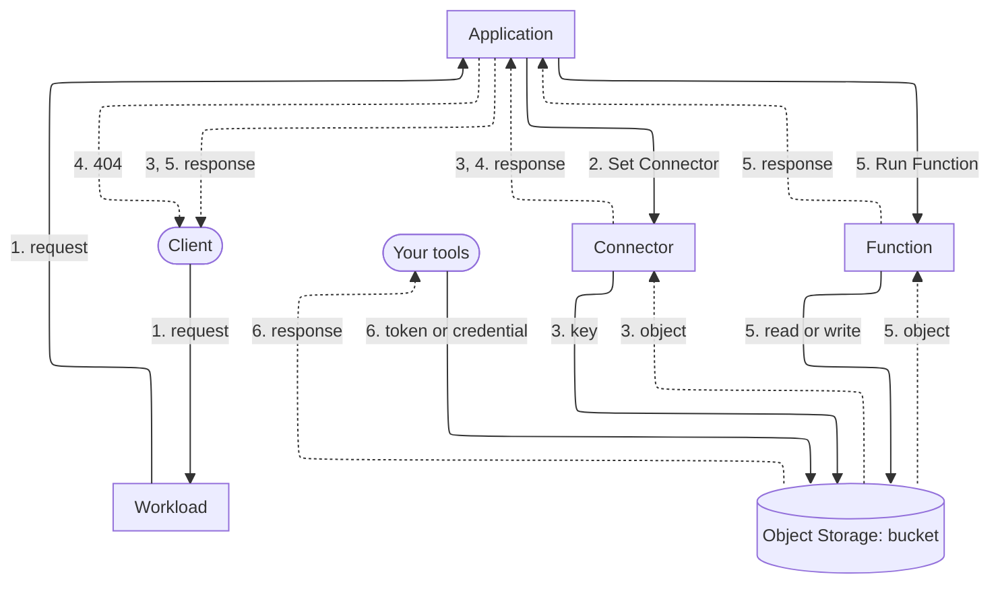

import FrameBox from '@aziontech/webkit/frame-box'
import ItemList from '@aziontech/webkit/item-list'
import DocItem from '@aziontech/webkit/doc-item'

An object store is a storage service that keeps each file as one object under a key of your choice. A write always stores a whole object, and a read can return all of it or a range of its bytes. Keys can look like paths, and the container stays flat: a folder is only the shared start of several keys.

On Azion, [Object Storage](/en/documentation/platform/object-storage/) is the Platform Resource that stores files as objects in buckets. An object carries its key, its content, and the content type it is served with. A bucket holds objects directly, and a bucket does not nest inside another. Azion Console, the Azion API, the Azion CLI, the `@aziontech/storage` library, and the S3 protocol manage the objects, and your [Applications](/en/documentation/platform/applications/) serve them.

This page covers the mechanisms rather than the values. The fields and their bounds are on [Buckets and objects](/en/documentation/platform/object-storage/buckets-and-objects/), and the S3 surface is on [S3 compatibility](/en/documentation/platform/object-storage/s3-compatibility/). The sections below cover the object and its key, the request path, the access levels, object delivery, and deletion.

---

## The object and its key

An upload names the bucket and the key, and sends the content as the body. There is no create-then-write sequence: the object exists when the request succeeds, and it does not exist before.

The key is the whole address. It may contain the forward slash. The Azion API, Azion Console, and the S3 protocol read a shared leading segment as a prefix, so `src/assets/logo.svg` appears grouped under `src` and `src/assets`. A prefix exists only while a key under it exists: it appears with the first key and leaves the listing with the last one.

The cost of that flatness is that a rename or a move rewrites the object. The Azion API has no rename, so you copy the object to its new key and delete the old one. Azion Console renames and moves objects with the same copy and delete, so moving a prefix rewrites every object under it.

Writing to a key that is already in use replaces the object that the Azion API returns. An Application returns the new object once it holds no cached copy of the old one. No request updates part of an object, and no setting turns versioning on.

Through the S3 protocol, `ListObjectVersions` still lists the earlier version, and `GetObject` reads it by its version ID, for a period you cannot set. So an object that must stay retrievable after a change is written under a new key, usually one that carries a version.

The content type is fixed at upload from the `Content-Type` header. When an upload through the Azion API sends none, Azion detects the type from the key's extension. An object whose key has no extension gets `application/octet-stream`. The type is stored with the object and returned on every read, so an object uploaded with the wrong content type keeps serving the wrong one until it is written again.

---

## The request path

Two paths reach the same objects, and only the management path asks for a token or a credential.

The _management path_ is every interface you manage objects with: Azion Console, the Azion API, the Azion CLI, the `@aziontech/storage` library, and the S3 protocol. The Azion API, the CLI, and the library send a personal token, and the S3 protocol signs each request with an S3 credential. The Azion API and the S3 endpoint refuse a request that carries neither with `401`.

A token reaches every bucket of the account. An S3 credential reaches the buckets it names, or every bucket when it names none.

The _delivery path_ runs through a Workload and an Application, and it is how your users reach an object. The diagram follows a request for `https://www.example.com/assets/logo.svg` on the delivery path, and a request from your own tools on the management path. Solid arrows carry the request, and dotted arrows carry the response. Each label starts with the number of its step below.

1. The client sends the request to the [Workload](/en/documentation/platform/workloads/) that holds `www.example.com`, and the Workload passes it to the Application that the Workload's deployment sets.
2. A rule of the Application matches the request and sets a [Connector](/en/documentation/platform/connectors/) of type `storage` with the _Set Connector_ behavior.
3. The Connector asks the bucket for the key made of its prefix, when it has one, followed by the request path. The Application returns the object with the content type stored with it.
4. When the bucket holds no object under that key, the client receives `404`.
5. Instead of setting a Connector, a rule can run a [Function](/en/documentation/platform/functions/). The Function reads or writes objects through the [Runtime API](/en/documentation/devtools/runtime/api-reference/storage/) and returns its own response.
6. Your tools reach the same bucket through the management path, with a token or an S3 credential.

Creating a bucket publishes none of its objects: only the management path reaches them until a rule sets a Connector or runs a Function.

The prefix on a Connector decides where the Application's path starts, so a Connector with the prefix `src/assets` serves the object `src/assets/logo.svg` at `/logo.svg`. 
:::caution
Without a prefix, a request for `/` that reaches the Connector returns an XML list of the object keys in the bucket, with no credentials. A rule that redirects `/` hides that list, as [Object Storage limits](/en/documentation/platform/object-storage/limits/#scope) explains.
:::

A Function reads and writes objects through the Runtime API during a request. That is how an Application serves an object it first has to decide about, such as one behind an authentication check.

---

## Access levels

A bucket's `workloads_access` decides what a Connector and a Function of your Applications can do with its objects. It is a property of the bucket, not of a request.

| Value | A Connector | A Function |
| --- | --- | --- |
| `read_only` | Reads objects and refuses every write | Reads and lists objects, and cannot write |
| `read_write` | Reads objects, deletes one on `DELETE`, and refuses `PUT` and `POST` | Reads, writes, lists, and deletes objects |
| `restricted` | Answers `502` to every request | Cannot reach the bucket |

The level governs the delivery path alone. A personal token, or an S3 credential with the `writeFiles` capability, writes to a bucket at every level, `restricted` included. So a deployment pipeline can write to a `read_only` bucket that your users can only read.

The cost of `read_write` falls on the Connector, which deletes an object on any `DELETE` request that reaches it. So a bucket that a Function writes to takes no Connector, and a bucket that a Connector serves stays `read_only`. `restricted` removes the delivery path entirely, and a Connector cannot be created for a `restricted` bucket.

A change of level takes some time to reach the Connector and the Function. Until then, a request can get the old behavior or the new one. Check the new level with one request before you depend on it.

---

## Object delivery

The [Terms of Service](/en/documentation/agreements/tos/) say that objects should reach your end users through an Application that uses Connectors. They also subject direct access to objects, outside an Application, to rate limits.

A pre-signed URL carries an S3 signature, so the S3 endpoint delivers the object to whoever holds the URL. That request skips every Application, so it is direct access.

Serving the same objects through an Application puts its rules in front of them, such as a redirect of `/` that hides the bucket listing. With the default settings of a new Application, a replaced object is served at once, and the response carries no cache headers. [Cache](/en/documentation/platform/applications/cache/) documents the cache settings an Application can apply.

The tradeoff is the setup: the S3 endpoint answers a pre-signed URL as soon as it is signed, while an Application first needs its rule. That setup is what the delivery path buys.

---

## Deletion and the grace period

Deleting an object is asynchronous and staged. The Azion API accepts the request with `202`, the key leaves the listing at once, and a read returns `404`. An Application returns `404` too, once it holds no cached copy of the object.

The object itself is retained for a 24-hour grace period before it is removed permanently. Through the S3 protocol, `GetObject` can still read it by its version ID.

The grace period is why an emptied bucket cannot be deleted immediately. A bucket is deleted only when it holds no objects and none was removed from it in the last 24 hours, and both cases return the same error. A bucket that never held an object is deleted at once.

A bucket that a Connector references cannot be deleted: the Azion API answers `409` `17016` and names that Connector in the error.

---

## Related resources

<FrameBox>
<ItemList>
  <DocItem title="Buckets and objects" href="/en/documentation/platform/object-storage/buckets-and-objects/">The fields behind every mechanism on this page, with the operations and the errors.</DocItem>
  <DocItem title="Best practices" href="/en/documentation/platform/object-storage/best-practices/">What to do about replacement, access levels, and delivery, and what each choice costs.</DocItem>
  <DocItem title="Use a bucket as an application origin" href="/en/documentation/guides/application-development/data/use-bucket-as-origin/">The procedure that builds the delivery path, from the Connector to the rule.</DocItem>
  <DocItem title="Object Storage limits" href="/en/documentation/platform/object-storage/limits/">The bounds these mechanisms operate within, and what happens past each one.</DocItem>
</ItemList>
</FrameBox>
