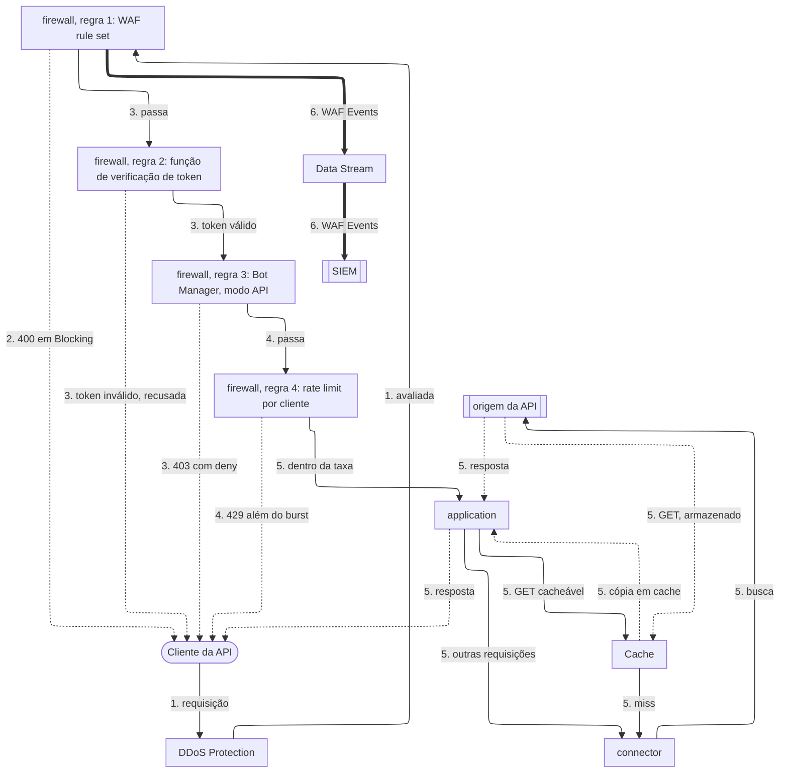

import FrameBox from '@aziontech/webkit/frame-box'
import ItemList from '@aziontech/webkit/item-list'
import DocItem from '@aziontech/webkit/doc-item'

Este design atende equipes cujas APIs rodam no próprio gateway, na própria nuvem ou no próprio data center. Um firewall vinculado ao workload da API inspeciona cada requisição: regras do WAF e rate limits filtram ataques e inundações, Bot Manager pontua clientes automatizados e uma função valida tokens. A application encaminha então a requisição por um connector até a origem da API. Os eventos de Firewall e de WAF seguem pelo Data Stream até o SIEM, e Real-Time Events explica cada bloqueio. O design implementa o caso de uso [Proteger APIs públicas contra abuso](/pt-br/documentacao/casos-de-uso/proteger-aplicacoes-e-redes/proteger-apis-publicas-contra-abuso/).

## Diagrama de arquitetura

As setas contínuas levam a requisição, as setas pontilhadas levam a resposta, e as setas grossas levam os eventos do WAF, que rodam separados de qualquer requisição. Cada rótulo começa pelo número da etapa do fluxo de dados a que pertence.

### Fluxo de dados

1. A requisição de um cliente da API chega ao workload. DDoS Protection a avalia antes que qualquer regra de firewall rode.
2. O behavior _Set WAF_ de uma regra pontua a requisição contra o rule set, incluindo o seu corpo JSON, e recusa um padrão de ataque com `400` em _Blocking_.
3. O behavior _Run Function_ de uma regra executa a verificação de token, que recusa uma requisição cujo token é inválido. Outra regra executa Bot Manager, que pontua o cliente em busca de automação e age no threshold.
4. O behavior _Set Rate Limit_ de uma regra conta as requisições de cada endereço IP de cliente e recusa as requisições além do burst com `429`.
5. Uma requisição que nenhuma regra para chega à application. Uma resposta GET cacheável vem do Cache, e toda outra requisição chega à origem da API pelo connector.
6. Data Stream envia ao SIEM as requisições que WAF analisou, e Real-Time Events guarda o registro de cada requisição, ligado a uma recusa pelo seu `x-azion-request-id`.

A conexão já foi aceita quando uma requisição chega às regras do firewall, então cada verificação age sobre uma requisição, não sobre a identidade de um cliente: regras, um token, um score de bot e uma taxa. Cada verificação age pela regra que a chama, então a ordem das regras é a ordem das verificações.

Cada recusa começa na regra que a decidiu e vai direto ao cliente, porque a application nunca recebe uma requisição recusada. Toda outra resposta volta pela application, que a entrega ao cliente.

## Componentes

- **firewall**: o Platform Resource que é o ponto de aplicação. As suas regras rodam WAF, as funções e o rate limit por cliente na ordem que as regras definem, e _Set Rate Limit_ é um dos seus behaviors integrados.
- **DDoS Protection**: a Feature que mitiga ataques DoS e DDoS em todo workload, sempre ativa, antes que qualquer regra de firewall rode.
- **WAF**: pontua cada requisição contra oito famílias de ameaças e recusa padrões de ataque em _Blocking_. Ele faz o parsing de corpos JSON, então lê os campos que uma API recebe.
- **Bot Manager**: pontua cada requisição em busca de automação. O seu modo `api` é documentado para clientes que não carregam cookies, que é como a maioria dos clientes de API se comporta.
- **Functions**: executa a verificação de token no firewall, como a função JWT do Azion Marketplace, e qualquer verificação personalizada que a equipe escreva no ambiente de execução `firewall`.
- **application**: o Platform Resource que roteia as requisições que o firewall deixa passar e decide quais respostas Cache pode responder.
- **Cache**: responde com as respostas GET seguras, para que leituras repetidas nunca cheguem à origem da API.
- **connector**: o Platform Resource que alcança a origem da API. Toda requisição que passa pelo firewall e não encontra a resposta no Cache termina nele.
- **Data Stream**: envia as requisições que WAF analisou, com o seu score, as regras correspondidas e a action, a um endpoint que o SIEM lê.
- **SIEM**: a integração que correlaciona os eventos de segurança da API com as outras fontes da equipe.
- **Real-Time Events**: guarda o registro de cada requisição, para que o relato de uma recusa feito por um cliente possa ser rastreado até a regra que a decidiu.

## Implementação

- [Proteger APIs públicas contra abuso](/pt-br/documentacao/casos-de-uso/proteger-aplicacoes-e-redes/proteger-apis-publicas-contra-abuso/) - constrói este design de ponta a ponta, com a regra do WAF, a verificação de token, Bot Manager, o rate limit e as verificações de cada um.
- [Instale a integração JWT](/pt-br/documentacao/guias/desenvolvimento-de-aplicacoes/integracoes/jwt/) - instala a função JWT e a executa em um firewall.
- [Envie eventos do WAF para um SIEM](/pt-br/documentacao/guias/seguranca-de-aplicacoes/firewall-e-waf/integrar-siems/) - cria o stream que leva os eventos do WAF até o SIEM.

## Recursos relacionados

<FrameBox>
<ItemList>
  <DocItem title="Como Firewall funciona" href="/pt-br/documentacao/plataforma/firewall/como-funciona/">Como a ordem das regras, os rate limits e os resultados das funções decidem cada requisição.</DocItem>
  <DocItem title="Rules Engine para Firewall" href="/pt-br/documentacao/plataforma/firewall/rules-engine/">Cada critério e behavior que uma regra de API combina, com os atributos de Set Rate Limit.</DocItem>
  <DocItem title="Functions no Firewall" href="/pt-br/documentacao/plataforma/firewall/functions/">O evento de firewall e os métodos que uma verificação personalizada chama para negar, descartar ou responder uma requisição.</DocItem>
  <DocItem title="Argumentos" href="/pt-br/documentacao/plataforma/firewall/bot-manager/argumentos/">O modo, o threshold e a action que uma instância do Bot Manager recebe.</DocItem>
</ItemList>
</FrameBox>
