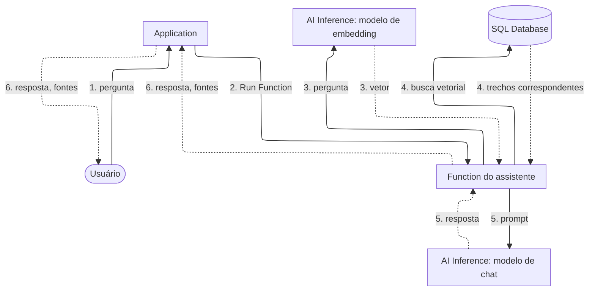

import FrameBox from '@aziontech/webkit/frame-box'
import ItemList from '@aziontech/webkit/item-list'
import DocItem from '@aziontech/webkit/doc-item'

Um copilot é um assistente que fica dentro de um produto e responde perguntas sobre ele em linguagem comum. Ele conduz o usuário por uma tarefa complexa em vez de devolver uma lista de resultados de busca. Esta arquitetura constrói um copilot com retrieval-augmented generation (RAG): ela recupera os trechos que correspondem a uma pergunta, e um modelo responde a partir deles. Use-a quando as respostas estão nos seus próprios documentos e dados, e não no conjunto de treinamento de um modelo. O design implementa o caso de uso [Criar e executar assistentes de IA para suporte ao cliente](/pt-br/documentacao/casos-de-uso/construir-e-executar-workloads-de-ai/criar-e-executar-assistentes-de-ia-para-suporte-ao-cliente/).

O assistente faz uma única passagem por pergunta. Ele gera o embedding da pergunta, recupera os trechos mais próximos e chama o modelo de chat uma vez, então toda resposta usa as mesmas três chamadas. Ele não executa um loop de agente, em que um modelo escolhe ferramentas e decide quando parar. Para conhecer esse design, consulte [Criar agentes de IA](/pt-br/documentacao/casos-de-uso/construir-e-executar-workloads-de-ai/criar-agentes-de-ia/).

---

## Diagrama de arquitetura

As setas contínuas levam a requisição, e as setas pontilhadas levam a resposta. Cada rótulo começa pelo número da etapa do fluxo de dados a que pertence.

### Fluxo de dados

1. Um usuário envia uma pergunta à Application que hospeda o copilot, e o data center mais próximo ao usuário recebe a requisição.
2. A Application executa as regras dela, e uma regra executa a Function do assistente com o behavior _Run Function_.
3. A Function envia a pergunta ao modelo de embedding do AI Inference, que retorna o vetor da pergunta.
4. A Function pede ao índice vetorial no SQL Database os trechos mais próximos desse vetor, e o banco de dados os retorna.
5. A Function envia os trechos, os turnos anteriores da conversa e a pergunta ao modelo de chat do AI Inference. O modelo retorna uma resposta escrita a partir dos trechos.
6. A Function retorna a resposta e as fontes dela à Application, que as entrega ao usuário.

A Function lê o banco de dados uma vez e chama cada modelo uma vez por pergunta, em uma ordem fixada no código dela. Nenhuma etapa depende de uma decisão do modelo. Uma chamada ao modelo que falha termina dentro da Function, então o fluxo de falha fica dentro da Azion.

---

## Componentes

- [Applications](/pt-br/documentacao/plataforma/applications/): constrói e hospeda a Application que responde à requisição do usuário a partir da infraestrutura distribuída da Azion. As regras que você configura aqui executam antes da Function, então uma requisição pode ser autenticada ou rejeitada antes de alcançar o seu código.
- [Functions](/pt-br/documentacao/plataforma/functions/): executa a Function do assistente na infraestrutura distribuída da Azion. A Function gera o embedding da pergunta, recupera os trechos, monta o prompt e chama o modelo de chat. Uma única execução contém a passagem inteira, então a recuperação e a geração ficam no mesmo lugar.
- [AI Inference](/pt-br/documentacao/plataforma/ai-inference/): executa o modelo de embedding que transforma a pergunta em um vetor e o modelo de chat que escreve a resposta. A Function alcança os dois com `Azion.AI.run`, então o código dela não nomeia nenhum host e não guarda nenhuma credencial de modelo.
- [SQL Database](/pt-br/documentacao/plataforma/sql-database/): uma solução SQL projetada para aplicações serverless. Ela contém a base de conhecimento que a Function lê. É isso que mantém as respostas presas aos seus próprios dados, e não ao que o modelo aprendeu no treinamento.
- [Vector Search](/pt-br/documentacao/plataforma/sql-database/vector-search/): permite implementar mecanismos de busca semântica sobre os registros do SQL Database. Aqui, uma pergunta e um trecho correspondem quando significam a mesma coisa, então a Function recupera contexto que uma consulta por palavra-chave não encontraria.
- **Infraestrutura distribuída da Azion**: a arquitetura altamente distribuída em que todas as partes acima executam. Esta arquitetura não tem região a escolher. O data center mais próximo ao usuário responde à requisição, e você não o seleciona.

---

## Implementação

- [Criar e executar assistentes de IA para suporte ao cliente](/pt-br/documentacao/casos-de-uso/construir-e-executar-workloads-de-ai/criar-e-executar-assistentes-de-ia-para-suporte-ao-cliente/) - constrói este design de ponta a ponta, com a tabela de trechos, a Function de ingestão e a Function do assistente.
- [Primeiros passos com Applications](/pt-br/documentacao/plataforma/applications/primeiros-passos/) - cria a Application que recebe a requisição.
- [Criar um banco de dados](/pt-br/documentacao/guias/desenvolvimento-de-aplicacoes/dados/gerenciar-bancos-dados-edge-sql/) - cria o SQL Database que o assistente lê.
- [Primeiros passos com Functions](/pt-br/documentacao/plataforma/functions/primeiros-passos/) - escreve a Function que carrega a lógica do assistente.
- [Instanciar uma função](/pt-br/documentacao/guias/desenvolvimento-de-aplicacoes/primeiros-passos/instanciar-functions/) - anexa essa Function à Application.
- [Guia do Vector Search](/pt-br/documentacao/guias/desenvolvimento-de-aplicacoes/dados/edge-sql-vector-search/) - constrói as consultas semânticas que a Function executa sobre a base de conhecimento.

---

## Recursos relacionados

<FrameBox>
<ItemList>
  <DocItem title="AI Inference" href="/pt-br/documentacao/plataforma/ai-inference/">Os modelos que Azion executa, para o embedding e a resposta de que esta arquitetura depende.</DocItem>
  <DocItem title="Invocação de modelos" href="/pt-br/documentacao/plataforma/ai-inference/invocacao-de-modelos/">O corpo da requisição que uma Function envia ao chamar um modelo.</DocItem>
  <DocItem title="SQL Database" href="/pt-br/documentacao/plataforma/sql-database/">O armazenamento que contém a base de conhecimento e seus embeddings.</DocItem>
  <DocItem title="Real-Time Metrics" href="/pt-br/documentacao/plataforma/real-time-metrics/">O tráfego e a performance da Application que serve o copilot.</DocItem>
  <DocItem title="Real-Time Events" href="/pt-br/documentacao/plataforma/real-time-events/">As requisições individuais e os logs a consultar quando uma resposta volta errada.</DocItem>
</ItemList>
</FrameBox>
