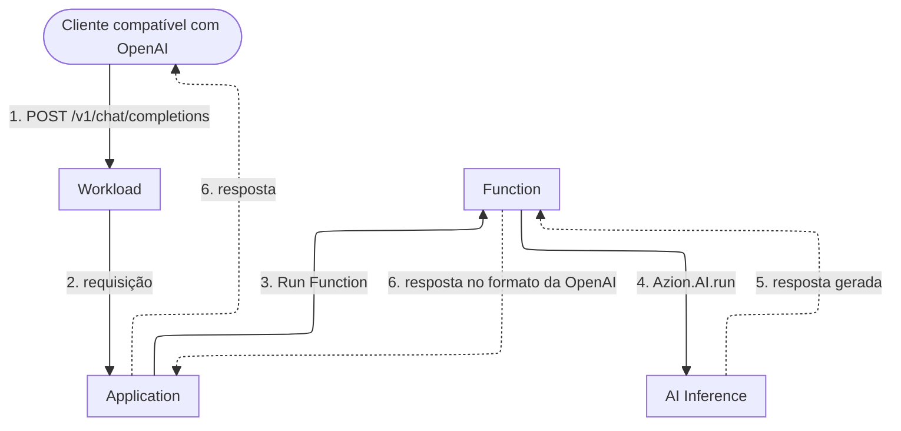

import FrameBox from '@aziontech/webkit/frame-box'
import ItemList from '@aziontech/webkit/item-list'
import DocItem from '@aziontech/webkit/doc-item'

Um cliente que chama um modelo precisa de um endereço para o qual enviar a requisição e de um formato de resposta para ler. Esta arquitetura coloca esse endereço em uma Application que você implanta: a Application é o endpoint de inferência, e o modelo executa atrás dela. Use-a quando seu time já serve uma API HTTP e quer que a inferência seja mais um caminho nela. O domínio é seu, e nenhum servidor de inferência fica em execução. O design implementa o caso de uso [Adicionar funcionalidades de IA a aplicações existentes](/pt-br/documentacao/casos-de-uso/construir-e-executar-workloads-de-ai/adicionar-funcionalidades-de-ia-a-aplicacoes-existentes/).

[Como AI Inference funciona](/pt-br/documentacao/plataforma/ai-inference/como-funciona/) cobre as passagens dentro de uma única chamada. Esta página descreve a forma que você implanta em torno delas.

---

## Diagrama de arquitetura

As setas contínuas levam a requisição, e as setas pontilhadas levam a resposta. Cada rótulo começa pelo número da etapa do fluxo de dados a que pertence.

### Fluxo de dados

1. Um cliente envia uma requisição compatível com OpenAI para `/v1/chat/completions` em um domínio do Workload.
2. Um data center perto do cliente recebe a requisição, e o deployment do Workload define a Application que a trata.
3. A Application executa as regras dela, incluindo qualquer verificação de autenticação que você acrescentar, e uma regra executa a Function com o behavior _Run Function_.
4. A Function monta o corpo da requisição e chama o modelo com `Azion.AI.run`.
5. AI Inference executa o modelo e retorna a resposta gerada à Function.
6. A Function formata essa resposta e a retorna ao cliente pelo mesmo caminho.

O cliente não sabe nada sobre a Azion. Ele envia JSON para uma URL e lê JSON de volta, como faria com qualquer serviço compatível com OpenAI. Atrás do domínio, uma única execução faz o resto, e a Function mantém a requisição aberta até o modelo responder. Nenhuma seta sai em direção a um host de inferência, porque a Function não passa nenhuma URL base e não nomeia nenhum host. Ela passa um id de modelo, e Azion faz a chamada.

---

## Componentes

- [Workloads](/pt-br/documentacao/plataforma/workloads/): recebe a requisição nos domínios dele, o workload domain ou um domínio personalizado, e o deployment dele define a Application. O endereço para o qual o cliente envia a requisição pertence ao Workload.
- [Applications](/pt-br/documentacao/plataforma/applications/): executa as regras dela sobre a requisição antes que qualquer código seu execute. O caminho que a Function responde e qualquer autenticação à frente dela são definidos nessas regras. `Azion.AI.run` não recebe nenhuma credencial, então um endpoint sem verificação própria responde a qualquer um que o encontre.
- [Functions](/pt-br/documentacao/plataforma/functions/): contém a lógica de inferência e emite a chamada de modelo. Seu código não executa em nenhum outro lugar desta arquitetura, então o prompt, o id do modelo, o contexto recuperado de um armazenamento e qualquer serviço externo de que a chamada precise ficam todos em uma única execução.
- [AI Inference](/pt-br/documentacao/plataforma/ai-inference/): executa o modelo, que é o que remove o servidor de inferência desta arquitetura. Você não carrega nenhum modelo e não dimensiona nenhum cluster, e o id em [Modelos de AI](/pt-br/documentacao/plataforma/ai-inference/modelos/) é o único endereço de que a Function precisa.
- **A infraestrutura distribuída da Azion**: executa todas as partes acima. É por isso que esta arquitetura não tem região a escolher. Um data center perto do cliente responde a requisição, e você não seleciona nenhum deles.
- [Real-Time Metrics](/pt-br/documentacao/plataforma/real-time-metrics/): reporta o tráfego e a performance da Application que serve o endpoint. Uma arquitetura sem servidor de inferência próprio ainda precisa de uma visão do que o endpoint transportou.
- [Real-Time Events](/pt-br/documentacao/plataforma/real-time-events/): rastreia requisições individuais, dados brutos e logs. Quando uma resposta está errada, a requisição que a produziu é o que você lê aqui.

:::note[nota]
Nos planos Hobby e Pro, AI Inference está disponível sob solicitação, sujeito a aprovação. Para o acesso que cada plano dá, consulte [Limites do AI Inference](/pt-br/documentacao/plataforma/ai-inference/limites/).
:::

---

## Implementação

- [Adicionar funcionalidades de IA a aplicações existentes](/pt-br/documentacao/casos-de-uso/construir-e-executar-workloads-de-ai/adicionar-funcionalidades-de-ia-a-aplicacoes-existentes/) - constrói este design de ponta a ponta, com a function de resumo e a rota de API.
- [Primeiros passos com AI Inference](/pt-br/documentacao/plataforma/ai-inference/primeiros-passos/) - implanta esta arquitetura e envia uma primeira requisição a um modelo no domínio que ela atribui.
- [Como implementar o template AI Inference Starter Kit](/pt-br/documentacao/guias/desenvolvimento-de-aplicacoes/frameworks/ai-inference-starter-kit/) - cria o Workload com o deployment dele, a Application e a Function que esta página descreve, em uma única implantação.
- [Invocação de modelos](/pt-br/documentacao/plataforma/ai-inference/invocacao-de-modelos/) - traz o corpo da requisição que as duas interfaces aceitam e a forma em `curl` para o endpoint HTTP.

---

## Recursos relacionados

<FrameBox>
<ItemList>
  <DocItem title="Como AI Inference funciona" href="/pt-br/documentacao/plataforma/ai-inference/como-funciona/">A cadeia de invocação passagem por passagem, e onde termina a parte da Azion.</DocItem>
  <DocItem title="Modelos de AI" href="/pt-br/documentacao/plataforma/ai-inference/modelos/">O id a passar e o que cada modelo aceita.</DocItem>
  <DocItem title="Limites do AI Inference" href="/pt-br/documentacao/plataforma/ai-inference/limites/">Os tetos que uma chamada de modelo encontra, e quando Azion desprovisiona um modelo.</DocItem>
  <DocItem title="SQL Database" href="/pt-br/documentacao/plataforma/sql-database/">O armazenamento de onde uma Function lê contexto antes de chamar um modelo.</DocItem>
  <DocItem title="Vector Search" href="/pt-br/documentacao/plataforma/sql-database/vector-search/">As consultas de embeddings que constroem o contexto que um prompt carrega.</DocItem>
</ItemList>
</FrameBox>
