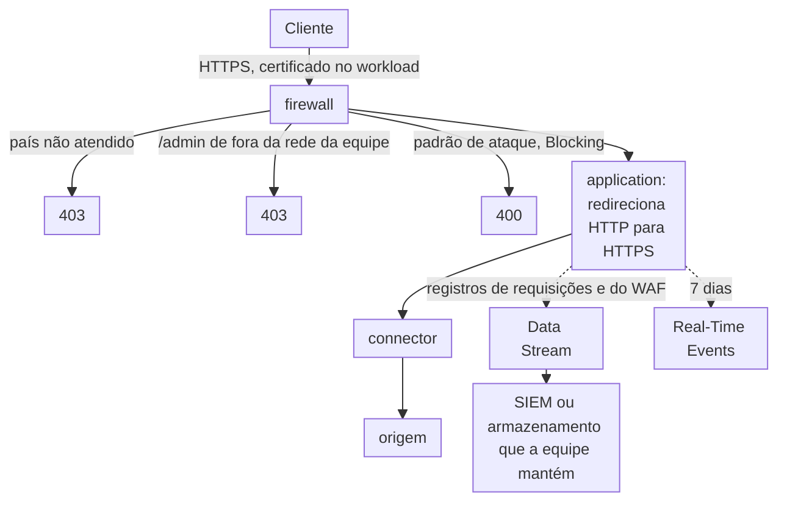

import FrameBox from '@aziontech/webkit/frame-box'
import ItemList from '@aziontech/webkit/item-list'
import DocItem from '@aziontech/webkit/doc-item'

Este design atende equipes de segurança e de compliance que precisam mostrar aos auditores os controles na frente de uma aplicação regulada. Essa aplicação trata dados de cartão ou dados pessoais sob um padrão como PCI DSS, SOC 2, LGPD ou GDPR. [Certificate Manager](/pt-br/documentacao/plataforma/workloads/#certificate-manager) guarda os certificados TLS, e a [application](/pt-br/documentacao/plataforma/applications/) redireciona todo o tráfego para HTTPS. Um [firewall](/pt-br/documentacao/plataforma/firewall/) aplica regras do [WAF](/pt-br/documentacao/plataforma/firewall/#waf), listas do [Network Shield](/pt-br/documentacao/plataforma/firewall/#network-shield) e restrições geográficas antes que as requisições cheguem à origem por um [connector](/pt-br/documentacao/plataforma/connectors/). [Data Stream](/pt-br/documentacao/plataforma/data-stream/) exporta o registro de cada requisição, com a sua decisão do WAF, a um SIEM ou armazenamento que a equipe mantém pelo período que o seu padrão exige. Pelo [Modelo de Responsabilidade Compartilhada](/pt-br/documentacao/fundamentos/responsabilidade-compartilhada/), a Azion protege a plataforma, e a equipe configura e evidencia esses controles. O design implementa o caso de uso [Preparar aplicações web reguladas para auditorias de segurança](/pt-br/documentacao/casos-de-uso/proteger-aplicacoes-e-redes/preparar-aplicacoes-web-reguladas-para-auditorias-de-seguranca/).

## Diagrama de arquitetura

O diagrama traz dois caminhos que partem da mesma requisição. O caminho contínuo é a própria requisição. Ela chega por HTTPS, passa pelas regras de país, de endereço e do WAF do firewall e chega à origem pelo connector. O caminho pontilhado é a evidência dessa requisição. O seu registro, com a decisão do WAF, sai pelo Data Stream para um destino que a equipe mantém, e [Real-Time Events](/pt-br/documentacao/plataforma/real-time-events/) guarda os últimos 7 dias. Todo controle do caminho contínuo deixa um registro no pontilhado.

### Fluxo de dados

1. Um cliente se conecta por HTTPS, e o workload apresenta o certificado que Certificate Manager guarda para o domínio. [DDoS Protection](/pt-br/documentacao/plataforma/workloads/#ddos-protection) avalia o tráfego antes que qualquer regra de firewall rode.
2. Regras de firewall leem listas do Network Shield e respondem `403` em dois casos. Um é um cliente de um país fora da lista atendida, e o outro uma requisição a `/admin` de fora da rede da equipe.
3. WAF pontua toda requisição e, em _Blocking_, responde `400` a uma requisição cujo score atinge o threshold de uma família de ameaças.
4. Uma requisição que passa chega à application, que redireciona HTTP simples para HTTPS e encaminha a requisição à origem pelo connector.
5. Data Stream exporta o registro de cada requisição, com as suas variáveis do WAF, a um SIEM ou armazenamento. Esse destino guarda a evidência pelo período que o padrão exige.
6. Real-Time Events guarda cada registro por 7 dias, para a revisão de um incidente recente.

## Componentes

- **Certificate Manager**: o Platform Resource que guarda os certificados TLS que um workload apresenta. A equipe envia o seu próprio certificado, ou a Azion solicita um ao Let's Encrypt e o renova.
- **application**: o Platform Resource que redireciona HTTP simples para HTTPS e entrega as requisições que o firewall deixa passar.
- **firewall**: o Platform Resource onde todo controle roda, cada um como uma regra nomeada que a equipe pode mapear a um controle auditado.
- **DDoS Protection**: a Feature que mitiga ataques DoS e DDoS em todo workload. Ela fica sempre ativa, sem nada para configurar.
- **WAF**: o controle da camada de aplicação. Ele pontua cada requisição contra oito famílias de ameaças e, em _Blocking_, recusa um padrão de ataque.
- **Network Shield**: restringe o acesso por país e por rede, por meio de listas que regras de negação leem com o critério _Network_. O caminho de administração lê uma lista `ip_cidr`, porque a resolução de país pode errar para alguns endereços.
- **connector**: o Platform Resource que alcança a origem.
- **Data Stream**: exporta os registros de requisições, com as variáveis do WAF, para retenção fora da plataforma. A sua fonte de dados _Activity History_ também exporta as alterações de configuração que os usuários fazem no Azion Console. A própria página de [Activity History](/pt-br/documentacao/fundamentos/activity-history/) mostra só os últimos 30 dias.
- **Real-Time Events**: guarda cada registro de requisição por 7 dias, para a revisão de incidentes. A evidência de um período de auditoria mais longo vem do destino.
- **SIEM ou armazenamento**: a integração que guarda a evidência pelo período que o padrão da equipe exige.

## Implementação

- [Preparar aplicações web reguladas para auditorias de segurança](/pt-br/documentacao/casos-de-uso/proteger-aplicacoes-e-redes/preparar-aplicacoes-web-reguladas-para-auditorias-de-seguranca/) - constrói este design de ponta a ponta, com o redirecionamento para HTTPS, as regras de país e de endereço, o stream de eventos de segurança e as verificações de cada um.
- [Solicite um certificado Let's Encrypt](/pt-br/documentacao/guias/seguranca-de-aplicacoes/tls-e-certificados/como-gerar-um-certificado-lets-encrypt/) - faz a Azion solicitar e renovar um certificado para os domínios do workload.
- [Primeiros passos com Certificate Manager](/pt-br/documentacao/plataforma/workloads/certificate-manager/primeiros-passos/) - envia um certificado próprio e o vincula a um workload.
- [Redirecione HTTP para HTTPS](/pt-br/documentacao/guias/seguranca-de-aplicacoes/tls-e-certificados/redirecionar-http-para-https/) - cria a regra da application que redireciona cada requisição HTTP simples para HTTPS.
- [Vincule um firewall a um workload](/pt-br/documentacao/guias/seguranca-de-aplicacoes/firewall-e-waf/proteja-seu-dominio/) - nomeia o firewall no deployment do workload, para que ele inspecione as requisições a todo domínio.
- [Aplique um rule set a toda requisição](/pt-br/documentacao/guias/seguranca-de-aplicacoes/firewall-e-waf/aplicar-rule-set/) - aplica o WAF rule set, o controle da camada de aplicação que uma auditoria pede.
- [Negue requisições de uma lista de países](/pt-br/documentacao/guias/seguranca-de-aplicacoes/bots-e-rede/negar-paises/) - cria a lista de países atendidos e a regra que recusa todo outro país.
- [Permita somente os endereços de uma lista](/pt-br/documentacao/guias/seguranca-de-aplicacoes/bots-e-rede/allowlist/) - cria uma lista de endereços e uma regra que recusa todo cliente fora dela.
- [Proteja um caminho com uma network list](/pt-br/documentacao/guias/seguranca-de-aplicacoes/bots-e-rede/proteger-um-caminho/) - une um critério de caminho ao critério _Network_, para que a regra de administração aja só em `/admin`.
- [Envie registros de requisições e do WAF a um SIEM](/pt-br/documentacao/guias/plataforma/observabilidade/enviar-registros-de-requisicoes-e-waf-a-um-siem/) - exporta cada requisição com as suas variáveis do WAF ao destino que guarda a evidência.

## Recursos relacionados

<FrameBox>
<ItemList>
  <DocItem title="Compliance PCI" href="/pt-br/documentacao/fundamentos/pci-dss-certification/">O atestado PCI DSS da própria Azion, para o lado do fornecedor em uma auditoria.</DocItem>
  <DocItem title="Compliance SOC" href="/pt-br/documentacao/fundamentos/soc/">Os relatórios SOC da própria Azion, para o lado do fornecedor em uma auditoria.</DocItem>
  <DocItem title="Endpoints" href="/pt-br/documentacao/plataforma/data-stream/endpoints/">Os destinos aos quais um stream pode enviar a evidência.</DocItem>
  <DocItem title="Boas práticas para Data Stream" href="/pt-br/documentacao/plataforma/data-stream/boas-praticas/#acompanhe-o-codigo-de-status-de-cada-envio-no-real-time-events">Como confirmar que cada envio chegou ao destino, para que nenhuma evidência se perca.</DocItem>
</ItemList>
</FrameBox>
