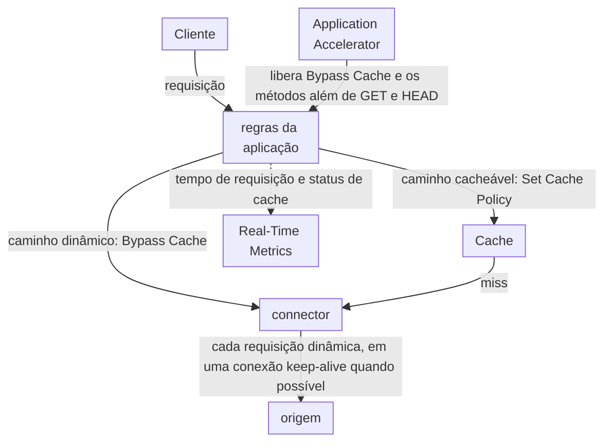

import FrameBox from '@aziontech/webkit/frame-box'
import ItemList from '@aziontech/webkit/item-list'
import DocItem from '@aziontech/webkit/doc-item'

Este design atende times cujas respostas de API são personalizadas ou transacionais e não podem ser cacheadas. A aplicação faz bypass do cache nesses caminhos, então cada chamada chega à origem por meio de um connector. Application Accelerator libera esse bypass e os métodos `OPTIONS`, `POST`, `PUT`, `PATCH` e `DELETE` de que uma API precisa. Os caminhos cacheáveis do mesmo site mantêm as suas regras de cache. O design implementa o caso de uso [Acelerar sites e APIs com uma CDN](/pt-br/documentacao/casos-de-uso/melhorar-performance-e-confiabilidade/acelerar-sites-e-apis-com-uma-cdn/).

## Diagrama de arquitetura

O diagrama divide um site nas regras da aplicação. Uma requisição em um caminho dinâmico pula o cache e chega à origem por meio do connector. O tempo de resposta da origem, portanto, faz parte de cada resposta nesse caminho. Uma requisição em um caminho cacheável tenta o Cache primeiro e só chega ao mesmo connector em um miss. Nada em um caminho dinâmico é armazenado, então esse caminho não tem TTL para definir nem nada para purgar. As decisões são quais caminhos fazem bypass do cache e como o connector alcança a origem.

### Fluxo de dados

1. Um cliente envia uma requisição ao domínio de um workload, e o deployment do workload nomeia a aplicação.
2. A aplicação executa as suas regras da Request Phase em ordem. Uma regra que corresponde a um caminho dinâmico, como `/api/`, carrega o behavior **Bypass Cache**.
3. **Bypass Cache** envia a requisição à origem por meio do connector que uma regra com **Set Connector** nomeia, e a Azion não guarda nenhuma cópia da resposta. A resposta a uma requisição enviada com `Pragma: azion-debug-cache` informa `BYPASS` no seu header `x-cache`.
4. O connector alcança a origem com o protocolo que as suas configurações decidem. Quando possível, a requisição que fez bypass trafega em uma conexão keep-alive com a origem.
5. Uma requisição em um caminho cacheável recebe o cache setting que uma regra com **Set Cache Policy** aplica. Cache responde a partir de uma cópia válida, e um miss chega à origem pelo mesmo connector.
6. Real-Time Metrics registra cada requisição ao domínio. Em um caminho dinâmico, o tempo de requisição sempre inclui o tempo que a origem leva para responder.

## Componentes

- **aplicação**: o Platform Resource que contém as regras por caminho. Uma regra da Request Phase com **Bypass Cache** corresponde a cada caminho dinâmico, e regras com **Set Cache Policy** aplicam cache settings aos outros caminhos. Um **Max Age** de `0` não substitui o bypass. Ele agrupa requisições paralelas pelo mesmo objeto em uma única requisição à origem, então dois chamadores simultâneos recebem a mesma resposta.
- **Application Accelerator**: o Product que faz a aplicação aceitar `OPTIONS`, `POST`, `PUT`, `PATCH` e `DELETE`, além de `GET` e `HEAD`, que ela aceita nativamente. Ele também libera **Bypass Cache**. Uma requisição que **Bypass Cache** envia à origem mantém as otimizações de protocolo e, quando possível, uma conexão keep-alive com ela. O seu switch pertence à aplicação e fica desativado em uma aplicação nova.
- **connector**: o Platform Resource que carrega o endereço da origem e molda cada requisição a ela, para cada requisição dinâmica e cada miss de cache. A sua **Transport Protocol Policy** define o protocolo até a origem: forçar HTTPS protege esse trecho e custa um handshake TLS a cada nova conexão. Sem Load Balancer, os timeouts da conexão seguem os padrões da plataforma e não são configurações.
- **Cache**: guarda as respostas dos caminhos que continuam cacheáveis, sob o cache setting que a regra de cada caminho aplica. **Bypass Cache** não alcança a camada do Tiered Cache. Uma aplicação cujos cache settings têm Tiered Cache ativo continua a guardar objetos nessa camada pelo TTL mínimo.
- **Real-Time Metrics**: mostra quanto tempo a aplicação leva para responder a uma requisição, filtrado pelo domínio. O dashboard **Requests** traz o gráfico **Average Request Time**, e um filtro em **Upstream Cache Status** com o valor `BYPASS` mantém só as requisições que fizeram bypass. Na API GraphQL, o campo `upstreamResponseTime` de [`workloadMetrics`](/pt-br/documentacao/devtools/graphql/campos-gql-real-time-metrics/#workloadmetrics) soma o tempo que a Azion leva para receber as respostas da origem.

## Implementação

- [Acelerar sites e APIs com uma CDN](/pt-br/documentacao/casos-de-uso/melhorar-performance-e-confiabilidade/acelerar-sites-e-apis-com-uma-cdn/) - constrói o proxy reverso com cache para um site e a sua API, faz bypass do cache em `/api/` e compara aquele design com este.
- [Configure políticas de cache para uma aplicação](/pt-br/documentacao/guias/performance-e-confiabilidade/cache-e-purge/cache-settings/) - ativa Application Accelerator e depois faz bypass do cache em um caminho ou em vários caminhos e em um cookie de sessão.
- [Crie um cache setting](/pt-br/documentacao/guias/performance-e-confiabilidade/cache-e-purge/ajustar-cache-settings/) - cria o cache setting dos caminhos cacheáveis e a regra que o aplica.
- [Primeiros passos com Applications](/pt-br/documentacao/plataforma/applications/primeiros-passos/) - cria o connector para a sua origem, a aplicação, a regra que envia toda requisição ao connector e o workload que a entrega.
- [Adicione um domínio a um workload](/pt-br/documentacao/guias/plataforma/migracao/configurar-dominio/) - lista o seu domínio no workload e aponta o domínio para ele.
- [Verifique o status de cache de uma resposta](/pt-br/documentacao/guias/performance-e-confiabilidade/cache-e-purge/verificar-tempo-de-cache-da-pagina/) - lê o header `x-cache`, que informa `BYPASS` em um caminho dinâmico e o status de cache nos outros caminhos.

## Recursos relacionados

<FrameBox>
<ItemList>
  <DocItem title="Variação de cache" href="/pt-br/documentacao/plataforma/applications/application-accelerator/variacao-de-cache/#bypass-cache-e-um-ttl-de-0">Como Bypass Cache difere de um Max Age de 0, e o que cada um custa à origem.</DocItem>
  <DocItem title="Configurações do Application Accelerator" href="/pt-br/documentacao/plataforma/applications/application-accelerator/configuracoes/#http-methods">Os métodos e os behaviors do Rules Engine que Application Accelerator adiciona a uma aplicação.</DocItem>
  <DocItem title="Como Connectors funciona" href="/pt-br/documentacao/plataforma/connectors/como-funciona/#reutilizacao-de-conexoes-e-timeouts">Os padrões de timeout e de conexão ociosa entre a Azion e a origem, e quando eles se tornam configurações.</DocItem>
  <DocItem title="Dashboards de Build" href="/pt-br/documentacao/plataforma/real-time-metrics/dashboards-build/#requests">O que Average Request Time e os outros gráficos do dashboard Requests medem.</DocItem>
</ItemList>
</FrameBox>
