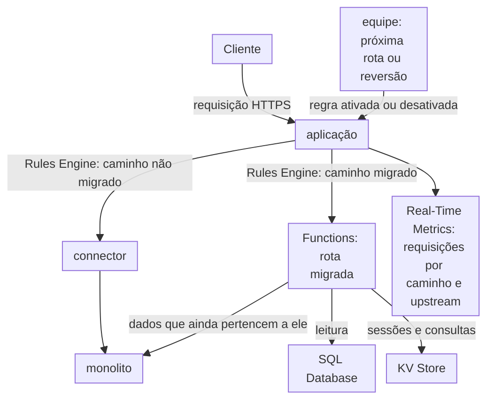

import FrameBox from '@aziontech/webkit/frame-box'
import ItemList from '@aziontech/webkit/item-list'
import DocItem from '@aziontech/webkit/doc-item'

Este design atende equipes que substituem um monolito uma rota por vez, em vez de reescrevê-lo em um único projeto. Uma aplicação na Azion se torna o ponto de entrada único do domínio. Rules Engine envia cada caminho migrado para uma função, e todos os outros caminhos por um connector até o monolito. A lógica migrada mantém o seu estado no SQL Database ou no KV Store, ou chama as APIs do monolito enquanto os dados ainda pertencem a ele. Uma rota é revertida quando a regra dela é desativada. O design implementa o caso de uso [Modernizar uma aplicação monolítica sem reescrevê-la](/pt-br/documentacao/casos-de-uso/construir-e-executar-aplicacoes/modernizar-uma-aplicacao-monolitica-sem-reescreve-la/).

## Diagrama de arquitetura

O diagrama tem um ponto de entrada e dois destinos. Toda requisição passa pela aplicação, onde Rules Engine escolhe o destino pelo caminho da requisição. Os caminhos que nenhuma equipe moveu terminam no monolito, pelo connector. Um caminho migrado termina em uma função. A função lê o seu estado do SQL Database ou do KV Store, e chama o monolito para os dados que ainda pertencem a ele. O nó da equipe, na parte de baixo, é o fluxo de controle: ativar uma regra move uma rota, e desativá-la manda a rota de volta. Real-Time Metrics registra qual lado atendeu cada caminho.

### Fluxo de dados

1. Uma requisição chega ao workload, e a aplicação executa as regras da Request Phase em ordem, sobre o caminho e o método da requisição.
2. A primeira regra corresponde a todos os caminhos e nomeia o connector, então cada rota que não foi movida continua chegando ao monolito.
3. Uma regra posterior por rota migrada corresponde ao caminho e ao método dela, e executa uma instância de função. A resposta da função é o que o cliente recebe, e um método ao qual a regra não corresponde continua no monolito.
4. A função lê o estado da rota do SQL Database por uma réplica de leitura, ou sessões e consultas do KV Store. Para uma tabela que ainda pertence ao monolito, a função chama a API do monolito.
5. Real-Time Metrics agrupa as requisições por caminho e endereço de upstream. A parcela respondida pelo Azion Runtime, registrada como `127.0.0.1:1666`, cresce à medida que as rotas se movem.
6. Para mover a próxima rota, a equipe adiciona uma regra. Para reverter uma rota, a equipe desativa a regra dela, e a próxima requisição nesse caminho corresponde apenas à primeira regra.

## Componentes

- **aplicação**: o Platform Resource que é o ponto de entrada único do domínio. Toda requisição passa por ela, então uma rota muda de destino sem mudança de DNS e sem mudança no cliente.
- **Rules Engine**: a Feature da aplicação que roteia por caminho. A primeira regra nomeia o connector para todos os caminhos, e uma regra posterior por rota migrada executa a função dela. As regras que correspondem são executadas em ordem, então a regra posterior decide o seu caminho.
- **Functions**: executam as rotas migradas no Azion Runtime, em JavaScript. O behavior **Run Function**, que aciona cada uma delas, exige Application Accelerator na aplicação.
- **connector**: o Platform Resource que é o caminho até o monolito. Toda rota que não foi movida, e toda rota revertida, chega ao monolito por ele.
- **SQL Database**: guarda o estado das rotas migradas. Uma função abre um banco de dados na réplica de leitura dele, então as escritas passam pela API da Azion ou ficam no monolito até que a tabela delas seja movida. Qual lado é dono de cada tabela durante a migração é uma decisão de design.
- **KV Store**: uma opção de design que guarda sessões e consultas, para uma rota que lê um valor por uma key da requisição, como um ID de sessão.
- **Cache**: armazena respostas cacheáveis dos dois lados. Uma cache setting aplicada por uma regra **Set Cache Policy** faz cache das respostas do monolito, e uma função faz cache das próprias respostas pela Cache API.
- **Real-Time Metrics**: mostra a divisão do tráfego e a taxa de erros por rota. Ele conta as requisições por caminho e endereço de upstream, e os status codes da aplicação mostram os erros de cada cut-over.

## Implementação

- [Modernizar uma aplicação monolítica sem reescrevê-la](/pt-br/documentacao/casos-de-uso/construir-e-executar-aplicacoes/modernizar-uma-aplicacao-monolitica-sem-reescreve-la/) - monta este design de ponta a ponta: move `GET /api/stores` para uma função que lê o SQL Database, reverte a rota e mede o resultado.
- [Primeiros passos com Applications](/pt-br/documentacao/plataforma/applications/primeiros-passos/) - cria a aplicação, o connector para o monolito, a regra que envia toda requisição a ele e o workload.
- [Execute uma função em um caminho e reverta-o](/pt-br/documentacao/guias/desenvolvimento-de-aplicacoes/functions-e-runtime/executar-uma-funcao-em-um-caminho-e-reverter/) - cria a regra de cut-over para um caminho e depois a desativa.
- [Consulte um banco de dados de uma function](/pt-br/documentacao/guias/desenvolvimento-de-aplicacoes/dados/listando-dados-edge-functions-edge-sql/) - cria um banco de dados e a tabela dele, e uma função que retorna as linhas como JSON pela réplica de leitura.
- [Grave linhas no SQL Database a partir de uma function](/pt-br/documentacao/guias/desenvolvimento-de-aplicacoes/dados/gravar-linhas-no-sql-database-a-partir-de-uma-function/) - envia os statements de escrita de uma rota migrada pela API da Azion, para uma tabela que agora pertence à rota.
- [Importe dados com o EdgeSQL Shell](/pt-br/documentacao/guias/desenvolvimento-de-aplicacoes/dados/importar-dados-edge-sql/) - carrega linhas em uma tabela, como uma exportação do banco de dados do monolito.
- [Detalhe as requisições por status code](/pt-br/documentacao/guias/plataforma/observabilidade/detalhar-requisicoes-por-status-code/) - lê os status codes do workload, onde aparece a taxa de erros de um cut-over.

## Recursos relacionados

<FrameBox>
<ItemList>
  <DocItem title="Camada de middleware sobre uma origem legada" href="/pt-br/documentacao/casos-de-uso/construir-e-executar-aplicacoes/aplicacoes-edge-enhanced/">O outro design deste caso de uso, que mantém todos os caminhos no monolito e adiciona comportamento ao redor dele.</DocItem>
  <DocItem title="Como Functions funciona" href="/pt-br/documentacao/plataforma/functions/como-funciona/">A função, a instância e a regra de que uma rota migrada precisa antes de receber tráfego.</DocItem>
  <DocItem title="Rules Engine para Applications" href="/pt-br/documentacao/plataforma/applications/rules-engine/">A ordem em que as regras são executadas, e os behaviors Set Connector e Run Function que dividem o tráfego.</DocItem>
  <DocItem title="APIs do Node.js" href="/pt-br/documentacao/devtools/runtime/node/">As APIs do Node.js que o código movido do monolito pode chamar no Azion Runtime.</DocItem>
</ItemList>
</FrameBox>
