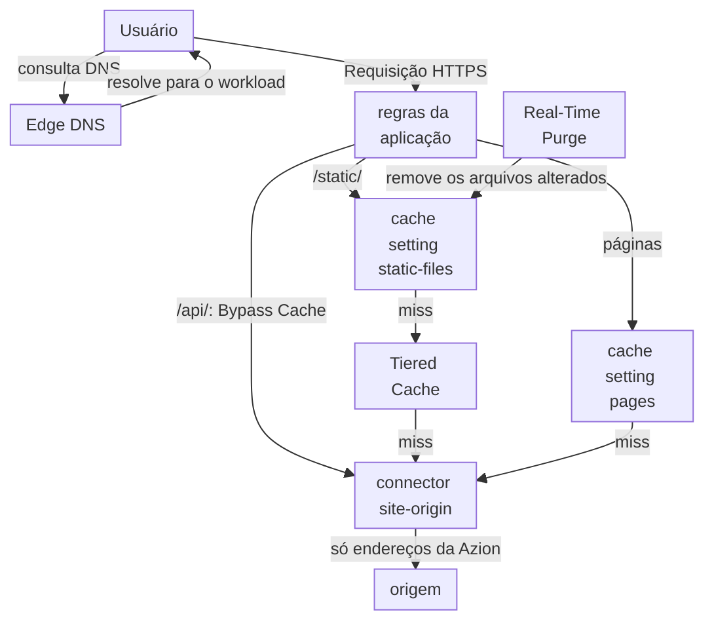

import FrameBox from '@aziontech/webkit/frame-box'
import ItemList from '@aziontech/webkit/item-list'
import DocItem from '@aziontech/webkit/doc-item'

Este design atende times cujo conteúdo é, na maior parte, cacheável e fica em uma origem que eles operam, em uma região de nuvem ou em um data center. Os usuários longe dessa origem recebem páginas lentas, e os picos de tráfego a sobrecarregam. Edge DNS aponta o domínio para uma aplicação que faz cache das respostas por regra, e Tiered Cache reduz ainda mais as requisições à origem. A aplicação busca cada miss por um connector. Origin Shield faz a origem aceitar tráfego só da Azion, e Real-Time Purge remove o conteúdo quando ele muda. As decisões do design são as cache keys, os TTLs e a invalidação. O design implementa o caso de uso [Acelerar sites e APIs com uma CDN](/pt-br/documentacao/casos-de-uso/melhorar-performance-e-confiabilidade/acelerar-sites-e-apis-com-uma-cdn/).

## Diagrama de arquitetura

O diagrama empilha as camadas que uma requisição tenta, uma depois da outra. As regras da aplicação escolhem uma cache setting pelo caminho, e o cache do data center responde primeiro. Um arquivo estático que não está ali tenta em seguida a camada do Tiered Cache, e só um miss em todas as camadas chega ao connector. As chamadas em `/api/` pulam todas as camadas e vão direto ao connector. A origem permite só endereços da Azion, então o connector é a única entrada. Real-Time Purge age no cache por fora do fluxo de requisição e remove os arquivos alterados antes que o TTL deles termine.

### Fluxo de dados

1. Edge DNS resolve o domínio para o workload, e a requisição do usuário chega à aplicação em um data center próximo.
2. As regras da aplicação leem o caminho na Request Phase e aplicam uma cache setting. Uma cópia válida no cache desse data center responde a requisição, e a origem não é consultada.
3. Em um miss de um arquivo estático, o data center consulta a camada do Tiered Cache, que todos os data centers compartilham, antes de consultar a origem.
4. Um miss em todas as camadas chega à origem pelo connector, e a resposta é guardada para a requisição seguinte. Uma chamada em um caminho com bypass, como `/api/`, sempre chega à origem, e a resposta dela nunca é guardada.
5. O connector chega à origem a partir de um endereço da lista `Azion Origin Shield`, e o firewall da origem recusa todas as outras fontes.
6. Quando o conteúdo muda, um purge por cache key o remove primeiro da camada do Tiered Cache e depois do Cache. A requisição seguinte então busca a nova versão na origem.

## Componentes

- **Edge DNS**: resolve o domínio para o workload. Um subdomínio aponta para o domínio do workload com um registro `CNAME`, e o apex aponta para ele com um registro `ANAME`.
- **aplicação**: o Platform Resource que guarda as regras de cache. Cada regra corresponde a um conjunto de caminhos e aplica uma cache setting. Uma regra com o behavior **Bypass Cache** mantém um caminho fora do cache, e esse behavior exige Application Accelerator na aplicação.
- **Cache**: guarda cada resposta no data center que a buscou, pelo TTL da sua cache setting, e responde às requisições repetidas com essa cópia. A cache key é o esquema, o host e o caminho, mais as variações que uma cache setting adiciona. Uma requisição que carrega `Pragma: azion-debug-cache` recebe a key no header `x-cache-key`. Para arquivos estáticos, o design mantém o TTL em 15 dias (`1296000` segundos) ou menos, o máximo padrão do [template Static Cache](/pt-br/documentacao/guias/desenvolvimento-de-aplicacoes/frameworks/static-cache-template/).
- **Tiered Cache**: a Feature que adiciona uma segunda camada de cache entre o Cache e a origem, compartilhada por todos os data centers, na região que a sua topologia nomeia. Ela exige _Override cache behavior_ e um **Max Age** de pelo menos 3 segundos.
- **connector**: o Platform Resource que chega à origem em um miss em todas as camadas de cache e em toda chamada a um caminho com bypass.
- **Origin Shield**: com Origin IP ACL no connector, o firewall da origem permite os prefixos da lista `Azion Origin Shield` e recusa todas as outras fontes. A Azion não aplica a allowlist, e a lista traz prefixos IPv4 e IPv6 de que a allowlist precisa juntos.
- **Real-Time Purge**: o Platform Resource que remove o conteúdo alterado antes que o TTL dele termine. Um purge por cache key aceita até 50 keys por requisição, e é o único tipo de purge que chega à camada do Tiered Cache.
- **Real-Time Metrics**: mostra a parcela das requisições e dos dados respondidos pelo cache, os misses que chegaram à origem e os misses que a camada do Tiered Cache absorveu.

## Implementação

- [Acelerar sites e APIs com uma CDN](/pt-br/documentacao/casos-de-uso/melhorar-performance-e-confiabilidade/acelerar-sites-e-apis-com-uma-cdn/) - constrói este design de ponta a ponta: duas cache settings, Tiered Cache nos arquivos estáticos, o repasse da API, Origin IP ACL e o purge no deploy.
- [Aponte um domínio para um workload](/pt-br/documentacao/guias/plataforma/migracao/apontar-dominio-para-a-azion/) - aponta um subdomínio para o workload com um registro `CNAME` e confirma que o hostname resolve.
- [Aponte um domínio raiz com ANAME](/pt-br/documentacao/guias/seguranca-de-aplicacoes/dns/acessar-root-domain/) - aponta o apex do domínio para o workload.
- [Crie um cache setting](/pt-br/documentacao/guias/performance-e-confiabilidade/cache-e-purge/ajustar-cache-settings/) - cria uma cache setting para arquivos estáticos com Tiered Cache, uma para páginas e as regras que as aplicam.
- [Configure políticas de cache para uma aplicação](/pt-br/documentacao/guias/performance-e-confiabilidade/cache-e-purge/cache-settings/) - cria a regra que faz bypass do cache em `/api/`, no Azion Console ou pela API.
- [Configure a Advanced Cache Key para uma aplicação](/pt-br/documentacao/guias/performance-e-confiabilidade/cache-e-purge/advanced-cache-key/) - varia um objeto em cache por um argumento de query string ou por um cookie.
- [Restrinja uma origem à Azion com Origin IP ACL](/pt-br/documentacao/guias/seguranca-de-aplicacoes/bots-e-rede/restringir-uma-origem-a-azion-com-origin-ip-acl/) - ativa Origin IP ACL no connector e permite só a lista `Azion Origin Shield` no firewall da origem.
- [Purgue conteúdo em cache](/pt-br/documentacao/guias/performance-e-confiabilidade/cache-e-purge/purgar-conteudo-em-cache/) - envia purges por cache key à camada do Tiered Cache e ao Cache, e os confirma.
- [Verifique o status de cache de uma resposta](/pt-br/documentacao/guias/performance-e-confiabilidade/cache-e-purge/verificar-tempo-de-cache-da-pagina/) - lê os headers `x-cache` e `x-cache-key` de uma resposta.
- [Meça o offload de cache de um domínio](/pt-br/documentacao/guias/plataforma/observabilidade/medir-offload-de-cache/) - lê as requisições e os dados respondidos pelo cache, e os misses que chegaram à origem.
- [Deploy do template File Optimization](/pt-br/documentacao/guias/desenvolvimento-de-aplicacoes/frameworks/dynamic-static-file-optimization-template/) - cria uma aplicação com políticas de cache padrão por extensão de arquivo, na frente da origem que você indicar.

## Recursos relacionados

<FrameBox>
<ItemList>
  <DocItem title="Cache keys" href="/pt-br/documentacao/plataforma/applications/cache/cache-keys/">Como a Azion monta uma cache key a partir de uma requisição, e o que cada variação acrescenta a ela.</DocItem>
  <DocItem title="Expiração e atualização" href="/pt-br/documentacao/plataforma/applications/cache/expiracao-e-atualizacao/">Como um TTL decide quando uma cópia em cache expira, e quando uma cópia expirada ainda responde.</DocItem>
  <DocItem title="Tiered Cache" href="/pt-br/documentacao/plataforma/applications/cache/tiered-cache/">As topologias da segunda camada de cache, e as configurações que ela exige.</DocItem>
  <DocItem title="Real-Time Purge" href="/pt-br/documentacao/plataforma/applications/cache/real-time-purge/">Os tipos de purge, e quais camadas de cache cada um alcança.</DocItem>
</ItemList>
</FrameBox>
