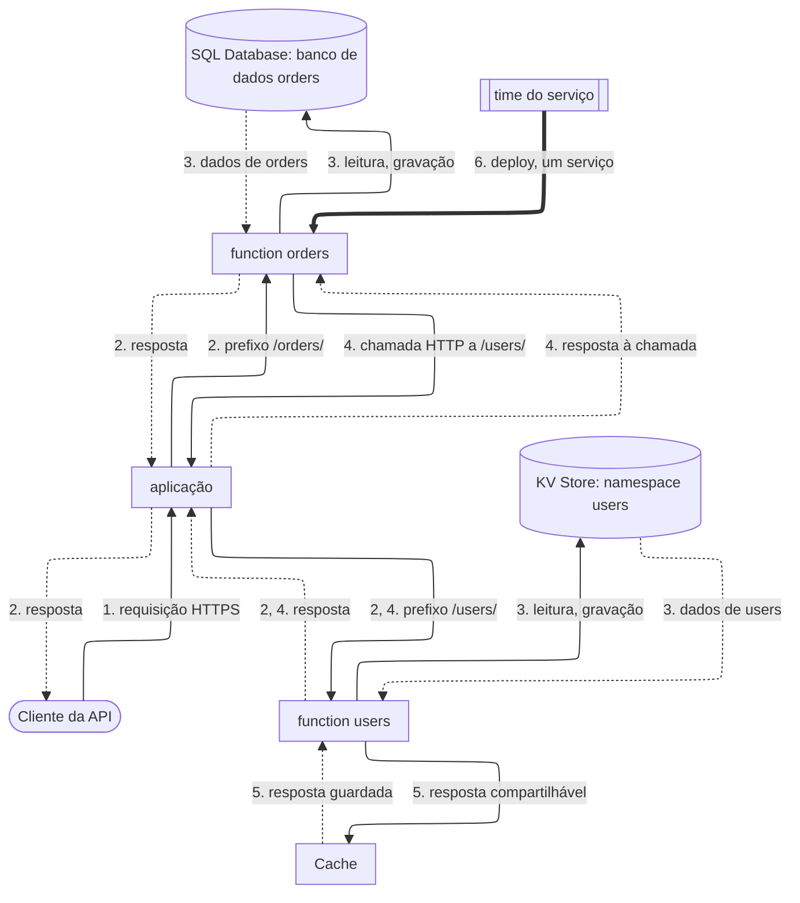

import FrameBox from '@aziontech/webkit/frame-box'
import ItemList from '@aziontech/webkit/item-list'
import DocItem from '@aziontech/webkit/doc-item'

Este design atende times que dividem uma API em serviços de times diferentes. Cada serviço é a sua própria function, com os seus próprios dados, implantada e versionada de forma independente. Na aplicação, Rules Engine encaminha cada prefixo de caminho para o seu serviço, e os serviços chamam uns aos outros por HTTP quando um precisa de outro. Cada serviço escolhe o seu próprio armazenamento, na Azion ou fora dela. O design implementa o caso de uso [Criar APIs REST e GraphQL](/pt-br/documentacao/casos-de-uso/construir-e-executar-aplicacoes/criar-apis-rest-e-graphql/).

## Diagrama de arquitetura

As setas contínuas levam a requisição, as setas pontilhadas levam a resposta, e a seta grossa leva um deploy, que roda separado de qualquer requisição. Cada rótulo começa pelo número da etapa do fluxo de dados a que pertence.

### Fluxo de dados

1. A requisição de um cliente chega à aplicação no domínio da API, e Rules Engine compara o caminho dela com o prefixo da regra de cada serviço.
2. A regra que corresponde executa a instância de function desse serviço. `/orders/` chega à function orders, e `/users/` chega à function users.
3. Cada function lê e grava apenas no seu próprio armazenamento: um banco de dados no SQL Database, um namespace no KV Store ou um armazenamento fora da Azion.
4. Quando um serviço precisa de dados que outro serviço possui, ele chama o caminho desse serviço por HTTP, e a chamada é encaminhada pelas mesmas regras que uma requisição de cliente.
5. Uma resposta que todo cliente pode compartilhar é guardada no Cache, para que chamadas repetidas pulem o armazenamento do serviço.
6. Como cada serviço é uma function separada, um deploy muda o código de um serviço e deixa os outros executando a versão que tinham.

Toda resposta volta pela aplicação, que a entrega ao cliente ou ao serviço que fez a chamada. As regras são o mapa da API: adicionar um serviço adiciona uma regra, e nada mais muda na aplicação. Cada serviço alcança apenas o seu próprio armazenamento, e é isso que permite a um time mudar um schema sem se coordenar com outro time.

## Componentes

- **aplicação**: o Platform Resource que recebe as requisições da API e mantém uma instância de function e uma regra por serviço.
- **Rules Engine**: a Feature da aplicação que encaminha cada prefixo de caminho para o seu serviço. O behavior **Run Function** de uma regra nomeia uma instância de function e exige Application Accelerator e Functions na aplicação.
- **Functions**: uma function por serviço. Uma instância de function vincula a function de um serviço à aplicação, e uma mudança no código de uma function chega a todas as instâncias que a vinculam.
- **SQL Database e KV Store**: dados por serviço. Um serviço com registros relacionais possui um banco de dados; um serviço cujos dados são lidos por chave, como perfis ou sessões, possui um namespace. Um namespace não pode ser renomeado nem excluído, então o namespace de um serviço sobrevive ao serviço.
- **Cache**: guarda as respostas que todo cliente pode compartilhar, para que uma consulta muito requisitada não chegue ao serviço a cada vez.
- **Real-Time Metrics**: reporta o tempo de requisição e os status codes do domínio da API, e o número de vezes que as functions foram executadas. Um serviço servido em um host próprio pode ser lido separadamente com o filtro **Host**.

## Implementação

- [Instancie uma função em uma aplicação](/pt-br/documentacao/guias/desenvolvimento-de-aplicacoes/primeiros-passos/instanciar-functions/) - vincula a function de cada serviço à aplicação compartilhada e cria a regra que a executa.
- [Crie regras de request e response](/pt-br/documentacao/guias/desenvolvimento-de-aplicacoes/primeiros-passos/rules-engine/) - cria a regra de prefixo de caminho de cada serviço no Azion Console.
- [Faça o deploy de uma function com a Azion CLI](/pt-br/documentacao/guias/desenvolvimento-de-aplicacoes/functions-e-runtime/deploy-function-with-cli/) - implanta a function de um serviço a partir do próprio projeto do serviço.

## Recursos relacionados

<FrameBox>
<ItemList>
  <DocItem title="Como Functions funciona" href="/pt-br/documentacao/plataforma/functions/como-funciona/">Por que uma function só é executada por meio de uma instância e de uma regra, e como uma function atende várias instâncias.</DocItem>
  <DocItem title="Rules Engine para Applications" href="/pt-br/documentacao/plataforma/applications/rules-engine/">Os critérios, os operadores e o behavior Run Function que encaminham um prefixo para o seu serviço.</DocItem>
  <DocItem title="Limites de Functions" href="/pt-br/documentacao/plataforma/functions/limites/">O teto de sub-requisições que limita quantos serviços uma invocação pode chamar.</DocItem>
  <DocItem title="Como o KV Store funciona" href="/pt-br/documentacao/plataforma/kv-store/como-funciona/">A consistência eventual e a regra last-write-wins que o namespace de um serviço segue.</DocItem>
</ItemList>
</FrameBox>
