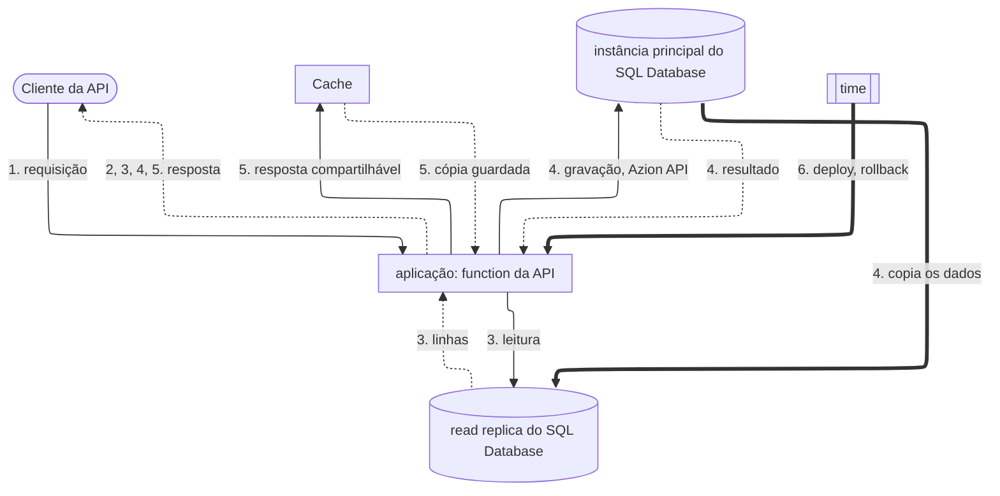

import FrameBox from '@aziontech/webkit/frame-box'
import ItemList from '@aziontech/webkit/item-list'
import DocItem from '@aziontech/webkit/doc-item'

Este design atende times que entregam a sua API como uma única unidade implantável. A aplicação encaminha os caminhos da API para uma única function que implementa todos os endpoints e lê e grava no SQL Database, com KV Store para sessões ou configurações, e Cache guarda as respostas que o permitem. O design implementa o caso de uso [Criar APIs REST e GraphQL](/pt-br/documentacao/casos-de-uso/construir-e-executar-aplicacoes/criar-apis-rest-e-graphql/).

## Diagrama de arquitetura

As setas contínuas levam a requisição, as setas pontilhadas levam a resposta, e as setas grossas levam a replicação e os deploys, que rodam separados de qualquer requisição. Cada rótulo começa pelo número da etapa do fluxo de dados a que pertence.

### Fluxo de dados

1. A requisição de um cliente chega à aplicação no domínio da API, e uma regra da aplicação executa a function da API.
2. A function associa o método e o caminho a um endpoint e responde com um erro a um caminho que ela não atende.
3. Uma leitura abre uma conexão com uma read replica do banco de dados, que recebe o nome do banco de dados e nenhum token, então os dados de que uma leitura precisa ficam dentro da Azion.
4. Uma gravação vai para a instância principal pela Azion API, porque a instância principal é a única que aplica gravações. As réplicas passam a ter a mudança em seguida.
5. Uma resposta que todo cliente pode compartilhar é guardada no Cache, e as requisições seguintes por ela são respondidas pela cópia guardada até que ela expire ou a function a remova.
6. Uma function e um banco de dados servem a API inteira, então um deploy, um rollback ou uma mudança de schema chega a todos os endpoints no mesmo momento.

Toda requisição que a aplicação recebe executa a mesma function, então o diagrama desenha as duas como um único nó, e a function é o único lugar que conhece todos os endpoints. Real-Time Metrics lê o que a aplicação registra e não muda nada no caminho da requisição.

## Componentes

- **aplicação**: o Platform Resource que recebe as requisições da API no domínio dela e as encaminha para a function com uma regra do Rules Engine.
- **Functions**: uma function implementa todos os endpoints. Um deploy substitui o código de todos os endpoints juntos, e é isso que faz da API uma unidade.
- **SQL Database**: guarda os dados relacionais da API. Uma function lê por uma read replica sem token, e as gravações vão para a instância principal pela Azion API com um personal token.
- **KV Store**: guarda sessões e configurações lidas por chave, uma opção de design. Ele tem consistência eventual e não tem compare-and-set, então carrega valores que toleram um atraso curto, não os registros da API.
- **Cache**: guarda as respostas que todo cliente pode compartilhar, como uma lista ou uma consulta, para que uma chamada repetida pule a leitura no banco de dados.
- **Real-Time Metrics**: reporta o tempo de requisição e os status codes da API por domínio, e o número de vezes que a function foi executada.

## Implementação

- [Criar APIs REST e GraphQL](/pt-br/documentacao/casos-de-uso/construir-e-executar-aplicacoes/criar-apis-rest-e-graphql/) - constrói este design de ponta a ponta: o banco de dados, as credenciais de gravação da function, a function da API com a sua lista em cache e as verificações de cada um.
- [Crie uma API RESTful de tarefas com Functions e SQL Database](/pt-br/documentacao/guias/desenvolvimento-de-aplicacoes/functions-e-runtime/api-restful-edge-functions-edge-sql/) - implementa os endpoints da function com o roteador Hono.
- [Faça o deploy de uma function com a Azion CLI](/pt-br/documentacao/guias/desenvolvimento-de-aplicacoes/functions-e-runtime/deploy-function-with-cli/) - cria o projeto, a aplicação e a instância de function que servem a API.
- [Crie e gerencie bancos de dados](/pt-br/documentacao/guias/desenvolvimento-de-aplicacoes/dados/gerenciar-bancos-dados-edge-sql/) - cria o banco de dados que a function lê e grava.

## Recursos relacionados

<FrameBox>
<ItemList>
  <DocItem title="Como o SQL Database funciona" href="/pt-br/documentacao/plataforma/sql-database/como-funciona/">Por que as leituras vêm de réplicas e toda gravação chega a uma única instância principal.</DocItem>
  <DocItem title="SQL Database API" href="/pt-br/documentacao/devtools/runtime/api-reference/sql-database/">Como uma function abre uma read replica, vincula parâmetros e lê linhas.</DocItem>
  <DocItem title="Como Functions funciona" href="/pt-br/documentacao/plataforma/functions/como-funciona/">A function, a instância dela e a regra que a executa em uma requisição.</DocItem>
  <DocItem title="Cache API" href="/pt-br/documentacao/devtools/runtime/api-reference/cache/">Como uma function guarda uma resposta e a encontra em uma requisição posterior.</DocItem>
</ItemList>
</FrameBox>
