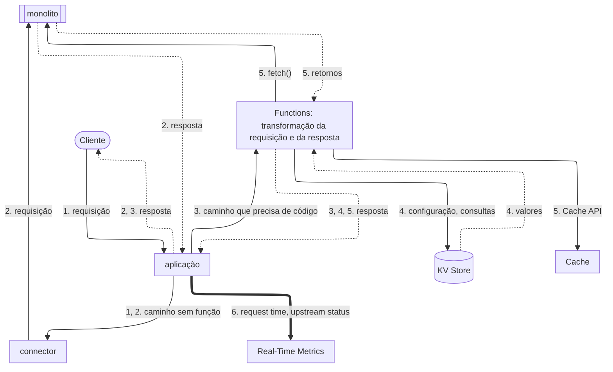

import FrameBox from '@aziontech/webkit/frame-box'
import ItemList from '@aziontech/webkit/item-list'
import DocItem from '@aziontech/webkit/doc-item'

Este design atende equipes que precisam de um novo comportamento na frente de um monolito antes de poderem mover qualquer parte do código dele. As necessidades típicas são verificações de autenticação, personalização de respostas, reescritas de headers ou de HTML e uma resposta composta a partir de vários endpoints legados. Toda requisição continua chegando ao monolito, e a Azion adiciona o comportamento ao redor dessa chamada. Functions envolvem a chamada ao monolito com código, e Cache armazena as respostas que a camada serve. O design implementa o caso de uso [Modernizar uma aplicação monolítica sem reescrevê-la](/pt-br/documentacao/casos-de-uso/construir-e-executar-aplicacoes/modernizar-uma-aplicacao-monolitica-sem-reescreve-la/).

## Diagrama de arquitetura

As setas contínuas levam a requisição, as setas pontilhadas levam a resposta, e a seta grossa leva as métricas, que rodam separadas de qualquer requisição. Cada rótulo começa pelo número da etapa do fluxo de dados a que pertence.

### Fluxo de dados

1. Uma requisição chega ao workload, e a aplicação executa as regras da Request Phase em ordem. A primeira regra corresponde a todos os caminhos e nomeia o connector para o monolito.
2. Em um caminho sem função, a requisição chega ao monolito pelo connector. Behaviors da Request Phase e da Response Phase ainda podem adicionar ou remover headers e cookies no trajeto, sem código.
3. Em um caminho que precisa de um novo comportamento, uma regra posterior executa uma função JavaScript na Request Phase. A resposta da função é o que o cliente recebe.
4. A função verifica a requisição com base na configuração e nas consultas que lê do KV Store. Quando uma verificação falha, como uma verificação de autenticação, a função responde por conta própria.
5. Caso contrário, a função chama o monolito com `fetch()`, uma vez ou para vários endpoints legados, e retorna uma resposta montada a partir dos retornos. Ela pode guardar essa resposta no Cache pela Cache API.
6. Nenhum caminho passa por cut-over, então uma falha do monolito faz todas as rotas falharem. Em um caminho sem função, Real-Time Metrics registra o código que o monolito retornou como upstream status, e `0` quando uma cópia em cache respondeu.

Toda resposta volta pela aplicação, que a entrega ao cliente. O código da função é executado antes da chamada ao monolito e depois dela, e é ali que a requisição e a resposta mudam. As duas vias até o monolito podem deixar uma cópia no Cache. Todo caminho do diagrama leva ao monolito, então a camada adiciona comportamento e não move nenhuma rota.

## Componentes

- **aplicação**: o Platform Resource que é o ponto de entrada do domínio. Toda requisição passa por ela antes de chegar ao monolito, então um novo comportamento entra no ar sem mudança no monolito.
- **Rules Engine**: a Feature da aplicação que roteia cada requisição. Uma regra para todos os caminhos nomeia o connector, e uma regra posterior executa uma função em cada caminho que precisa de código. Os behaviors dele também podem adicionar ou remover headers e cookies sem função.
- **Functions**: transformam a requisição e a resposta em JavaScript, na Request Phase. Para a Response Phase, o formulário de instância de função do Azion Console informa `Only Lua functions can be used in the Response phase.` Uma função JavaScript, portanto, envolve a chamada: ela chama o monolito com `fetch()` e monta a resposta a partir do retorno. O behavior **Run Function** exige Application Accelerator, e as chamadas `fetch()` de saída de uma invocação têm um limite, que restringe quantos endpoints uma resposta compõe.
- **connector**: o Platform Resource que é o caminho até o monolito para toda requisição que nenhuma função responde.
- **Cache**: armazena as respostas que a camada serve. Uma cache setting aplicada por uma regra **Set Cache Policy** armazena as respostas do monolito, e uma função armazena a sua resposta transformada pela Cache API.
- **KV Store**: guarda a configuração e as consultas que as funções leem. Uma função abre um namespace com `Azion.KV.open(name)`, e o namespace precisa já existir, porque o cliente não consegue criar um.
- **Real-Time Metrics**: mostra quanto tempo as requisições levam e quais erros vêm do monolito. **Average Request Time** é o tempo médio que a aplicação leva para processar uma requisição e respondê-la. Em um caminho sem função, **Upstream Status** é o código que o monolito retornou, ou `0` quando uma cópia em cache respondeu. Em um caminho que uma função responde, o endereço de upstream é `127.0.0.1:1666`, que marca Azion Runtime.

## Implementação

- [Modernizar uma aplicação monolítica sem reescrevê-la](/pt-br/documentacao/casos-de-uso/construir-e-executar-aplicacoes/modernizar-uma-aplicacao-monolitica-sem-reescreve-la/) - cita este design ao lado da fachada strangler, que a página monta. Ela não monta este design.
- [Primeiros passos com Functions](/pt-br/documentacao/plataforma/functions/primeiros-passos/) - cria uma função, a instancia na aplicação e adiciona a regra que a executa.
- [Execute uma função em um caminho e reverta-o](/pt-br/documentacao/guias/desenvolvimento-de-aplicacoes/functions-e-runtime/executar-uma-funcao-em-um-caminho-e-reverter/) - coloca uma regra de função para um caminho depois da regra que envia todos os caminhos ao connector, e depois a desativa.
- [Primeiros passos com KV Store](/pt-br/documentacao/plataforma/kv-store/primeiros-passos/) - cria um namespace pela API da Azion e depois grava e lê uma key a partir de uma função.
- [Configure políticas de cache para uma aplicação](/pt-br/documentacao/guias/performance-e-confiabilidade/cache-e-purge/cache-settings/) - define por quanto tempo as respostas de um caminho ficam em cache, por uma cache setting e uma regra.
- [Detalhe as requisições por status code](/pt-br/documentacao/guias/plataforma/observabilidade/detalhar-requisicoes-por-status-code/) - compara o status code de cada requisição com o código que a origem retornou.

## Recursos relacionados

<FrameBox>
<ItemList>
  <DocItem title="Fachada strangler para aplicações legadas" href="/pt-br/documentacao/casos-de-uso/construir-e-executar-aplicacoes/modernizacao-de-aplicacoes/">O outro design deste caso de uso, que tira as rotas do monolito uma por vez.</DocItem>
  <DocItem title="Responder com outro site" href="/pt-br/documentacao/plataforma/functions/respond-site/">Uma função que chama outro site com fetch() e repassa a resposta dele ao cliente.</DocItem>
  <DocItem title="Rules Engine para Applications" href="/pt-br/documentacao/plataforma/applications/rules-engine/">Os behaviors que cada fase aceita, incluindo as mudanças de headers e cookies que não precisam de função.</DocItem>
  <DocItem title="Cache API" href="/pt-br/documentacao/devtools/runtime/api-reference/cache/">Como uma função armazena a resposta que montou, e a lê de volta em uma requisição posterior.</DocItem>
</ItemList>
</FrameBox>
