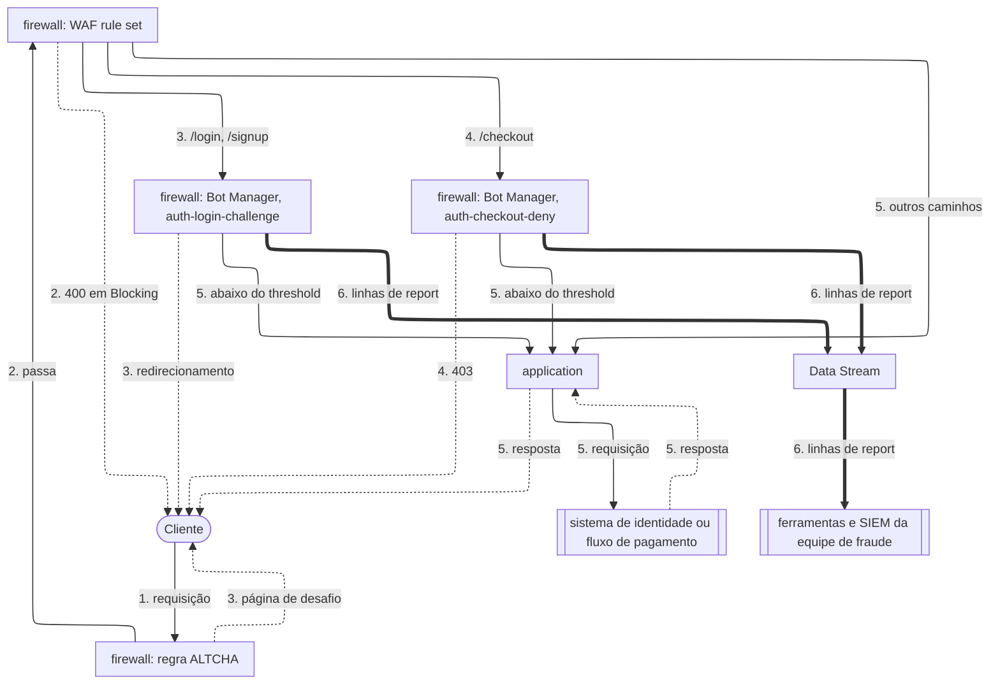

import FrameBox from '@aziontech/webkit/frame-box'
import ItemList from '@aziontech/webkit/item-list'
import DocItem from '@aziontech/webkit/doc-item'

Este design atende equipes de fraude e de segurança que protegem transações sensíveis em login, cadastro e checkout. Credential stuffing, criação de contas falsas e card testing chegam todos por esses três caminhos. Regras em um [firewall](/pt-br/documentacao/plataforma/firewall/) entregam só esses caminhos ao [Bot Manager](/pt-br/documentacao/plataforma/firewall/#bot-manager), e cada score decide se a requisição passa, é desafiada ou é negada. [WAF](/pt-br/documentacao/plataforma/firewall/#waf) filtra ataques nos mesmos caminhos, e [Data Stream](/pt-br/documentacao/plataforma/data-stream/) envia cada decisão às ferramentas da equipe de fraude. O design implementa o caso de uso [Bloquear account takeover em fluxos de login e checkout](/pt-br/documentacao/casos-de-uso/proteger-aplicacoes-e-redes/bloquear-account-takeover-em-fluxos-de-login-e-checkout/).

## Diagrama de arquitetura

As setas contínuas levam a requisição, as setas pontilhadas levam a resposta, e as setas grossas levam as linhas de report, que rodam separadas de qualquer requisição. Cada rótulo começa pelo número da etapa do fluxo de dados a que pertence.

### Fluxo de dados

1. Uma requisição chega ao firewall vinculado ao workload. A regra ALTCHA roda primeiro e valida a sessão de um cliente que já resolveu um desafio.
2. Em `/login`, `/signup` e `/checkout`, o WAF rule set pontua a requisição em busca de payloads de ataque, como uma injeção em um campo de formulário.
3. Em `/login` e `/signup`, a instância `auth-login-challenge` pontua a requisição em busca de automação. No seu threshold, o cliente é redirecionado ao desafio ALTCHA, e uma pessoa que o resolve continua sem um novo desafio.
4. Em `/checkout`, a instância `auth-checkout-deny` pontua a requisição, e no seu threshold o cliente recebe `403`. Um script que testa cartões não tem uma pessoa por trás para responder a um desafio.
5. Uma requisição abaixo do threshold, ou em qualquer outro caminho, chega à application e, por meio dela, ao sistema de identidade ou ao fluxo de pagamento.
6. Cada instância grava uma linha de report por requisição. [Real-Time Events](/pt-br/documentacao/plataforma/real-time-events/) guarda a linha, e Data Stream a envia às ferramentas e ao SIEM da equipe de fraude.

A regra ALTCHA e o WAF rule set rodam antes da divisão por caminho, então um desafio resolvido é validado antes de qualquer score. Uma instância por tipo de caminho permite que cada uma execute o seu próprio threshold e a sua própria action, e as requisições a qualquer outro caminho chegam à application sem nenhum score.

Toda recusa, todo redirecionamento e toda página de desafio saem da regra do firewall que os produz. Eles vão direto ao cliente, porque a application nunca recebe essa requisição.

## Componentes

- **firewall**: o Platform Resource cujas regras decidem quais requisições Bot Manager e WAF veem. Cada tipo de caminho tem a sua própria regra e a sua própria instância do Bot Manager, então login e checkout mantêm thresholds e actions separados.
- **Bot Manager**: pontua cada requisição em busca de automação e executa a action da instância quando o score atinge o threshold. Ele roda como uma instância de função que uma regra de firewall invoca, em qualquer uma das duas edições: Bot Manager, ou Bot Manager Lite do Azion Marketplace. Este design usa duas das suas sete actions: `redirect` em login e cadastro, e `deny`, que responde `403`, no checkout. Para as outras cinco, consulte [Argumentos](/pt-br/documentacao/plataforma/firewall/bot-manager/argumentos/#action).
- **WAF**: pontua os mesmos três caminhos em busca de payloads de ataque, como uma injeção em um campo de formulário de login ou de checkout. Bot Manager não inspeciona uma requisição em busca de vulnerabilidades de aplicação, então WAF cobre essa parte de toda requisição.
- **Functions**: executa o desafio ALTCHA do Azion Marketplace antes do Bot Manager. Também executa qualquer verificação de risco personalizada que a equipe escreva para o ambiente de execução `firewall` nos mesmos caminhos.
- **Data Stream**: envia a fonte de dados _Functions_, que carrega as linhas de report do Bot Manager, ao endpoint que a equipe de fraude lê.
- **SIEM**: a integração onde a equipe de fraude correlaciona as decisões do Bot Manager com os seus próprios sinais.
- **Real-Time Events**: guarda a linha de report de cada requisição por 7 dias, com o seu score e as regras que ela correspondeu. Um analista lê uma decisão ali.

## Implementação

- [Bloquear account takeover em fluxos de login e checkout](/pt-br/documentacao/casos-de-uso/proteger-aplicacoes-e-redes/bloquear-account-takeover-em-fluxos-de-login-e-checkout/) - constrói este design de ponta a ponta, com a janela de observação, as duas instâncias e os seus thresholds, o WAF rule set e as verificações de cada um.
- [Execute Bot Manager em caminhos selecionados](/pt-br/documentacao/guias/seguranca-de-aplicacoes/bots-e-rede/executar-bot-manager-em-caminhos-selecionados/) - cria as instâncias e as regras de firewall que restringem o Bot Manager a login, cadastro e checkout.
- [Execute Bot Manager em modo de observação](/pt-br/documentacao/guias/seguranca-de-aplicacoes/bots-e-rede/modo-de-observacao/) - pontua os três caminhos sem recusar nenhuma requisição, para que as linhas de report definam cada threshold.
- [Proteja uma rota com um desafio ALTCHA](/pt-br/documentacao/guias/desenvolvimento-de-aplicacoes/functions-e-runtime/altcha/) - instancia o ALTCHA no firewall, com a regra que serve o desafio para o qual um cliente sinalizado é redirecionado.
- [Instale o Bot Manager Lite](/pt-br/documentacao/guias/desenvolvimento-de-aplicacoes/integracoes/bot-manager-lite/) - instala em um firewall a edição do Bot Manager do Azion Marketplace.
- [Crie um rule set em sensibilidade média](/pt-br/documentacao/guias/seguranca-de-aplicacoes/firewall-e-waf/rule-set-medio/) - cria um WAF rule set com toda família de ameaças em medium.
- [Aplique um rule set a toda requisição](/pt-br/documentacao/guias/seguranca-de-aplicacoes/firewall-e-waf/aplicar-rule-set/) - aplica o WAF rule set com uma regra que começa em Logging.
- [Mude um rule set para blocking](/pt-br/documentacao/guias/seguranca-de-aplicacoes/firewall-e-waf/mudar-para-blocking/) - muda a regra do WAF para Blocking quando o Tuning não tiver nenhuma requisição que deveria ter sido servida.
- [Leia o report log de uma instância](/pt-br/documentacao/guias/seguranca-de-aplicacoes/bots-e-rede/ler-o-report-log/) - consulta as linhas de report por trás de cada decisão.
- [Depure functions com o Data Stream](/pt-br/documentacao/guias/plataforma/observabilidade/debugging-functions-data-stream/) - envia a fonte de dados Functions, que carrega as linhas de report, a um endpoint.

## Recursos relacionados

<FrameBox>
<ItemList>
  <DocItem title="Score de bots" href="/pt-br/documentacao/plataforma/firewall/bot-manager/score-de-bots/">Como o Bot Manager monta um score a partir das regras que uma requisição corresponde, e o que o threshold decide.</DocItem>
  <DocItem title="Boas práticas de Firewall" href="/pt-br/documentacao/plataforma/firewall/boas-praticas/#execute-uma-instancia-mais-rigorosa-do-bot-manager-em-um-caminho-de-alto-valor">Onde começam os thresholds dos caminhos de login, de criação de contas e de checkout.</DocItem>
  <DocItem title="Loop de mitigação no firewall orientado pelo SIEM" href="/pt-br/documentacao/casos-de-uso/proteger-aplicacoes-e-redes/automacao-da-seguranca-com-edge-computing/">Como uma detecção no SIEM volta ao firewall como um bloqueio do endereço do atacante.</DocItem>
  <DocItem title="Perímetro de segurança de APIs" href="/pt-br/documentacao/casos-de-uso/proteger-aplicacoes-e-redes/implementar-seguranca-api-gateways/">O design de firewall para APIs públicas, que este design não cobre.</DocItem>
</ItemList>
</FrameBox>
