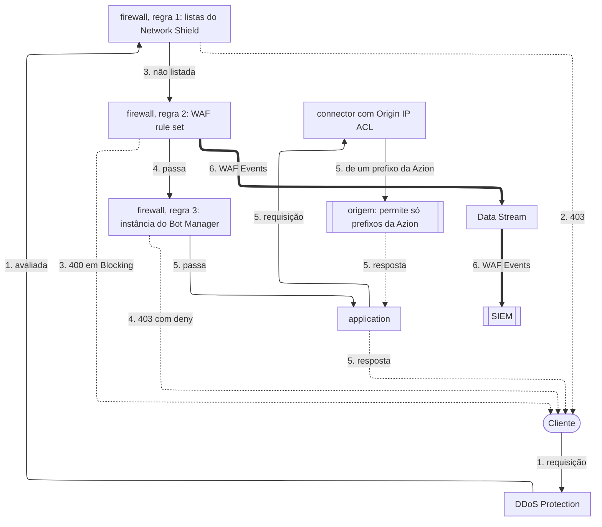

import FrameBox from '@aziontech/webkit/frame-box'
import ItemList from '@aziontech/webkit/item-list'
import DocItem from '@aziontech/webkit/doc-item'

Este design atende equipes que consolidam a segurança de aplicações na frente de uma origem que elas operam. Um firewall no workload da application executa listas do Network Shield, regras do WAF e Bot Manager em uma única política, com DDoS Protection sempre ativa. As requisições limpas chegam à origem por um connector, e Origin Shield permite que a origem descarte o tráfego que não vem da Azion. Os eventos seguem pelo Data Stream até o SIEM. O design implementa o caso de uso [Proteger aplicações web contra ataques do OWASP Top 10 e zero-day](/pt-br/documentacao/casos-de-uso/proteger-aplicacoes-e-redes/proteger-aplicacoes-web-contra-ataques-do-owasp-top-10-e-zero-day/).

## Diagrama de arquitetura

As setas contínuas levam a requisição, as setas pontilhadas levam a resposta, e as setas grossas levam os eventos do WAF, que rodam separados de qualquer requisição. Cada rótulo começa pelo número da etapa do fluxo de dados a que pertence.

### Fluxo de dados

1. A requisição de um cliente chega ao workload. DDoS Protection a avalia em busca de um ataque DoS ou DDoS antes que qualquer regra de firewall rode.
2. O firewall vinculado ao deployment do workload roda as suas regras em ordem. Uma regra com o critério _Network_ compara o endereço do cliente com uma network list e nega uma fonte listada.
3. Uma regra com o behavior _Set WAF_ pontua a requisição contra as famílias de ameaças do rule set. Em _Blocking_, um score no threshold de uma família recusa a requisição com `400`.
4. Uma regra com o behavior _Run Function_ executa uma instância do Bot Manager, que pontua a requisição em busca de automação e executa a sua action quando o score atinge o threshold.
5. Uma requisição que nenhuma regra para chega à application, que a encaminha à origem pelo connector. A origem aceita conexões apenas dos prefixos da lista `Azion Origin Shield`.
6. Data Stream envia ao SIEM as requisições que WAF analisou, e Real-Time Events guarda o registro de cada requisição, ligado a uma recusa pelo seu `x-azion-request-id`.

Network Shield, WAF e Bot Manager agem cada um só pela regra que os chama, então a ordem dessas regras é a ordem da política. Toda requisição que passa termina em um único connector, e o próprio firewall da origem fecha qualquer outro caminho até ela.

Uma recusa começa na regra que a decidiu e vai direto ao cliente, porque a application nunca recebe uma requisição recusada.

## Componentes

- **firewall**: o Platform Resource que aplica a política. O deployment de um workload o nomeia, e ele roda as suas regras em toda requisição a esse workload antes que a application a veja.
- **DDoS Protection**: a Feature que mitiga ataques DoS e DDoS em todo workload, sempre ativa e sem nada para configurar. Ela age antes de qualquer regra de firewall.
- **WAF**: pontua cada requisição que uma regra _Set WAF_ lhe entrega contra oito famílias de ameaças, e recusa a requisição no modo _Blocking_ quando um score atinge o seu threshold. Ele filtra o OWASP Top 10 e outros padrões de ataque.
- **Bot Manager**: pontua cada requisição que uma regra _Run Function_ lhe entrega em busca de sinais de automação, e executa a action que a sua instância define quando o score atinge o threshold.
- **Network Shield**: adiciona o critério _Network_, que compara o endereço do cliente com uma lista de endereços, ASNs ou países. Ele recusa fontes sabidamente maliciosas antes que WAF e Bot Manager as pontuem.
- **application**: o Platform Resource que entrega as requisições que o firewall deixa passar e as encaminha à origem.
- **connector**: o Platform Resource que alcança a origem. Toda requisição que passa pela política termina nele.
- **Origin Shield**: Origin IP ACL no connector publica a lista `Azion Origin Shield` com os prefixos da Azion, que o firewall da origem permite enquanto recusa qualquer outra fonte. Nenhum cliente consegue então alcançar a origem contornando a política.
- **Data Stream**: envia as requisições que WAF analisou, com o seu score, as regras correspondidas e a action, a um endpoint que o SIEM lê.
- **SIEM**: a integração que correlaciona os eventos do firewall com as outras fontes de segurança da equipe.
- **Real-Time Events**: guarda o registro de cada requisição, com os seus campos de WAF, para que um bloqueio possa ser explicado a partir do request ID que o cliente informa.

## Implementação

- [Proteger aplicações web contra ataques do OWASP Top 10 e zero-day](/pt-br/documentacao/casos-de-uso/proteger-aplicacoes-e-redes/proteger-aplicacoes-web-contra-ataques-do-owasp-top-10-e-zero-day/) - constrói este design de ponta a ponta, com a regra de rede, o WAF rule set, Bot Manager, Origin IP ACL e as verificações de cada um.
- [Vincule um firewall a um workload](/pt-br/documentacao/guias/seguranca-de-aplicacoes/firewall-e-waf/proteja-seu-dominio/) - nomeia o firewall no deployment do workload, o que coloca a política no caminho da requisição.
- [Envie eventos do WAF para um SIEM](/pt-br/documentacao/guias/seguranca-de-aplicacoes/firewall-e-waf/integrar-siems/) - cria o stream que leva os eventos do WAF até o SIEM.
- [Libere os IPs da Azion na sua origem](/pt-br/documentacao/suporte/obter-ranges-ip-azion/) - lê a lista `Azion Origin Shield` e a permite no firewall da origem.

## Recursos relacionados

<FrameBox>
<ItemList>
  <DocItem title="Como Firewall funciona" href="/pt-br/documentacao/plataforma/firewall/como-funciona/">Como a ordem das regras define a ordem em que Network Shield, WAF e Bot Manager agem sobre uma requisição.</DocItem>
  <DocItem title="Score e modos" href="/pt-br/documentacao/plataforma/firewall/waf/score-e-modos/">Como WAF pontua uma requisição, o que Logging e Blocking fazem e os formatos de corpo que ele interpreta.</DocItem>
  <DocItem title="Score de bots" href="/pt-br/documentacao/plataforma/firewall/bot-manager/score-de-bots/">Como Bot Manager constrói um score a partir das regras a que uma requisição corresponde, e quando ele age.</DocItem>
  <DocItem title="Mitigação de ataques" href="/pt-br/documentacao/plataforma/workloads/ddos-protection/ddos-mitigation/">Os tipos de ataque que DDoS Protection mitiga e as camadas em que ela age.</DocItem>
</ItemList>
</FrameBox>
