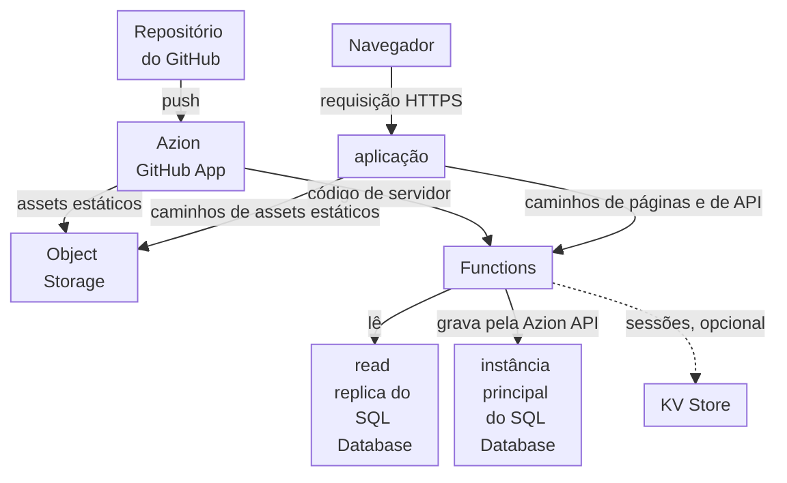

import FrameBox from '@aziontech/webkit/frame-box'
import ItemList from '@aziontech/webkit/item-list'
import DocItem from '@aziontech/webkit/doc-item'

Este design atende times que constroem uma aplicação web com um framework de renderização no servidor, como Next.js. O build do framework se divide em assets estáticos, guardados no Object Storage, e código de servidor, implantado como uma function. A aplicação encaminha as requisições de páginas e de API para a function, que lê e grava no SQL Database, com KV Store para sessões como opção, e Cache guarda as respostas que o permitem. O design implementa o caso de uso [Implantar aplicações full-stack globalmente](/pt-br/documentacao/casos-de-uso/construir-e-executar-aplicacoes/implantar-aplicacoes-full-stack-globalmente/).

## Diagrama de arquitetura

Leia o diagrama como dois fluxos. O fluxo de publicação vai do repositório pelo Azion GitHub App, que coloca os assets estáticos do build no Object Storage e o código de servidor em uma function. O fluxo de requisição começa na aplicação, que envia os caminhos de assets estáticos para o bucket e todos os outros caminhos para a function. Toda visualização de página inclui, portanto, uma execução da function e uma leitura de dados, então o banco de dados fica dentro do fluxo de requisição e do fluxo de falha, enquanto os assets estáticos não dependem de nenhum dos dois.

### Fluxo de dados

1. Um push no repositório faz com que o Azion GitHub App construa o projeto. Os assets estáticos vão para um bucket do Object Storage, e o código de servidor é implantado como uma function.
2. A requisição de um navegador chega à aplicação. As regras dela entregam os caminhos estáticos do framework, como `/_next/static/`, e os tipos de arquivo estático a partir do bucket, sem executar a function.
3. Uma regra executa a function em todos os outros caminhos. A function renderiza a página, ou responde à rota de API, a cada requisição.
4. A function lê do SQL Database por meio de uma read replica, que não precisa de token. Uma resposta que é a mesma para todo visitante pode ser guardada com a Cache API do runtime e devolvida em requisições seguintes.
5. Uma gravação vai para o endpoint de query do banco de dados na Azion API, com um personal token guardado em uma variável de ambiente, e a instância principal a aplica. Um statement que falha ainda responde `200`, com o erro dentro da entrada dele.
6. Quando a leitura ou a gravação no banco de dados falha, a function responde o erro para aquela página ou rota. As requisições por assets estáticos continuam sendo respondidas pelo bucket.

## Componentes

- **Functions**: executa o código de servidor do build. As functions renderizam cada página sob demanda, respondem às rotas de API e são o único caminho até os dados.
- **SQL Database**: guarda os dados relacionais. A instância principal recebe todas as gravações, e as read replicas respondem às leituras que uma function envia com `Database.open`, que é somente leitura.
- **KV Store**: guarda sessões, uma opção de design. Ele tem consistência eventual, então uma sessão gravada em uma localidade pode levar até 60 segundos para ficar visível em todas as outras.
- **Object Storage**: guarda os assets estáticos do build, em um bucket que a aplicação lê, para que eles sejam entregues sem uma execução de function.
- **aplicação**: o Platform Resource cujas regras dividem cada requisição entre o bucket e a function, por caminho.
- **Cache**: guarda as respostas que são as mesmas para todo visitante, para que uma requisição repetida pule a renderização. Uma function guarda uma resposta com a Cache API do runtime, e um `max-age` nela limita por quanto tempo as requisições seguintes a recebem.
- **Azion GitHub App**: a integração que constrói o repositório a cada push e implanta os assets estáticos e a function, para que um commit chegue à produção sem nenhum passo manual.

## Implementação

- [Implantar aplicações full-stack globalmente](/pt-br/documentacao/casos-de-uso/construir-e-executar-aplicacoes/implantar-aplicacoes-full-stack-globalmente/) - constrói este design de ponta a ponta com um projeto Next.js, com o banco de dados, as credenciais, o código de servidor, o deploy e as verificações de cada um.
- [Desenvolva com Next.js](/pt-br/documentacao/guias/desenvolvimento-de-aplicacoes/frameworks/next/) - implanta um projeto Next.js a partir de um template, de um repositório ou da CLI, e lista as regras que cada preset gera.
- [Importe um projeto do GitHub](/pt-br/documentacao/guias/desenvolvimento-de-aplicacoes/automacao/importar-um-projeto-existente-do-github/) - conecta um repositório pelo Azion GitHub App para que cada push o implante.
- [Comece com o OpenNext](/pt-br/documentacao/guias/desenvolvimento-de-aplicacoes/frameworks/como-comecar/) - adapta um projeto Next.js existente com o adaptador OpenNext.

## Recursos relacionados

<FrameBox>
<ItemList>
  <DocItem title="Como o SQL Database funciona" href="/pt-br/documentacao/plataforma/sql-database/como-funciona/">Por que as leituras vêm de uma réplica e toda gravação chega à instância principal.</DocItem>
  <DocItem title="SQL Database API" href="/pt-br/documentacao/devtools/runtime/api-reference/sql-database/">A classe `Database` com a qual uma function abre uma réplica, os parâmetros e os erros dela.</DocItem>
  <DocItem title="Versões do Next.js" href="/pt-br/documentacao/devtools/runtime/frameworks/nextjs-compatibility/">As versões e os recursos do Next.js que o build suporta.</DocItem>
  <DocItem title="Como Functions funciona" href="/pt-br/documentacao/plataforma/functions/como-funciona/">A function, a instância e a regra que decidem quando o código de servidor é executado.</DocItem>
</ItemList>
</FrameBox>
