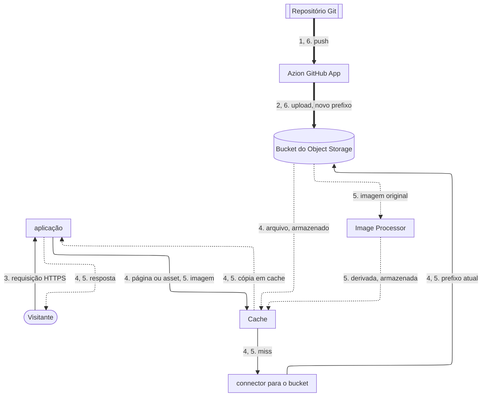

import FrameBox from '@aziontech/webkit/frame-box'
import ItemList from '@aziontech/webkit/item-list'
import DocItem from '@aziontech/webkit/doc-item'

Este design atende times que mantêm as páginas e o conteúdo de um site em um repositório Git. O Azion GitHub App constrói o site a cada push e implanta o resultado no Object Storage, uma aplicação o serve pelo Cache e um build anterior pode ser implantado de novo para fazer o rollback. O design implementa o caso de uso [Criar e operar sites de marketing](/pt-br/documentacao/casos-de-uso/construir-e-executar-aplicacoes/criar-e-operar-sites-de-marketing/).

## Diagrama de arquitetura

As setas contínuas levam a requisição, as setas pontilhadas levam a resposta, e as setas grossas levam o fluxo de publicação, que roda separado de qualquer requisição. Cada rótulo começa pelo número da etapa do fluxo de dados a que pertence.

### Fluxo de dados

1. Um push no repositório conectado inicia um deploy, e o Azion GitHub App constrói o site com o preset de framework do projeto.
2. O deploy envia o resultado do build para o bucket do Object Storage do projeto sob um novo prefixo de armazenamento e aponta o connector para esse prefixo. Os arquivos dos deploys anteriores continuam no bucket sob os seus próprios prefixos.
3. A requisição de um visitante chega à aplicação, cujas regras aplicam a cache setting do projeto à página ou ao asset.
4. Cache responde com a sua cópia quando tem uma. Em um miss, a aplicação lê o arquivo do bucket por meio do connector, e Cache o guarda pelo Max Age dele.
5. Quando Image Processor está ativo, uma requisição de imagem é redimensionada ou convertida a partir do original no bucket, e Cache guarda cada variação.
6. Para fazer o rollback, um push que reverte a mudança implanta o conteúdo anterior de novo. Para um projeto implantado com a Azion CLI, o comando `rollback` serve os arquivos de um deploy anterior a partir do bucket.

Os dois fluxos só se encontram no bucket. Toda resposta volta pela aplicação, que a entrega ao visitante. Nada no fluxo de requisição constrói ou renderiza uma página, então a requisição de um visitante nunca espera por um build.

## Componentes

- **Azion GitHub App**: a integração que conecta a conta do GitHub à Azion. Ela implanta cada push em um repositório conectado, então publicar uma mudança é um push e nada mais.
- **Object Storage**: guarda o resultado do build. Cada deploy grava os seus arquivos sob o seu próprio prefixo, e é isso que mantém um build anterior disponível para um rollback.
- **aplicação**: o Platform Resource que entrega o site. O connector dela lê o bucket, e as regras dela aplicam a cache setting que a configuração do projeto declara.
- **Cache**: guarda páginas e assets, para que requisições repetidas nunca cheguem ao bucket. O Max Age dele limita por quanto tempo uma página fica desatualizada depois de um deploy que nenhum purge segue.
- **Image Processor**: uma opção de design que redimensiona e converte imagens sob demanda, para que o repositório mantenha um único original por imagem.

## Implementação

- [Criar e operar sites de marketing](/pt-br/documentacao/casos-de-uso/construir-e-executar-aplicacoes/criar-e-operar-sites-de-marketing/) - constrói este design de ponta a ponta, com o deploy a cada push, os valores de cache, o purge depois de cada deploy e as verificações de cada um.
- [Importe um projeto do GitHub](/pt-br/documentacao/guias/desenvolvimento-de-aplicacoes/automacao/importar-um-projeto-existente-do-github/) - conecta um repositório e o implanta de novo a cada push.
- [Desenvolva com Astro](/pt-br/documentacao/guias/desenvolvimento-de-aplicacoes/frameworks/astro/) - cria e implanta um site Astro, que a Azion executa como uma aplicação estática.
- [Azion CLI rollback](/pt-br/documentacao/devtools/cli/rollback/) - serve de novo os arquivos estáticos de um deploy anterior, para um projeto implantado com a CLI.
- [Primeiros passos com Image Processor](/pt-br/documentacao/plataforma/applications/image-processor/primeiros-passos/) - adiciona a regra de imagem e a cache setting para imagens processadas.

## Recursos relacionados

<FrameBox>
<ItemList>
  <DocItem title="Como a Azion CLI funciona" href="/pt-br/documentacao/devtools/cli/como-funciona/">O caminho de um projeto até um deployment, e por que cada deploy grava um novo prefixo de armazenamento.</DocItem>
  <DocItem title="Gerencie o Azion GitHub App" href="/pt-br/documentacao/guias/desenvolvimento-de-aplicacoes/automacao/azion-github-app/">O que o app pode ler na sua conta do GitHub, e como suspendê-lo ou removê-lo.</DocItem>
  <DocItem title="azion.config.js" href="/pt-br/documentacao/devtools/cli/azion-config-js/">As cache settings e as regras que um projeto declara, que cada deploy aplica.</DocItem>
  <DocItem title="Real-Time Purge" href="/pt-br/documentacao/plataforma/applications/cache/real-time-purge/">Os tipos de purge, e por que um purge por wildcard limpa um site inteiro em uma requisição.</DocItem>
</ItemList>
</FrameBox>
