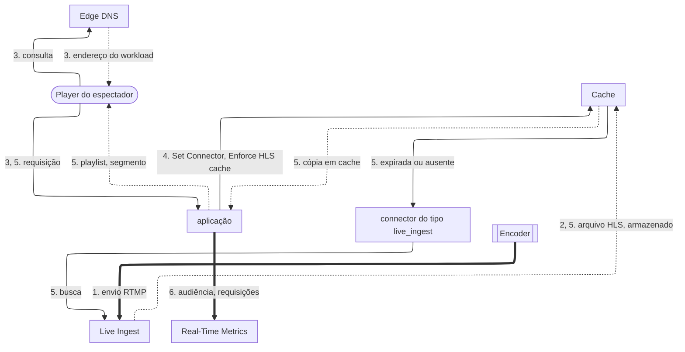

import FrameBox from '@aziontech/webkit/frame-box'
import ItemList from '@aziontech/webkit/item-list'
import DocItem from '@aziontech/webkit/doc-item'

Este design atende equipes que transmitem eventos ao vivo sem uma origem de streaming própria. O encoder envia a transmissão por RTMP ao Live Ingest na região que a equipe escolhe, e Live Ingest produz a saída em HLS. Uma aplicação entrega a transmissão aos espectadores sob a política de cache ao vivo que a Azion aplica automaticamente, então uma única cópia em cache de cada arquivo responde a todos os espectadores. O design implementa o caso de uso [Transmitir eventos ao vivo para grandes audiências](/pt-br/documentacao/casos-de-uso/entregar-midia-e-streaming/transmitir-eventos-ao-vivo-para-grandes-audiencias/).

## Diagrama de arquitetura

As setas contínuas levam a requisição, as setas pontilhadas levam a resposta, e as setas grossas levam a transmissão do encoder e os relatórios de audiência, que rodam separados da requisição de qualquer espectador. Cada rótulo começa pelo número da etapa do fluxo de dados a que pertence.

### Fluxo de dados

1. O encoder envia a transmissão por RTMP ao Live Ingest, na região de um connector do tipo `live_ingest`.
2. Live Ingest converte a transmissão em HLS: uma playlist, `.m3u8`, e os segmentos que ela lista, `.ts`.
3. O player de um espectador resolve o hostname da transmissão pelo Edge DNS e requisita a playlist à aplicação.
4. Uma regra da aplicação nomeia o connector com _Set Connector_, e a Azion adiciona o behavior _Enforce HLS cache_, que faz cache das playlists por 5 segundos e dos segmentos por 60 segundos.
5. Cache responde a todos os espectadores com uma cópia válida, e uma cópia expirada ou ausente é buscada pelo connector.
6. Real-Time Metrics conta os usuários conectados da transmissão e as requisições que a aplicação respondeu.

Toda resposta volta pela aplicação, que a entrega ao player. O fluxo de ingestão começa no encoder, não em uma origem: a ingestão e o empacotamento acontecem na Azion, então nenhum servidor da equipe fica no caminho.

## Componentes

- **Live Ingest**: o Produto que recebe a transmissão RTMP do encoder em uma região e a converte em HLS. A região é o atributo de um connector do tipo `live_ingest` e decide onde a transmissão entra na Azion, não onde os espectadores se conectam.
- **aplicação**: o Platform Resource que entrega a transmissão. A regra dela com _Set Connector_ envia as requisições dos espectadores ao connector do Live Ingest, e ela é alcançada pelo hostname de um workload.
- **Cache**: mantém a playlist e os segmentos sob a política de cache ao vivo do _Enforce HLS cache_, que ignora as cache settings da própria aplicação. A playlist muda conforme a transmissão avança, então a cópia dela dura segundos; um segmento nunca muda, então a cópia dele dura mais.
- **Edge DNS**: resolve o hostname da transmissão para o workload, incluindo um domínio apex por um registro `ANAME`.
- **Real-Time Metrics**: traz a audiência no dataset `connectedUsersMetrics` e a parcela de requisições respondidas pelo cache no dataset `httpMetrics`.

## Implementação

- [Transmitir eventos ao vivo para grandes audiências](/pt-br/documentacao/casos-de-uso/entregar-midia-e-streaming/transmitir-eventos-ao-vivo-para-grandes-audiencias/) - constrói este design de ponta a ponta: o connector do Live Ingest, a regra de entrega, as configurações do encoder e as verificações de cada um.
- [Primeiros passos com Applications](/pt-br/documentacao/plataforma/applications/primeiros-passos/) - cria a aplicação e o workload que servem a transmissão.
- [Aponte um domínio para um workload](/pt-br/documentacao/guias/plataforma/migracao/apontar-dominio-para-a-azion/) - cria o registro que envia o hostname da transmissão para o workload, no Edge DNS ou em outro provedor de DNS.
- [Consulte os usuários conectados do Live Ingest](/pt-br/documentacao/guias/plataforma/observabilidade/query-dados-connected-users-com-graphql/) - lê a audiência da transmissão pela GraphQL API.

## Recursos relacionados

<FrameBox>
<ItemList>
  <DocItem title="Ingestão e entrega" href="/pt-br/documentacao/plataforma/connectors/live-ingest/ingestao-e-entrega/">Como Live Ingest recebe a transmissão em uma região e a converte em HLS, e como a aplicação a entrega.</DocItem>
  <DocItem title="Enforce HLS cache" href="/pt-br/documentacao/plataforma/applications/rules-engine/#enforce-hls-cache">O behavior que a Azion adiciona à regra e o tempo de cache das playlists e dos segmentos.</DocItem>
  <DocItem title="Configurações de connector" href="/pt-br/documentacao/plataforma/connectors/configuracoes/#live-ingest">Os valores de região de um connector do tipo live_ingest e os erros que uma região ausente ou desconhecida retorna.</DocItem>
  <DocItem title="Boas práticas de Connectors" href="/pt-br/documentacao/plataforma/connectors/boas-praticas/#live-ingest">Endpoints redundantes, configurações do encoder, fallback do player e o teste de carga antes de um evento.</DocItem>
</ItemList>
</FrameBox>
