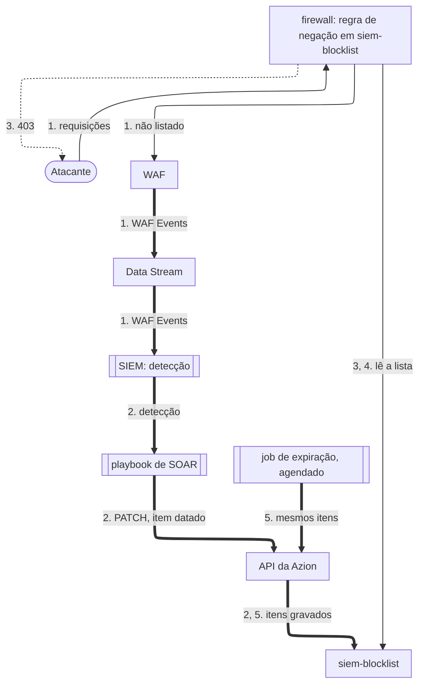

import FrameBox from '@aziontech/webkit/frame-box'
import ItemList from '@aziontech/webkit/item-list'
import DocItem from '@aziontech/webkit/doc-item'

Este design atende equipes de SOC que detectam ameaças em um SIEM mas bloqueiam à mão, então os atacantes continuam alcançando as aplicações entre a detecção e o bloqueio. [Data Stream](/pt-br/documentacao/plataforma/data-stream/) envia os eventos do [firewall](/pt-br/documentacao/plataforma/firewall/) e do seu [WAF](/pt-br/documentacao/plataforma/firewall/waf/) ao SIEM, onde uma detecção inicia um playbook de SOAR. O playbook adiciona o endereço do atacante a uma network list do [Network Shield](/pt-br/documentacao/plataforma/firewall/network-shield/) pela [Azion API](https://api.azion.com/) ou pelo [Terraform Provider](/pt-br/documentacao/devtools/terraform/). Regras de firewall que referenciam a lista bloqueiam as próximas requisições, e um job de expiração remove os itens vencidos. O design implementa o caso de uso [Bloquear atacantes automaticamente a partir de detecções do SIEM](/pt-br/documentacao/casos-de-uso/proteger-aplicacoes-e-redes/bloquear-atacantes-automaticamente-a-partir-de-deteccoes-do-siem/).

## Diagrama de arquitetura

As setas contínuas levam a requisição, as setas pontilhadas levam a resposta, e as setas grossas levam o loop, que roda separado de qualquer requisição. Cada rótulo começa pelo número da etapa do fluxo de dados a que pertence.

### Fluxo de dados

1. As requisições de um atacante chegam ao firewall. WAF as pontua, e Data Stream envia os eventos do WAF ao endpoint que o SIEM lê.
2. Uma detecção no SIEM inicia um playbook de SOAR. O playbook lê `siem-blocklist`, adiciona o endereço com uma data de vencimento e um comentário e grava a lista inteira de volta pela API.
3. A regra de negação já lê `siem-blocklist`, então as próximas requisições desse endereço recebem `403` assim que a alteração chega ao tráfego, em cerca de 100 segundos.
4. Regras em vários firewalls podem ler a mesma lista, então uma gravação bloqueia o endereço em toda aplicação que esses firewalls protegem.
5. Um job de expiração grava os itens da lista de volta de forma agendada. Cada gravação descarta os itens cuja data de vencimento passou, o que encerra esses bloqueios.

A regra de negação lê `siem-blocklist` antes que o WAF rode, então um item novo altera o que o firewall bloqueia sem alterar nenhuma regra, e o WAF não pontua as requisições de um endereço listado.

## Componentes

- **Data Stream**: exporta os eventos do WAF do firewall ao endpoint que o SIEM lê. O loop começa ali.
- **SIEM ou SOAR**: a integração que guarda a lógica de detecção e executa o playbook. O playbook transforma uma detecção em uma gravação na lista, e a lógica de detecção fica no SIEM da equipe.
- **API e Terraform Provider**: as interfaces pelas quais a automação altera a lista. Um `PATCH` que envia `items` substitui o array inteiro, então o playbook lê a lista antes de gravá-la. O Terraform Provider gerencia uma network list como o recurso `azion_network_list`.
- **Network Shield**: adiciona o critério _Network_, que compara cada endereço de cliente com uma network list. Um item `ip_cidr` pode carregar uma data de vencimento e um comentário, que registram quando o bloqueio termina e por que o endereço está na lista.
- **firewall**: o Platform Resource que aplica o bloqueio. A sua regra de negação na lista ocupa a primeira posição, então um endereço listado é recusado antes que o WAF o pontue. Uma alteração em uma lista chega ao tráfego em cerca de 100 segundos, e uma regra nova em 6 a 10 minutos. Por isso o loop altera dados, nunca regras.
- **WAF**: a fonte dos eventos. Os seus scores, as regras correspondidas e as actions são o que as detecções do SIEM leem.

## Implementação

- [Bloquear atacantes automaticamente a partir de detecções do SIEM](/pt-br/documentacao/casos-de-uso/proteger-aplicacoes-e-redes/bloquear-atacantes-automaticamente-a-partir-de-deteccoes-do-siem/) - constrói este design de ponta a ponta, com a lista, a regra de negação, a leitura e a gravação do playbook, o job de expiração e as verificações de cada um.
- [Primeiros passos com WAF](/pt-br/documentacao/plataforma/firewall/waf/primeiros-passos/) - aplica um WAF rule set ao firewall, a fonte dos eventos que o SIEM lê.
- [Envie eventos do WAF para um SIEM](/pt-br/documentacao/guias/seguranca-de-aplicacoes/firewall-e-waf/integrar-siems/) - cria o stream de eventos do WAF que as detecções leem e confirma que o endpoint do SIEM o aceita.
- [Bloqueie endereços até uma data](/pt-br/documentacao/guias/seguranca-de-aplicacoes/bots-e-rede/bloqueio-temporario/) - cria a network list com o seu primeiro item e a regra que nega todo endereço nela.
- [Altere a ordem das regras de firewall](/pt-br/documentacao/guias/seguranca-de-aplicacoes/bots-e-rede/alterar-a-ordem-das-regras-de-firewall/) - move a regra de negação para cima da regra que aplica o WAF.
- [Atualize uma network list a partir de uma automação](/pt-br/documentacao/guias/seguranca-de-aplicacoes/bots-e-rede/atualizar-network-list-a-partir-de-automacao/) - envia a leitura e a gravação que adicionam um item datado, e a gravação agendada que descarta os expirados.

## Recursos relacionados

<FrameBox>
<ItemList>
  <DocItem title="Network Lists" href="/pt-br/documentacao/plataforma/firewall/network-shield/network-lists/">Os tipos de lista, a data de vencimento e o comentário de um item, e os erros que uma gravação pode retornar.</DocItem>
  <DocItem title="Recursos de segurança" href="/pt-br/documentacao/devtools/terraform/security/">Os argumentos de `azion_network_list`, para uma lista que o Terraform Provider gerencia.</DocItem>
  <DocItem title="Fontes de dados de Real-Time Events" href="/pt-br/documentacao/plataforma/real-time-events/fontes-de-dados/#http-requests">A fonte de dados HTTP Requests, onde o primeiro `403` para um endereço listado mostra quanto tempo o loop levou.</DocItem>
  <DocItem title="Perímetro de pontuação de bots para fluxos de autenticação" href="/pt-br/documentacao/casos-de-uso/proteger-aplicacoes-e-redes/prevencao-fraudes-online/">Um design cujas decisões do Bot Manager em login, cadastro e checkout também chegam ao SIEM.</DocItem>
</ItemList>
</FrameBox>
