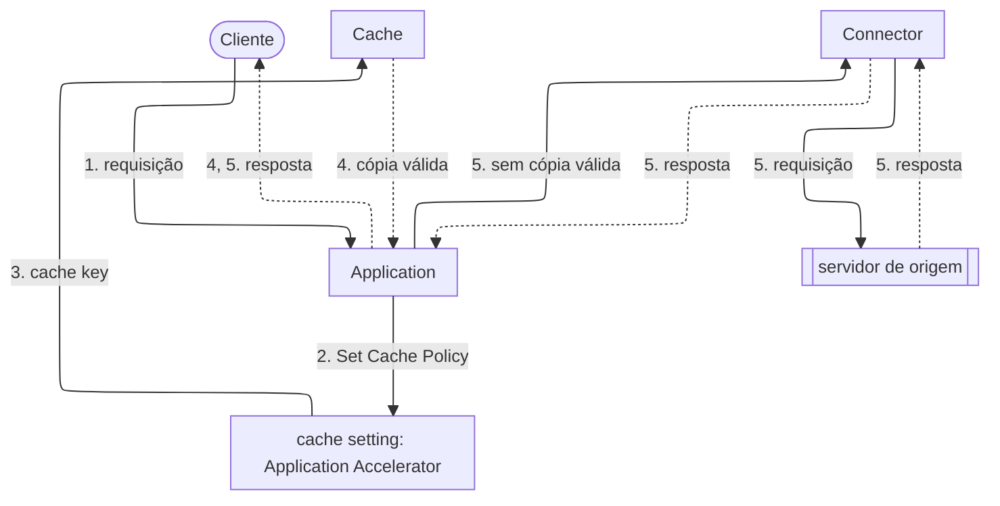

import DocButton from '~/components/webkit/DocButton.vue'
import DocCardGroup from '@aziontech/webkit/doc-card-group'
import DocCard from '@aziontech/webkit/doc-card'

**Application Accelerator** é um recurso da plataforma que libera quatro capacidades para o cache e para as regras de uma [Application](/pt-br/documentacao/plataforma/applications/). Com Application Accelerator ativo, uma Application pode acrescentar mais partes da requisição à cache key, armazenar em cache respostas `POST` e `OPTIONS` e manter uma resposta em cache por menos de 60 segundos. As regras da Application também podem usar mais behaviors do [Rules Engine](/pt-br/documentacao/plataforma/applications/rules-engine/), como _Bypass Cache_ e _Forward Cookies_, e mais duas variáveis.

Um cache guarda cada resposta armazenada sob uma key montada a partir da requisição. Quando essa key contém apenas a URL, todo visitante que requisita a URL recebe a mesma cópia, mesmo quando o conteúdo muda com um cookie, um dispositivo ou um argumento. Acrescentar uma dessas entradas à key dá a cada um dos seus valores uma cópia própria. Uma URL passa então a guardar várias respostas corretas, e cada visitante recebe a que corresponde à sua requisição.

Em uma Application com Application Accelerator ativo, a key pode receber quatro entradas: um argumento de query string, um cookie, o device group e o método da requisição. Um [device group](/pt-br/documentacao/plataforma/applications/device-groups/) é um nome e uma expressão regular que a Application compara com o header `User-Agent` de cada requisição.

Application Accelerator vem desativado em uma Application nova, e cada Application o ativa separadamente, no campo `modules.application_accelerator.enabled` da Application na API. Cada [cache setting](/pt-br/documentacao/plataforma/applications/cache/cache-settings/) da Application guarda por quanto tempo uma resposta fica em cache. Ele também define quais entradas variam a key, no seu próprio objeto `modules.application_accelerator`. Depois, uma [regra](/pt-br/documentacao/plataforma/applications/rules-engine/) com o behavior [Set Cache Policy](/pt-br/documentacao/plataforma/applications/rules-engine/#set-cache-policy) aplica o cache setting às requisições que correspondem à regra. Use Application Accelerator para armazenar em cache cópias separadas de uma página personalizada por um cookie, de uma resposta de API que muda com a sua query string, de um catálogo que difere por dispositivo ou de uma resposta a um `POST`.

<DocButton href="/pt-br/documentacao/plataforma/applications/application-accelerator/primeiros-passos/" label="Primeiros passos" size="medium" />
<DocButton href="/pt-br/documentacao/plataforma/applications/application-accelerator/configuracoes/" label="Referência do Application Accelerator" kind="secondary" size="medium" />

---

## Estrutura do cache setting

Um cache setting guarda as entradas que variam a cache key no seu objeto `modules.application_accelerator`, que [Azion Console](https://console.azion.com) mostra como a seção **Application Accelerator** do setting só enquanto Application Accelerator está ativo na Application. Este cache setting mantém uma listagem de produtos por 30 segundos e dá a cada valor do argumento `category` uma cópia própria. Envie-o como corpo de `POST /v4/workspace/applications/<application-id>/cache_settings`:

```json
{
  "name": "product-listing",
  "browser_cache": { "behavior": "honor" },
  "modules": {
    "cache": {
      "behavior": "override",
      "max_age": 30
    },
    "application_accelerator": {
      "cache_vary_by_querystring": {
        "behavior": "allowlist",
        "fields": ["category"],
        "sort_enabled": true
      }
    }
  }
}
```

- `modules.application_accelerator` guarda os quatro controles de variação: `cache_vary_by_querystring`, `cache_vary_by_cookies`, `cache_vary_by_devices` e `cache_vary_by_method`. Um controle que o corpo deixa de fora mantém o seu padrão, `ignore`, ou uma lista vazia para os métodos.
- `behavior` aceita `ignore`, `all`, `allowlist` ou `denylist`, e o controle de dispositivos aceita `ignore` ou `allowlist`. Aqui, `allowlist` varia a key apenas pelos argumentos em `fields`, e `sort_enabled` agrupa todas as ordens deles sob uma key.
- `max_age` definido como `30` só é aceito enquanto Application Accelerator está ativo. Sem ele, o piso é de 60 segundos, e [Azion API](https://api.azion.com/) recusa um valor menor com `21021`.
- A Application carrega um objeto `modules.application_accelerator` próprio, e o campo `enabled` dele ativa Application Accelerator. `PATCH /v4/workspace/applications/<application-id>` o define com `{ "modules": { "application_accelerator": { "enabled": true } } }`. Enquanto esse campo é `false`, a API recusa com `21013` um cache setting que varia o cache: uma variação por query string, por cookie ou por device group cujo `behavior` não é `ignore`, ou um método em `cache_vary_by_method`.

Se você configurou um header `Vary` ou uma regra de cache key em outro lugar, o modelo se mantém. Você nomeia as entradas que tornam duas requisições diferentes, e cada valor distinto recebe a sua própria cópia. Só os quatro controles de variação definem essas entradas, então um header da requisição como `Accept-Language` não varia a key.

---

## Caminho da requisição

Uma cache key é a entrada de índice de um objeto em cache. Por padrão, a Azion a monta a partir do scheme, do host e do path da requisição, então cada path é um objeto em cache. Enquanto o controle de query string fica no seu padrão, `ignore`, toda query string de um path aponta para esse único objeto. Cada variação que um cache setting ativa acrescenta uma entrada à key, e cada tipo acrescenta o seu próprio marcador:

- Uma variação por cookie acrescenta o separador `@@`, depois os nomes e os valores dos cookies, cada um seguido de `;`.
- Uma variação por dispositivo acrescenta `@@` e o nome do device group.
- Uma resposta `POST` em cache acrescenta `@@` e o hash MD5 do corpo da requisição. Uma resposta `OPTIONS` em cache acrescenta só o prefixo do método.
- Uma variação por query string sob `allowlist` ou `denylist` acrescenta `@@`, depois `?` e os argumentos escolhidos. Sob `all`, a query string inteira vem depois do path, antes de `@@`.

Uma requisição que usa qualquer método diferente de `GET` ou `HEAD` é uma requisição complexa, e a key dela carrega o método como prefixo.

As setas sólidas levam a requisição, e as setas pontilhadas levam a resposta. Cada rótulo começa com o número do seu passo abaixo.



1. A requisição chega à Application com o seu scheme, host, path e query string.
2. Uma regra com _Set Cache Policy_ aplica um cache setting à requisição.
3. A key começa com o scheme, o host e o path. Cada variação do objeto `modules.application_accelerator` do cache setting acrescenta então a sua entrada, com o marcador que esta seção lista para ela.
4. Quando [Cache](/pt-br/documentacao/plataforma/applications/cache/) tem uma cópia válida sob essa key, essa cópia se torna a resposta.
5. Caso contrário, o [Connector](/pt-br/documentacao/plataforma/connectors/) encaminha a requisição ao servidor de origem, e Cache guarda a resposta sob essa key.

Uma variação por cookie sobre um cookie `user` produz uma key no formato `httpwww.example.com/@@user=user;`. Um `POST` em cache produz uma no formato `posthttpsdynamic.example.com/path@@md5_of_post_body`. Duas requisições compartilham um objeto em cache quando produzem a mesma key, e recebem objetos separados quando não produzem. Para o formato completo e cada entrada que uma key carrega, consulte [Cache keys](/pt-br/documentacao/plataforma/applications/cache/cache-keys/#formato-da-key).

Para saber o que ativar Application Accelerator libera, o custo de uma variação e como funcionam os purges, consulte [Variação de cache](/pt-br/documentacao/plataforma/applications/application-accelerator/variacao-de-cache/). Essa página também compara _Bypass Cache_ com um tempo de vida (TTL) de 0.

---

## Escopo e limites

- **Application**: Application Accelerator vem desativado em uma Application nova e pertence à Application, então uma Application pode tê-lo ativo enquanto outra o tem desativado. Ativá-lo mantém o tráfego como estava: os controles de um cache setting começam em `ignore`, e um cache setting só alcança uma requisição por meio de uma regra com [Set Cache Policy](/pt-br/documentacao/plataforma/applications/rules-engine/#set-cache-policy). [Main Settings](/pt-br/documentacao/plataforma/applications/main-settings/#recursos-da-plataforma) mostra onde ativá-lo no Azion Console e na API.
- **O que Application Accelerator libera**: variação de cache, o cache de respostas `POST` e `OPTIONS` e um Max Age, o campo `modules.cache.max_age` do cache setting, que pode chegar a 0 segundos. Ele também libera behaviors do Rules Engine e as variáveis `${request_uri}` e `${device_group}`, e uma Application recebe tudo isso ou nada. Os behaviors são _Add Request Cookie_ e _Add Response Cookie_, _Bypass Cache_, _Capture Match Groups_, _Filter Request Cookie_ e _Filter Response Cookie_, _Forward Cookies_ e _Rewrite Request_. Uma Application repassa `POST`, `PUT`, `PATCH`, `DELETE` e `OPTIONS` à origem com ou sem Application Accelerator. Desses métodos, Application Accelerator permite armazenar em cache só as respostas `POST` e `OPTIONS`.
- **Tamanho da variação**: cada valor distinto de uma entrada variada é um objeto em cache separado. Um cookie único para cada visitante dá uma cópia a cada visitante, então o número de objetos cresce com a audiência, e não com o conteúdo. Para saber como uma allowlist e a ordenação, o campo `sort_enabled`, limitam esse número, consulte [Variação de cache](/pt-br/documentacao/plataforma/applications/application-accelerator/variacao-de-cache/#o-custo-de-uma-variacao) e, para as práticas, [Boas práticas de Applications](/pt-br/documentacao/plataforma/applications/boas-praticas/#application-accelerator).
- **Purges**: as variações por cookie e por device group sobrevivem a um purge por URL. Um purge por cache key as alcança, assim como um purge por wildcard que termina a key com `@@*`. As variações por query string são a exceção. Um purge por URL as alcança quando envia os argumentos na ordem em que foram apresentados, ou em ordem alfabética com `sort_enabled` ativo. Para os tipos de purge, consulte [Real-Time Purge](/pt-br/documentacao/plataforma/applications/cache/real-time-purge/#purgue-conteudo-que-varia).
- **Bypass Cache e um TTL de 0**: [Bypass Cache](/pt-br/documentacao/plataforma/applications/rules-engine/#bypass-cache) envia à origem cada requisição que corresponde à sua regra e mantém a resposta fora do cache da Azion. Ele age só sobre o cache da Azion, então a camada do [Tiered Cache](/pt-br/documentacao/plataforma/applications/cache/tiered-cache/) continua a armazenar objetos para uma Application cujos cache settings ativam o Tiered Cache. Um Max Age de 0 segundos mantém a requisição no caminho do cache, e toda requisição ainda chega à origem. Para comparar os dois, consulte [Bypass Cache e um TTL de 0](/pt-br/documentacao/plataforma/applications/application-accelerator/variacao-de-cache/#bypass-cache-e-um-ttl-de-0).
- **Vizinhos**: com Application Accelerator ativo, os controles de variação de um cache setting decidem o que entra em uma key, e [Cache](/pt-br/documentacao/plataforma/applications/cache/) então mantém uma cópia separada para cada valor. Para variar o cache pela string `ims` do [Image Processor](/pt-br/documentacao/plataforma/applications/image-processor/), acrescente `ims` à allowlist de query string do cache setting que entrega as imagens.
- **Interfaces**: você ativa Application Accelerator no Azion Console, pela Azion API em `/v4/workspace/applications/<application-id>` e com `azion update application --application-accelerator` na [Azion CLI](/pt-br/documentacao/devtools/cli/). [`azion.config.js`](/pt-br/documentacao/devtools/cli/azion-config-js/) o define com `applicationAcceleratorEnabled`, e [Azion Lib](/pt-br/documentacao/devtools/azion-lib/application/) com `application_acceleration` em uma atualização. [Azion Terraform Provider](/pt-br/documentacao/devtools/terraform/) gerencia o recurso da Application que carrega o switch. Os controles de variação pertencem ao cache setting, em `/v4/workspace/applications/<application-id>/cache_settings` ou por meio de flags de `azion create cache-setting` como `--cache-by-query-string` e `--cache-by-cookies`. `azion create cache-setting` recebe a variação por device group e o Max Age do cache só em um corpo `--file`.
- **Observabilidade**: com `Pragma: azion-debug-cache` em uma requisição, o header `x-cache-key` da resposta mostra o que cada variação acrescentou à key. Um `POST` informa `-` em `x-cache` até que o campo `cache_vary_by_method` do cache setting carregue `post`. Para verificar o status de cache de uma resposta, consulte [Verifique o status de cache de uma resposta](/pt-br/documentacao/guias/performance-e-confiabilidade/cache-e-purge/verificar-tempo-de-cache-da-pagina/).
- **Limites**: com Application Accelerator ativo, o Max Age de um cache setting desce até 0 segundos, ou até 3 segundos quando o cache setting também tem Tiered Cache ativo. Ativá-lo pode gerar custos relacionados ao uso. Para cada limite de TTL e a resposta quando ele é ultrapassado, consulte [Limites de Applications](/pt-br/documentacao/plataforma/applications/limites/#application-accelerator) e, para os valores, [Preços](/pt-br/documentacao/fundamentos/precos/#application-accelerator). A página [Preços da Azion](https://www.azion.com/pt-br/precos/) lista o que cada plano inclui.
- **Termos**: o [glossário de Applications](/pt-br/documentacao/plataforma/applications/glossario/) define as palavras às quais as páginas do Application Accelerator dão um significado específico, como Advanced Cache Key, variação de cache e device group.

---

## Próximos passos

<DocCardGroup cols={2}>
  <DocCard title="Primeiros passos" href="/pt-br/documentacao/plataforma/applications/application-accelerator/primeiros-passos/" label="Armazene em cache uma listagem que varia por um argumento de query string." />
  <DocCard title="Variação de cache" href="/pt-br/documentacao/plataforma/applications/application-accelerator/variacao-de-cache/" label="Veja o que uma variação custa, como um purge a alcança e como um TTL de 0 difere de Bypass Cache." />
  <DocCard title="Configurações do Application Accelerator" href="/pt-br/documentacao/plataforma/applications/application-accelerator/configuracoes/" label="Consulte um controle de variação, um método HTTP ou um behavior que Application Accelerator libera." />
  <DocCard title="Guias e tutoriais" href="/pt-br/documentacao/plataforma/applications/guias/" label="Conclua uma tarefa específica, de uma Advanced Cache Key a uma resposta POST em cache." />
  <DocCard title="Limites" href="/pt-br/documentacao/plataforma/applications/limites/#application-accelerator" label="Consulte um limite de TTL e a resposta quando ele é ultrapassado." />
  <DocCard title="Solução de problemas" href="/pt-br/documentacao/plataforma/applications/solucao-de-problemas/#application-accelerator" label="Encontre a causa quando uma variação sobrevive a um purge ou um behavior não pode ser selecionado." />
</DocCardGroup>
