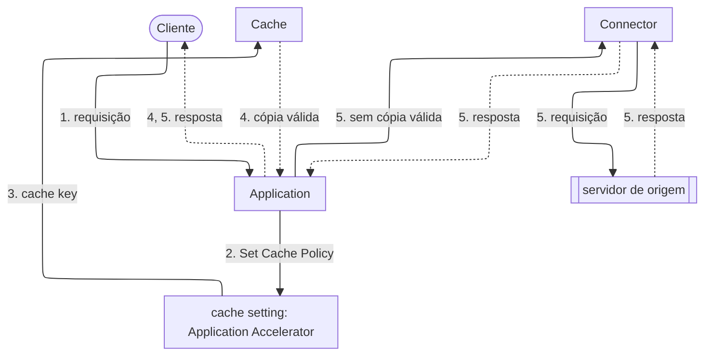

import DocButton from '~/components/webkit/DocButton.vue'
import DocCardGroup from '@aziontech/webkit/doc-card-group'
import DocCard from '@aziontech/webkit/doc-card'

**Application Accelerator** é um recurso da plataforma que libera quatro capacidades de cache e regras na infraestrutura distribuída da Azion, para requisições recebidas por [Applications](/pt-br/documentacao/plataforma/applications/). Com ele, uma Application pode variar a cache key por query string, cookie, [device group](/pt-br/documentacao/plataforma/applications/device-groups/) ou método e armazenar em cache respostas `POST` e `OPTIONS`. Os cache settings aceitam um tempo de vida (TTL) mínimo menor, e as regras podem usar behaviors e variáveis do [Rules Engine](/pt-br/documentacao/plataforma/applications/rules-engine/) reservados a ele. Use Application Accelerator para guardar em cache uma página personalizada por cookie, respostas de API por query string ou catálogos por dispositivo.

<DocButton href="/pt-br/documentacao/plataforma/applications/application-accelerator/primeiros-passos/" label="Primeiros passos" size="medium" />
<DocButton href="/pt-br/documentacao/plataforma/applications/application-accelerator/referencia/" label="Referência do Application Accelerator" kind="outlined" size="medium" />

---

## Caminho da requisição

Ativar Application Accelerator mantém toda cache key como estava: uma variação só se aplica por meio de uma regra com [Set Cache Policy](/pt-br/documentacao/plataforma/applications/rules-engine/#set-cache-policy). Essa regra aplica o cache setting que guarda a variação às requisições que correspondem a ela. Um [cache setting](/pt-br/documentacao/plataforma/applications/cache/cache-settings/), o conjunto de valores que diz ao [Cache](/pt-br/documentacao/plataforma/applications/cache/) como e por quanto tempo armazenar e servir uma resposta, guarda as suas variações no seu próprio objeto `modules.application_accelerator`.

Uma cache key é a entrada de índice de um objeto em cache. Por padrão, a Azion a monta a partir do scheme, do host e do path da requisição, então cada path é um objeto em cache. A menos que um cache setting varie a key por query string, toda query string de um path aponta para esse único objeto. Cada variação que um cache setting ativa acrescenta a sua entrada à key com um marcador, como detalha [Cache keys](/pt-br/documentacao/plataforma/applications/cache/cache-keys/#formato-da-key).

Uma requisição que usa qualquer método diferente de `GET` ou `HEAD` é uma requisição complexa, e a key dela carrega o método como prefixo.

As setas sólidas levam a requisição, e as setas pontilhadas levam a resposta. Cada rótulo começa com o número do seu passo abaixo.

1. A requisição chega à Application com o seu scheme, host, path e query string.
2. Uma regra com _Set Cache Policy_ aplica um cache setting à requisição.
3. Cache monta a key a partir da requisição e de cada variação do cache setting.
4. Quando Cache tem uma cópia válida sob essa key, essa cópia se torna a resposta.
5. Caso contrário, o [Connector](/pt-br/documentacao/plataforma/connectors/) encaminha a requisição ao servidor de origem, e Cache guarda a resposta sob essa key.

Duas requisições compartilham uma cópia quando produzem a mesma key, e recebem cópias separadas quando não produzem.

Para saber o que ativar Application Accelerator libera, o custo de uma variação e como funcionam os purges, consulte [Variação de cache](/pt-br/documentacao/plataforma/applications/application-accelerator/variacao-de-cache/). Essa página também compara _Bypass Cache_ com um TTL de 0.

---

## Próximos passos

<DocCardGroup cols={2}>
  <DocCard title="Primeiros passos" href="/pt-br/documentacao/plataforma/applications/application-accelerator/primeiros-passos/" label="Armazene em cache uma listagem que varia por um argumento de query string." />
  <DocCard title="Variação de cache" href="/pt-br/documentacao/plataforma/applications/application-accelerator/variacao-de-cache/" label="Veja o que uma variação custa, como um purge alcança as cópias dela e como um TTL de 0 difere de Bypass Cache." />
  <DocCard title="Configurações do Application Accelerator" href="/pt-br/documentacao/plataforma/applications/application-accelerator/configuracoes/" label="Consulte um controle de variação, um método HTTP ou um behavior que Application Accelerator libera." />
  <DocCard title="Guias e tutoriais" href="/pt-br/documentacao/plataforma/applications/guias/" label="Conclua uma tarefa específica, de uma Advanced Cache Key a uma resposta POST em cache." />
  <DocCard title="Boas práticas" href="/pt-br/documentacao/plataforma/applications/boas-praticas/#application-accelerator" label="Escolha os argumentos e os cookies que variam a key e ordene a query string." />
  <DocCard title="Limites" href="/pt-br/documentacao/plataforma/applications/limites/#application-accelerator" label="Consulte o escopo do Application Accelerator, um limite de TTL e a resposta quando ele é ultrapassado." />
  <DocCard title="Solução de problemas" href="/pt-br/documentacao/plataforma/applications/solucao-de-problemas/#application-accelerator" label="Encontre a causa quando as cópias de uma variação sobrevivem a um purge ou um behavior não pode ser selecionado." />
  <DocCard title="Glossário" href="/pt-br/documentacao/plataforma/applications/glossario/" label="Consulte um termo que as páginas do Application Accelerator usam, como Advanced Cache Key." />
</DocCardGroup>
