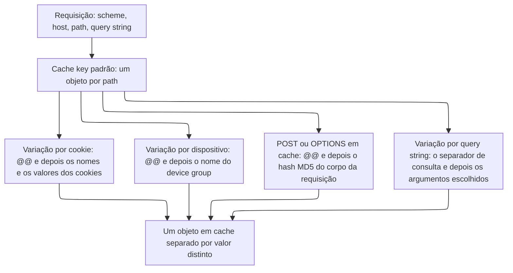

import DocButton from '~/components/webkit/DocButton.vue'
import DocCardGroup from '@aziontech/webkit/doc-card-group'
import DocCard from '@aziontech/webkit/doc-card'

Um cache guarda cada resposta armazenada sob uma key montada a partir da requisição. Quando essa key contém apenas a URL, toda requisição para a URL recebe a mesma cópia. Essa cópia está errada para um conteúdo que muda com um cookie, um dispositivo ou um argumento. Acrescentar essa entrada à key dá a cada um dos seus valores uma cópia própria. Uma URL passa então a guardar várias respostas corretas, e nenhum visitante recebe a resposta destinada a outro.

**Application Accelerator** coloca essas entradas na cache key de uma [aplicação](/pt-br/documentacao/plataforma/applications/): um argumento de query string, um cookie, o device group ou o método da requisição. O switch dele em **Main Settings** › **Modules** o ativa somente para aquela aplicação. Um cache setting então nomeia as entradas que variam as suas cópias, e uma regra com _Set Cache Policy_ aplica esse setting às requisições que correspondem a ela. Use Application Accelerator para armazenar em cache uma página personalizada, uma resposta de API que muda com a query string, um catálogo por dispositivo ou uma resposta a um `POST`.

<DocButton href="/pt-br/documentacao/plataforma/applications/application-accelerator/primeiros-passos/" label="Primeiros passos" size="medium" />
<DocButton href="/pt-br/documentacao/plataforma/applications/application-accelerator/configuracoes/" label="Referência do Application Accelerator" kind="secondary" size="medium" />

---

## Estrutura do cache setting

Application Accelerator age por meio do objeto `modules.application_accelerator` de um cache setting, que [Azion Console](https://console.azion.com) mostra como a seção **Application Accelerator** do setting. Este cache setting mantém uma listagem de produtos por 30 segundos e dá a cada valor do argumento `category` uma cópia própria, enviado como corpo de `POST /v4/workspace/applications/<application-id>/cache_settings`:

```json
{
  "name": "product-listing",
  "browser_cache": { "behavior": "honor" },
  "modules": {
    "cache": {
      "behavior": "override",
      "max_age": 30
    },
    "application_accelerator": {
      "cache_vary_by_querystring": {
        "behavior": "allowlist",
        "fields": ["category"],
        "sort_enabled": true
      }
    }
  }
}
```

- `modules.application_accelerator` guarda os quatro controles **Cache vary by**: `cache_vary_by_querystring`, `cache_vary_by_cookies`, `cache_vary_by_devices` e `cache_vary_by_method`. Um controle que o corpo deixa de fora mantém o seu padrão, `ignore`, ou uma lista vazia para os métodos.
- `behavior` aceita `ignore`, `all`, `allowlist` ou `denylist`, e o controle de dispositivos aceita `ignore` ou `allowlist`. Aqui, `allowlist` varia a key apenas pelos argumentos em `fields`, e `sort_enabled` agrupa todas as ordens deles sob uma key.
- `max_age` definido como `30` só é aceito enquanto Application Accelerator está ativo. Sem ele, o piso é de 60 segundos, e [Azion API](https://api.azion.com/) recusa um valor menor com `21021`.
- O switch pertence à aplicação, não ao cache setting. `PATCH /v4/workspace/applications/<application-id>` o ativa com `{ "modules": { "application_accelerator": { "enabled": true } } }`, e, enquanto ele está desativado, a API recusa qualquer campo de `modules.application_accelerator` com `21013`.

Se você configurou um header `Vary` ou uma regra de cache key em outro lugar, o modelo se mantém. Você nomeia as entradas que tornam duas requisições diferentes, e cada valor distinto recebe a sua própria cópia.

---

## Caminho da requisição

Uma cache key é a entrada de índice de um objeto em cache. Por padrão, a Azion a monta a partir do scheme, do host e do path da requisição, então cada path é um objeto em cache. Enquanto o controle de query string fica no seu padrão, `ignore`, uma query string não divide esse objeto. Cada variação que um cache setting ativa acrescenta uma entrada à key, e cada tipo acrescenta o seu próprio marcador:

- Uma variação por cookie acrescenta o separador `@@`, depois os nomes e os valores dos cookies, cada um seguido de `;`.
- Uma variação por dispositivo acrescenta `@@` e o nome do device group.
- Uma resposta `POST` ou `OPTIONS` em cache acrescenta `@@` e o hash MD5 do corpo da requisição.
- Uma variação por query string acrescenta o separador de consulta e os argumentos escolhidos, na ordem em que a requisição os enviou. Os argumentos já fazem parte da URL, então essa variação não precisa de `@@`.

Uma requisição que usa qualquer método diferente de `GET` ou `HEAD` é uma requisição complexa, e a key dela carrega o método como prefixo. Este diagrama mostra a partir do que a key padrão é montada e o que cada variação acrescenta a ela:



Uma variação por cookie sobre um cookie `user` produz uma key no formato `httpwww.example.com/@@user=user;`. Um `POST` em cache produz uma no formato `httpsdynamic.example.com/path@@md5_of_post_arguments`. Duas requisições compartilham um objeto em cache quando produzem a mesma key, e recebem objetos separados quando não produzem. Para o formato completo e cada entrada que uma key carrega, consulte [Cache keys](/pt-br/documentacao/plataforma/applications/cache/cache-keys/#formato-da-key).

Para saber o que o switch libera, o custo de uma variação, como funcionam os purges e como _Bypass Cache_ difere de um tempo de vida (TTL) de 0, consulte [Variação de cache](/pt-br/documentacao/plataforma/applications/application-accelerator/variacao-de-cache/).

---

## Escopo e limites

- **Aplicação**: o switch vem desativado em uma aplicação nova e pertence à aplicação, então uma aplicação pode tê-lo ativo enquanto outra não. Ativá-lo não altera nenhum tráfego por si só. Os controles de um cache setting começam em `ignore`, e um cache setting só alcança uma requisição por meio de uma regra com [Set Cache Policy](/pt-br/documentacao/plataforma/applications/rules-engine/#set-cache-policy). Para o switch, consulte [Main Settings](/pt-br/documentacao/plataforma/applications/main-settings/#produtos).
- **O que o switch libera**: variação de cache, o cache de respostas `POST` e `OPTIONS` e um **Max Age** que pode chegar a 0 segundos. Ele também libera mais sete behaviors do Rules Engine e as variáveis `${request_uri}` e `${device_group}`, e uma aplicação recebe tudo isso ou nada. Os behaviors são _Add Cookie_, _Bypass Cache_, _Capture Match Groups_, _Filter Request Cookie_, _Forward Cookies_, _Rewrite Request_ e _Run Function_. Além de `GET` e `HEAD`, que uma aplicação aceita nativamente, o switch acrescenta `OPTIONS`, `POST`, `PUT`, `PATCH` e `DELETE`. Desses, só as respostas `POST` e `OPTIONS` podem ser armazenadas em cache.
- **Tamanho da variação**: cada valor distinto de uma entrada variada é um objeto em cache separado. Um cookie único para cada visitante dá uma cópia a cada visitante, então o número de objetos cresce com a audiência, e não com o conteúdo. Para saber como uma allowlist e **Sort** limitam esse número, consulte [Variação de cache](/pt-br/documentacao/plataforma/applications/application-accelerator/variacao-de-cache/#o-custo-de-uma-variacao) e, para as práticas, [Boas práticas de Applications](/pt-br/documentacao/plataforma/applications/boas-praticas/#application-accelerator).
- **Purges**: as variações por cookie e por device group sobrevivem a um purge por URL. Um purge por cache key as alcança, assim como um purge por wildcard que termina a key com `@@*`. As variações por query string são a exceção. Um purge por URL as alcança quando envia os argumentos na ordem em que foram apresentados, ou em ordem alfabética com **Sort** ativo. Para os tipos de purge, consulte [Real-Time Purge](/pt-br/documentacao/plataforma/applications/cache/real-time-purge/#purgue-conteudo-que-varia).
- **Bypass Cache e um TTL de 0**: [Bypass Cache](/pt-br/documentacao/plataforma/applications/rules-engine/#bypass-cache) envia à origem cada requisição que corresponde à sua regra e não armazena nada no cache da Azion. Ele não alcança a camada do [Tiered Cache](/pt-br/documentacao/plataforma/applications/cache/tiered-cache/). Um **Max Age** de 0 segundos mantém a requisição no caminho do cache, então requisições paralelas pelo mesmo objeto chegam à origem como uma única requisição. Para saber quando usar cada um, consulte [Bypass Cache e um TTL de 0](/pt-br/documentacao/plataforma/applications/application-accelerator/variacao-de-cache/#bypass-cache-e-um-ttl-de-0).
- **Produtos vizinhos**: Application Accelerator decide o que entra em uma key, e [Cache](/pt-br/documentacao/plataforma/applications/cache/) então mantém uma cópia separada para cada valor. Variar o cache pela string `ims` do [Image Processor](/pt-br/documentacao/plataforma/applications/image-processor/) exige Application Accelerator, enquanto processar uma imagem não exige.
- **Interfaces**: você ativa o switch no Azion Console, pela Azion API em `/v4/workspace/applications/<application-id>` e com `azion update application --application-accelerator` na [Azion CLI](/pt-br/documentacao/devtools/cli/). [`azion.config.js`](/pt-br/documentacao/devtools/cli/azion-config-js/) o define com `applicationAcceleratorEnabled`, e [Azion Lib](/pt-br/documentacao/devtools/azion-lib/application/) com `application_acceleration` em uma atualização. [Azion Terraform Provider](/pt-br/documentacao/devtools/terraform/) gerencia o recurso de aplicação que carrega o switch. Os controles de variação pertencem ao cache setting, em `/v4/workspace/applications/<application-id>/cache_settings` ou por meio de flags de `azion create cache-setting` como `--cache-by-query-string` e `--cache-by-cookies`. Nenhuma flag de `azion create cache-setting` define a variação por device group ou o **Max Age** do cache, então envie esses valores em um corpo `--file`.
- **Observabilidade**: com `Pragma: azion-debug-cache` em uma requisição, o header `x-cache-key` da resposta mostra o que cada variação acrescentou à key. Um `POST` informa `-` em `x-cache` até que o cache setting nomeie _POST_ em **Cache vary by Method**. Para ler os mesmos headers em um browser, consulte [Verificar indicadores de cache](/pt-br/documentacao/guias/performance-e-confiabilidade/cache-e-purge/verificar-tempo-de-cache-da-pagina/).
- **Limites**: com Application Accelerator ativo, **Max Age** desce até 0 segundos, ou até 3 segundos quando o cache setting também tem Tiered Cache ativo. Ativá-lo pode gerar custos relacionados ao uso. Para cada limite de TTL, a resposta quando ele é ultrapassado e o que cada plano inclui, consulte [Limites de Applications](/pt-br/documentacao/plataforma/applications/limites/#application-accelerator) e, para os valores, [Preços](/pt-br/documentacao/fundamentos/precos/#application-accelerator).
- **Termos**: o [glossário de Applications](/pt-br/documentacao/plataforma/applications/glossario/) define as palavras às quais as páginas do Application Accelerator dão um significado específico, como Advanced Cache Key, allowlist, denylist e requisição complexa.

---

## Próximos passos

<DocCardGroup cols={2}>
  <DocCard title="Primeiros passos" href="/pt-br/documentacao/plataforma/applications/application-accelerator/primeiros-passos/" label="Armazene em cache uma listagem que varia por um argumento de query string." />
  <DocCard title="Variação de cache" href="/pt-br/documentacao/plataforma/applications/application-accelerator/variacao-de-cache/" label="Veja o que uma variação custa, como um purge a alcança e como um TTL de 0 difere de Bypass Cache." />
  <DocCard title="Configurações do Application Accelerator" href="/pt-br/documentacao/plataforma/applications/application-accelerator/configuracoes/" label="Consulte um controle de variação, um método HTTP ou um behavior que o switch libera." />
  <DocCard title="Guias e tutoriais" href="/pt-br/documentacao/plataforma/applications/guias/" label="Conclua uma tarefa específica, de uma Advanced Cache Key a uma resposta POST em cache." />
  <DocCard title="Limites" href="/pt-br/documentacao/plataforma/applications/limites/#application-accelerator" label="Consulte um limite de TTL, a resposta quando ele é ultrapassado ou o que um plano inclui." />
  <DocCard title="Solução de problemas" href="/pt-br/documentacao/plataforma/applications/solucao-de-problemas/#application-accelerator" label="Encontre a causa quando uma variação sobrevive a um purge ou um behavior não pode ser selecionado." />
</DocCardGroup>
