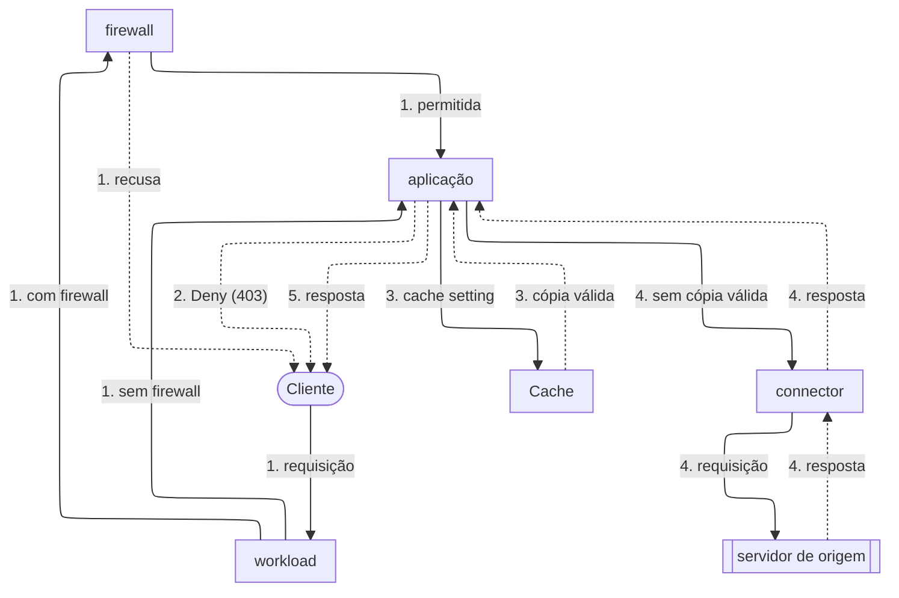
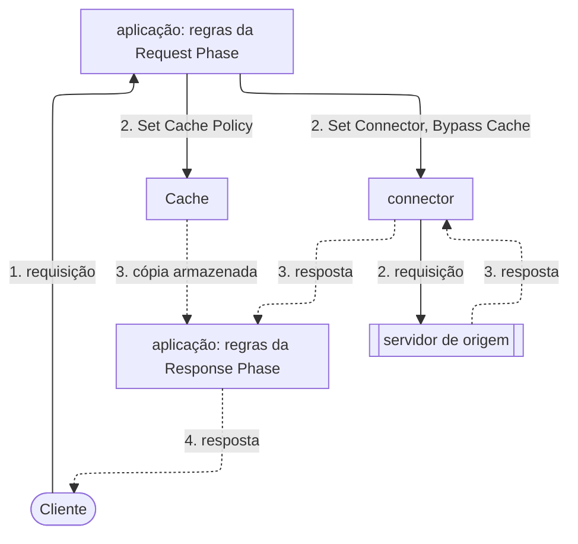
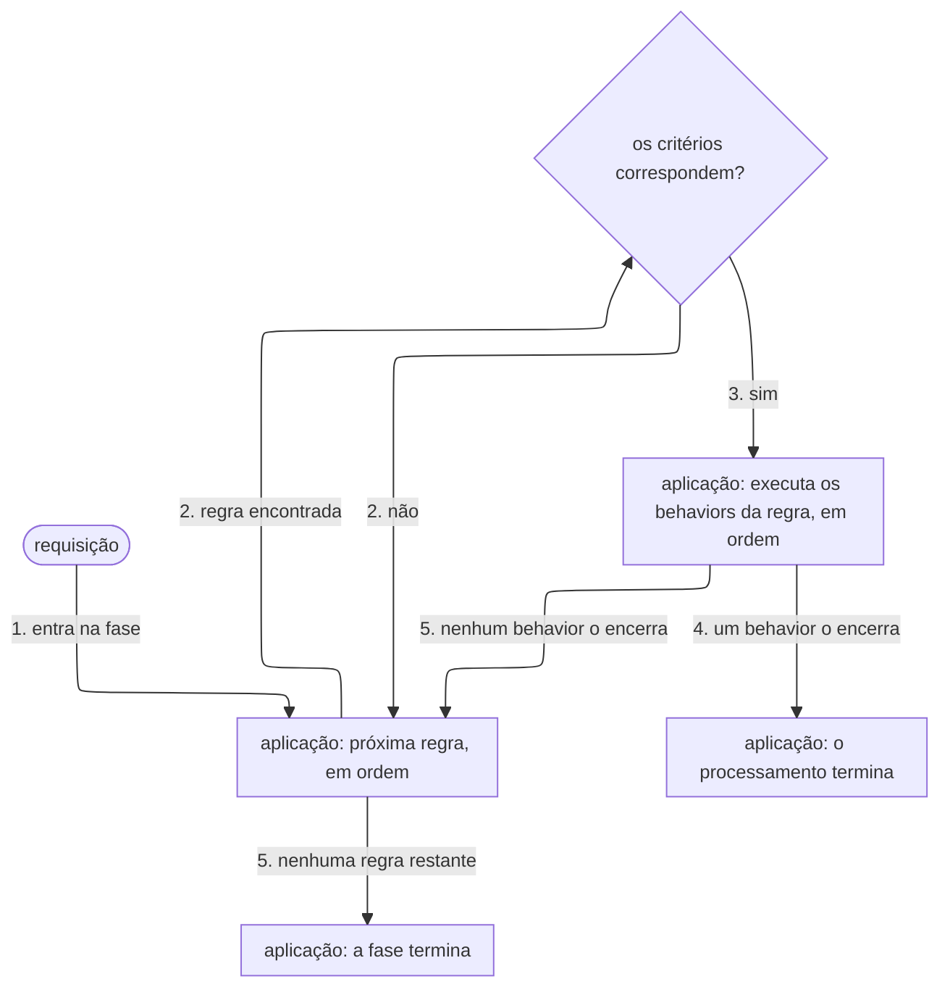

import FrameBox from '@aziontech/webkit/frame-box'
import ItemList from '@aziontech/webkit/item-list'
import DocItem from '@aziontech/webkit/doc-item'

Entre um cliente e o servidor que guarda o seu conteúdo, uma camada pode ler cada requisição antes desse servidor, seja ela para uma página, um arquivo ou uma rota de API. A camada então decide o que acontece com a requisição. Ela pode responder com uma cópia de uma resposta que o servidor enviou antes, adicionar ou remover um header ou escolher o servidor que recebe a requisição. Quando a resposta volta, a mesma camada pode alterá-la antes que o cliente a receba.

Na Azion, essa camada é uma aplicação, o objeto que você cria em [Applications](/pt-br/documentacao/plataforma/applications/). Applications é um recurso da plataforma que executa cada aplicação na infraestrutura distribuída da Azion, a partir do data center mais próximo ao seu usuário. Um [workload](/pt-br/documentacao/plataforma/workloads/) recebe a requisição em um dos seus domínios, e o deployment do workload define a aplicação que trata a requisição.

A aplicação age sobre a requisição por meio das suas regras, que você escreve em [Rules Engine para Applications](/pt-br/documentacao/plataforma/applications/rules-engine/). Cada regra pertence a uma de duas fases: as regras da Request Phase agem sobre a requisição, e as regras da Response Phase agem sobre a resposta que o usuário recebe. Para chegar à origem, uma regra da Request Phase usa o behavior _Set Connector_, que define o [connector](/pt-br/documentacao/plataforma/connectors/) que encaminha a requisição até lá.

Três produtos de Applications agem no caminho do workload até a origem, cada um com o seu próprio switch na aplicação. [Cache](/pt-br/documentacao/plataforma/applications/cache/) responde com uma cópia armazenada de uma resposta da origem. [Application Accelerator](/pt-br/documentacao/plataforma/applications/application-accelerator/) acrescenta mais partes da requisição, como um cookie ou um argumento de query string, à cache key, o índice sob o qual Cache arquiva cada cópia. [Image Processor](/pt-br/documentacao/plataforma/applications/image-processor/) constrói uma imagem redimensionada ou convertida a partir de uma imagem na origem.

Esta página explica os mecanismos, e outras duas páginas guardam os campos: Rules Engine para Applications lista cada variável, operador e behavior, e [Limites de Applications](/pt-br/documentacao/plataforma/applications/limites/) lista cada limite. As seções acompanham uma requisição pelo seu caminho e depois cobrem as duas fases, como as regras são executadas, o que uma aplicação nova tem e a propagação. Depois delas, uma seção para cada um cobre Cache, Application Accelerator e Image Processor. [WebSocket Proxy](/pt-br/documentacao/plataforma/applications/websocket/) cobre, em uma página própria, as conexões WebSocket que uma aplicação repassa à origem.

---

## O caminho que uma requisição percorre

Criar uma aplicação não a coloca no caminho de nenhuma requisição: uma requisição só chega à aplicação depois que o deployment de um workload a define. A relação fica guardada no deployment, não na aplicação, e no Azion Console você a define no campo **Application** das **Deployment Settings** do workload. O deployment também pode definir um [firewall](/pt-br/documentacao/plataforma/firewall/), e a requisição então passa pelo firewall antes que a aplicação a receba. Os domínios, os protocolos e os certificados também ficam no workload, então uma aplicação não tem configurações de entrega próprias.

A aplicação também não guarda uma origem. A API mostra isso: uma aplicação criada só com `name` e `active` volta com `modules`, `active` e `debug`, e sem nenhum campo que aponte para um servidor. Uma requisição só chega a uma origem quando uma regra da Request Phase a envia para lá com o behavior _Set Connector_. Esse behavior define um connector, e o connector guarda o endereço da origem. Os connectors substituem as origens que as versões anteriores de Applications configuravam na aplicação.

O diagrama acompanha uma requisição do cliente até a resposta que ele recebe. As setas sólidas levam a requisição, e as setas pontilhadas levam a resposta. Cada rótulo começa com o número do seu passo abaixo.



1. O cliente envia a requisição para um dos domínios do workload. Quando o deployment do workload também define um firewall, o firewall executa as suas regras primeiro e pode recusar a requisição.
2. A aplicação que o deployment define executa as suas regras da Request Phase, em ordem. Quando um behavior encerra o processamento, como faz _Deny (403 Forbidden)_, a aplicação responde ao cliente e nenhum behavior ou regra posterior é executado.
3. Quando uma regra com _Set Cache Policy_ aplicou um cache setting, Cache procura uma cópia válida da resposta da origem. Se encontra uma, essa cópia se torna a resposta, e a origem não recebe nenhuma requisição.
4. Caso contrário, o connector que uma regra com _Set Connector_ definiu encaminha a requisição à origem, e a resposta da origem volta por esse connector.
5. A aplicação executa as suas regras da Response Phase sobre a resposta, e o cliente recebe o resultado.

Como uma regra escolhe a origem de cada requisição, uma aplicação pode encaminhar `/api/` para um servidor e todos os outros paths para outro, com duas regras e dois connectors. O custo é que nenhuma requisição chega a uma origem por padrão: uma aplicação nova não tem regras, então nenhum connector é definido para as suas requisições. Para criar a primeira regra que encaminha as requisições de uma aplicação a uma origem, consulte [Primeiros passos com Applications](/pt-br/documentacao/plataforma/applications/primeiros-passos/).

---

## Fases de requisição e de resposta

Cada regra de uma aplicação pertence a uma fase, e as duas fases são executadas em uma ordem fixa: a Request Phase antes que exista uma resposta, depois a Response Phase sobre a resposta que a aplicação entrega. Você escolhe a fase na seção **Phase** quando cria a regra e não pode mudá-la depois. Para executar a mesma lógica na outra fase, adicione uma segunda regra nessa fase.

As setas sólidas levam a requisição, e as setas pontilhadas levam a resposta. Cada rótulo começa com o número do seu passo abaixo.



1. A requisição chega, e as regras da Request Phase são executadas sobre ela primeiro. Elas podem ler o que a requisição carrega, como a sua URI, os seus headers e os seus cookies, mas nada sobre a resposta, que ainda não existe.
2. Essas regras decidem o cache e a origem. _Set Cache Policy_ aplica um cache setting, _Bypass Cache_ faz a requisição ignorar o cache e _Set Connector_ define o connector que encaminha a requisição à origem. Esses três behaviors e _Optimize Images_ só são executados na Request Phase. Nessa fase, _Add Request Header_ adiciona um header à requisição que a origem recebe.
3. A resposta volta: ou uma cópia de uma resposta da origem que Cache armazenou, ou a resposta da origem pelo connector.
4. As regras da Response Phase são executadas sobre essa resposta, uma vez para cada entrega ao usuário. Elas também podem ler o que voltou, como `${status}` e os headers que a origem enviou. Nessa fase, _Add Response Header_ adiciona um header à resposta que o usuário recebe.

Por isso, o cache é decidido antes que a resposta exista. Nenhuma regra pode aplicar um cache setting com base no status code que a origem retorna, porque `${status}` só pode ser lido na Response Phase e _Set Cache Policy_ só é executado na Request Phase.

Alguns behaviors funcionam nas duas fases, e a fase limita o que eles fazem. Em uma regra da Response Phase, _Redirect To_ só é executado quando a origem retorna `404`. Um redirecionamento nessa fase pode, então, enviar o usuário para outra página quando a origem não tem nada no path e deixar intactas as requisições para paths que existem. _Run Function_ também funciona nas duas fases, mas a Response Phase só aceita funções Lua. O formulário de instância de função no Azion Console informa esse limite: `Only Lua functions can be used in the Response phase.` [Fases](/pt-br/documentacao/plataforma/applications/rules-engine/#fases) lista as variáveis e os behaviors que cada fase aceita.

---

## Como as regras são executadas

Dentro de uma fase, a aplicação pega as suas regras uma de cada vez, em ordem. Ela para quando todas as regras da fase foram executadas ou quando um behavior encerra o processamento.

As setas sólidas acompanham uma requisição pelas regras de uma fase. Cada rótulo começa com o número do seu passo abaixo.



1. A requisição entra em uma fase, e a aplicação pega a primeira regra dessa fase.
2. A aplicação compara os critérios da regra com a requisição. Se eles não correspondem, a regra não executa nada, e a aplicação passa para a próxima regra.
3. Se correspondem, a regra executa os seus behaviors um após o outro, na ordem em que você os organizou.
4. Quando um desses behaviors encerra o processamento, nada depois dele é executado na fase.
5. Caso contrário, a aplicação passa para a próxima regra, até que não reste nenhuma regra da fase.

[Rules Engine para Applications](/pt-br/documentacao/plataforma/applications/rules-engine/#criterios) lista as variáveis, os operadores e os condicionais que os critérios combinam.

A posição de uma regra é o seu `order`. A plataforma o atribui quando você cria a regra, a partir de `0` para a primeira regra de cada fase. Você pode reordenar a lista do **Rules Engine** no Azion Console ou reordenar uma fase com uma única chamada à API. Alguns behaviors não podem ficar juntos na mesma regra ou só podem ficar juntos sob algumas condições, e o Console recusa essas combinações.

### Behaviors que se repetem

Quando várias regras correspondem a uma requisição e carregam o mesmo behavior, o tipo do behavior decide o resultado. Com um behavior do tipo Set, como _Set Connector_, não há acúmulo: só o da última regra correspondente é executado. Por exemplo, uma primeira regra define um connector para todos os paths, e uma segunda regra define outro connector para `/api/`. Uma requisição para `/api/` corresponde às duas regras, então o connector da segunda regra a encaminha.

Um behavior do tipo Add, ao contrário, se acumula. _Add Request Cookie_ e _Add Request Header_ são executados uma vez em cada regra correspondente que os carrega, então duas regras que adicionam o mesmo nome e o mesmo valor produzem duas entradas idênticas.

Assim, a ordem das regras molda o resultado tanto quanto o conteúdo delas. Uma regra ampla perto do topo define um padrão, e uma regra mais específica mais abaixo substitui esse padrão para as requisições às quais ela corresponde. O mesmo mecanismo tem um custo: mover uma regra na lista pode mudar o connector a que um path chega, mesmo sem nenhuma regra alterada.

### Behaviors que encerram o processamento

Alguns behaviors interrompem o processamento de uma requisição, e nada depois deles é executado: nenhum behavior posterior na regra deles e nenhuma regra posterior. _Deny (403 Forbidden)_ responde com uma página `403 Forbidden`, _Deliver_ entrega o conteúdo ao usuário e _Redirect To_ envia o usuário para outra URL com um status `301` ou `302`. _Finish Request Phase_ encerra a Request Phase no ponto em que é executado, então o restante da sua regra e todas as regras posteriores dessa fase são ignorados.

Um behavior que encerra o processamento economiza trabalho e também pode esconder uma regra. No início da lista, ele resolve a requisição antes que as regras seguintes gastem tempo com ela. Colocado antes de uma regra de que você ainda precisa, ele impede que essa regra seja executada em cada requisição à qual a regra anterior corresponde. Para ver quais regras foram executadas em uma requisição, ative **Debug Rules** em **Main Settings**, como explica [Debug Rules](/pt-br/documentacao/plataforma/applications/main-settings/#debug-rules).

---

## O que uma aplicação nova tem

Uma aplicação nova tem dois switches ativos, Cache e Functions, e nenhuma regra. Quando você cria uma aplicação pela API só com `name` e `active`, a resposta traz estes campos:

```json
{
  "modules": {
    "cache": { "enabled": true },
    "functions": { "enabled": true },
    "application_accelerator": { "enabled": false },
    "image_processor": { "enabled": false }
  },
  "active": true,
  "debug": false
}
```

A lista das suas regras de requisição vem vazia, com `count` em `0`. No Azion Console, a seção **Modules** de **Main Settings** reúne os switches, e os seus **Default Modules** são **Application Accelerator**, **Cache**, **Functions** e **Image Processor**. A nota sob **Cache** diz `Automatically enabled in all accounts.` [Tiered Cache](/pt-br/documentacao/plataforma/applications/cache/tiered-cache/) não tem switch nessa seção, porque é uma feature de Cache que você ativa dentro de cada cache setting. [Main Settings](/pt-br/documentacao/plataforma/applications/main-settings/#produtos) relaciona cada switch ao seu campo na API.

Cache está ativo, mas ainda não armazena nada. Um cache setting só age sobre uma requisição quando uma regra o aplica, e uma aplicação nova não tem cache settings nem regras. Cache começa a armazenar cópias quando você cria um cache setting e uma regra com _Set Cache Policy_ que o aplica.

Enquanto um switch está desativado, as opções de regra que dependem dele ficam indisponíveis. O formulário do **Rules Engine** no Azion Console marca cada uma dessas opções com _- Required Application Accelerator_, _- Required Image Processor_ ou _- Required Function_, e a API recusa uma regra que usa uma delas. Por exemplo, em uma aplicação com Application Accelerator desativado, uma regra de requisição com um critério sobre `${request_uri}` retorna `400` com este corpo:

```json
{
  "errors": [
    {
      "code": "25047",
      "title": "Missing Required Modules",
      "detail": " It requires any of the following modules to be enabled: ['application_accelerator'].",
      "status": "400",
      "source": { "pointer": "/data/criteria/0/0/variable" },
      "meta": {
        "message_prefix": "",
        "owner_modules": "any",
        "missing_required_modules": ["application_accelerator"]
      }
    }
  ]
}
```

A API aceita a mesma regra com `${uri}` no lugar de `${request_uri}`, porque `${uri}` não depende de nenhum produto. Essa verificação impede que uma regra dependa de um produto que a aplicação não executa. A contrapartida é escolher entre duas variáveis: `${uri}` guarda a URI decodificada sem a query string, enquanto `${request_uri}` mantém a query string e precisa de Application Accelerator. [Rules Engine para Applications](/pt-br/documentacao/plataforma/applications/rules-engine/#behaviors) lista as variáveis e os behaviors que cada produto acrescenta.

---

## Propagação

Uma alteração em uma aplicação só chega ao tráfego depois de se propagar pela infraestrutura distribuída da Azion, e a Azion não garante nenhum tempo de propagação. Uma regra nova em uma aplicação que já atende tráfego pode levar alguns minutos para valer. O deployment de um workload novo pode levar vários minutos para se propagar e, até lá, o workload responde com o `404` de placeholder da Azion.

Enquanto uma alteração se propaga, as respostas se alternam, porque cada requisição pode chegar a um data center diferente. Uma requisição retorna o `404` de placeholder, e a seguinte retorna a resposta da aplicação. Uma resposta correta depois de uma alteração não prova que a alteração está no ar, já que a requisição seguinte ainda pode retornar o placeholder. Repita a requisição até que todas as respostas sejam a que você espera.

Um firewall que o mesmo deployment define pode entrar no caminho bem depois da aplicação. Um domínio que já responde pode, então, ainda atender requisições que não passam pelo firewall. Para ver como um firewall age sobre as requisições, consulte [Firewall](/pt-br/documentacao/plataforma/firewall/).

---

## Cache

Um cache armazena uma cópia de uma resposta da origem no data center que a buscou. As requisições seguintes pelo mesmo objeto recebem essa cópia, e a origem não recebe nenhuma requisição por elas. Cada cópia é arquivada sob uma cache key, construída a partir da requisição, e mantida pelo seu tempo de vida (TTL). Quando o TTL termina, a cópia expira, e a próxima requisição por esse objeto consulta a origem.

Em uma aplicação, Cache armazena essas cópias, e ele está ativo em toda aplicação que você cria. Você cria um cache setting com **+ Cache** na aba **Cache Settings** da aplicação, e ele guarda os TTLs e as entradas que tornam duas requisições diferentes. Um cache setting só age por meio de uma regra da Request Phase, que o aplica com _Set Cache Policy_ às requisições às quais a regra corresponde. _Bypass Cache_ faz o contrário e faz a requisição ignorar o cache. [Cache settings](/pt-br/documentacao/plataforma/applications/cache/cache-settings/) lista cada campo e o seu padrão, e [Cache keys](/pt-br/documentacao/plataforma/applications/cache/cache-keys/) traz o formato completo da key. Para variar o cache por query string, cookie, device group ou método, você precisa de [Application Accelerator](/pt-br/documentacao/plataforma/applications/application-accelerator/). [Primeiros passos com Cache](/pt-br/documentacao/plataforma/applications/cache/primeiros-passos/) cria um primeiro cache setting e a regra que o aplica.

A [visão geral do Cache](/pt-br/documentacao/plataforma/applications/cache/#caminho-da-requisicao) mostra onde Cache age sobre uma requisição, e [Expiração e atualização](/pt-br/documentacao/plataforma/applications/cache/expiracao-e-atualizacao/) explica quanto tempo uma cópia dura e o que a encerra.

---

## Application Accelerator

Uma cache key construída só a partir da URL supõe que cada URL tem uma única resposta correta. O conteúdo dinâmico quebra essa suposição: sob uma única URL, um visitante autenticado vê o próprio carrinho, uma listagem se reordena quando um filtro muda e o layout difere em um celular. Com uma key construída só a partir da URL, o cache ou entrega a resposta de um visitante a outro, ou não consegue armazenar o path em cache.

Em uma aplicação, Application Accelerator remove essa suposição. O seu switch, **Application Accelerator** em **Main Settings** › **Modules**, o ativa só para essa aplicação, e o switch vem desativado em uma aplicação nova. Você configura as variações na seção **Application Accelerator** de um cache setting, que a API expõe como o objeto `modules.application_accelerator` do setting. Se você já escreveu um header `Vary` ou uma regra de cache key, o modelo é o mesmo: você lista as entradas que tornam duas requisições diferentes. [Configurações do Application Accelerator](/pt-br/documentacao/plataforma/applications/application-accelerator/configuracoes/) lista cada campo, o seu tipo e o seu padrão, e [Limites de Applications](/pt-br/documentacao/plataforma/applications/limites/#application-accelerator) traz os limites de TTL. Para ativar o switch e acrescentar uma primeira variação a um cache setting, consulte [Primeiros passos com Application Accelerator](/pt-br/documentacao/plataforma/applications/application-accelerator/primeiros-passos/).

A [visão geral do Application Accelerator](/pt-br/documentacao/plataforma/applications/application-accelerator/#caminho-da-requisicao) mostra como uma variação muda a cache key, e [Variação de cache](/pt-br/documentacao/plataforma/applications/application-accelerator/variacao-de-cache/) explica o que o switch libera e quanto custa cada variação.

---

## Image Processor

Uma página costuma precisar da mesma imagem em vários tamanhos, recortes e formatos, um para cada layout e browser. Preparar cada variante com antecedência significa um arquivo armazenado por variante e a reconstrução de todos eles sempre que o original muda. Transformar a imagem no momento da requisição evita as duas coisas: a URL descreve a variante, e a plataforma a constrói a partir de um único original quando uma requisição a pede.

Em uma aplicação, Image Processor constrói essas variantes. A URL da requisição descreve a variante na sua query string `ims`, e Image Processor aplica essa descrição à imagem original, que fica na origem. O resultado, a imagem derivada, é o que o cliente recebe. Image Processor nunca modifica a imagem original e nunca salva a imagem derivada como um ativo próprio, então um único arquivo atende a cada tamanho, recorte, qualidade e formato que uma página pede.

O seu switch, **Image Processor** em **Main Settings** › **Modules**, vem desativado em uma aplicação nova. Mesmo com o switch ativo, Image Processor só age sobre as requisições às quais uma regra da Request Phase com _Optimize Images_ corresponde. [Parâmetros de URL do Image Processor](/pt-br/documentacao/plataforma/applications/image-processor/parametros-de-url/) lista as operações que `ims` aceita, e [Configurações do Image Processor](/pt-br/documentacao/plataforma/applications/image-processor/configuracoes/) cobre os headers e os behaviors. Para pedir uma primeira imagem derivada, siga [Primeiros passos com Image Processor](/pt-br/documentacao/plataforma/applications/image-processor/primeiros-passos/).

A [visão geral do Image Processor](/pt-br/documentacao/plataforma/applications/image-processor/#caminho-da-requisicao) mostra onde Image Processor age sobre uma requisição, e [Entrega de imagens](/pt-br/documentacao/plataforma/applications/image-processor/entrega-de-imagens/) explica como o formato entregue é escolhido e onde Image Processor para.

---

## Recursos relacionados

<FrameBox>
<ItemList>
  <DocItem title="Rules Engine para Applications" href="/pt-br/documentacao/plataforma/applications/rules-engine/">As variáveis, os operadores e os behaviors de cada fase, com o produto de que cada um precisa.</DocItem>
  <DocItem title="Main Settings" href="/pt-br/documentacao/plataforma/applications/main-settings/">Cada switch, Debug Rules e os campos da API por trás dos padrões de uma aplicação nova.</DocItem>
  <DocItem title="Primeiros passos com Applications" href="/pt-br/documentacao/plataforma/applications/primeiros-passos/">Crie a primeira regra que encaminha as requisições de uma aplicação nova à sua origem.</DocItem>
  <DocItem title="Boas práticas de Applications" href="/pt-br/documentacao/plataforma/applications/boas-praticas/">Recomendações que seguem desses mecanismos, para a aplicação e para cada produto ativo nela.</DocItem>
</ItemList>
</FrameBox>
