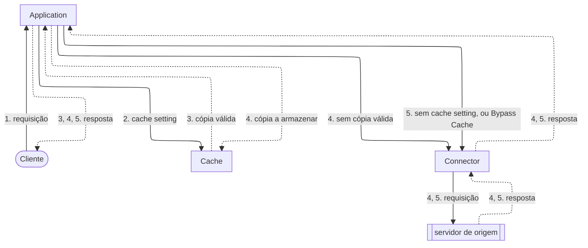

import DocButton from '~/components/webkit/DocButton.vue'
import DocCardGroup from '@aziontech/webkit/doc-card-group'
import DocCard from '@aziontech/webkit/doc-card'

**Cache** é um recurso da plataforma que armazena cópias das respostas da origem para as suas [Applications](/pt-br/documentacao/plataforma/applications/), no data center que buscou cada resposta. Um cache é um armazenamento de cópias de respostas entre os clientes e a origem, o servidor que guarda o conteúdo. Ele responde às requisições repetidas com essas cópias.

A primeira requisição por um objeto chega à origem, e o cache armazena a resposta sob uma key montada a partir da requisição. As requisições seguintes com a mesma key recebem a cópia armazenada. A cópia dura até que o seu tempo de vida (TTL), um período em segundos, termine. Assim, a origem responde apenas à primeira requisição e às que chegam depois que a cópia expira.

Cache vem ativo em toda Application nova. Ele armazena apenas as respostas que uma regra do [Rules Engine](/pt-br/documentacao/plataforma/applications/rules-engine/) seleciona com o behavior _Set Cache Policy_. Essa regra aplica um [cache setting](/pt-br/documentacao/plataforma/applications/cache/cache-settings/), que guarda os TTLs e decide como a Azion armazena e varia cada cópia. Use Cache para manter arquivos estáticos no data center mais próximo ao seu usuário, entregar vídeos grandes em fragmentos com a Large File Optimization, responder com uma cópia expirada por meio do stale cache enquanto a origem está fora do ar ou remover uma cópia com [Real-Time Purge](/pt-br/documentacao/plataforma/applications/cache/real-time-purge/) quando a origem muda.

<DocButton href="/pt-br/documentacao/plataforma/applications/cache/primeiros-passos/" label="Primeiros passos" size="medium" />
<DocButton href="/pt-br/documentacao/plataforma/applications/cache/cache-settings/" label="Referência do Cache" kind="secondary" size="medium" />

---

## Estrutura do cache setting

Cache age por meio de um cache setting. O setting guarda por quanto tempo a Azion e o browser mantêm uma cópia, o que a Azion faz com uma cópia expirada e o que torna duas requisições diferentes. Para manter cada resposta por 300 segundos no cache da Azion e por um dia no browser, envie este cache setting como corpo de `POST /v4/workspace/applications/<application-id>/cache_settings`:

```json
{
  "name": "static-assets",
  "browser_cache": { "behavior": "override", "max_age": 86400 },
  "modules": {
    "cache": {
      "behavior": "override",
      "max_age": 300,
      "stale_cache": { "enabled": true },
      "large_file_cache": { "enabled": true, "offset": 1024 },
      "tiered_cache": { "enabled": true, "topology": "nearest-region" }
    }
  }
}
```

- `browser_cache` decide o que o browser de um visitante mantém. `honor` repassa os headers `Cache-Control` e `Expires` da origem. `override` os substitui por `max_age`, em segundos. `no-cache` desativa o cache no browser.
- `modules.cache` decide o que a Azion mantém. Com `behavior` definido como `override`, `max_age` substitui os headers da origem. Em `honor`, a Azion mantém esses headers. Quando a origem não envia TTL, a Azion guarda a resposta por um TTL padrão.
- `stale_cache`, `large_file_cache` e `tiered_cache` ativam o stale cache, fragmentos de 1.024 kB e uma segunda camada de cache na região que `topology` nomeia. O stale cache pode entregar uma cópia expirada quando a Azion não consegue confirmar a cópia com a origem. Um corpo que deixa um desses três campos de fora recebe esse campo desativado. O `tiered_cache` também exige o behavior `override`.
- Um cache setting só age quando uma regra da Request Phase o aplica com `{ "type": "set_cache_policy", "attributes": { "value": <cache-setting-id> } }`. Você também pode montar o mesmo setting no Azion Console, como mostra [Primeiros passos com Cache](/pt-br/documentacao/plataforma/applications/cache/primeiros-passos/).

Se você define headers `Cache-Control` na sua origem, o modelo se mantém: `honor` os preserva e `override` os substitui.

---

## Caminho da requisição

Criar um cache setting não armazena nada em cache: uma requisição só chega a uma cópia armazenada por meio de uma regra que aplica o setting.

As setas sólidas levam a requisição, e as setas pontilhadas levam a resposta. Cada rótulo começa com o número do seu passo abaixo.



1. A requisição do cliente chega a uma Application, e as regras da Request Phase da Application são executadas em ordem.
2. Quando uma regra com _Set Cache Policy_ aplica um cache setting, Cache monta a cache key a partir da requisição e de cada variação que o setting nomeia.
3. Quando Cache tem uma cópia válida sob essa key, o data center que recebeu a requisição responde a partir dela. A resposta informa `HIT`.
4. Caso contrário, o Connector definido por uma regra com _Set Connector_ encaminha a requisição à origem, e a resposta informa `MISS`. Cache pode armazenar a resposta sob a key para as requisições seguintes.
5. Quando nenhuma regra aplica um cache setting, ou uma regra com _Bypass Cache_ corresponde à requisição, a requisição vai à origem sem passar por Cache. _Bypass Cache_ exige [Application Accelerator](/pt-br/documentacao/plataforma/applications/application-accelerator/). Com _Bypass Cache_, nada é armazenado, e a resposta informa `BYPASS`.

Uma cópia armazenada responde até que o seu TTL termine ou um purge a remova. O status volta no header `x-cache` da resposta a uma requisição enviada com `Pragma: azion-debug-cache`. Para cada status e os headers de debug, consulte [Cache keys](/pt-br/documentacao/plataforma/applications/cache/cache-keys/#status-de-cache).

Para TTL e expiração, stale cache, Large File Optimization, cache keys e variações, Tiered Cache e purge, consulte [Expiração e atualização](/pt-br/documentacao/plataforma/applications/cache/expiracao-e-atualizacao/).

---

## Escopo e limites

- **Application**: Cache vem ativo em toda Application nova, no campo `modules.cache.enabled` dela na API, e [Main Settings](/pt-br/documentacao/plataforma/applications/main-settings/#recursos-da-plataforma) mostra o switch dele no Azion Console. A nota desse switch diz `Automatically enabled in all accounts.` Uma Application nova não tem cache settings nem regras, então Cache começa a armazenar cópias quando uma regra com _Set Cache Policy_ aplica um cache setting.
- **Cópias expiradas**: com o stale cache ativo, no campo `modules.cache.stale_cache.enabled` de um cache setting, a Azion pode servir uma cópia expirada quando não consegue confirmar a cópia com a origem. A resposta então informa `STALE`. Um setting criado pela [Azion API](https://api.azion.com/) ou pela [Azion CLI](/pt-br/documentacao/devtools/cli/) vem com ele desativado, enquanto Azion Console o ativa em um setting novo. [Cache settings](/pt-br/documentacao/plataforma/applications/cache/cache-settings/#cache) mostra onde alterá-lo em cada interface. Para saber quando uma página antiga é melhor que um erro, consulte [Boas práticas de Applications](/pt-br/documentacao/plataforma/applications/boas-praticas/#cache).
- **Arquivos grandes**: a Large File Optimization, o campo `modules.cache.large_file_cache.enabled` de um cache setting, armazena em cache um objeto grande em fragmentos de 1.024 kB. Ela vem desativada em um cache setting novo. Cada fragmento é buscado quando um usuário chega a ele e armazenado sob uma key própria, então um purge do arquivo precisa nomear cada fragmento ou usar um wildcard.
- **Tiered Cache**: [Tiered Cache](/pt-br/documentacao/plataforma/applications/cache/tiered-cache/) é uma feature de Cache que adiciona uma segunda camada de cache entre o cache da Azion e a origem. Cada cache setting a ativa no seu campo `modules.cache.tiered_cache.enabled`, e todos os planos a incluem. Um data center que não tem uma cópia válida consulta essa camada antes de consultar a origem. Tiered Cache exige o behavior `override` e um TTL mínimo. Uma regra com _Bypass Cache_ age apenas sobre o cache da Azion, então a camada do Tiered Cache continua a armazenar objetos pelo TTL mínimo.
- **Keys e variação**: a Azion monta a [cache key](/pt-br/documentacao/plataforma/applications/cache/cache-keys/) padrão a partir do scheme, do host e do path, então um path é um objeto armazenado, e a query string fica fora da key. Variar uma cópia por query string, cookie, device group ou método exige [Application Accelerator](/pt-br/documentacao/plataforma/applications/application-accelerator/). [Image Processor](/pt-br/documentacao/plataforma/applications/image-processor/) acrescenta à key o formato de uma imagem convertida.
- **Purge**: [Real-Time Purge](/pt-br/documentacao/plataforma/applications/cache/real-time-purge/) é um recurso da plataforma que remove uma cópia armazenada antes do fim do seu TTL, por URL, por cache key ou por wildcard. A Azion coloca um purge em fila depois que você o confirma, porque o resultado leva tempo para se propagar. O purge aparece no histórico de purges quando termina. Uma cópia que varia por cookie, device group ou formato de imagem sobrevive a um purge por URL, e um purge por cache key ou por wildcard a alcança.
- **Código**: o código que lê e grava entradas em cache é executado em uma [Function](/pt-br/documentacao/plataforma/functions/) e chama [Cache API](/pt-br/documentacao/devtools/runtime/api-reference/cache/), porque o próprio Cache não pode executar código.
- **Interfaces**: você cria cache settings na aba **Cache Settings** de uma Application no Azion Console, pela Azion API em `/v4/workspace/applications/<application-id>/cache_settings` e com comandos da Azion CLI como `azion create cache-setting`. [`azion.config.js`](/pt-br/documentacao/devtools/cli/azion-config-js/) declara um setting como uma entrada do seu array `cache`, [Azion Lib](/pt-br/documentacao/devtools/azion-lib/application/) cria um com `createCacheSetting` e [Azion Terraform Provider](/pt-br/documentacao/devtools/terraform/applications/) gerencia um com o recurso `azion_application_cache_setting`. Um purge é enviado de **Real-Time Purge** no Azion Console, para `POST /v4/workspace/purge/<purge-type>` ou com `azion purge`.
- **Observabilidade**: uma requisição enviada com `Pragma: azion-debug-cache` recebe dois headers. O `x-cache` carrega o status de cache, e o `x-cache-key` carrega a key da cópia. [Real-Time Metrics](/pt-br/documentacao/plataforma/real-time-metrics/) mostra o tráfego de Cache e de Tiered Cache, e [Real-Time Events](/pt-br/documentacao/plataforma/real-time-events/) traz um dataset de Tiered Cache.
- **Limites**: um único objeto em cache pode chegar a 10 GB. O Max Age, o campo `modules.cache.max_age` de um cache setting, aceita de 60 segundos a um ano. Com Application Accelerator ativo, a Azion API aceita a partir de 0 segundos. Para cada limite de um cache setting, de um objeto e de um purge, consulte [Limites de Applications](/pt-br/documentacao/plataforma/applications/limites/#cache). Para os valores, consulte [Preços](/pt-br/documentacao/fundamentos/precos/#cache) e, para o que cada plano inclui, [Preços da Azion](https://www.azion.com/pt-br/precos/).
- **Termos**: o [glossário de Applications](/pt-br/documentacao/plataforma/applications/glossario/) define as palavras às quais as páginas de Cache dão um significado específico, como cache setting, cache key, status de cache e stale cache.

---

## Próximos passos

<DocCardGroup cols={2}>
  <DocCard title="Primeiros passos" href="/pt-br/documentacao/plataforma/applications/cache/primeiros-passos/" label="Armazene em cache o seu primeiro path e leia o status de cache da resposta dele." />
  <DocCard title="Expiração e atualização" href="/pt-br/documentacao/plataforma/applications/cache/expiracao-e-atualizacao/" label="Veja por quanto tempo uma cópia vive e o que a encerra antes do prazo ou a mantém depois do TTL." />
  <DocCard title="Cache settings" href="/pt-br/documentacao/plataforma/applications/cache/cache-settings/" label="Consulte um campo de um cache setting, com o padrão dele em cada interface." />
  <DocCard title="Guias e tutoriais" href="/pt-br/documentacao/plataforma/applications/guias/" label="Conclua uma tarefa específica, de uma política de cache a um purge." />
  <DocCard title="Limites" href="/pt-br/documentacao/plataforma/applications/limites/#cache" label="Consulte um limite e a resposta quando ele é ultrapassado." />
  <DocCard title="Solução de problemas" href="/pt-br/documentacao/plataforma/applications/solucao-de-problemas/#cache" label="Encontre a causa quando as respostas ficam em MISS ou um purge deixa uma cópia para trás." />
</DocCardGroup>
