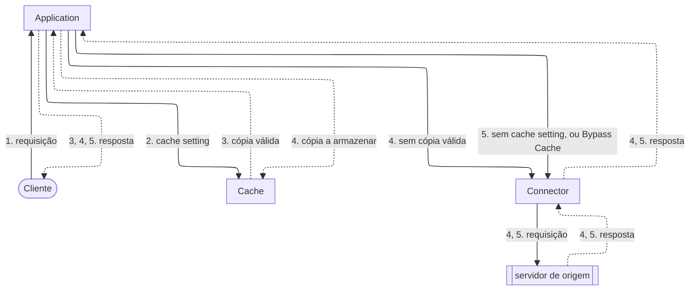

import DocButton from '~/components/webkit/DocButton.vue'
import DocCardGroup from '@aziontech/webkit/doc-card-group'
import DocCard from '@aziontech/webkit/doc-card'

**Cache** é um recurso da plataforma que armazena cópias das respostas às requisições recebidas pelas suas [Applications](/pt-br/documentacao/plataforma/applications/), do data center mais próximo ao seu usuário. Um cache é um armazenamento de cópias de respostas, entre os clientes e a origem, que responde às requisições repetidas sem consultar a origem. Cache também pode remover cópias armazenadas sob demanda com [Real-Time Purge](/pt-br/documentacao/plataforma/applications/cache/real-time-purge/). Use Cache para entregar arquivos estáticos, vídeos grandes em fragmentos e cópias expiradas se a origem falhar.

Em cada Application, Cache pode usar estes recursos aninhados e features:

- [Real-Time Purge](/pt-br/documentacao/plataforma/applications/cache/real-time-purge/) permite entregar uma atualização que a origem já tem antes do fim do tempo de vida (TTL) de uma cópia. Use-o para remover um objeto obsoleto ou para controlar o que a Azion entrega em conteúdo dinâmico.
- [Tiered Cache](/pt-br/documentacao/plataforma/applications/cache/tiered-cache/) permite que uma Application responda a um cache miss a partir de uma segunda camada de cache antes que a requisição chegue à origem. A origem então recebe menos requisições e lida com menos carga.

<DocButton href="/pt-br/documentacao/plataforma/applications/cache/primeiros-passos/" label="Primeiros passos" size="medium" />
<DocButton href="/pt-br/documentacao/plataforma/applications/cache/referencia/" label="Referência do Cache" kind="outlined" size="medium" />

---

## Caminho da requisição

Criar um cache setting não armazena nada: uma requisição só chega a uma cópia armazenada por meio de uma regra que aplica o setting. Um cache setting é um conjunto de valores que dizem ao Cache como armazenar e entregar uma resposta, como os seus TTLs. O próprio Cache está ativo em toda Application, então essa regra é o único passo de que uma cópia precisa.

As setas sólidas levam a requisição, e as setas pontilhadas levam a resposta. Cada rótulo começa com o número do seu passo abaixo.

1. A requisição do cliente chega a uma Application, e as regras da Request Phase da Application são executadas em ordem.
2. Quando uma regra com _Set Cache Policy_ aplica um cache setting, Cache monta a cache key a partir da requisição e de cada variação que o setting nomeia.
3. Quando Cache tem uma cópia válida sob essa key, o data center que recebeu a requisição responde a partir dela, porque cada cópia fica no data center que a armazenou. A resposta informa `HIT`.
4. Caso contrário, o Connector definido por uma regra com _Set Connector_ encaminha a requisição à origem, e a resposta informa `MISS`. Cache pode armazenar a resposta sob a key para as requisições seguintes.
5. Quando nenhuma regra aplica um cache setting, ou uma regra com _Bypass Cache_ corresponde à requisição, a requisição vai à origem sem passar por Cache. _Bypass Cache_ exige [Application Accelerator](/pt-br/documentacao/plataforma/applications/application-accelerator/). Com _Bypass Cache_, o cache da Azion não armazena nenhuma cópia, e a resposta informa `-` ou `BYPASS` em `x-cache`.

Uma cópia armazenada responde até que o seu TTL, um período em segundos, termine. Cache armazena uma resposta construída pela origem ou por uma [Function](/pt-br/documentacao/plataforma/functions/). O status volta no header `x-cache` da resposta a uma requisição enviada com `Pragma: azion-debug-cache`. Para cada status e os headers de debug, consulte [Cache keys](/pt-br/documentacao/plataforma/applications/cache/cache-keys/#status-de-cache).

---

## Próximos passos

<DocCardGroup cols={2}>
  <DocCard title="Primeiros passos" href="/pt-br/documentacao/plataforma/applications/cache/primeiros-passos/" label="Armazene em cache o seu primeiro path e leia o status de cache da resposta dele." />
  <DocCard title="Expiração e atualização" href="/pt-br/documentacao/plataforma/applications/cache/expiracao-e-atualizacao/" label="Veja por quanto tempo uma cópia vive e como stale cache, Large File Optimization e purges a alteram." />
  <DocCard title="Cache settings" href="/pt-br/documentacao/plataforma/applications/cache/cache-settings/" label="Consulte um campo de um cache setting, com o padrão dele em cada interface." />
  <DocCard title="Cache keys" href="/pt-br/documentacao/plataforma/applications/cache/cache-keys/" label="Leia como uma requisição vira uma cache key e o que cada status de cache significa." />
  <DocCard title="Guias e tutoriais" href="/pt-br/documentacao/plataforma/applications/guias/" label="Conclua uma tarefa específica, de uma política de cache a um purge." />
  <DocCard title="Limites" href="/pt-br/documentacao/plataforma/applications/limites/#cache" label="Consulte um limite, a resposta quando ele é ultrapassado e onde Cache para." />
  <DocCard title="Solução de problemas" href="/pt-br/documentacao/plataforma/applications/solucao-de-problemas/#cache" label="Encontre a causa quando as respostas ficam em MISS ou um purge deixa uma cópia para trás." />
  <DocCard title="Glossário" href="/pt-br/documentacao/plataforma/applications/glossario/" label="Consulte uma palavra que as páginas de Cache usam em um sentido específico, como cache setting ou stale cache." />
</DocCardGroup>
