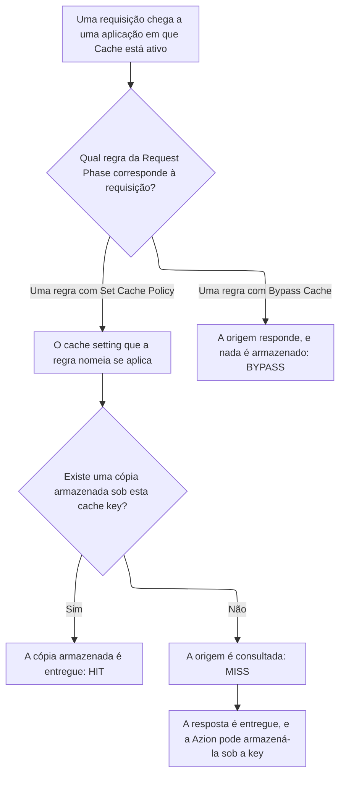

import DocButton from '~/components/webkit/DocButton.vue'
import DocCardGroup from '@aziontech/webkit/doc-card-group'
import DocCard from '@aziontech/webkit/doc-card'

Um cache mantém uma cópia de uma resposta para que o servidor que guarda o conteúdo, a origem, não responda a cada requisição por ele. A primeira requisição por um objeto chega à origem, e o cache armazena a resposta sob uma key montada a partir da requisição. As requisições seguintes que produzem a mesma key recebem a cópia armazenada até que o tempo de vida (TTL) dela termine. Assim, a origem responde apenas à primeira requisição e às que chegam depois que a cópia expira.

**Cache** mantém essas cópias para uma [aplicação](/pt-br/documentacao/plataforma/applications/), no data center que buscou cada resposta. Ele vem ativo em toda aplicação nova e armazena as respostas das requisições que correspondem a uma regra da Request Phase com o behavior _Set Cache Policy_. Essa regra nomeia um cache setting, o objeto que guarda os TTLs. Use Cache para manter arquivos estáticos perto dos usuários, entregar vídeos grandes em fragmentos, responder com a origem fora do ar ou remover uma cópia quando a origem muda.

<DocButton href="/pt-br/documentacao/plataforma/applications/cache/primeiros-passos/" label="Primeiros passos" size="medium" />
<DocButton href="/pt-br/documentacao/plataforma/applications/cache/cache-settings/" label="Referência do Cache" kind="secondary" size="medium" />

---

## Estrutura do cache setting

Cache age por meio de um cache setting. O setting guarda por quanto tempo a Azion e o browser mantêm uma cópia e o que a Azion faz com ela em torno desse tempo. Este cache setting mantém cada resposta por 300 segundos no cache da Azion e por um dia no browser, enviado como corpo de `POST /v4/workspace/applications/<application-id>/cache_settings`:

```json
{
  "name": "static-assets",
  "browser_cache": { "behavior": "override", "max_age": 86400 },
  "modules": {
    "cache": {
      "behavior": "override",
      "max_age": 300,
      "stale_cache": { "enabled": true },
      "large_file_cache": { "enabled": true, "offset": 1024 },
      "tiered_cache": { "enabled": true, "topology": "nearest-region" }
    }
  }
}
```

- `browser_cache` decide o que o browser de um visitante mantém. `honor` repassa os headers `Cache-Control` e `Expires` que a origem envia, `override` os substitui por `max_age`, em segundos, e `no-cache` desativa o cache no browser.
- `modules.cache` decide o que a Azion mantém. Com `behavior` definido como `override`, `max_age` substitui os headers da origem. Em `honor`, a Azion mantém esses headers e guarda uma resposta cuja origem não envia TTL por um TTL padrão.
- `stale_cache`, `large_file_cache` e `tiered_cache` ativam o stale cache, fragmentos de 1.024 kB e uma segunda camada de cache na região que `topology` nomeia. Um corpo que deixa um deles de fora o recebe desativado, e `tiered_cache` exige o behavior `override`.
- Um cache setting não armazena nada sozinho: uma regra da Request Phase o aplica com `{ "type": "set_cache_policy", "attributes": { "value": <cache-setting-id> } }`. [Azion Console](https://console.azion.com) monta o mesmo setting a partir de **+ Cache** na aba **Cache Settings** de uma aplicação.

Se você define headers `Cache-Control` na sua origem, o modelo se mantém: `honor` os preserva e `override` os substitui.

---

## Caminho da requisição

Uma requisição chega a uma cópia em cache por uma cadeia de objetos. Este diagrama mostra a cadeia, da requisição até a cópia armazenada ou até a origem:



1. Uma regra da Request Phase corresponde à requisição e aplica um cache setting por meio de _Set Cache Policy_.
2. A Azion monta a cache key a partir da requisição e de cada variação que o setting nomeia.
3. Quando há uma cópia armazenada sob essa key, o data center que recebeu a requisição responde a partir dela, e a resposta informa `HIT`.
4. Caso contrário, a requisição vai à origem, a resposta informa `MISS` e a Azion pode armazenar a resposta para as requisições seguintes.
5. A cópia responde até que o seu TTL termine, um purge a remova ou uma regra envie a requisição para fora do cache.

Uma regra com _Bypass Cache_, em vez disso, envia as suas requisições à origem, nada é armazenado e a resposta informa `BYPASS`. O status volta no header `x-cache` da resposta a uma requisição enviada com `Pragma: azion-debug-cache`. Para cada status e os headers de debug, consulte [Cache keys](/pt-br/documentacao/plataforma/applications/cache/cache-keys/#status-de-cache).

Para TTL e expiração, stale cache, Large File Optimization, cache keys e variações, Tiered Cache e purge, consulte [Expiração e atualização](/pt-br/documentacao/plataforma/applications/cache/expiracao-e-atualizacao/).

---

## Escopo e limites

- **Aplicação**: Cache vem ativo em toda aplicação nova, em que `modules.cache.enabled` mostra `true`. O switch dele em [Main Settings](/pt-br/documentacao/plataforma/applications/main-settings/#produtos) › **Modules** carrega a nota `Automatically enabled in all accounts.` Uma aplicação nova não tem cache settings nem regras, então Cache não armazena nada até que uma regra com _Set Cache Policy_ nomeie um cache setting.
- **Cópias expiradas**: com **Stale cache** ativo, a Azion pode servir uma cópia expirada quando uma revalidação com a origem falha, e a resposta informa `STALE`. Um setting criado pela [Azion API](https://api.azion.com/) ou pela [Azion CLI](/pt-br/documentacao/devtools/cli/) vem com ele desativado, enquanto Azion Console o ativa em um setting novo. Para saber quando uma página antiga é melhor que um erro, consulte [Boas práticas de Applications](/pt-br/documentacao/plataforma/applications/boas-praticas/#cache).
- **Arquivos grandes**: **Large file optimization** armazena em cache um objeto grande em fragmentos de 1.024 kB, cada um buscado quando um usuário chega a ele e armazenado sob uma key própria. Um purge do arquivo precisa, portanto, nomear cada fragmento ou usar um wildcard.
- **Tiered Cache**: [Tiered Cache](/pt-br/documentacao/plataforma/applications/cache/tiered-cache/) adiciona uma segunda camada de cache entre o cache da Azion e a origem, ativada por cache setting e incluída em todos os planos. Um data center que não tem uma cópia válida consulta essa camada antes de consultar a origem. Ela exige _Override cache behavior_ e um TTL mínimo, e uma regra com _Bypass Cache_ não a alcança.
- **Keys e variação**: a Azion monta a [cache key](/pt-br/documentacao/plataforma/applications/cache/cache-keys/) padrão a partir do scheme, do host e do path. Um path é, portanto, um objeto armazenado, e a query string fica fora da key. Variar uma cópia por query string, cookie, device group ou método exige [Application Accelerator](/pt-br/documentacao/plataforma/applications/application-accelerator/). [Image Processor](/pt-br/documentacao/plataforma/applications/image-processor/) acrescenta à key o formato de uma imagem convertida.
- **Purge**: [Real-Time Purge](/pt-br/documentacao/plataforma/applications/cache/real-time-purge/) remove uma cópia armazenada antes do fim do seu TTL, por URL, por cache key ou por wildcard. A Azion coloca um purge em fila depois que você o confirma, porque o resultado leva tempo para se propagar. O purge aparece no histórico de purges quando termina. Um purge por URL não alcança uma cópia que varia por cookie, device group ou formato de imagem.
- **Código**: Cache não executa código, então uma função que lê e grava entradas em cache chama [Cache API](/pt-br/documentacao/devtools/runtime/api-reference/cache/).
- **Interfaces**: você cria cache settings na aba **Cache Settings** de uma aplicação no Azion Console, pela Azion API em `/v4/workspace/applications/<application-id>/cache_settings` e com comandos da Azion CLI como `azion create cache-setting`. [`azion.config.js`](/pt-br/documentacao/devtools/cli/azion-config-js/) declara um setting como uma entrada do seu array `cache`, [Azion Lib](/pt-br/documentacao/devtools/azion-lib/application/) cria um com `createCacheSetting` e [Azion Terraform Provider](/pt-br/documentacao/devtools/terraform/applications/) gerencia um com o recurso `azion_application_cache_setting`. Um purge é enviado de **Real-Time Purge** no Azion Console, para `POST /v4/workspace/purge/<purge-type>` ou com `azion purge`.
- **Observabilidade**: uma requisição enviada com `Pragma: azion-debug-cache` recebe `x-cache`, que carrega o status de cache, e `x-cache-key`, que carrega a key que indexa a cópia. [Real-Time Metrics](/pt-br/documentacao/plataforma/real-time-metrics/) mostra o tráfego de Cache e de Tiered Cache, e [Real-Time Events](/pt-br/documentacao/plataforma/real-time-events/) traz um dataset de Tiered Cache.
- **Limites**: um único objeto em cache pode chegar a 10 GB. **Max Age** aceita de 60 segundos a um ano, e a partir de 0 segundos com Application Accelerator. Para cada limite de um cache setting, de um objeto e de um purge, e o que cada plano inclui, consulte [Limites de Applications](/pt-br/documentacao/plataforma/applications/limites/#cache) e, para os valores, [Preços](/pt-br/documentacao/fundamentos/precos/#cache).
- **Termos**: o [glossário de Applications](/pt-br/documentacao/plataforma/applications/glossario/) define as palavras às quais as páginas de Cache dão um significado específico, como cache setting, cache key, status de cache e stale cache.

---

## Próximos passos

<DocCardGroup cols={2}>
  <DocCard title="Primeiros passos" href="/pt-br/documentacao/plataforma/applications/cache/primeiros-passos/" label="Armazene em cache o seu primeiro path e leia o status de cache da resposta dele." />
  <DocCard title="Expiração e atualização" href="/pt-br/documentacao/plataforma/applications/cache/expiracao-e-atualizacao/" label="Veja por quanto tempo uma cópia vive e o que a encerra antes do prazo ou a mantém depois do TTL." />
  <DocCard title="Cache settings" href="/pt-br/documentacao/plataforma/applications/cache/cache-settings/" label="Consulte um campo de um cache setting, com o padrão dele em cada interface." />
  <DocCard title="Guias e tutoriais" href="/pt-br/documentacao/plataforma/applications/guias/" label="Conclua uma tarefa específica, de uma política de cache a um purge." />
  <DocCard title="Limites" href="/pt-br/documentacao/plataforma/applications/limites/#cache" label="Consulte um limite, a resposta quando ele é ultrapassado ou o que um plano inclui." />
  <DocCard title="Solução de problemas" href="/pt-br/documentacao/plataforma/applications/solucao-de-problemas/#cache" label="Encontre a causa quando as respostas ficam em MISS ou um purge deixa uma cópia para trás." />
</DocCardGroup>
