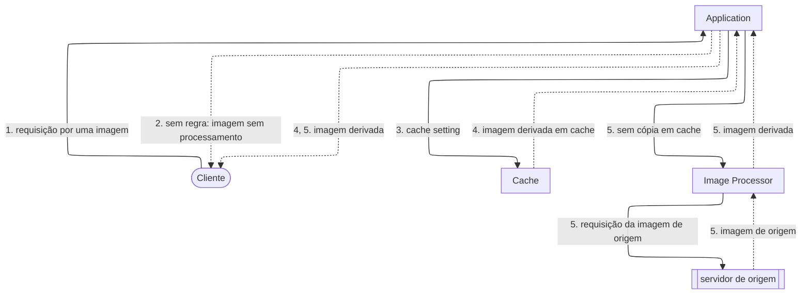

import DocButton from '~/components/webkit/DocButton.vue'
import DocCardGroup from '@aziontech/webkit/doc-card-group'
import DocCard from '@aziontech/webkit/doc-card'

**Image Processor** é um recurso da plataforma que constrói uma imagem nova, a imagem derivada, a partir de uma imagem na origem de uma [Application](/pt-br/documentacao/plataforma/applications/). A transformação de imagens sob demanda é um modelo de entrega em que o servidor constrói cada variante de uma imagem quando uma URL a pede. A URL descreve a variante, como uma largura, um recorte, uma qualidade ou um formato. Cada variante vem do único original, então o original é o único arquivo que você armazena e atualiza.

Em uma Application, Image Processor lê a imagem de origem, o arquivo na origem, sem alterá-la. A query string `ims` da requisição descreve a imagem derivada, como `?ims=fit-in/400x400`. Image Processor processa somente as requisições às quais uma regra da Request Phase com o behavior _Optimize Images_ corresponde, e você escreve essa regra no [Rules Engine](/pt-br/documentacao/plataforma/applications/rules-engine/) da Application. Use Image Processor para entregar uma imagem em vários tamanhos, recortes, qualidades ou formatos, como WEBP para os navegadores que o aceitam, sem um arquivo por variante.

<DocButton href="/pt-br/documentacao/plataforma/applications/image-processor/primeiros-passos/" label="Primeiros passos" size="medium" />
<DocButton href="/pt-br/documentacao/plataforma/applications/image-processor/parametros-de-url/" label="Referência do Image Processor" kind="secondary" size="medium" />

---

## Estrutura da regra

Image Processor age por meio de uma regra da Request Phase que carrega o behavior _Optimize Images_. Para processar cada requisição por um path de imagem e armazenar em cache cada imagem derivada, envie esta regra como corpo de `POST /v4/workspace/applications/<application-id>/request_rules`:

```json
{
  "name": "Optimize images",
  "description": "Apply the cache setting and optimize images",
  "active": true,
  "criteria": [
    [
      {
        "conditional": "if",
        "variable": "${request_uri}",
        "operator": "matches",
        "argument": "\\.(jpg|jpeg|gif|bmp|png|ico|webp|avif)"
      }
    ]
  ],
  "behaviors": [
    { "type": "set_cache_policy", "attributes": { "value": <cache-setting-id> } },
    { "type": "optimize_images" }
  ]
}
```

- `criteria` compara o path com uma lista de extensões de imagem por meio de `matches`. `${request_uri}` exige [Application Accelerator](/pt-br/documentacao/plataforma/applications/application-accelerator/), e `${uri}` corresponde aos mesmos paths sem ele.
- `optimize_images` não recebe atributos e marca a requisição para Image Processor. Ele exige Image Processor ativo na Application que executa a regra.
- `set_cache_policy` aplica o cache setting cujo ID está em `attributes.value`, e esse cache setting armazena cada imagem derivada. Com `ims` nos `fields` da allowlist `cache_vary_by_querystring` dele, cada string `ims` distinta recebe uma cache key própria. Esse campo pertence ao Application Accelerator, então exige Application Accelerator ativo.
- Cada requisição então carrega a sua transformação na URL, como `?ims=400x`. Uma resposta processada carrega `x-ims: Enabled`, e `x-original-image-size` carrega o tamanho da imagem de origem antes da transformação.

---

## Caminho da requisição

Uma query string `ims` não transforma uma imagem por si só: uma transformação só acontece quando uma regra da Request Phase aplica o behavior [Optimize Images](/pt-br/documentacao/plataforma/applications/rules-engine/#optimize-images) à requisição. Ativar Image Processor em uma Application apenas disponibiliza esse behavior para as regras dela.

As setas sólidas levam a requisição, e as setas pontilhadas levam a resposta. Cada rótulo começa com o número do seu passo abaixo.



1. Uma requisição para um path que contém uma imagem chega à Application, que executa as suas regras da Request Phase. Uma regra para imagens compara `${uri}`, ou `${request_uri}` com Application Accelerator ativo, com um argumento como `\.(jpg|jpeg|gif|bmp|png|ico|webp|avif)`.
2. Quando nenhuma regra com _Optimize Images_ corresponde à requisição, a imagem de origem é entregue sem processamento, mesmo quando a requisição carrega `ims`.
3. Uma regra que corresponde à requisição aplica os seus behaviors. _Optimize Images_ marca a requisição para Image Processor. Quando a regra também carrega _Set Cache Policy_, esse behavior aplica o cache setting que guarda a imagem derivada. Uma regra pode carregar _Optimize Images_ sozinho, porque o behavior não recebe argumento.
4. Quando a imagem derivada já está em cache, Cache a entrega sem processamento.
5. Caso contrário, Image Processor lê a imagem de origem a partir da origem e aplica a query string `ims` a ela. A imagem derivada é entregue e armazenada em cache.

Quando uma regra corresponde a um path sem nenhuma imagem, ela é executada mesmo assim, então são os critérios da regra que decidem quais requisições são marcadas para Image Processor. Para criar essa regra passo a passo, consulte [Configure Image Processor em uma aplicação](/pt-br/documentacao/guias/performance-e-confiabilidade/otimizacao-de-entrega/processar-imagens/).

Para saber como o formato entregue é escolhido, como o cache diferencia as imagens derivadas e onde Image Processor para, consulte [Entrega de imagens](/pt-br/documentacao/plataforma/applications/image-processor/entrega-de-imagens/).

---

## Escopo e limites

- **Application**: Image Processor vem desativado em uma Application nova, e cada Application o ativa separadamente, no seu campo `modules.image_processor.enabled` na API. Mesmo ativo, Image Processor processa somente as requisições às quais uma regra com _Optimize Images_ corresponde. [Main Settings](/pt-br/documentacao/plataforma/applications/main-settings/#recursos-da-plataforma) mostra onde ativá-lo no Azion Console e na API.
- **Operações**: uma string `ims` pode carregar um redimensionamento, um recorte e uma cadeia de filtros. As operações são redimensionamento, recorte, rotação, qualidade, marca d'água, conversão de formato e preenchimento, e `fit-in` encaixa uma imagem em uma área sem ampliá-la. Para a sintaxe e os valores que cada uma aceita, consulte [Parâmetros de URL](/pt-br/documentacao/plataforma/applications/image-processor/parametros-de-url/).
- **Posição do parâmetro**: `ims` precisa ser o último parâmetro da URL. Uma requisição com outro parâmetro de query string depois dele pode retornar `504`.
- **Formatos**: Image Processor lê JPEG, GIF, PNG, BMP, ICO, WEBP e AVIF. Mesmo sem nenhum parâmetro `ims`, ele pode converter uma imagem para um formato que o navegador aceita, como WEBP ou AVIF, e converte uma imagem BMP para JPEG ou WEBP. Uma conversão para WEBP ou AVIF que um filtro pede exige `Accept: image/webp` ou `Accept: image/avif`, que o behavior _Add Request Header_ pode acrescentar. Para saber como o formato entregue é escolhido, consulte [Entrega de imagens](/pt-br/documentacao/plataforma/applications/image-processor/entrega-de-imagens/#negociacao-de-formato).
- **Cache**: quando `ims` está na allowlist do cache setting, cada string `ims` distinta, em cada formato entregue, é um objeto armazenado separado. Uma página que pede quatro larguras fixas armazena quatro objetos por formato entregue, enquanto uma página que pede larguras arbitrárias armazena um por largura e formato. Quando uma imagem derivada já está em cache, ela é entregue sem processamento. Para as práticas, consulte [Boas práticas de Applications](/pt-br/documentacao/plataforma/applications/boas-praticas/#image-processor).
- **Armazenamento**: Image Processor retorna cada imagem derivada sem salvá-la como um ativo da conta, e não é possível fazer upload de imagens para Image Processor. O cache guarda as imagens derivadas, e a imagem de origem permanece onde já está. Um workflow que precisa manter um arquivo transformado salva a resposta por conta própria.
- **Vizinhos**: [WASM Image Processor](/pt-br/documentacao/devtools/azion-lib/wasm-image-processor/) é uma biblioteca WebAssembly que processa imagens dentro de uma [Function](/pt-br/documentacao/plataforma/functions/). Ela é executada no código dessa Function, separada do recurso da plataforma Image Processor e das configurações dele.
- **Interfaces**: você ativa Image Processor na aba **Main Settings** de uma Application no [Azion Console](https://console.azion.com) e pela [Azion API](https://api.azion.com/) em `/v4/workspace/applications/<application-id>`. [Azion CLI](/pt-br/documentacao/devtools/cli/) o define com `--image-processor` em `azion create application` ou `azion update application`. [`azion.config.js`](/pt-br/documentacao/devtools/cli/azion-config-js/) e [Azion Lib](/pt-br/documentacao/devtools/azion-lib/) o definem com `imageProcessorEnabled`. Para cada campo, flag, behavior e header, consulte [Configurações do Image Processor](/pt-br/documentacao/plataforma/applications/image-processor/configuracoes/).
- **Observabilidade**: no Azion Console, [Real-Time Metrics](/pt-br/documentacao/plataforma/real-time-metrics/) tem uma aba **Image Processor** com gráficos de requisições, e [Real-Time Events](/pt-br/documentacao/plataforma/real-time-events/) tem um dataset **Image Processor**, que exige Image Processor ativo.
- **Limites**: uma imagem aceita até 150 MB, 3840 pixels de largura e 2160 pixels de altura. Para cada limite, consulte [Limites de Applications](/pt-br/documentacao/plataforma/applications/limites/#image-processor) e, para os valores, [Preços](/pt-br/documentacao/fundamentos/precos/#image-processor). A página [Preços da Azion](https://www.azion.com/pt-br/precos/) lista o que cada plano inclui.
- **Termos**: o [glossário de Applications](/pt-br/documentacao/plataforma/applications/glossario/) define as palavras às quais as páginas do Image Processor dão um significado específico, como imagem derivada, imagem de origem, recorte automático e `fit-in`.

---

## Próximos passos

<DocCardGroup cols={2}>
  <DocCard title="Primeiros passos" href="/pt-br/documentacao/plataforma/applications/image-processor/primeiros-passos/" label="Requisite a sua primeira imagem derivada a partir de uma Application." />
  <DocCard title="Entrega de imagens" href="/pt-br/documentacao/plataforma/applications/image-processor/entrega-de-imagens/" label="Veja como o formato entregue é escolhido, como o cache separa as imagens derivadas e onde Image Processor para." />
  <DocCard title="Parâmetros de URL" href="/pt-br/documentacao/plataforma/applications/image-processor/parametros-de-url/" label="Consulte uma operação da query string ims e os valores que ela aceita." />
  <DocCard title="Guias e tutoriais" href="/pt-br/documentacao/plataforma/applications/guias/" label="Conclua uma tarefa específica, do processamento de imagens à consulta do uso delas." />
  <DocCard title="Limites" href="/pt-br/documentacao/plataforma/applications/limites/#image-processor" label="Consulte os limites de uma imagem." />
  <DocCard title="Solução de problemas" href="/pt-br/documentacao/plataforma/applications/solucao-de-problemas/#image-processor" label="Encontre a causa quando uma imagem volta sem processamento ou no formato errado." />
</DocCardGroup>
