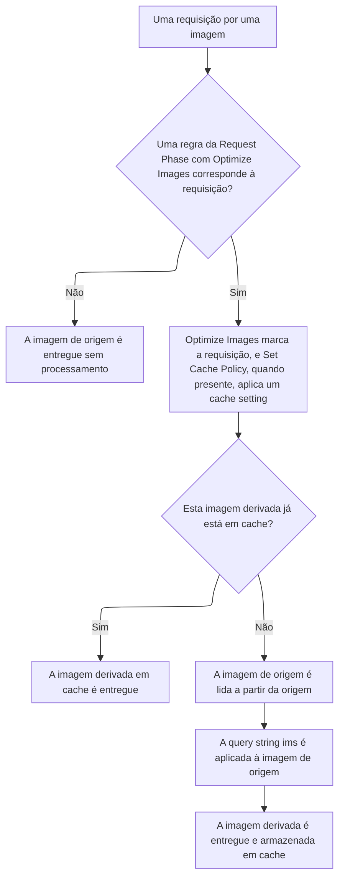

import DocButton from '~/components/webkit/DocButton.vue'
import DocCardGroup from '@aziontech/webkit/doc-card-group'
import DocCard from '@aziontech/webkit/doc-card'

Transformar uma imagem sob demanda constrói cada variante quando uma requisição a pede, e não com antecedência. A URL descreve a variante, como uma largura, um recorte, uma qualidade ou um formato, e o servidor a constrói a partir de um único arquivo original. Nenhuma variante precisa ser construída, armazenada ou reconstruída com antecedência, porque cada uma vem desse único original quando é pedida.

**Image Processor** constrói essa variante, a imagem derivada, a partir da imagem de origem que está no servidor de origem de uma [aplicação](/pt-br/documentacao/plataforma/applications/). A query string `ims` da requisição a descreve, como `?ims=fit-in/400x400`, e a imagem de origem nunca é modificada. Ele roda nas requisições que uma regra da Request Phase com o behavior _Optimize Images_ entrega a ele. Use Image Processor para entregar uma imagem em vários tamanhos, recortes, qualidades ou formatos, como WEBP para os browsers que o aceitam, sem um arquivo por variante.

<DocButton href="/pt-br/documentacao/plataforma/applications/image-processor/primeiros-passos/" label="Primeiros passos" size="medium" />
<DocButton href="/pt-br/documentacao/plataforma/applications/image-processor/parametros-de-url/" label="Referência do Image Processor" kind="secondary" size="medium" />

---

## Estrutura da regra

Image Processor age por meio de uma regra da Request Phase que carrega o behavior _Optimize Images_. Esta regra entrega ao Image Processor cada requisição por um path de imagem e aplica o cache setting que armazena cada imagem derivada. Ela é enviada como corpo de `POST /v4/workspace/applications/<application-id>/request_rules`:

```json
{
  "name": "Optimize images",
  "description": "Apply the cache setting and optimize images",
  "active": true,
  "criteria": [
    [
      {
        "conditional": "if",
        "variable": "${request_uri}",
        "operator": "matches",
        "argument": "\\.(jpg|jpeg|gif|bmp|png|ico|webp|avif)"
      }
    ]
  ],
  "behaviors": [
    { "type": "set_cache_policy", "attributes": { "value": <cache-setting-id> } },
    { "type": "optimize_images" }
  ]
}
```

- `criteria` compara o path com uma lista de extensões de imagem por meio de `matches`. `${request_uri}` exige [Application Accelerator](/pt-br/documentacao/plataforma/applications/application-accelerator/), e `${uri}` corresponde aos mesmos paths sem ele.
- `optimize_images` não recebe atributos e marca a requisição para Image Processor. Ele exige Image Processor ativo na aplicação que executa a regra.
- `set_cache_policy` nomeia o cache setting que armazena cada imagem derivada. Com `ims` na allowlist do controle **Cache vary by Query String** desse setting, cada string `ims` distinta recebe uma cache key própria. Esse controle exige Application Accelerator.
- Cada requisição então carrega a sua transformação na URL, como `?ims=400x`. Uma resposta processada carrega `x-ims: Enabled`, e `x-original-image-size` carrega o tamanho da imagem de origem antes da transformação.

---

## Caminho da requisição

Uma transformação não acontece porque uma query string `ims` está presente. Ela acontece porque uma regra da Request Phase foi executada e aplicou o behavior [Optimize Images](/pt-br/documentacao/plataforma/applications/rules-engine/#optimize-images) à requisição. Ativar Image Processor disponibiliza esse behavior, e ele não processa nada sozinho.

Este diagrama mostra a cadeia, de uma requisição por uma imagem até a imagem derivada:



1. Uma requisição chega para um path que contém uma imagem.
2. A aplicação executa as suas regras da Request Phase. Uma regra para imagens compara `${uri}`, ou `${request_uri}` com Application Accelerator ativo, com um argumento como `\.(jpg|jpeg|gif|bmp|png|ico|webp|avif)`.
3. Uma regra que corresponde à requisição aplica os seus behaviors. _Optimize Images_ marca a requisição para Image Processor, e _Set Cache Policy_, quando a regra o carrega, escolhe o cache setting que guarda a imagem derivada. Uma regra pode carregar _Optimize Images_ sozinho, porque o behavior não recebe argumento.
4. Quando a imagem derivada já está em cache, o cache a entrega, e nenhum processamento acontece.
5. Caso contrário, a imagem de origem é lida a partir da origem, a query string `ims` é aplicada a ela, e o resultado é entregue e armazenado.

Duas consequências decorrem do passo 2, e as duas surpreendem quem espera que a query string sozinha faça o trabalho. Uma requisição que não corresponde a nenhuma regra é entregue sem processamento, mesmo quando carrega `ims`. Quando uma regra corresponde a um path sem nenhuma imagem, ela é executada mesmo assim, então são os critérios que decidem quais requisições chegam ao Image Processor. Para a regra que envia requisições de imagens ao Image Processor, consulte [Configure Image Processor em uma aplicação](/pt-br/documentacao/guias/performance-e-confiabilidade/otimizacao-de-entrega/processar-imagens/).

Para saber como o formato entregue é escolhido, como o cache diferencia as imagens derivadas e onde Image Processor para, consulte [Entrega de imagens](/pt-br/documentacao/plataforma/applications/image-processor/entrega-de-imagens/).

---

## Escopo e limites

- **Aplicação**: Image Processor vem desativado em uma aplicação nova, e ativá-lo não processa nada por si só. O toggle dele em [Main Settings](/pt-br/documentacao/plataforma/applications/main-settings/#produtos) › **Modules** define `modules.image_processor.enabled`, e uma regra com _Optimize Images_ decide quais requisições chegam a ele.
- **Operações**: uma string `ims` pode carregar um redimensionamento, um recorte e uma cadeia de filtros. As operações são redimensionamento, recorte, rotação, qualidade, marca d'água, conversão de formato e preenchimento, e `fit-in` encaixa uma imagem em uma área sem ampliá-la. Para a sintaxe e os valores que cada uma aceita, consulte [Parâmetros de URL](/pt-br/documentacao/plataforma/applications/image-processor/parametros-de-url/).
- **Posição do parâmetro**: `ims` precisa ser o último parâmetro da URL. Uma requisição com outro parâmetro de query string depois dele pode retornar `504`.
- **Formatos**: Image Processor lê JPEG, GIF, PNG, BMP, ICO, WEBP e AVIF. Sem nenhum parâmetro `ims`, ele converte uma imagem para WEBP para um browser que aceita o formato, e uma imagem BMP para JPEG ou WEBP. Uma conversão para WEBP ou AVIF que um filtro pede exige `Accept: image/webp` ou `Accept: image/avif`, que o behavior _Add Request Header_ pode acrescentar. Para saber como o formato entregue é escolhido, consulte [Entrega de imagens](/pt-br/documentacao/plataforma/applications/image-processor/entrega-de-imagens/#negociacao-de-formato).
- **Cache**: quando `ims` está na allowlist do cache setting, cada string `ims` distinta é um objeto armazenado separado. Uma página que pede quatro larguras fixas armazena quatro objetos, enquanto uma página que pede larguras arbitrárias armazena um por largura. Quando uma imagem derivada já está em cache, ela é entregue sem processamento. Para as práticas, consulte [Boas práticas de Applications](/pt-br/documentacao/plataforma/applications/boas-praticas/#image-processor).
- **Armazenamento**: Image Processor não armazena imagens e não aceita uploads. A imagem de origem permanece onde já está, e nenhuma imagem derivada se torna um ativo da conta. Um workflow que precisa manter um arquivo transformado salva a resposta por conta própria.
- **Produtos vizinhos**: [WASM Image Processor](/pt-br/documentacao/devtools/azion-lib/wasm-image-processor/) é uma biblioteca WebAssembly que processa imagens dentro de uma função em [Functions](/pt-br/documentacao/plataforma/functions/). É uma superfície diferente, com uma interface diferente, e nenhuma configuração do Image Processor a configura.
- **Interfaces**: você ativa Image Processor na aba **Main Settings** de uma aplicação no [Azion Console](https://console.azion.com) e pela [Azion API](https://api.azion.com/) em `/v4/workspace/applications/<application-id>`. [Azion CLI](/pt-br/documentacao/devtools/cli/) o define com `--image-processor` em `azion create application` ou `azion update application`. [`azion.config.js`](/pt-br/documentacao/devtools/cli/azion-config-js/) e [Azion Lib](/pt-br/documentacao/devtools/azion-lib/) o definem com `imageProcessorEnabled`. Para cada campo, flag, behavior e header, consulte [Configurações do Image Processor](/pt-br/documentacao/plataforma/applications/image-processor/configuracoes/).
- **Observabilidade**: [Real-Time Metrics](/pt-br/documentacao/plataforma/real-time-metrics/) tem uma aba **Image Processor** com gráficos de requisições, e [Real-Time Events](/pt-br/documentacao/plataforma/real-time-events/) tem um dataset **Image Processor**, que exige Image Processor ativo.
- **Limites**: uma imagem aceita até 150 MB, 3840 pixels de largura e 2160 pixels de altura. Para cada limite e o que cada plano inclui, consulte [Limites de Applications](/pt-br/documentacao/plataforma/applications/limites/#image-processor) e, para os valores, [Preços](/pt-br/documentacao/fundamentos/precos/#image-processor).
- **Termos**: o [glossário de Applications](/pt-br/documentacao/plataforma/applications/glossario/) define as palavras às quais as páginas do Image Processor dão um significado específico, como imagem derivada, imagem de origem, recorte automático e `fit-in`.

---

## Próximos passos

<DocCardGroup cols={2}>
  <DocCard title="Primeiros passos" href="/pt-br/documentacao/plataforma/applications/image-processor/primeiros-passos/" label="Requisite a sua primeira imagem derivada a partir de uma aplicação." />
  <DocCard title="Entrega de imagens" href="/pt-br/documentacao/plataforma/applications/image-processor/entrega-de-imagens/" label="Veja como o formato entregue é escolhido, como o cache separa as imagens derivadas e onde Image Processor para." />
  <DocCard title="Parâmetros de URL" href="/pt-br/documentacao/plataforma/applications/image-processor/parametros-de-url/" label="Consulte uma operação da query string ims e os valores que ela aceita." />
  <DocCard title="Guias e tutoriais" href="/pt-br/documentacao/plataforma/applications/guias/" label="Conclua uma tarefa específica, do processamento de imagens à consulta do uso delas." />
  <DocCard title="Limites" href="/pt-br/documentacao/plataforma/applications/limites/#image-processor" label="Consulte os limites de uma imagem ou o que um plano inclui." />
  <DocCard title="Solução de problemas" href="/pt-br/documentacao/plataforma/applications/solucao-de-problemas/#image-processor" label="Encontre a causa quando uma imagem volta sem processamento ou no formato errado." />
</DocCardGroup>
