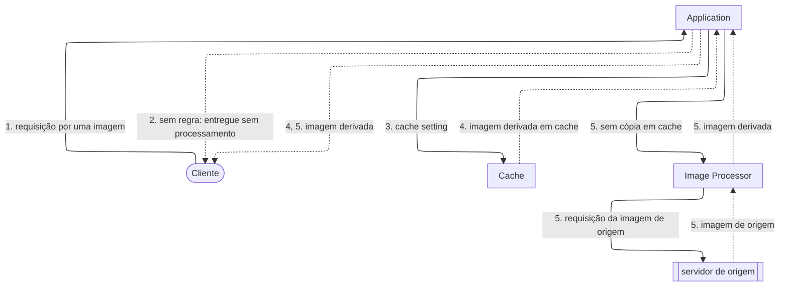

import DocButton from '~/components/webkit/DocButton.vue'
import DocCardGroup from '@aziontech/webkit/doc-card-group'
import DocCard from '@aziontech/webkit/doc-card'

**Image Processor** é um recurso da plataforma que constrói imagens derivadas de imagens da origem na infraestrutura distribuída da Azion, para requisições recebidas por [Applications](/pt-br/documentacao/plataforma/applications/). A transformação de imagens sob demanda é um modelo de entrega em que o servidor constrói cada variante na requisição, conforme descrito na URL. Use Image Processor para servir uma imagem em vários tamanhos, recortes, qualidades ou formatos, como WEBP para navegadores que o aceitam, de um arquivo.

<DocButton href="/pt-br/documentacao/plataforma/applications/image-processor/primeiros-passos/" label="Primeiros passos" size="medium" />
<DocButton href="/pt-br/documentacao/plataforma/applications/image-processor/referencia/" label="Referência do Image Processor" kind="outlined" size="medium" />

---

## Caminho da requisição

O parâmetro de query string `ims` não transforma uma imagem por si só: antes, uma regra com o behavior [Optimize Images](/pt-br/documentacao/plataforma/applications/rules-engine/#optimize-images) precisa corresponder à requisição. Ativar Image Processor em uma Application apenas disponibiliza esse behavior para as regras do [Rules Engine](/pt-br/documentacao/plataforma/applications/rules-engine/) dela.

As setas sólidas levam a requisição, e as setas pontilhadas levam a resposta. Cada rótulo começa com o número do seu passo abaixo.

1. Uma requisição para um path que contém uma imagem chega à Application, que executa as suas regras da Request Phase, como uma regra com _Optimize Images_ que corresponde a requisições de imagem. Para criar essa regra passo a passo, consulte [Configure Image Processor em uma aplicação](/pt-br/documentacao/guias/performance-e-confiabilidade/otimizacao-de-entrega/processar-imagens/).
2. Quando nenhuma regra com _Optimize Images_ corresponde à requisição, a imagem de origem, o arquivo no servidor de origem, é entregue sem processamento.
3. Uma regra que corresponde à requisição aplica os seus behaviors. _Optimize Images_ aplica Image Processor à requisição. Quando a regra também carrega _Set Cache Policy_, esse behavior aplica o [cache setting](/pt-br/documentacao/plataforma/applications/cache/cache-settings/) que guarda a imagem derivada. Uma regra pode carregar _Optimize Images_ sozinho, porque o behavior não recebe argumento.
4. Quando a imagem derivada já está em cache, [Cache](/pt-br/documentacao/plataforma/applications/cache/) a entrega sem processamento.
5. Caso contrário, Image Processor lê a imagem de origem sem alterá-la e aplica `ims` a ela, como em `?ims=fit-in/400x400`. A imagem derivada é entregue. O cache da Application só a armazena quando a regra aplica um cache setting com _Set Cache Policy_. Sem esse cache setting, toda requisição chega ao Image Processor, que responde a uma transformação repetida a partir do próprio cache.

Para saber como o formato entregue é escolhido, como o cache diferencia as imagens derivadas e onde Image Processor para, consulte [Entrega de imagens](/pt-br/documentacao/plataforma/applications/image-processor/entrega-de-imagens/).

---

## Próximos passos

<DocCardGroup cols={2}>
  <DocCard title="Primeiros passos" href="/pt-br/documentacao/plataforma/applications/image-processor/primeiros-passos/" label="Requisite a sua primeira imagem derivada a partir de uma Application." />
  <DocCard title="Entrega de imagens" href="/pt-br/documentacao/plataforma/applications/image-processor/entrega-de-imagens/" label="Veja como o formato entregue é escolhido, como o cache separa as imagens derivadas e onde Image Processor para." />
  <DocCard title="Parâmetros de URL" href="/pt-br/documentacao/plataforma/applications/image-processor/parametros-de-url/" label="Consulte uma operação do parâmetro ims e os valores que ela aceita." />
  <DocCard title="Configurações do Image Processor" href="/pt-br/documentacao/plataforma/applications/image-processor/configuracoes/" label="Consulte o switch, os behaviors da regra, os headers de resposta e os dados de uso." />
  <DocCard title="Guias e tutoriais" href="/pt-br/documentacao/plataforma/applications/guias/" label="Conclua uma tarefa específica, do processamento de imagens à consulta do uso delas." />
  <DocCard title="Boas práticas" href="/pt-br/documentacao/plataforma/applications/boas-praticas/#image-processor" label="Escolha a qualidade, o redimensionamento e o cache setting que mantêm uma transformação barata." />
  <DocCard title="Limites" href="/pt-br/documentacao/plataforma/applications/limites/#image-processor" label="Consulte o escopo do Image Processor e os limites de uma imagem." />
  <DocCard title="Solução de problemas" href="/pt-br/documentacao/plataforma/applications/solucao-de-problemas/#image-processor" label="Encontre a causa quando uma imagem volta sem processamento ou no formato errado." />
</DocCardGroup>
