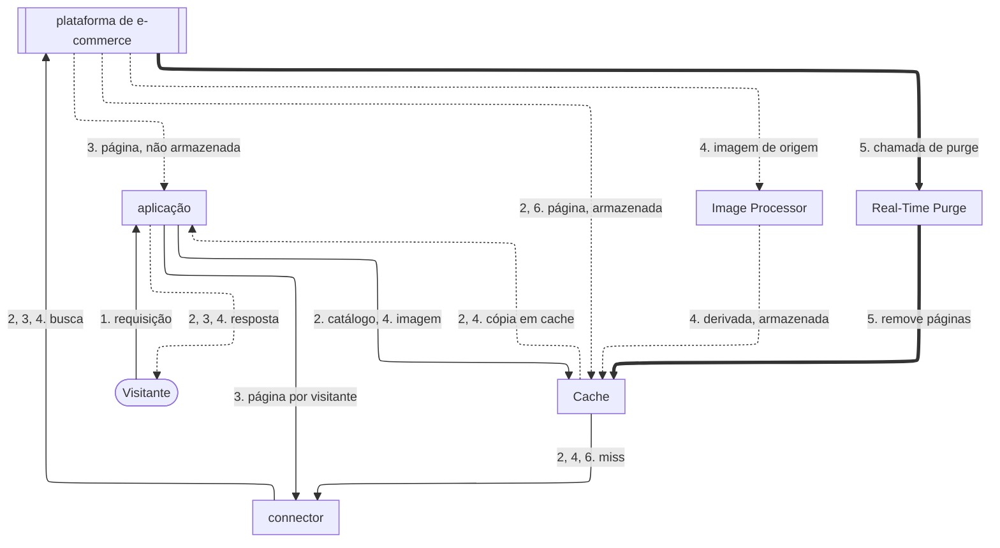
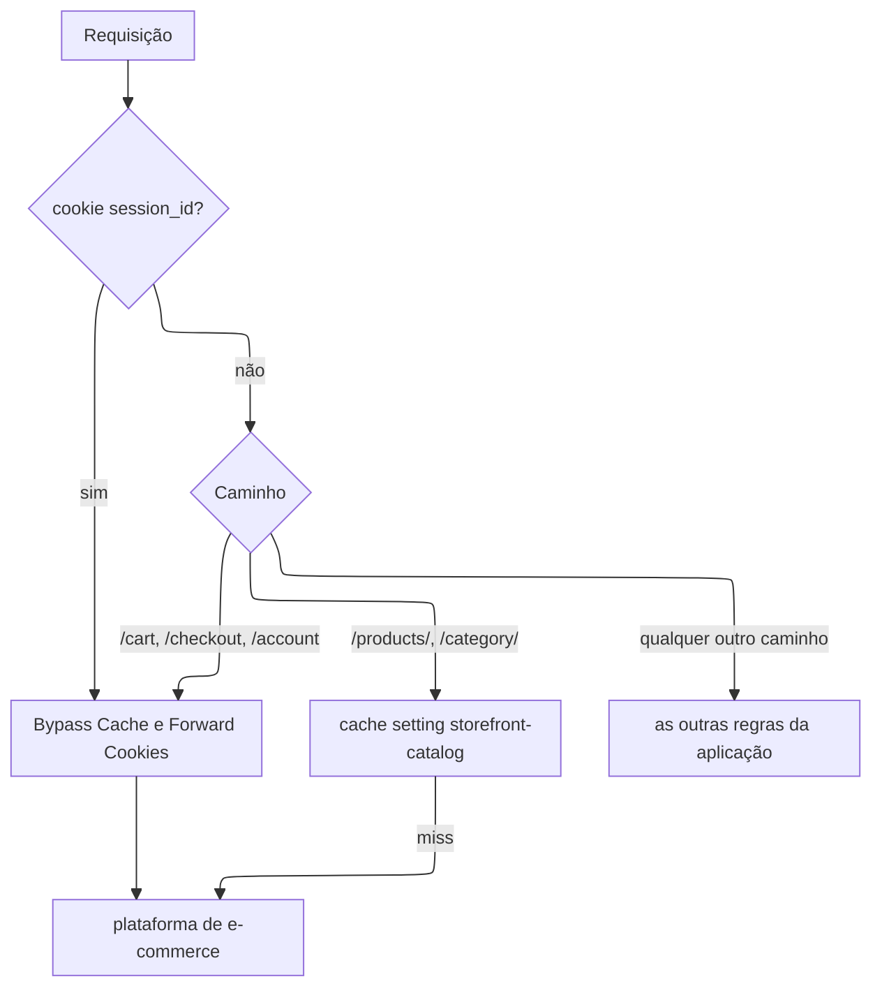
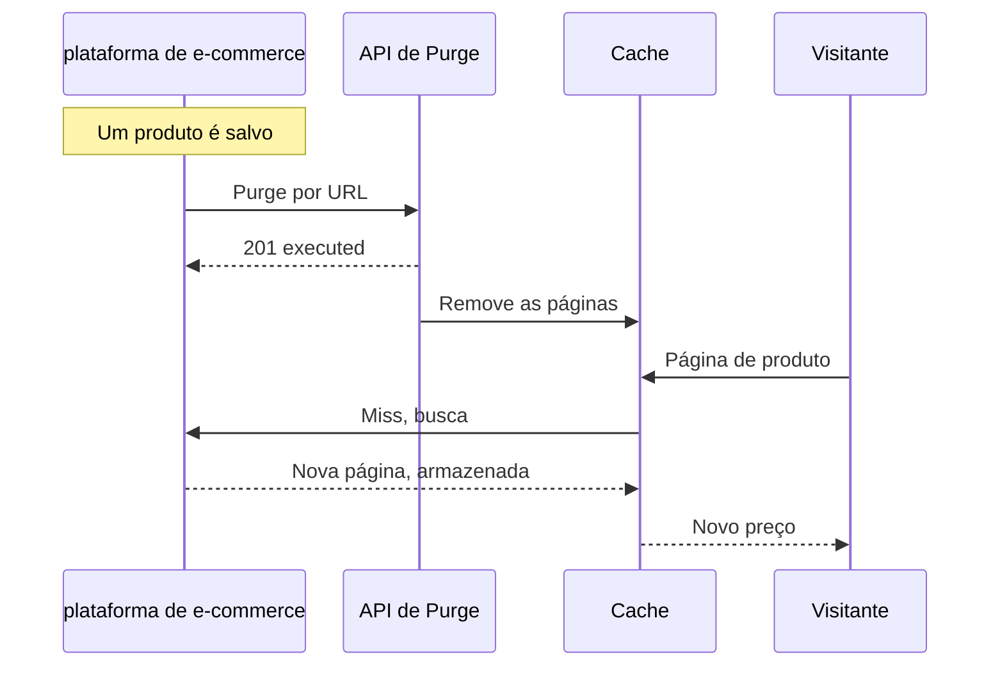

import DocCardGroup from '@aziontech/webkit/doc-card-group'
import DocCard from '@aziontech/webkit/doc-card'

Um time de comércio digital opera a vitrine de uma loja online em uma plataforma de e-commerce que ele mesmo opera, como Magento ou WooCommerce. As páginas de catálogo e de produto são as mesmas para todo visitante e precisam continuar rápidas durante picos de tráfego, enquanto preços e estoque mudam ao longo do dia. O carrinho, o checkout e as páginas de um visitante autenticado são diferentes para cada visitante e nunca podem vir de uma cópia compartilhada. Esta página configura uma aplicação na frente da loja que coloca o catálogo em cache, envia o tráfego de carrinho, checkout e sessão para a loja e purga uma página de produto quando ela muda. O resultado é medido pelo time to first byte nas páginas de catálogo e de produto, pelo tempo entre uma mudança de preço ou estoque e a página atualizada no ar e pela parcela das requisições de catálogo que nunca chega à plataforma de e-commerce.

Este caso de uso não cobre a proteção de login e checkout contra bots. Para isso, consulte [Bloquear account takeover em fluxos de login e checkout](/pt-br/documentacao/casos-de-uso/proteger-aplicacoes-e-redes/bloquear-account-takeover-em-fluxos-de-login-e-checkout/).

## Pré-requisitos

- Uma conta Azion. Se você ainda não tem uma, [crie uma conta](https://console.azion.com/signup).
- Uma aplicação que serve a loja por meio de um connector e de um workload. Para criá-los, consulte [Primeiros passos com Applications](/pt-br/documentacao/plataforma/applications/primeiros-passos/).
- Application Accelerator ativo nessa aplicação, exigido pelos behaviors **Bypass Cache** e **Forward Cookies**. Para ativá-lo, consulte [Ative Application Accelerator](/pt-br/documentacao/guias/performance-e-confiabilidade/cache-e-purge/cache-settings/#ative-application-accelerator).

---

## Produtos necessários

| A vitrine precisa de | O que significa | Produto | Documentado em |
| --- | --- | --- | --- |
| Páginas de catálogo e de produto respondidas do cache | Uma cache setting aplicada por uma regra que casa com os caminhos do catálogo, para visitantes sem sessão | Cache | [Cache settings](/pt-br/documentacao/plataforma/applications/cache/cache-settings/) |
| Páginas de carrinho, checkout e sessão que nunca vêm de uma cópia compartilhada | Uma regra que ignora o cache por caminho e por cookie de sessão | Application Accelerator | [Ignore o cache em um path](/pt-br/documentacao/guias/performance-e-confiabilidade/cache-e-purge/cache-settings/#ignore-o-cache-em-um-path) |
| Páginas de produto que se atualizam quando o catálogo muda | Um purge por URL que a plataforma de e-commerce envia quando um produto muda | Cache | [Purgue páginas quando a origem publica uma mudança](/pt-br/documentacao/guias/performance-e-confiabilidade/cache-e-purge/purgar-ao-publicar/) |
| Imagens de produto no tamanho e no formato que cada página pede | Image Processor na aplicação, aplicado por uma regra nos caminhos de imagem | Image Processor | [Primeiros passos com Image Processor](/pt-br/documentacao/plataforma/applications/image-processor/primeiros-passos/) |

---

## Arquitetura de referência

Esta página constrói a *Vitrine de plataforma de e-commerce hospedada na origem*: uma aplicação na frente de uma loja que continua renderizando todas as páginas.

As setas contínuas levam a requisição, as setas pontilhadas levam a resposta, e as setas grossas levam o purge, que roda separado de qualquer requisição. Cada rótulo começa pelo número da etapa do fluxo de dados a que pertence.

### Fluxo de dados

1. A requisição de um visitante chega ao workload no domínio da loja, que a entrega à aplicação, e o Rules Engine lê o caminho e o cookie `session_id` na Request Phase.
2. Uma página de catálogo ou de produto requisitada sem cookie de sessão vai para o Cache. Em um hit, o Cache responde com a cópia que guarda, e a loja não é consultada. Em um miss, o connector busca a página na loja, e o Cache a armazena no caminho de volta.
3. Uma requisição de carrinho, checkout ou conta, ou qualquer requisição que carregue o cookie de sessão, ignora o cache e vai para a loja por meio do connector. A página que a loja retorna chega ao visitante, e nada é armazenado.
4. Uma requisição de imagem vai primeiro para o Cache, que guarda cada variação. Em um miss, o connector busca a imagem de origem na loja, o Image Processor a redimensiona ou converte, e o Cache armazena a imagem derivada no caminho de volta.
5. Quando um produto muda, a plataforma de e-commerce chama a API do Real-Time Purge, que remove do Cache as páginas de produto afetadas antes que o TTL delas termine.
6. A requisição seguinte por uma página purgada é um miss, então chega à loja, e o Cache armazena a nova versão no caminho de volta.

Um miss também termina no connector, porque a plataforma de e-commerce continua sendo a única origem. Toda resposta volta pela aplicação, que a entrega ao visitante.

### Recursos de Plataforma

- **aplicação**: o Platform Resource na frente da loja. Ela guarda as cache settings e as regras que decidem, requisição por requisição, se uma página é servida do cache ou ignora o cache.
- **Rules Engine**: a Feature da aplicação que casa caminhos e cookies. O bypass de cache para um visitante autenticado depende de uma condição de cookie, porque o mesmo caminho de produto é compartilhado para um visitante anônimo e privado para um visitante autenticado.
- **connector**: o Platform Resource que chega à loja. Todo caminho, em cache ou não, termina nele, porque a loja renderiza todas as páginas.
- **Cache**: guarda as páginas de catálogo e de produto, para que requisições repetidas por elas nunca cheguem à loja.
- **Real-Time Purge**: o Platform Resource que remove do Cache uma página de produto alterada antes que o TTL dela termine, para que uma mudança de preço ou estoque entre no ar sem esperar a página expirar.
- **Image Processor**: redimensiona e converte imagens de produto sob demanda, para que a loja mantenha um único original por imagem.
- **plataforma de e-commerce**: a integração que é a origem e a fonte do conteúdo. Ela renderiza todas as páginas, é dona do carrinho e do checkout e envia o purge quando o catálogo muda.

### Outros designs para este caso de uso

- *Vitrine headless de e-commerce gerada estaticamente*: para catálogos que mudam algumas vezes por dia, em que um gerador de sites busca os produtos na API da plataforma de e-commerce no momento do build. As páginas de catálogo são pré-construídas no Object Storage e servidas pelo Cache, então a atualidade de preço e estoque depende de novos builds, e só o carrinho e o checkout chegam à API de e-commerce.
- *Vitrine headless de e-commerce renderizada no servidor*: para catálogos com mudanças frequentes de preço e estoque ou com preços por região, em que functions renderizam as páginas com um framework como Next.js e chamam a API de e-commerce. As páginas são renderizadas a cada requisição, então a API de e-commerce está nos fluxos de requisição e de falha, e a atualidade é uma decisão de cache em vez de um novo build.

---

## Como o design funciona

Esta seção explica como a aplicação separa as páginas de catálogo compartilhadas das páginas por visitante, e como uma mudança no catálogo chega ao cache.

### Cache do catálogo

O cache do catálogo é uma cache setting e a regra que a aplica. A regra casa com os caminhos do catálogo só para visitantes sem sessão, então um visitante autenticado nunca recebe uma cópia compartilhada.

A cache setting usa dois valores. **Max Age** é de `600` segundos: o purge configurado mais abaixo nesta página atualiza na hora uma página alterada, então o **Max Age** só limita por quanto tempo uma página fica desatualizada quando um purge não é enviado. O cache do navegador é sobrescrito para `0` segundos, porque uma cópia no navegador do visitante não pode ser purgada, e um preço desatualizado ficaria lá até expirar.

### Bypass para carrinho, checkout e sessões

A regra de bypass envia toda requisição por visitante para a loja. Ela casa com os caminhos de carrinho, checkout e conta e com qualquer requisição que carregue o cookie de sessão, então um visitante que adicionou um item ao carrinho também ignora o cache nas páginas de catálogo. A regra também carrega **Forward Cookies**, para que o cookie de sessão que a loja define chegue ao visitante. Nada que essa regra casa fica em cache, então nenhum visitante pode receber o cookie de outro visitante.

1. Uma requisição que carrega o cookie `session_id` ignora o cache, seja qual for o caminho.
2. Uma requisição sem o cookie ignora o cache em `/cart`, `/checkout` e `/account`.
3. Uma requisição sem o cookie em `/products/` ou `/category/` recebe a cache setting `storefront-catalog`.
4. Qualquer outro caminho fica com as outras regras da aplicação.

### Purge em mudanças do catálogo

Uma página de produto alterada é atualizada por um purge que a plataforma de e-commerce envia quando o produto é salvo. A chamada fica no código que a plataforma executa quando um produto é salvo, e ela se autentica com o personal token.

1. Um administrador salva um produto, e a plataforma executa o código de salvamento.
2. O código de salvamento envia um purge por URL da página de produto e da página de categoria, e um purge por wildcard das imagens quando elas mudaram.
3. A Azion remove as duas páginas do cache assim que o purge se propaga.
4. A requisição seguinte por cada página chega à loja, e a nova versão é colocada em cache.

A Azion aceita 2.000 requisições de purge por wildcard em um intervalo de 24 horas, então um wildcard a cada salvamento de um catálogo grande pode chegar a esse limite.

---

## Medindo resultados

| Métrica | Onde ler | Como fica quando funciona |
| --- | --- | --- |
| Parcela das requisições de catálogo que nunca chega à loja | **Requests Offloaded** no Real-Time Metrics, filtrado pelo domínio da loja. Consulte [Meça o offload de cache de um domínio](/pt-br/documentacao/guias/plataforma/observabilidade/medir-offload-de-cache/) | Sobe depois que a regra de catálogo se propaga e se mantém durante picos de tráfego |
| Time to first byte nas páginas de catálogo e de produto | O campo `ttfb` das medições do Edge Pulse, feitas nos navegadores dos visitantes. Consulte [Primeiros passos com Edge Pulse](/pt-br/documentacao/plataforma/edge-pulse/primeiros-passos/) | Menor nas páginas de catálogo do que nas páginas de carrinho e checkout, em todas as regiões |
| Tempo entre uma mudança de preço ou estoque e a página atualizada no ar | O histórico de purges do **Real-Time Purge** no Azion Console, que lista cada purge quando ele termina. Consulte [Real-Time Purge](/pt-br/documentacao/plataforma/applications/cache/real-time-purge/#confirmacao) | Cada purge termina, e nenhuma página de produto espera o **Max Age** de 600 segundos expirar |

---

## Boas práticas

- **Exclua sessões com um critério, não com variação por cookie.** Variar a chave de cache do catálogo por `session_id` guarda uma cópia por visitante, porque o cookie é único por visitante. O critério `does not exist` mantém uma única cópia compartilhada para todo visitante sem sessão. Para a variação por cookie e o custo dela, consulte [Boas práticas de Applications](/pt-br/documentacao/plataforma/applications/boas-praticas/).
- **Nunca coloque Forward Cookies em uma regra que guarda em cache.** Em uma resposta em cache, **Forward Cookies** pode entregar a um visitante o `Set-Cookie` da sessão de outro visitante. Nesta página, ele fica só na regra de bypass, onde nada é guardado em cache.
- **Purgue na mudança em vez de encurtar o Max Age.** Um **Max Age** curto envia mais requisições de catálogo para a loja e ainda deixa uma janela de conteúdo desatualizado. O purge atualiza a página quando ela muda, e o **Max Age** fica como limite de segurança para um purge não enviado.
- **Use Bypass Cache para o carrinho, não um Max Age de 0.** Um **Max Age** de `0` junta requisições simultâneas para um mesmo caminho em uma única requisição à origem, e dois visitantes que carregam os carrinhos no mesmo momento precisam de respostas diferentes. Para a diferença entre os dois, consulte [Variação de cache](/pt-br/documentacao/plataforma/applications/application-accelerator/variacao-de-cache/#bypass-cache-e-um-ttl-de-0).

---

## Guias deste caso de uso

<DocCardGroup cols={2}>
  <DocCard title="Configure políticas de cache para uma aplicação" href="/pt-br/documentacao/guias/performance-e-confiabilidade/cache-e-purge/cache-settings/" label="Cria a regra de cache do catálogo e a regra de bypass para carrinho, checkout e sessões, no Azion Console ou pela API." />
  <DocCard title="Purgue páginas quando a origem publica uma mudança" href="/pt-br/documentacao/guias/performance-e-confiabilidade/cache-e-purge/purgar-ao-publicar/" label="Envia as chamadas de purge que a loja faz a cada salvamento de produto e confirma que cada uma terminou." />
  <DocCard title="Configure Image Processor em uma aplicação" href="/pt-br/documentacao/guias/performance-e-confiabilidade/otimizacao-de-entrega/processar-imagens/" label="Confirma que cada variação de imagem de produto é processada e cacheada." />
</DocCardGroup>
