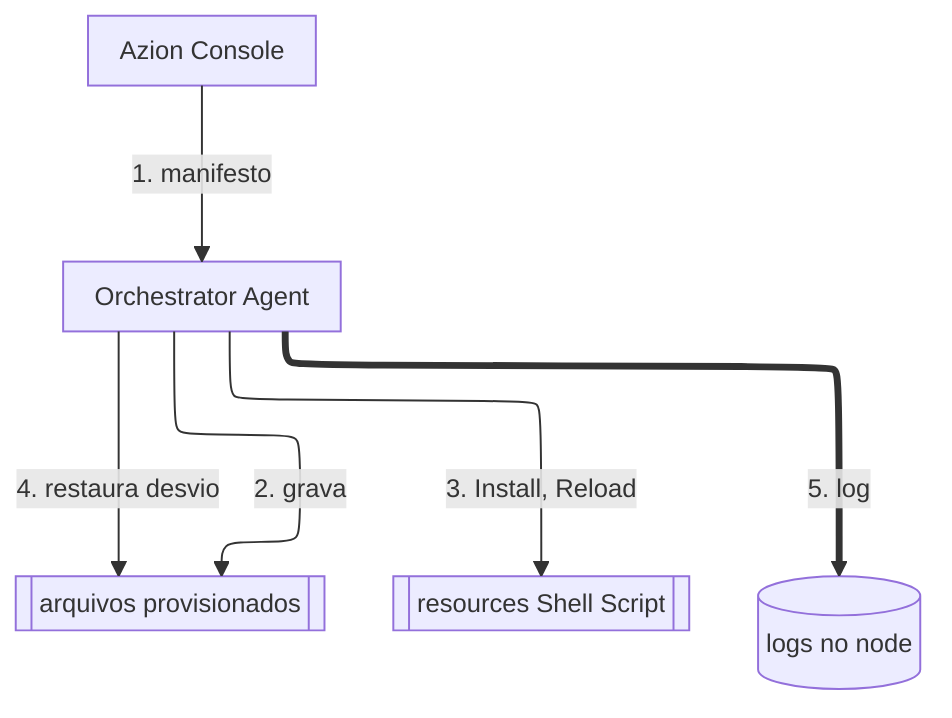

import FrameBox from '@aziontech/webkit/frame-box'
import ItemList from '@aziontech/webkit/item-list'
import DocItem from '@aziontech/webkit/doc-item'

O Orchestrator instala e mantém software em máquinas que você mesmo opera, como servidores, roteadores e dispositivos pequenos. Você descreve o software uma vez, como um serviço no Azion Console. Você escolhe as máquinas que o executam, e um agente em cada máquina aplica essa descrição e corrige qualquer desvio dela. Uma mudança no serviço chega a todas as máquinas vinculadas a ele, sem um login em cada uma.

As seções cobrem o agente e o node, a autorização, os serviços e os resources deles, o vínculo entre um serviço e um node, como o agente aplica um manifesto, o Watcher e os logs.

---

## O agente e o node

Uma máquina entra no Orchestrator quando você instala o Orchestrator Agent nela. O agente é um único binário, `edge-orchestrator`, disponível para FreeBSD, Linux e macOS em várias arquiteturas de processador. O comando `install` registra o agente no gerenciador de serviços da máquina, quando ela tem um, e pede um [personal token](/pt-br/documentacao/guias/plataforma/conta-e-billing/personal-tokens/). O token vincula a máquina à sua conta Azion.

Depois que o agente é instalado e iniciado, a máquina aparece como um node da sua conta. Na primeira inicialização, o agente também pode definir o nome do node e os grupos aos quais ele pertence. Sem um nome, o node recebe o hostname da máquina. O sistema operacional, as arquiteturas e os privilégios que um node precisa estão em [Requisitos do node](/pt-br/documentacao/plataforma/orchestrator/edge-node/#requisitos).

O agente faz o trabalho no node, e o Azion Console guarda a configuração. A Azion gerencia o node remotamente por um canal com criptografia de ponta a ponta, em redes locais e públicas e atrás de NAT.

---

## Autorização

Um node novo aparece na lista **Edge Nodes** do Azion Console com o status `Waiting Authorization` e não recebe nenhum serviço até que você o autorize. A lista identifica cada node pelo hash que ele usou para se registrar, na coluna **HashId**. Depois da autorização, o node pode levar até 10 segundos para que serviços possam ser orquestrados nele.

No Azion Console, você pode autorizar vários nodes em uma única ação. Os passos estão em [Autorizar um node](/pt-br/documentacao/guias/desenvolvimento-de-aplicacoes/automacao/autorizar-edge-node/).

---

## Serviços e resources

Um serviço é a descrição de um software, guardada na lista **Edge Services** do Azion Console. Ele contém resources, e cada resource é um arquivo que o agente grava em um caminho absoluto no node. Um resource tem um de dois tipos:

- **Text**: o agente copia o conteúdo para o caminho como texto simples. Arquivos de configuração usam esse tipo.
- **Shell Script**: o agente grava o script e o executa nos triggers que você seleciona. O agente executa o script com o interpretador da linha shebang, ou com `/bin/sh` quando o script não tem uma.

Um resource Shell Script roda em um ou mais de três triggers. **Install** roda primeiro, quando o serviço chega ao node. **Reload** roda depois que todos os resources do serviço são instalados, e de novo sempre que o vínculo entre o serviço e o node muda, por exemplo quando o valor de uma variável muda. **Uninstall** roda quando o serviço sai do node.

O conteúdo de um resource pode ter dois tipos de marcadores. Uma variável, escrita `{{ VARNAME }}`, recebe um valor que você define, então o mesmo serviço pode escutar na porta 3306 em um node e na porta 3307 em outro. Um fact, escrito `{{ FACT_NAME }}`, recebe um valor que o agente lê do node, como a arquitetura, o sistema operacional, o número de CPUs ou a memória. Não é possível sobrescrever um fact. A referência de Services lista as [variáveis predefinidas](/pt-br/documentacao/plataforma/orchestrator/edge-services/#variables) e os [facts](/pt-br/documentacao/plataforma/orchestrator/edge-services/#facts).

---

## O vínculo entre um serviço e um node

Um serviço não roda em lugar nenhum até que você o vincule a um node. Um vínculo nomeia o serviço, o node e os valores das variáveis para esse node. Assim, um serviço vinculado a vários nodes roda em todos eles com valores adequados a cada máquina. Apenas um serviço ativo pode ser vinculado.

Um serviço muda em um só lugar e chega a todos os nodes vinculados a ele. Quando você atualiza um serviço, a mudança é implantada nos nodes vinculados. Quando você muda o valor de uma variável em um vínculo, o trigger Reload roda naquele node. Quando você remove o vínculo, o trigger Uninstall roda e o serviço sai daquele node. Os passos estão em [Vincular um serviço a um node](/pt-br/documentacao/guias/desenvolvimento-de-aplicacoes/automacao/vincular-servico/).

---

## Como o agente aplica um manifesto

O agente recebe a configuração do node dele como um manifesto, que carrega os resources dos serviços vinculados ao node. Cada manifesto tem um número de versão, e o agente registra em log cada versão que aplica. O agente aplica um manifesto em ordem, um resource por vez, e respeita as dependências entre os resources e os triggers de que eles precisam.

O diagrama mostra um node recebendo o manifesto dele. As setas contínuas levam a configuração e as ações que o agente executa no node, e a seta grossa leva o log que o agente grava. Cada rótulo começa com o número do passo abaixo.

1. O node recebe um manifesto com os resources dos serviços vinculados a ele e os valores das variáveis de cada vínculo.
2. O agente grava cada resource no caminho absoluto dele, um resource por vez.
3. O agente roda o trigger Install de cada resource Shell Script, depois o Reload.
4. O Watcher verifica os arquivos provisionados periodicamente e restaura qualquer arquivo que tenha desviado do último manifesto aplicado.
5. O agente registra em log a versão do manifesto que aplicou e o resultado de cada verificação do Watcher.

Enquanto um manifesto é aplicado, o agente expõe duas variáveis predefinidas para os scripts. `CHANGESET_ADD_PATH` aponta para um arquivo com a lista de caminhos adicionados ou modificados neste manifesto, e `CHANGESET_RM_PATH` aponta para um arquivo com a lista de caminhos removidos ou modificados. Um script pode lê-las para agir apenas sobre os arquivos que mudaram.

---

## O Watcher

Depois que um manifesto é aplicado, o agente mantém os arquivos no estado que ele descreve. Uma parte do agente chamada Watcher executa um grupo de workers periodicamente. Os workers verificam cada arquivo provisionado e o comparam com o último manifesto aplicado. Um arquivo que foi modificado ou removido é restaurado.

O Watcher protege o node contra desvios, e essa proteção tem um custo: o serviço e os vínculos dele são os únicos lugares para mudar um arquivo provisionado. Uma edição local no node é revertida na próxima verificação, e não é possível desativar o Watcher. Toda mudança, inclusive uma urgente, entra no serviço. Arquivos que o serviço não provisiona ficam fora do escopo do Watcher.

---

## Logs no node

O agente grava dois logs no node. `/var/log/azion/edge-orchestrator.log` registra o trabalho do próprio agente: as versões de manifesto que ele aplica, a comunicação dele com a Azion e cada verificação do Watcher, com o número de arquivos verificados e o número dos que tiveram desvio. `/var/log/azion/edge-services.log` registra o que os triggers dos serviços vinculados escreveram. Para lê-los, consulte [Verificar os logs do Orchestrator](/pt-br/documentacao/guias/desenvolvimento-de-aplicacoes/automacao/verificar-logs/).

---

## Recursos relacionados

<FrameBox>
<ItemList>
  <DocItem title="Nodes" href="/pt-br/documentacao/plataforma/orchestrator/edge-node/">Os requisitos do node e todos os comandos e opções do Orchestrator Agent.</DocItem>
  <DocItem title="Services" href="/pt-br/documentacao/plataforma/orchestrator/edge-services/">Resources, variáveis, facts e triggers, campo a campo.</DocItem>
  <DocItem title="Instalar o Orchestrator Agent" href="/pt-br/documentacao/guias/desenvolvimento-de-aplicacoes/automacao/instalar-orchestrator-agent/">Os passos para transformar uma máquina em um node.</DocItem>
  <DocItem title="Criar um serviço" href="/pt-br/documentacao/guias/desenvolvimento-de-aplicacoes/automacao/criar-edge-service/">Os passos para descrever um software e os resources dele.</DocItem>
</ItemList>
</FrameBox>
