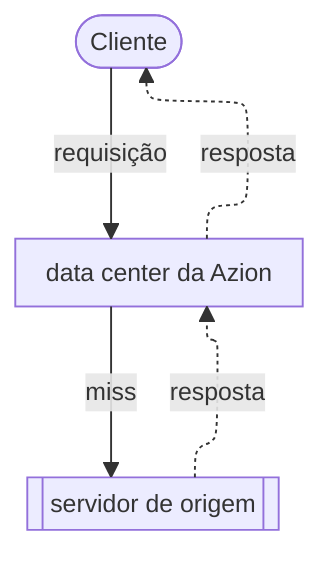

import FrameBox from '@aziontech/webkit/frame-box'
import ItemList from '@aziontech/webkit/item-list'
import DocItem from '@aziontech/webkit/doc-item'

As páginas de documentação são MDX, e esta página é o vocabulário completo de componentes: cada entrada é um componente do design system, `@aziontech/webkit`, ou um wrapper fino sobre um. Um componente ausente desta página não está disponível: um import dele falha o build.

## Asides

Sem import. Asides são escritos como blocos `:::` e renderizam o `DocCallout` do design system; são a construção mais comum depois dos links.

```mdx
:::note[nota]
Nomes de bucket precisam ser únicos entre todos os buckets existentes.
:::

:::tip[dica]
**Aumente os limites** <br></br>
Entre em contato com o [suporte técnico](/pt-br/documentacao/suporte/) para solicitar um limite maior para o seu plano.
:::

:::caution[Atenção]
Com Load Balancer habilitado, a transferência de dados pode gerar custos relacionados ao uso. Para mais informações, consulte [Preços](/pt-br/documentacao/fundamentos/precos/).
:::
```

Tipos válidos: `note`, `tip`, `caution`, `danger`. `caution` renderiza como o tipo warning do callout.

**`:::warning` não é válido** e não renderiza como esperado. Use `:::caution`.

- Um callout contém prosa: frases, parágrafos curtos e uma lista. Mantenha fences e tabelas fora dele: um fence dentro de um callout renderiza cada linha em caixa, como código inline. Coloque-os antes ou depois do aside.
- O callout não tem linha de título. O texto entre colchetes é mantido como introdução ao texto (`Você sabia? — ...`), então use-o só quando as primeiras palavras precisarem dele. Em páginas em português do Brasil, localize: `:::note[nota]`, `:::tip[dica]`, `:::caution[Atenção]`, `:::danger[perigo]`. A caixa segue o uso do repositório: `nota`, `dica` e `perigo` em minúscula, `Atenção` com maiúscula.

## DocButton

A call to action padrão da documentação. Um wrapper sobre o Button do design system que mantém o estilo de botão dentro do corpo do artigo.

```mdx
import DocButton from '~/components/webkit/DocButton.vue'

<DocButton href="/pt-br/documentacao/plataforma/applications/cache/primeiros-passos/" label="Primeiros passos" size="medium" />
<DocButton href="/pt-br/documentacao/plataforma/applications/cache/referencia/" label="Referência do Cache" kind="outlined" size="medium" />
```

- `href` e `label` são obrigatórios. Sem diretiva client: o botão é um link estático.
- `kind`: omita para a ação primária; `outlined` para o segundo botão de um par, como o link de referência depois de **Primeiros passos** em uma Visão geral. `secondary`, `text` e `danger` também existem.
- Sempre `size="medium"`.
- `icon` recebe uma classe de ícone, sempre antes do rótulo. `target="_blank"` abre um destino externo em nova aba.

## Code

Renderiza o `CodeBlock` do design system, com um botão de copiar. Blocos com fence renderizam o mesmo componente.

```mdx
import Code from '~/components/webkit/CodeBlock.vue'

<Code client:visible lang="bash" code={`azion deploy --local`} />
```

- Um bloco de duas ou mais linhas numera as linhas e mostra uma barra no topo com o nome da linguagem: `Shell`, `JSON`, `JavaScript`. Um bloco `text` mostra `Texto`.
- Um bloco de uma linha mostra o código e o botão de copiar, sem números de linha, e sem barra se não tiver um nome de arquivo.
- `client:visible` é obrigatório em `<Code>`: sem ele, o botão de copiar não funciona. Um fence já o recebe.
- Props: `code`, `lang` e duas opcionais. `fileName` põe um nome de arquivo na barra no lugar da linguagem. `showLineNumbers` substitui o padrão de numeração de linhas. Em um fence, `title="index.js"` depois da tag de linguagem define o nome do arquivo.

**O valor é um template literal de JavaScript.** Backticks e `${` dentro dele precisam de escape, e uma continuação de linha precisa de barra invertida dupla. Quando um snippet contém um dos dois, isso é motivo para usar `<Code>` em vez de um fence, porque você controla o escape.

Blocos com fence também são o padrão da documentação. Use um fence para a saída que o leitor lê, e `<Code>` para a entrada que o leitor copia.

Tags de linguagem em uso: `bash`, `sh`, `json`, `javascript`, `js`, `typescript`, `ts`, `hcl`, `graphql`, `shell`, `text`, `plaintext`. Terraform é `hcl`, não `terraform`.

---

## Tabs e Fragment

O padrão multi-interface: uma tarefa, um painel por interface. Renderiza o `TabView` do design system, com todos os painéis mantidos no HTML.

```mdx
import Tabs from '~/components/webkit/Tabs.vue'
import Code from '~/components/webkit/CodeBlock.vue'

<Tabs client:visible>
    <Fragment slot="tab.console">Console</Fragment>
    <Fragment slot="tab.api">API</Fragment>

<Fragment slot="panel.console">

1. Acesse [Azion Console](https://console.azion.com/) > **Object Storage**.
2. Selecione **+ Bucket**.

</Fragment>

<Fragment slot="panel.api">

<Code client:visible lang="bash" code={`curl ...`} />

</Fragment>

</Tabs>
```

- `client:visible` é obrigatório. Sem ele, as tabs renderizam e não alternam.
- Um bloco pareia cada `tab.x` com um `panel.x`. A única exceção é uma página que documenta mais de uma interface, como uma [página de Quickstart](/pt-br/documentacao/guia-de-estilo/conteudo/quickstart/) ou um [guia how-to](/pt-br/documentacao/guia-de-estilo/conteudo/guias-how-to/). Nessa página, o bloco de pré-requisitos declara a faixa de tabs, e todo bloco seguinte da mesma `sharedStore` tem apenas slots `panel.x`. Um bloco só de painéis da store `interface` renderiza essa faixa acima dos próprios painéis, então o leitor troca de interface em qualquer seção.
- **Linhas em branco ao redor de markdown dentro de um Fragment são obrigatórias**, ou o markdown renderiza como um único parágrafo literal.
- Os painéis são pareados com as tabs pela chave, e a primeira tab é o padrão. Um bloco `interface` renderiza as tabs em uma única ordem em todas as páginas, qualquer que seja a ordem declarada no MDX: Console, GraphiQL, CLI, GitHub, API. Escreva nessa ordem mesmo assim, para que a página e a sua versão em Markdown sejam lidas da mesma forma.
- Chaves canônicas: `tab.console`, `tab.api`, `tab.cli`, mais `tab.apiv3` / `tab.apiv4` para APIs versionadas. Uma chave tem apenas letras minúsculas e dígitos: um hífen escapa da checagem de pareamento `tab.x` / `panel.x` sem falhar nela.
- Em um bloco com `sharedStore="interface"`, abra cada painel com um título um nível abaixo da seção em que ele está, com o rótulo da tab: `### Console`. Esses títulos ficam fora do sumário, e cada um aponta para a sua seção com a sua interface selecionada: `?interface=console#crie-um-banco-de-dados`.
- O `sharedStore="<chave>"` opcional sincroniza a seleção entre grupos de tabs de uma página. Tabs de interface usam `sharedStore="interface"`, então uma seleção acompanha o leitor em uma página que repete as tabs por seção, e também até a página seguinte. Essa única store é guardada no navegador e escrita na URL como `?interface=<chave>`, o que deixa o fragmento livre para uma seção. Dê a todo bloco que compartilha uma chave as mesmas tabs. Um bloco que não oferece a chave selecionada abre no próprio primeiro painel, e deixa a seleção intacta para os blocos que a oferecem.

## Tag

Selos de status.

```mdx
import Tag from '~/components/webkit/Tag.vue'

<Tag severity="warning">Breaking Changes</Tag>
```

- Sem diretiva client: o selo é HTML estático.
- `severity` é `success`, `info`, `warning` ou `danger`. `info` é o chip neutro de rótulo, usado para selos de recurso da plataforma; os outros três são cores de status.
- O rótulo vai nos filhos. `value="Breaking Changes"` também é aceito.
- Nunca use uma Tag para um estágio de liberação, como Preview ou Descontinuado. O estágio de uma página vem de `stage` no frontmatter, como descreve [Avisos de versão](#avisos-de-versao).

## Video

Sem import. Emite o iframe mais os metadados `VideoObject` do schema.org.

```mdx
<Video
  src="https://www.youtube.com/embed/BV4jRPpADw8"
  title="Desenvolvimento local com a Azion CLI"
  description="Como a CLI apoia a depuração local e fluxos de trabalho mais rápidos."
  uploadDate="2023-10-17"
/>
```

`src` precisa ser uma URL de **embed** do YouTube. `src` e `title` são obrigatórios. Para uma captura de tela ou um arquivo de clipe, use Figura.

## Diagramas Mermaid

Um diagrama é um fence de código `mermaid`, não uma imagem. O texto chega a um agente que busca a versão em Markdown; uma referência de imagem, não.

````md

````

`title="..."` depois de `mermaid` no fence adiciona uma legenda abaixo do diagrama. Nomeie cada nó e cada aresta em palavras, e nunca dependa de cor sozinha para carregar uma distinção. Um diagrama nunca fica sozinho: páginas de arquitetura e de caso de uso mantêm o fluxo de dados numerado abaixo dele.

Todo diagrama segue as mesmas regras:

- **Abra com a linha `init` compartilhada** que o exemplo mostra. Ela organiza o diagrama com o ELK, dá espaço aos rótulos e reduz um diagrama mais largo que a coluna até caber nela. Quando o primeiro nó não aparece no topo, adicione um objeto `elk` logo depois de `"layout": "elk",`. Em um diagrama com um ciclo, como uma requisição e a resposta dela, use as opções de ordem do modelo do ELK. Assim a ordem de declaração decide as camadas: `"cycleBreakingStrategy": "MODEL_ORDER"`, ou `"preset": "modelOrder", "keepEntryNodeOnTop": true`. Em um diagrama com mais de um nó de partida, use `"layeringStrategy": "LONGEST_PATH_SOURCE"`, que põe todos os nós de partida na primeira linha.
- **Desenhe todo flowchart de cima para baixo** (`flowchart TD`), inclusive uma cadeia de etapas. Uma cadeia desenhada da esquerda para a direita fica mais larga que a coluna e reduz os rótulos para caber.
- **Dê uma forma a cada papel.** O cliente é um estádio (`(["Cliente"])`). Tudo o que está na Azion, um produto ou um recurso da plataforma, é um retângulo (`["aplicação"]`). Um armazenamento de dados é um cilindro (`[("KV Store")]`), e um sistema fora da Azion é uma sub-rotina (`[["servidor de origem"]]`). Uma etapa, um estado ou uma decisão mantém o retângulo ou o losango.
- **Deixe o estilo da linha dizer para onde o fluxo vai.** Quando um diagrama desenha uma requisição e a resposta dela, setas contínuas (`-->`) levam a requisição e setas pontilhadas (`-.->`) levam a resposta. Um fluxo que roda separado de qualquer requisição, como um purge ou um stream de logs, usa setas grossas (`==>`).

## Passos

Um passo a passo numerado: cada passo é um título com um corpo opcional, e os números vêm da ordem na página.

```mdx
import DocSteps from '@aziontech/webkit/doc-steps'
import DocStep from '@aziontech/webkit/doc-step'

<DocSteps>
  <DocStep title="Crie o bucket">

  Acesse [Azion Console](https://console.azion.com/) > **Object Storage** e selecione **+ Bucket**.

  </DocStep>
  <DocStep title="Dê um nome">

  Nomes de bucket precisam ser únicos entre todos os buckets existentes.

  </DocStep>
</DocSteps>
```

- Sem diretiva client.
- Nunca escreva o número: reordenar os passos os renumera.
- Um `DocStep` fica sempre dentro de um `DocSteps`. Linhas em branco ao redor do markdown dentro de um passo são obrigatórias.

## Figura

Uma captura de tela, um clipe ou um diagrama emoldurado, com uma introdução opcional acima e uma legenda abaixo.

```mdx
import DocFrame from '@aziontech/webkit/doc-frame'

<DocFrame
  src="/assets/docs/images/uploads/real-time-metrics-overview.png"
  alt="Visão geral do fluxo de consulta do Real-Time Metrics"
  caption="O fluxo de consulta, do console à fonte de dados."
/>
```

- `src` recebe uma imagem ou um clipe (`.mp4`, `.webm`). Dê um `alt` a uma imagem. Sem `src`, a moldura envolve os filhos, como um fence `mermaid`.
- `caption` e `hint` são strings simples; os slots de mesmo nome (`<Fragment slot="caption">`) carregam uma legenda com link ou código inline.
- `autoplay` reproduz um clipe sem som, inline e em loop, sem controles.

## Cards

Uma grade de cards de navegação, para uma página que se abre em seções. É a seção `## Próximos passos` que fecha uma página: um card por destino, com o motivo como texto.

```mdx
import DocCardGroup from '@aziontech/webkit/doc-card-group'
import DocCard from '@aziontech/webkit/doc-card'

<DocCardGroup cols={2}>
  <DocCard title="Build" href="/pt-br/documentacao/" label="Applications, funções e connectors." />
  <DocCard title="Secure" href="/pt-br/documentacao/">Firewall, WAF e proteção contra DDoS.</DocCard>
</DocCardGroup>
```

- Sem diretiva client.
- `cols` é 2, 3 ou 4; a grade colapsa para uma coluna no celular.
- `href` transforma o card inteiro em link. `label` é o texto; os filhos o substituem quando o texto precisa de um link ou de código inline.
- Opcionais: `icon` recebe uma classe PrimeIcons (`pi pi-bolt`), `overline` uma linha pequena acima do título, `link` um texto de call to action em uma linha de fechamento.

## Itens relacionados

Uma lista emoldurada de linhas, cada uma com um nome e uma frase, para um leitor escolhendo o que ler em seguida. É a seção `## Recursos relacionados` que fecha uma página.

```mdx
import FrameBox from '@aziontech/webkit/frame-box'
import ItemList from '@aziontech/webkit/item-list'
import DocItem from '@aziontech/webkit/doc-item'

<FrameBox>
<ItemList>
  <DocItem title="Cache settings" href="/pt-br/documentacao/plataforma/applications/cache/cache-settings/">Como um data center decide o que guardar e por quanto tempo.</DocItem>
  <DocItem title="Rules Engine" href="/pt-br/documentacao/plataforma/applications/rules-engine/">Condições e comportamentos nas fases de requisição e resposta.</DocItem>
</ItemList>
</FrameBox>
```

- Sem diretiva client. `FrameBox` desenha o perímetro; `ItemList` traça as linhas entre os itens.
- `href` transforma a linha em link; uma URL externa recebe a seta para fora. O `icon` opcional recebe uma classe PrimeIcons.
- O texto é uma frase: o que a coisa é, ou por que o leitor iria até lá. Código inline e links são permitidos; blocos, não.

## Entrada de changelog

Uma entrada datada: rótulo e versão à esquerda, as notas à direita e uma âncora no rótulo.

```mdx
import DocUpdate from '@aziontech/webkit/doc-update'

<DocUpdate label="10 de julho de 2026" description="Versão 1.3.0" tags={['Marketplace']} anchor="10-de-julho-de-2026">

**Bot Manager** agora traz nove novas regras estáticas e dois novos argumentos.

</DocUpdate>
```

- Sem diretiva client. Linhas em branco ao redor do markdown interno são obrigatórias.
- Sempre passe `anchor`. O painel da direita lista apenas as entradas que trazem um, e sem ele o id cai no `label` em slug. Duas entradas com o mesmo rótulo precisam de valores distintos de `anchor`.
- `description` é a linha abaixo do rótulo; `tags` é um array de rótulos curtos.
- Uma página de entradas tem o sumário montado a partir delas. O painel da direita lista uma linha por data e aponta para a primeira entrada daquela data, no lugar dos títulos dentro das notas. O padrão de [Changelog](/pt-br/documentacao/guia-de-estilo/conteudo/changelog/) tem o resto.

## Prompt

Um bloco de texto literal que o leitor entrega a um agente, em fonte mono e com um botão de copiar. Não é um bloco de código: sem linguagem, sem destaque de sintaxe.

```mdx
import DocPrompt from '@aziontech/webkit/doc-prompt'

<DocPrompt client:visible title="Experimente">Crie uma aplicação com cache habilitado e faça o deploy.</DocPrompt>
```

- `client:visible` é obrigatório: o botão de copiar e o de expandir precisam dele.
- `kind="line"` faz uma única linha com rolagem em vez de um parágrafo limitado a quatro linhas. `title` e `icon` são opcionais.

## Glosa inline

Um termo no meio da prosa que mostra sua definição ao passar o mouse ou receber foco, com um link opcional.

```mdx
import DocTooltip from '@aziontech/webkit/doc-tooltip'

A <DocTooltip client:visible headline="Cache key" tip="O identificador que um data center monta a partir de uma requisição." cta="Leia mais" href="/pt-br/documentacao/plataforma/applications/cache/cache-settings/">cache key</DocTooltip> decide o que corresponde.
```

- `client:visible` é obrigatório; sem ele o termo renderiza e nunca abre.
- `tip` é a definição, `headline` a introdução em negrito, `cta` mais `href` o link.

## Fornecidos pelo layout

`DocPageHeader` (a partir de `title` e `description` no frontmatter), `DocOnThisPage`, `DocPagination` e o contrato tipográfico `DocProse` renderizam ao redor de toda página. Nunca os escreva.

Em um hub de grupo, o layout também lista as linhas do grupo da sidebar depois do corpo, como linhas `DocItem` montadas a partir da árvore de navegação. Nunca digite essa lista. [Hubs de navegação](/pt-br/documentacao/guia-de-estilo/conteudo/hubs-de-navegacao/) carrega essa forma.

---

## Snippets compartilhados

Blocos reutilizáveis em `~/includes/snippets/`, cada um com uma variante `en/` e uma `pt/`. A pasta do português do Brasil é `pt/`, não `pt-br/`.

```mdx
import VersionDualSteps from '~/includes/snippets/versionDualSteps/pt/snippet.mdx'

<VersionDualSteps />
```

Disponíveis: `versionDualSteps`, `JourneyAPI`, `InterfaceNote`, `LetsEncryptExpiration`, `RulesEngineExecution`.

### Avisos de versão

O cabeçalho da página traz um select Versão da plataforma, entre a busca e o GitHub, em que o leitor escolhe v4.x ou v3.x. Em telas estreitas, o select fica no menu de navegação, acima do seletor de tema. O menu lista só as páginas compatíveis com essa versão. Quando a página não está em Disponibilidade Geral, uma tag de estágio aparece ao lado do título, também nas páginas de agente. Uma página com `page_header: false` não tem linha de título, então não mostra o estágio. Uma página que cobre só uma versão que não é a atual mostra também um banner no cabeçalho. O cabeçalho e a sidebar montam tudo isso a partir do frontmatter e da árvore de navegação. Nunca escreva a versão nem o estágio à mão no corpo: nem aside, nem frase, nem snippet.

Para as regras sobre quais páginas existem em cada versão e como nomeá-las, ligá-las e retirá-las, consulte [Versões da plataforma](/pt-br/documentacao/guia-de-estilo/convencoes/versoes-da-plataforma/).

Três campos do frontmatter carregam essas informações:

| Campo | Valor | Quando está ausente |
| --- | --- | --- |
| `versions` | `[v3]` ou `[v4]`, as versões com que a página é compatível | A árvore de navegação decide. Uma árvore sem versões vale para todas as versões |
| `stage` | `experimental`, `preview` ou `deprecated` | Disponibilidade Geral, que nunca aparece |
| `counterpart` | O `namespace` da página equivalente na outra versão | O banner fica sem botão |

```yaml
versions: [v3]
stage: deprecated
counterpart:
  v4: documentation_products_edge_applications
```

O ícone de ajuda ao lado da tag de estágio liga para a [seção 1.3 dos Termos de Serviço](/pt-br/documentacao/contratos/tds/#13-estagios-de-liberacao-de-produtos). A Disponibilidade Geral nunca aparece. A tag de estágio tem a mesma cor ao lado do título e no menu: Descontinuado é warning, e Preview e Experimental são info. Em pt-br, o estágio `deprecated` se escreve Descontinuado.

A interface nomeia uma versão pela linha de release, v4.x ou v3.x: o select, as tags do menu, o banner e as saídas para agentes. No texto corrido, escreva API v4 e API v3.

O select se comporta assim:

- Uma página que cobre uma única versão coloca o select nessa versão enquanto está aberta, sem mudar a escolha do leitor. Só o select, ou um link com `?api=`, muda a escolha. Uma página que cobre todas as versões a mantém.
- Escolher uma versão que a página aberta não cobre leva à página equivalente, que `counterpart` indica. Uma página sem equivalente leva à home da documentação.

Uma página que cobre só a API v3 mostra um banner, "Esta página documenta a API v3.x, que está descontinuada.", com um botão que abre a página equivalente, como **Ir para Workloads**. O banner não tem botão quando `counterpart` está ausente. A lista do select termina com um link para [Descubra a versão da API da sua conta](/pt-br/documentacao/fundamentos/account-api-version/).

Na sidebar, uma linha cuja página declara `versions` próprio mostra uma tag de versão, como v3.x. No menu, a versão atual nunca leva tag. Uma linha em Preview ou Experimental mostra também uma tag de estágio; Descontinuado não aparece no menu.

Uma árvore de navegação em `src/nav/trees` declara os mesmos três campos para todas as páginas de um produto. Nela, `counterpart` mapeia uma versão para o id da árvore equivalente. Uma página declara só o que difere da árvore.

```json
{
  "id": "domains",
  "versions": ["v3"],
  "stage": "deprecated",
  "counterpart": { "v4": "workloads" }
}
```

`versionDualSteps` é o único snippet que sobrou. Coloque-o no fim da introdução de um guia que reúne passos para as duas versões. Ele sai junto com os passos da API v3 quando a API v4 chegar a todas as contas.

Uma página da API v3 que declara `versions` aparece na sidebar quando o leitor seleciona a API v3, e sai dela quando o leitor seleciona a API v4. A linha dela na árvore de navegação continua com `"hidden": true`, e o frontmatter dela aponta a página da API v4 em `counterpart`. Uma linha oculta da API v3 só aparece no menu quando essa página da API v4 é uma linha visível da mesma árvore, e toma o lugar dela quando o leitor seleciona a API v3. Qualquer outra linha oculta fica fora do menu e dos índices gerados, como a lista do hub de uma seção, e a página mantém a sidebar e o breadcrumb do recurso da plataforma.

Nunca escreva sufixo de versão em um `title`, como `| v3`. O select, as tags de versão do menu e o banner carregam a versão.

As saídas para agentes leem os mesmos campos e não filtram nada: o twin em Markdown de uma página informa as versões e o estágio sob o título, e o `llms.txt` e o `sitemap.md` marcam cada entrada, como "(somente API v3.x, Descontinuado)".

A data em que a API v3 for desligada aparece só em [Migração para API v4](/pt-br/documentacao/fundamentos/api-v4-migration/).

## SectionBasicContent

O bloco de cabeçalho de uma página de vitrine de template. Importe de `~/components/webkit/SectionBasicContent.vue`. Recebe `description` e um array `buttons`, com o resto da página em um `<Fragment slot="content">`. Cada botão recebe `label`, `link` e, opcionalmente, `severity: "secondary"`, `outlined: true`, `icon` e `target`. Um botão sem `link` não renderiza nada. Leia uma página de vitrine existente antes de usar.

## ProductGuidesSection

Renderiza o hub de Guias e tutoriais como uma tabela de nome, tipo e última atualização. Usado na página de hub da seção de um recurso da plataforma, e em nenhum outro lugar.

```mdx
import ProductGuidesSection from '~/components/ProductGuidesSection.astro'

<ProductGuidesSection product="applications" />
```

- `product` — o id da seção, como `applications`. A tabela lista todo guia que o catálogo de guias marca com a seção ou com um recurso da plataforma aninhado nela.
- A data é a da última alteração da página, preenchida automaticamente. Nunca escreva a data à mão.
- A tabela também lista os vídeos que a lista de vídeos da navegação marca com a seção. Uma linha de vídeo abre o YouTube em uma nova aba, o tipo ganha Vídeo e a data fica vazia.
- A coluna de tipo mostra o tipo de conteúdo de cada página, no idioma do leitor.
- As linhas ordenam em ordem alfabética pelo rótulo de navegação de cada página, no idioma do leitor, nunca por data. A coluna de nome mostra esse rótulo, não o título da página.

---

## Tabelas e quebras de linha

Tabelas são pipe tables de GFM simples. A rolagem horizontal é adicionada automaticamente; não as envolva você mesmo.

`<br />` ou `<br></br>`. **Um `<br>` sem fechamento quebra o build** — MDX exige toda tag fechada.

## Regras de MDX que quebram builds

- `<` e `{` soltos na prosa são interpretados como JSX. Escape-os ou use backticks.
- Toda tag precisa estar fechada ou ser autofechada.
- Nenhum H1 no corpo; o `title` o renderiza.
- `---` entre seções principais é o padrão da documentação, cerca de três por página. Nunca imediatamente depois do bloco de frontmatter.
- Os imports vêm logo depois do bloco de frontmatter, antes de qualquer prosa.

## Recursos relacionados

<FrameBox>
<ItemList>
  <DocItem title="Código" href="/pt-br/documentacao/guia-de-estilo/formatacao/codigo/">Quando um fence carrega saída e um bloco `<Code>` carrega entrada.</DocItem>
  <DocItem title="Formatação de texto" href="/pt-br/documentacao/guia-de-estilo/formatacao/texto/">Links, negrito, itálico e monospace ao redor dos componentes.</DocItem>
  <DocItem title="Escolher um tipo de conteúdo" href="/pt-br/documentacao/guia-de-estilo/conteudo/escolher-um-tipo-de-conteudo/">Os tipos de página que estes componentes servem.</DocItem>
</ItemList>
</FrameBox>
