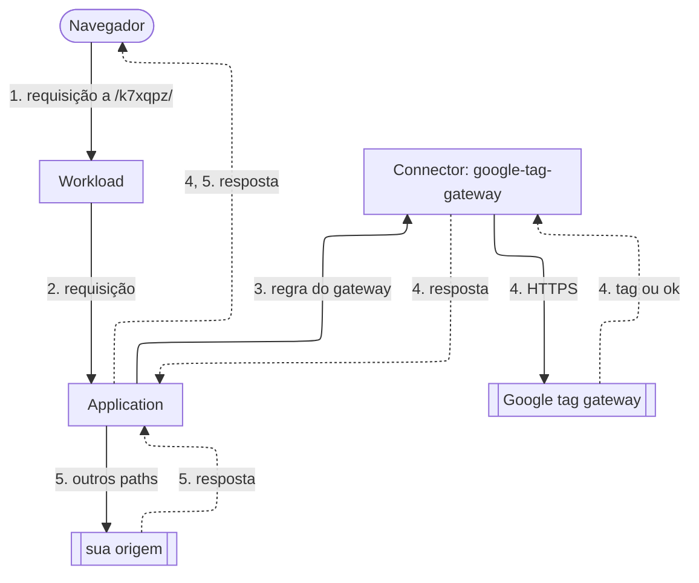

import DocCardGroup from '@aziontech/webkit/doc-card-group'
import DocCard from '@aziontech/webkit/doc-card'
import Tabs from '~/components/webkit/Tabs.vue'
import Code from '~/components/webkit/CodeBlock.vue'

As tags do Google, como Google Tag Manager (GTM), Google Analytics 4 (GA4) e Google Ads, carregam por padrão a partir de `googletagmanager.com`. Bloqueadores de anúncios e navegadores como Safari e Brave costumam bloquear esse domínio, então visitas e conversões acontecem e nunca chegam aos seus relatórios. O Google tag gateway for advertisers serve as mesmas tags a partir de um path do seu próprio domínio, como `www.example.com/k7xqpz/`.

Na Azion, o gateway usa um [Connector](/pt-br/documentacao/plataforma/connectors/) que alcança o endpoint do Google e uma regra da Request Phase na Application que já serve o seu site. A regra precisa de Application Accelerator ativado nessa Application. Você pode configurar tudo isso pelo Azion Console, pela Azion CLI ou pela API. O restante do site continua chegando à sua origem.

As setas contínuas levam a requisição, e as setas pontilhadas levam a resposta. Cada rótulo começa com o número do seu passo abaixo.



1. A página no navegador carrega o script da tag, ou envia um evento, pelo path de medição do seu domínio. A barra de endereço não muda.
2. O Workload do seu domínio recebe a requisição, e a Application que o deployment desse Workload define executa as regras da Request Phase.
3. A regra do gateway casa com o path de medição, ignora o cache, adiciona o país e a região do visitante e define o Connector.
4. O Connector envia a requisição por HTTPS a `<tag-id>.fps.goog`, e a resposta do Google volta pelo Connector e pela Application até o navegador.
5. As requisições para todos os outros paths continuam chegando à sua origem pelas regras que já servem o site.

---

## Pré-requisitos

<Tabs client:visible sharedStore="interface">
<Fragment slot="tab.console">Console</Fragment>
<Fragment slot="tab.cli">CLI</Fragment>
<Fragment slot="tab.api">API</Fragment>

<Fragment slot="panel.console">

### Console

- O ID da tag, no console do Google tag gateway. Com o GTM, é o ID do container, como `GTM-ABC123`.
- O path de medição, um path que o seu site não usa, como `/k7xqpz/`.
- Uma Application que serve o seu site por meio de um Workload. Para criar uma, consulte [Primeiros passos com Applications](/pt-br/documentacao/plataforma/applications/primeiros-passos/).
- Acesso ao [Azion Console](https://console.azion.com/).

</Fragment>

<Fragment slot="panel.cli">

### CLI

- O ID da tag, no console do Google tag gateway. Com o GTM, é o ID do container, como `GTM-ABC123`.
- O path de medição, um path que o seu site não usa, como `/k7xqpz/`.
- Uma Application que serve o seu site por meio de um Workload, e o ID dela. Para criar uma, consulte [Primeiros passos com Applications](/pt-br/documentacao/plataforma/applications/primeiros-passos/).
- A [Azion CLI](/pt-br/documentacao/devtools/cli/), instalada e autorizada.

</Fragment>

<Fragment slot="panel.api">

### API

- O ID da tag, no console do Google tag gateway. Com o GTM, é o ID do container, como `GTM-ABC123`.
- O path de medição, um path que o seu site não usa, como `/k7xqpz/`.
- Uma Application que serve o seu site por meio de um Workload, e o ID dela. Para criar uma, consulte [Primeiros passos com Applications](/pt-br/documentacao/plataforma/applications/primeiros-passos/).
- Um [token pessoal](/pt-br/documentacao/fundamentos/personal-tokens/) e o `curl`.

</Fragment>

</Tabs>

Um container do GTM cobre todas as tags dentro dele. Cada Google tag avulsa, com um ID que começa com `G-`, precisa de uma configuração própria. Dê a cada container ou tag o seu próprio path de medição e o seu próprio Connector. Depois, repita as seções do Connector, da regra, da posição e da conferência para cada um.

:::note[nota]
O path de medição não pode ser `/` e tem no máximo 100 caracteres.
:::

Uma sequência aleatória, como `/k7xqpz/`, evita conflito com um path que o seu site já serve. Os exemplos usam o ID de tag `GTM-ABC123`, o path `/k7xqpz/` e o domínio `www.example.com`: substitua-os pelos seus valores.

---

## Crie um Connector para o Google

O Connector guarda o endereço do endpoint do Google para a sua tag: `<tag-id>.fps.goog`, com o ID da tag em minúsculas, como `gtm-abc123.fps.goog`. O header `Host` leva o mesmo valor, porque o Google lê a tag a partir dele: com o padrão `${host}`, o Google recebe o domínio do seu site e não reconhece a tag. O endpoint aceita apenas HTTPS, na porta 443. O Connector não envia prefixo de path, então o path que o navegador pediu chega ao Google sem alteração.

Em uma Application, um Connector ocupa o lugar de uma origem. Um Connector não muda nada no seu site até que uma regra defina esse Connector.

<Tabs client:visible sharedStore="interface">

<Fragment slot="panel.console">

### Console

Para criar o Connector no Azion Console:

1. Acesse [Azion Console](https://console.azion.com/) > **Connectors**.
2. Selecione **+ Connectors**.
3. Em **Name**, insira `google-tag-gateway`.
4. Em **Connector Type**, mantenha _HTTP_.
5. Em **Host**, substitua `${host}` por `gtm-abc123.fps.goog`.
6. Deixe **Path** vazio.
7. Em **Transport Protocol Policy**, selecione _Force HTTPS_.
8. Em **Address Management**, insira `gtm-abc123.fps.goog` em **Address**.
9. Selecione **Save**.

O Connector aparece na lista **Connectors**, com `gtm-abc123.fps.goog` em **Address**.

</Fragment>

<Fragment slot="panel.cli">

### CLI

Para criar o Connector com a Azion CLI, salve-o como `connector.json`:

<Code client:visible lang="json" fileName="connector.json" code={`{
\x20 "name": "google-tag-gateway",
\x20 "type": "http",
\x20 "attributes": {
\x20   "addresses": [{"address": "gtm-abc123.fps.goog"}],
\x20   "connection_options": {
\x20     "transport_policy": "force_https",
\x20     "host": "gtm-abc123.fps.goog"
\x20   }
\x20 }
}`} />

Depois, crie o Connector a partir do arquivo:

<Code client:visible lang="bash" code={`azion create connector --type http --file connector.json`} />

```text
Created Connector with ID 237847
```

O seu ID é diferente. Guarde-o para a regra.

</Fragment>

<Fragment slot="panel.api">

### API

Para criar o Connector com a API, envie uma requisição `POST` ao endpoint de Connectors:

<Code client:visible lang="bash" code={`curl --request POST \\
\x20 --url https://api.azion.com/v4/workspace/connectors \\
\x20 --header 'Accept: application/json' \\
\x20 --header 'Authorization: Token [TOKEN VALUE]' \\
\x20 --header 'Content-Type: application/json' \\
\x20 --data '{
\x20   "name": "google-tag-gateway",
\x20   "type": "http",
\x20   "attributes": {
\x20     "addresses": [{"address": "gtm-abc123.fps.goog"}],
\x20     "connection_options": {
\x20       "transport_policy": "force_https",
\x20       "host": "gtm-abc123.fps.goog"
\x20     }
\x20   }
\x20 }'`} />

A API responde `202` com `"state": "pending"` e o Connector. Guarde `data.id` para a regra:

```json
{
  "state": "pending",
  "data": {
    "id": 237845,
    "name": "google-tag-gateway",
    "type": "http",
    "attributes": {
      "addresses": [{"active": true, "address": "gtm-abc123.fps.goog", "http_port": 80, "https_port": 443, "modules": null}],
      "connection_options": {
        "dns_resolution": "both",
        "transport_policy": "force_https",
        "http_version_policy": "http1_1",
        "host": "gtm-abc123.fps.goog",
        "path_prefix": "",
        …
      },
      …
    },
    …
  }
}
```

</Fragment>

</Tabs>

O Google também aceita o ID da tag em um header `X-Gtg-Tag-Id`, necessário apenas quando o `Host` é só `fps.goog`. Na configuração manual que este guia segue, o ID da tag está no endereço e no `Host`, então o Connector não precisa de nenhum outro header.

---

## Ative Application Accelerator

A regra do gateway precisa de [Application Accelerator](/pt-br/documentacao/plataforma/applications/application-accelerator/) ativado na Application. Sem ele, a API recusa _Forward Cookies_ com `25047` `Missing Required Modules`. Azion Console lista _Bypass Cache_ como `Bypass Cache - Required Application Accelerator`.

<Tabs client:visible sharedStore="interface">

<Fragment slot="panel.console">

### Console

Para ativar Application Accelerator no Azion Console:

1. Acesse [Azion Console](https://console.azion.com/) > **Applications**.
2. Selecione a Application que serve o seu site.
3. Na aba **Main Settings**, em **Modules**, ative **Application Accelerator**.
4. Selecione **Save**.

Depois de salvar, o seletor **Application Accelerator** fica ativado.

</Fragment>

<Fragment slot="panel.cli">

### CLI

Para ativar Application Accelerator com a Azion CLI, substitua `<application-id>` pelo ID da sua Application:

<Code client:visible lang="bash" code={`azion update application --application-id <application-id> --application-accelerator true`} />

```text
Updated Application with ID <application-id>
```

</Fragment>

<Fragment slot="panel.api">

### API

Para ativar Application Accelerator com a API, envie uma requisição `PATCH` à sua Application. Substitua `<application-id>` pelo ID dela:

<Code client:visible lang="bash" code={`curl --request PATCH \\
\x20 --url https://api.azion.com/v4/workspace/applications/<application-id> \\
\x20 --header 'Accept: application/json' \\
\x20 --header 'Authorization: Token [TOKEN VALUE]' \\
\x20 --header 'Content-Type: application/json' \\
\x20 --data '{"modules": {"application_accelerator": {"enabled": true}}}'`} />

A API responde `202`, e `data.modules.application_accelerator.enabled` fica `true`.

</Fragment>

</Tabs>

---

## Encaminhe o path de medição ao Google

Uma regra da Request Phase envia as requisições para `/k7xqpz/` e tudo abaixo dele ao Connector. Cada parte da regra tem uma função:

| Parte da regra | Por que o gateway precisa dela |
| --- | --- |
| _starts with_ `/k7xqpz/` | Casa com o path e tudo abaixo dele, como scripts e eventos |
| _Set Connector_ | Envia só essas requisições ao Google |
| _Bypass Cache_ | Mantém o script e os eventos de cada visitante fora do cache, sem cache setting |
| _Forward Cookies_ | Entrega ao visitante o header `Set-Cookie` da resposta do Google |
| _Add Request Header_, país | Envia o país do visitante, como `BR` |
| _Add Request Header_, região | Envia a região do visitante, como `SP` |

Com _is equal_ no lugar de _starts with_, só o path exato chega ao Google, e a medição quebra. Sem _Bypass Cache_, um visitante pode receber a resposta guardada em cache para outro, e as requisições `POST` dos eventos deixam de chegar ao Google. Os cookies `_ga` e `_gcl_*` ligam uma visita vinda de um anúncio à compra que ela gera, então o ganho do gateway depende deles.

Como a Azion fica entre o navegador e o Google, o Google recebe cada requisição a partir do endereço IP da Azion, e não do visitante. Os dois headers levam a localização do visitante: `${geoip_country_code}` guarda o código de país ISO 3166-1, e `${geoip_region}` guarda o código da região. Sem eles, o GA4 registra a geografia do visitante como `(not set)`, e regras de consentimento que dependem da região podem falhar.

<Tabs client:visible sharedStore="interface">

<Fragment slot="panel.console">

### Console

Para criar a regra no Azion Console:

1. Acesse [Azion Console](https://console.azion.com/) > **Applications**.
2. Selecione a Application que serve o seu site.
3. Selecione a aba **Rules Engine**.
4. Selecione **+ Rule**.
5. Em **Name**, insira `Google Tag Gateway`.
6. Em **Phase**, mantenha _Request Phase_.
7. Em **Criteria**, mantenha `${uri}` e _starts with_ e insira `/k7xqpz/` como argumento.
8. Em **Behaviors**, selecione _Set Connector_ e depois `google-tag-gateway`.
9. Selecione **+ Add Behavior** e depois _Bypass Cache_.
10. Selecione **+ Add Behavior** e depois _Forward Cookies_.
11. Selecione **+ Add Behavior** e depois _Add Request Header_.
12. No campo do behavior, insira `X-Forwarded-Country: ${geoip_country_code}`.
13. Selecione **+ Add Behavior** e depois _Add Request Header_.
14. No campo do behavior, insira `X-Forwarded-Region: ${geoip_region}`.
15. Selecione **Save**.

A regra aparece por último na lista **Request** da aba **Rules Engine**, com o status `Active`.

</Fragment>

<Fragment slot="panel.cli">

### CLI

Para criar a regra com a Azion CLI, salve-a como `rule.json`. Substitua `<connector-id>` pelo ID do Connector:

<Code client:visible lang="json" fileName="rule.json" code={`{
\x20 "name": "Google Tag Gateway",
\x20 "criteria": [[{"variable": "\${uri}", "conditional": "if", "operator": "starts_with", "argument": "/k7xqpz/"}]],
\x20 "behaviors": [
\x20   {"type": "set_connector", "attributes": {"value": <connector-id>}},
\x20   {"type": "bypass_cache"},
\x20   {"type": "forward_cookies"},
\x20   {"type": "add_request_header", "attributes": {"value": "X-Forwarded-Country: \${geoip_country_code}"}},
\x20   {"type": "add_request_header", "attributes": {"value": "X-Forwarded-Region: \${geoip_region}"}}
\x20 ]
}`} />

Depois, crie a regra na Request Phase da sua Application:

<Code client:visible lang="bash" code={`azion create rules-engine --application-id <application-id> --phase request --file rule.json`} />

```text
Created Rules Engine with ID 1554059
```

</Fragment>

<Fragment slot="panel.api">

### API

Para criar a regra com a API, envie uma requisição `POST` às regras da Request Phase da sua Application. Substitua `<application-id>` e `<connector-id>` pelos seus IDs:

<Code client:visible lang="bash" code={`curl --request POST \\
\x20 --url https://api.azion.com/v4/workspace/applications/<application-id>/request_rules \\
\x20 --header 'Accept: application/json' \\
\x20 --header 'Authorization: Token [TOKEN VALUE]' \\
\x20 --header 'Content-Type: application/json' \\
\x20 --data '{
\x20   "name": "Google Tag Gateway",
\x20   "criteria": [[{"variable": "\${uri}", "conditional": "if", "operator": "starts_with", "argument": "/k7xqpz/"}]],
\x20   "behaviors": [
\x20     {"type": "set_connector", "attributes": {"value": <connector-id>}},
\x20     {"type": "bypass_cache"},
\x20     {"type": "forward_cookies"},
\x20     {"type": "add_request_header", "attributes": {"value": "X-Forwarded-Country: \${geoip_country_code}"}},
\x20     {"type": "add_request_header", "attributes": {"value": "X-Forwarded-Region: \${geoip_region}"}}
\x20   ]
\x20 }'`} />

A API responde `202` com a regra. O `order` dela é a posição da regra na Request Phase, e uma regra nova fica na última:

```json
{
  "state": "pending",
  "data": {
    "id": 1554057,
    "name": "Google Tag Gateway",
    "active": true,
    …
    "order": 1,
    …
  }
}
```

</Fragment>

</Tabs>

Use _Add Request Header_, que adiciona o header à requisição que o Google recebe. _Add Response Header_ adiciona o header à resposta que o navegador recebe, que o Google nunca lê. _Filter Request Header_ é opcional. Quando o navegador envia um header com o mesmo nome, _Add Request Header_ substitui o valor dele, então um visitante não consegue forjar uma localização.

O gateway não precisa de regra na Response Phase. Confira se nenhuma regra da Response Phase da Application remove `Content-Type` ou `Set-Cookie`: sem eles, o script chega quebrado ao navegador, ou os cookies nunca chegam a ele. Remover o header `Server` não causa problema.

A Azion encaminha o endereço IP do visitante à origem em `X-Forwarded-For`, e o Google exige esse valor íntegro. Confira se nenhuma regra da Application altera esse header.

O Google também aceita um header com a latitude, a longitude e a cidade, `X-Forwarded-Geolocation`. O gateway funciona sem ele. O Rules Engine não tem variável de latitude nem de longitude, então uma [Function](/pt-br/documentacao/plataforma/functions/) pode montar esse header se a sua configuração exigir.

---

## Deixe a regra por último

A Application executa as regras da Request Phase em ordem, e quando várias regras que casam definem um Connector, vale a última. Quando uma regra que envia todos os paths à sua origem vem primeiro, a regra do gateway vem depois dela. Uma regra nova fica na última posição, então a regra do gateway só precisa ser movida quando outra regra vem depois dela.

<Tabs client:visible sharedStore="interface">

<Fragment slot="panel.console">

### Console

Para mover a regra no Azion Console:

1. Acesse [Azion Console](https://console.azion.com/) > **Applications**.
2. Selecione a Application que serve o seu site.
3. Selecione a aba **Rules Engine**.
4. Na lista **Request**, selecione a seta para baixo ao lado do número de `Google Tag Gateway` até que ela seja a última regra.
5. Selecione **Review Changes**.
6. Em **Review Changes**, confira as novas posições e selecione **Save**.

`Google Tag Gateway` é a última regra da lista **Request**.

</Fragment>

<Fragment slot="panel.cli">

### CLI

Para listar as regras da Request Phase com a Azion CLI:

<Code client:visible lang="bash" code={`azion list rules-engine --application-id <application-id> --phase request --details`} />

```text
ID       NAME                ORDER  PHASE    ACTIVE
1554059  Google Tag Gateway  0      request  true
1554058  site                1      request  true
```

Neste exemplo, a regra `site` tem um `ORDER` maior que a regra do gateway, então a regra do gateway precisa ser movida.

Para mover a regra do gateway para o fim, passe todos os IDs de regra da fase na nova ordem, com a regra do gateway por último:

<Code client:visible lang="bash" code={`azion update rules-engine-order --application-id <application-id> --phase request --rule-ids <other-rule-ids>,<gateway-rule-id>`} />

```text
Ordered Rules Engine of Application with ID <application-id>
```

Liste as regras de novo: a regra do gateway tem o maior `ORDER`.

</Fragment>

<Fragment slot="panel.api">

### API

Para mover a regra com a API, envie uma requisição `PUT` com todos os IDs de regra da Request Phase na nova ordem, com a regra do gateway por último:

<Code client:visible lang="bash" code={`curl --request PUT \\
\x20 --url https://api.azion.com/v4/workspace/applications/<application-id>/request_rules/order \\
\x20 --header 'Accept: application/json' \\
\x20 --header 'Authorization: Token [TOKEN VALUE]' \\
\x20 --header 'Content-Type: application/json' \\
\x20 --data '{"order": [<other-rule-ids>, <gateway-rule-id>]}'`} />

A API responde `202` com as regras da fase, e a regra do gateway tem o maior `order`.

</Fragment>

</Tabs>

Antes de conferir o gateway, abra as outras regras da Request Phase da Application. Uma regra ampla, como uma que casa com extensões de arquivo, `/static` ou argumentos de query string, não pode casar com o path de medição. Se o deployment do Workload define um Firewall com regras de WAF ou de bots, confira se elas não bloqueiam requisições `POST` ao path de medição.

---

## Confira o gateway

O Google responde a duas URLs de teste pelo gateway. Aguarde a propagação das mudanças e abra cada URL em uma janela anônima do navegador, ou faça a requisição com `curl`:

<Code client:visible lang="bash" code={`curl https://www.example.com/k7xqpz/healthy`} />

```text
ok
```

A segunda URL confere os headers de país e de região:

<Code client:visible lang="bash" code={`curl 'https://www.example.com/k7xqpz/?validate_geo=healthy'`} />

```text
ok
```

Uma regra chega ao tráfego ao longo de vários minutos, e cada data center a aplica no seu próprio momento. Até lá, o path de medição continua chegando à sua origem, e a resposta é a página `404` do seu próprio site. Um teste pode passar e depois falhar enquanto a mudança se propaga, porque cada requisição pode chegar a um data center diferente.

:::caution[Atenção]
Cada nova edição da regra reinicia a propagação. Aguarde de 10 a 15 minutos sem alterar a regra antes de diagnosticar.
:::

Quem abre o path de medição no navegador vê só uma resposta técnica do Google. O visual de um `404` mostra para onde a requisição foi. Um `404` com o visual do seu site significa que a requisição ainda chega à sua origem. Uma página de erro simples do Google significa que a requisição chegou ao Google, e o Connector ou os headers precisam de correção.

---

## Atualize o seu site

O restante da configuração acontece no seu site e nos produtos do Google:

1. No console do Google tag gateway, escolha a configuração manual e ative o gateway com o mesmo path de medição da regra.
2. Se o GTM está escrito no código do seu site, aponte o `src` do script para o path de medição. O snippet `<noscript>` continua apontando para `googletagmanager.com`.
3. No Tag Assistant, confira se os hits que a sua página envia saem pelo path de medição.
4. Acompanhe os resultados por 24 a 48 horas. O GA4 preenche a geografia dos visitantes sem `(not set)`, e [Real-Time Metrics](/pt-br/documentacao/plataforma/real-time-metrics/) não mostra aumento de respostas `4xx` ou `5xx` no path.

Para um container do GTM, o snippet muda uma linha, o endereço do `gtm.js`:

```js
// antes
j.src='https://www.googletagmanager.com/gtm.js?id='+i+dl;
// depois
j.src='/k7xqpz/?id='+i+dl;
```

Para uma Google tag avulsa, o `gtag.js` passa para o path de medição:

```html
<!-- antes -->
<script async src="//www.googletagmanager.com/gtag/js?id=G-12345"></script>
<!-- depois -->
<script async src="/k7xqpz/"></script>
```

O gateway muda apenas de onde a tag carrega e para onde ela envia dados. A tag continua executando no navegador, enquanto o server-side tagging do GTM processa os dados em um servidor seu, e você pode combinar os dois. O consentimento continua com o seu site e a plataforma de gestão de consentimento dele: o gateway não substitui o Consent Mode, e os headers de localização ajudam o Google a aplicar regras de consentimento por região.

---

## Desative o gateway

Para parar o gateway, primeiro aponte o `src` do script da tag de volta para `googletagmanager.com` e depois desative a regra. Uma regra inativa não executa, então o path de medição volta a chegar à sua origem. O Connector fica no lugar para uma volta posterior.

<Tabs client:visible sharedStore="interface">

<Fragment slot="panel.console">

### Console

Para desativar a regra no Azion Console:

1. Acesse [Azion Console](https://console.azion.com/) > **Applications**.
2. Selecione a Application que serve o seu site.
3. Selecione a aba **Rules Engine**.
4. Selecione `Google Tag Gateway`.
5. Em **Status**, desative **Active**.
6. Selecione **Save**.

A regra mostra o status `Inactive` na lista **Request**.

</Fragment>

<Fragment slot="panel.cli">

### CLI

Para desativar a regra com a Azion CLI, salve a mudança como `deactivate.json`:

<Code client:visible lang="json" fileName="deactivate.json" code={`{"active": false}`} />

Depois, atualize a regra. Substitua `<rule-id>` pelo ID da regra do gateway:

<Code client:visible lang="bash" code={`azion update rules-engine --application-id <application-id> --phase request --rule-id <rule-id> --file deactivate.json`} />

```text
Updated Rules Engine with ID <rule-id>
```

</Fragment>

<Fragment slot="panel.api">

### API

Para desativar a regra com a API, envie uma requisição `PATCH` com `active` igual a `false`:

<Code client:visible lang="bash" code={`curl --request PATCH \\
\x20 --url https://api.azion.com/v4/workspace/applications/<application-id>/request_rules/<rule-id> \\
\x20 --header 'Accept: application/json' \\
\x20 --header 'Authorization: Token [TOKEN VALUE]' \\
\x20 --header 'Content-Type: application/json' \\
\x20 --data '{"active": false}'`} />

A API responde `202`, e `data.active` fica `false`.

</Fragment>

</Tabs>

Depois que a mudança se propaga, `/k7xqpz/healthy` responde com a página `404` do seu site, então um snippet que ainda pede o path de medição deixa de carregar as tags.

---

## Resolva problemas do gateway

Cada sintoma indica a causa provável e a correção:

| Sintoma | Causa e correção |
| --- | --- |
| Um teste passa e depois falha | A mudança ainda está se propagando. Aguarde de 10 a 15 minutos sem editar a regra |
| Um `404` com o visual do seu site | A regra não casou. Confira _starts with_, espaços no argumento e a posição da regra |
| Um `404` que continua após a propagação | O `404` da sua origem está em cache. Purgue `www.example.com/k7xqpz/*` com um purge por wildcard |
| `healthy` passa e `validate_geo` falha | Os headers de localização estão ausentes. Confira os dois behaviors _Add Request Header_ e as variáveis |
| Uma página de erro do Google | Um endereço, `Host` ou ID errado, como um ID do GA4 no lugar do ID do container. Use o ID em minúsculas |
| O script chega quebrado | Uma regra da Response Phase remove `Content-Type` ou altera a compressão. Exclua o path de medição |

Para purgar por wildcard, consulte [Purgue conteúdo em cache](/pt-br/documentacao/guias/performance-e-confiabilidade/cache-e-purge/purgar-conteudo-em-cache/).

A regra pertence a uma Application, então alcança só os domínios dos Workloads cujo deployment define essa Application. Um site de homologação servido por outra Application também precisa da regra nessa Application, assim como qualquer subdomínio do seu funil de compra que outra Application serve. As duas Applications podem definir o mesmo Connector.

Os critérios comparam o path como o navegador o envia. Com _starts with_ `/k7xqpz/`, uma requisição a `/k7xqpz` sem a barra final não casa e chega à sua origem. Os snippets de Atualize o seu site sempre pedem um path abaixo de `/k7xqpz/`.

---

## Próximos passos

<DocCardGroup cols={2}>
  <DocCard title="Rules Engine para Applications" href="/pt-br/documentacao/plataforma/applications/rules-engine/" label="Todos os behaviors, variáveis e operadores que uma regra pode usar." />
  <DocCard title="Configurações de connector" href="/pt-br/documentacao/plataforma/connectors/configuracoes/" label="Todas as opções de conexão de um Connector, com o campo da API e o padrão." />
</DocCardGroup>
