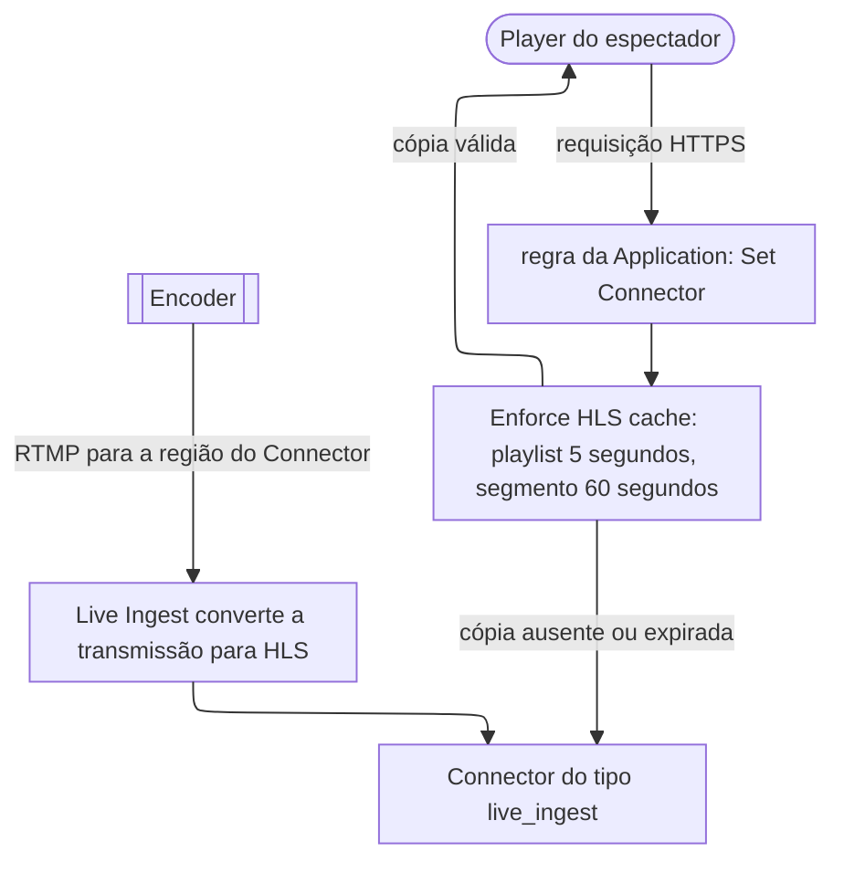

import DocCardGroup from '@aziontech/webkit/doc-card-group'
import DocCard from '@aziontech/webkit/doc-card'
import DocSteps from '@aziontech/webkit/doc-steps'
import DocStep from '@aziontech/webkit/doc-step'
import Tabs from '~/components/webkit/Tabs.vue'

Você cria um Connector do tipo `live_ingest` e uma regra da sua Application, pelo Azion Console ou pela API. O Connector define a região em que o [Live Ingest](/pt-br/documentacao/plataforma/connectors/live-ingest/) recebe a sua transmissão, e a regra encaminha as requisições dos espectadores ao Live Ingest. Para uma transmissão HTTP Live Streaming (HLS) que a sua própria origem produz, consulte [Implemente cache HLS para streaming ao vivo](/pt-br/documentacao/guias/midia-e-streaming/streaming/implementar-cache-hls/).

Seu encoder envia a transmissão por Real-Time Messaging Protocol (RTMP) ao Live Ingest, um recurso da plataforma aninhado em Connectors. O Live Ingest converte a transmissão para HLS: uma playlist, `.m3u8`, e os segmentos que ela lista, `.ts`. Os espectadores nunca chegam ao Live Ingest diretamente. Eles solicitam a transmissão a uma Application, e uma regra dessa Application define o Connector.



1. O encoder envia a transmissão por RTMP ao Live Ingest, na região do Connector.
2. O Live Ingest converte a transmissão para HLS.
3. O player de um espectador solicita a transmissão à Application, e o behavior _Set Connector_ de uma regra define o Connector.
4. As requisições que a regra envia ao Connector seguem a política de cache de HLS ao vivo do _Enforce HLS cache_: cada playlist fica em cache por 5 segundos e cada segmento por 60 segundos.
5. Uma cópia válida em cache responde a todos os espectadores, e só uma cópia expirada ou ausente é buscada pelo Connector.

---

## Pré-requisitos

<Tabs client:visible sharedStore="interface">
<Fragment slot="tab.console">Console</Fragment>
<Fragment slot="tab.api">API</Fragment>

<Fragment slot="panel.console">

### Console

- Uma Application servida por um Workload, com um hostname que os espectadores solicitam. Para criar os dois, consulte [Primeiros passos com Applications](/pt-br/documentacao/plataforma/applications/primeiros-passos/).
- Um encoder que envia RTMP com autenticação por usuário e senha. A Azion fornece as credenciais e as URLs de ingestão de um endpoint primário e de um endpoint de backup. Para o requisito, consulte [Ingestão](/pt-br/documentacao/plataforma/connectors/live-ingest/ingestao-e-entrega/#ingestao).
- Acesso ao Azion Console. Consulte [Acesse o Azion Console](/pt-br/documentacao/guias/plataforma/conta-e-billing/como-acessar-o-azion-console/).

</Fragment>

<Fragment slot="panel.api">

### API

- Uma Application servida por um Workload, com um hostname que os espectadores solicitam. Para criar os dois, consulte [Primeiros passos com Applications](/pt-br/documentacao/plataforma/applications/primeiros-passos/).
- Um encoder que envia RTMP com autenticação por usuário e senha. A Azion fornece as credenciais e as URLs de ingestão de um endpoint primário e de um endpoint de backup. Para o requisito, consulte [Ingestão](/pt-br/documentacao/plataforma/connectors/live-ingest/ingestao-e-entrega/#ingestao).
- Um [personal token](/pt-br/documentacao/guias/plataforma/conta-e-billing/personal-tokens/).

</Fragment>

</Tabs>

Este guia não cobre como você obtém as URLs de ingestão e as credenciais, nem o formato da URL da playlist que os espectadores solicitam. Os exemplos usam `my-live-connector` para o Connector e `us-east-1` para a região. Substitua-os pelos seus valores.

---

## Crie o Connector do Live Ingest

Um Connector do tipo `live_ingest` carrega uma configuração, a região onde o Live Ingest recebe a transmissão. Escolha a região mais próxima do encoder, não dos espectadores: ela encurta o caminho que a transmissão percorre antes de a Azion recebê-la. A região aceita um de cinco valores: `us-east-1`, `us-east-2`, `br-east-1`, `br-east-2` ou `br-east-3`.

<Tabs client:visible sharedStore="interface">

<Fragment slot="panel.console">

### Console

Para criar o Connector no Azion Console:

<DocSteps>
  <DocStep title="Abra a página Connectors">

  Acesse [Azion Console](https://console.azion.com/) > **Connectors**.

  </DocStep>
  <DocStep title="Selecione + Connectors">

  A página **Create Connector** é aberta.

  </DocStep>
  <DocStep title="Dê um nome ao Connector">

  Em **General**, insira `my-live-connector` como **Name**.

  </DocStep>
  <DocStep title="Selecione o tipo Live Ingest">

  Em **Connector Type**, selecione _Live Ingest_.

  </DocStep>
  <DocStep title="Selecione a região">

  Em **Region**, selecione _us-east-1_. O campo é obrigatório.

  </DocStep>
  <DocStep title="Selecione Save" />
</DocSteps>

O Connector `my-live-connector` existe na sua conta em `us-east-1`.

</Fragment>

<Fragment slot="panel.api">

### API

Para criar o Connector, envie o nome, o tipo e a região dele ao endpoint de Connectors:

```bash
curl --request POST \
  --url https://api.azion.com/v4/workspace/connectors \
  --header 'Authorization: Token <personal-token>' \
  --header 'Content-Type: application/json' \
  --data '{
  "name": "my-live-connector",
  "type": "live_ingest",
  "attributes": { "region": "us-east-1" }
}'
```

A API responde `202` com `"state": "pending"`, e a leitura do Connector retorna `"attributes": {"region": "us-east-1"}`. Anote o `id` dele, que a regra guarda em `attributes.value`. Uma requisição sem `region` falha com `10059`, e uma região fora dos cinco valores falha com `10039`.

</Fragment>
</Tabs>

O Connector existe na sua conta, e nenhuma requisição de espectador chega a ele até que uma regra da Application o defina. Uma mudança em um Connector chega à infraestrutura distribuída da Azion em alguns minutos.

No caso de uso [Transmitir eventos ao vivo para grandes audiências](/pt-br/documentacao/casos-de-uso/entregar-midia-e-streaming/transmitir-eventos-ao-vivo-para-grandes-audiencias/), esta seção usa estes valores:

| Configuração | Valor |
| --- | --- |
| **Name** | `live-ingest-us`, que a regra de entrega define |
| **Type** | _Live Ingest_, `live_ingest` na API |
| **Region** | `us-east-1`, a região mais próxima do local do evento |

O Connector existe na sua conta em `us-east-1`, e nenhuma requisição de espectador chega a ele até que uma regra da Application o defina.

---

## Envie as requisições dos espectadores ao Connector

Uma regra da Request Phase com o behavior _Set Connector_ define o Connector para as requisições que ela corresponde. Em uma Application que serve só a transmissão, a regra corresponde a todos os paths: `${uri}` começa com `/`. Quando várias regras correspondentes carregam _Set Connector_, só a última é executada, então mantenha esta regra depois de qualquer regra que defina outro Connector para todos os paths. Uma regra nova fica depois das regras que a Application já tem.

<Tabs client:visible sharedStore="interface">

<Fragment slot="panel.console">

### Console

Para criar a regra no Azion Console:

<DocSteps>
  <DocStep title="Abra a Application">

  Acesse [Azion Console](https://console.azion.com/) > **Applications** e selecione a Application que entrega a transmissão.

  </DocStep>
  <DocStep title="Selecione a aba Rules Engine" />
  <DocStep title="Selecione + Rule" />
  <DocStep title="Nomeie a regra">

  Em **General**, insira `send-to-live-ingest` como **Name**.

  </DocStep>
  <DocStep title="Selecione a fase de requisição">

  Em **Phase**, selecione _Request Phase_.

  </DocStep>
  <DocStep title="Defina o critério">

  Em **Criteria**, selecione a variável `${uri}` e o operador _starts with_, e insira `/` como argumento.

  </DocStep>
  <DocStep title="Selecione o behavior Set Connector">

  Em **Behaviors**, selecione _Set Connector_.

  </DocStep>
  <DocStep title="Selecione o Connector do Live Ingest">

  No behavior _Set Connector_, selecione `my-live-connector`.

  </DocStep>
  <DocStep title="Selecione Save" />
</DocSteps>

A regra aparece na aba **Rules Engine**, sob o título **Request**.

</Fragment>

<Fragment slot="panel.api">

### API

Para criar a regra, envie-a às regras da Request Phase da Application. Substitua `<connector-id>` pelo `id` do Connector:

```bash
curl --request POST \
  --url https://api.azion.com/v4/workspace/applications/<application-id>/request_rules \
  --header 'Authorization: Token <personal-token>' \
  --header 'Content-Type: application/json' \
  --data '{
  "name": "send-to-live-ingest",
  "active": true,
  "criteria": [[{ "variable": "${uri}", "conditional": "if", "operator": "starts_with", "argument": "/" }]],
  "behaviors": [{ "type": "set_connector", "attributes": { "value": <connector-id> } }]
}'
```

A API responde `202` com `"state": "pending"` e a regra armazenada, cujos `behaviors` contêm só `set_connector`. O _Enforce HLS cache_ não tem um `type` da API para enviar.

</Fragment>
</Tabs>

Todas as requisições da Application agora chegam à transmissão pelo Connector, sob a política de cache de HLS ao vivo. Uma regra nova pode levar alguns minutos para se propagar.

Essa política vem do [Enforce HLS cache](/pt-br/documentacao/plataforma/applications/rules-engine/#enforce-hls-cache): ele ignora as configurações de cache da Application e mantém cada playlist em cache por 5 segundos e cada segmento por 60 segundos. Um behavior _Set Cache Policy_ nessas requisições, portanto, não tem efeito, então não adicione um. Uma cópia em cache de um segmento responde a todos os espectadores que o solicitam nesse tempo, então um público grande não envia cada uma das suas requisições ao Live Ingest.

No caso de uso [Transmitir eventos ao vivo para grandes audiências](/pt-br/documentacao/casos-de-uso/entregar-midia-e-streaming/transmitir-eventos-ao-vivo-para-grandes-audiencias/), esta seção usa estes valores:

| Configuração | Valor |
| --- | --- |
| **Name** | `live - send to Live Ingest`, na Request Phase |
| **Criterion** | `${uri}` starts with `/`, porque a Application em `live.example.com` serve apenas a transmissão |
| **Behavior** | _Set Connector_, definindo `live-ingest-us` |

A regra define o Connector `live-ingest-us`.

---

## Confirme que a transmissão responde pelo cache

Execute estas requisições enquanto o encoder estiver transmitindo. Cada uma envia o header `Pragma: azion-debug-cache`, que faz a resposta trazer o header `x-cache`. Os exemplos usam `live.example.com` para o hostname que os espectadores requisitam. Substitua-o, `<stream>` e `<segment>` pelos seus valores.

:::note[nota]
Uma transmissão de teste é ingerida como uma real e é cobrada. Para o que o Live Ingest cobra e o valor, consulte [Preços](/pt-br/documentacao/fundamentos/precos/#live-ingest).
:::

Requisite a playlist duas vezes em até 5 segundos:

```bash
curl -sI -H "Pragma: azion-debug-cache" https://live.example.com/<stream>.m3u8
```

A segunda resposta traz `x-cache: HIT`. A primeira pode trazer `MISS`, enquanto a Application busca a playlist pelo Connector.

Pegue o nome de um segmento no corpo da playlist e requisite-o duas vezes em até 60 segundos:

```bash
curl -sI -H "Pragma: azion-debug-cache" https://live.example.com/<segment>.ts
```

A segunda resposta traz `x-cache: HIT`. Para saber como ler o header, consulte [Verifique o status de cache de uma resposta](/pt-br/documentacao/guias/performance-e-confiabilidade/cache-e-purge/verificar-tempo-de-cache-da-pagina/).

No caso de uso [Transmitir eventos ao vivo para grandes audiências](/pt-br/documentacao/casos-de-uso/entregar-midia-e-streaming/transmitir-eventos-ao-vivo-para-grandes-audiencias/), espere:

- **Os espectadores conseguem reproduzir a transmissão.** Carregue `https://live.example.com/<stream>.m3u8` em um player HLS, como a configuração do hls.js em [Boas práticas de Connectors](/pt-br/documentacao/plataforma/connectors/boas-praticas/#de-ao-player-um-fallback-para-erros-de-carregamento). O player inicia a transmissão e continua avançando conforme o encoder a envia.

---

## Próximos passos

<DocCardGroup cols={2}>
  <DocCard title="Ingestão e entrega" href="/pt-br/documentacao/plataforma/connectors/live-ingest/ingestao-e-entrega/" label="Como o Live Ingest recebe a transmissão em uma região e como a Application a entrega." />
  <DocCard title="Consulte os usuários conectados do Live Ingest" href="/pt-br/documentacao/guias/plataforma/observabilidade/query-dados-connected-users-com-graphql/" label="Conte as sessões únicas da transmissão por host, durante e depois do evento." />
</DocCardGroup>
