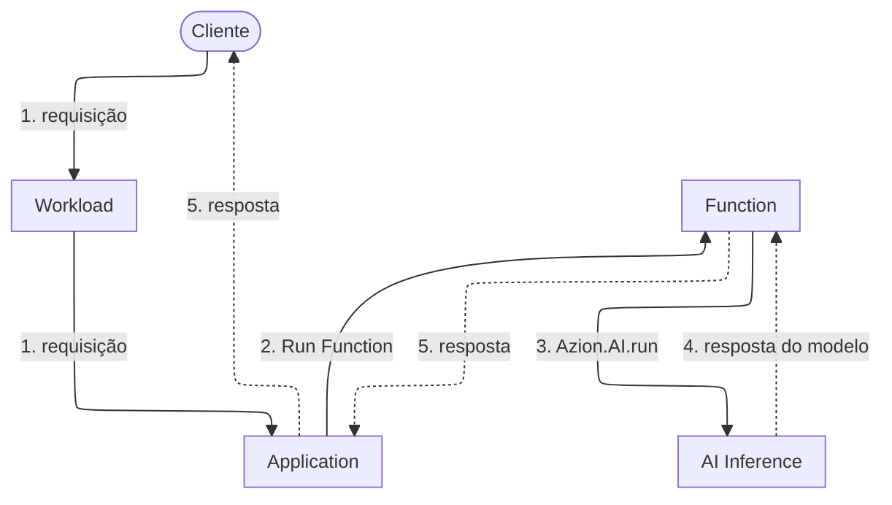

import FrameBox from '@aziontech/webkit/frame-box'
import ItemList from '@aziontech/webkit/item-list'
import DocItem from '@aziontech/webkit/doc-item'

Quando uma aplicação precisa que um modelo responda algo, ela envia a entrada e mantém a requisição aberta enquanto o modelo gera uma resposta. Em seguida, ela retorna essa resposta a quem chamou. Toda chamada de modelo tem essa forma. O que muda de uma plataforma para outra é onde o modelo executa e quanto dele você opera.

[AI Inference](/pt-br/documentacao/plataforma/ai-inference/) é um recurso da plataforma que executa modelos de AI, e uma [Function](/pt-br/documentacao/plataforma/functions/) chama um modelo com `Azion.AI.run`. Esse binding de runtime recebe um id de modelo e um corpo de requisição. A chamada acontece dentro da execução da Function, então um único trecho do seu código contém tanto a requisição que chegou quanto a resposta que o modelo produziu.

Três assuntos adjacentes têm páginas próprias. [LoRA Fine-Tune](/pt-br/documentacao/plataforma/ai-inference/lora-fine-tune/) é a extensão que adapta um modelo com LoRA, e nomeia os modelos que a aceitam. Os vetores que um modelo de embedding retorna são armazenados e consultados com [Vector Search](/pt-br/documentacao/plataforma/sql-database/vector-search/) no SQL Database. Para conhecer o corpo da requisição campo a campo, consulte [Invocação de modelos](/pt-br/documentacao/plataforma/ai-inference/invocacao-de-modelos/).

Os mecanismos são a chamada de modelo em si, a cadeia de invocação, o binding e o endpoint HTTP, o que Azion executa e o que é seu, e o que essa arquitetura custa.

---

## A chamada de modelo

Uma chamada de modelo começa no código que você implanta. `Azion.AI.run` é o binding de runtime que a faz, e recebe dois argumentos: o id do modelo e o corpo da requisição. A chamada é assíncrona, então a Function a aguarda e lê a resposta do modelo no valor resolvido. Para um modelo de chat, o texto gerado fica em `choices[0].message.content` dentro dessa resposta.

O id é o único endereço que o código passa: `Azion.AI.run` não recebe nenhuma URL base, nenhum host e nenhuma credencial. Os ids de modelo não seguem uma forma única: alguns são um caminho de repositório, como `Qwen/Qwen3-30B-A3B-Instruct-2507-FP8`, e outros uma string em minúsculas, como `qwen-qwen25-vl-3b-instruct-awq`. Copie o id da própria página do modelo em [Modelos de AI](/pt-br/documentacao/plataforma/ai-inference/modelos/) em vez de derivá-lo do nome do modelo, ou liste os ids que a sua conta pode chamar com `Azion.AI.models()`. Uma chamada é recusada com `AIError: model not found or not allowed` quando o id não existe ou quando a conta não tem acesso ao modelo, e o erro não diz qual dos dois.

Em torno da chamada, a Function é código comum. Ela pode pré-processar a entrada antes de invocar o modelo e formatar o que o modelo retorna antes que quem chamou veja. A mesma execução também pode recuperar contexto de um armazenamento e alcançar um serviço externo, tudo dentro de uma requisição.

---

## A cadeia de invocação

Este diagrama traça uma requisição, do cliente até o modelo e de volta. As setas sólidas levam a requisição, e as setas pontilhadas levam a resposta. Cada rótulo começa com o número do seu passo abaixo.

1. A requisição chega a um data center perto do cliente por um domínio de um [Workload](/pt-br/documentacao/plataforma/workloads/). O deployment desse Workload define a Application que recebe a requisição.
2. Uma regra da Application executa a Function com o behavior _Run Function_.
3. A Function chama o modelo com `Azion.AI.run`, passando o id do modelo e o corpo da requisição.
4. AI Inference executa o modelo e retorna a resposta do modelo para a Function.
5. A Function monta a resposta dela a partir da resposta do modelo, e a Application a entrega ao cliente.

Quatro recursos da plataforma sustentam essa cadeia, na infraestrutura distribuída da Azion. Workloads recebe a requisição, e o deployment do Workload define a Application. [Applications](/pt-br/documentacao/plataforma/applications/) executa a regra que chama a Function. Functions executa o código que chama o modelo, no [Azion Runtime](/pt-br/documentacao/devtools/runtime/). AI Inference executa o modelo.

---

## O binding e o endpoint HTTP

Uma requisição alcança um modelo por uma de duas interfaces, e as duas terminam no mesmo binding.

A primeira é o próprio binding. Dentro de uma Function, o código chama `Azion.AI.run` diretamente. A Function decide qual modelo responde, o que o corpo da requisição carrega e o que acontece antes e depois.

A segunda é um endpoint HTTP compatível com OpenAI que uma Application implantada por você serve no domínio dela. O template [AI Inference Starter Kit](/pt-br/documentacao/guias/desenvolvimento-de-aplicacoes/frameworks/ai-inference-starter-kit/) implanta uma Application desse tipo. [Invocação de modelos](/pt-br/documentacao/plataforma/ai-inference/invocacao-de-modelos/) traz o caminho, a forma do domínio e a requisição que o endpoint aceita.

Atrás do endpoint ainda existe uma Function, e ela chama `Azion.AI.run` como qualquer outra Function. Na Function que o template instala, o campo `model` do corpo da requisição seleciona o modelo, e a Function passa o corpo inteiro para o binding. A segunda interface é, portanto, a primeira com uma Application à frente, publicada em um formato de requisição que os clientes já falam. O template não configura nenhuma autenticação na frente do endpoint, então qualquer verificação que ele faça é uma que você acrescenta à sua Application.

---

## O que Azion executa e o que é seu

A cadeia de invocação cruza uma linha entre o que Azion opera e o que você implanta. Onde essa linha cai é o que indica de qual lado um problema está.

Azion executa os modelos e a infraestrutura que os executa. Você não carrega nenhum modelo, não dimensiona nenhum cluster e não mantém nenhum servidor de inferência em execução. Você também não seleciona qual data center atende uma requisição: a Azion a encaminha para um data center perto do cliente.

É seu tudo que decide o que se pergunta ao modelo. A Function é o seu código: o tratamento da entrada, o prompt, o id do modelo, o corpo da requisição e a resposta que quem chamou recebe ao final. A Application à frente da Function também é sua, junto com o domínio em que o seu Workload responde e a autenticação que a Application verifica. Quando uma resposta está errada, comece pela entrada que sua Function enviou.

Os modelos também têm termos próprios. Um modelo pode estar sujeito a termos de licença de terceiros, e você é responsável por cumpri-los e pela saída que o modelo gera. A Azion não verifica a precisão dessa saída.

---

## O que essa arquitetura custa

Executar um modelo de dentro de uma Function mantém a requisição e a chamada de modelo em uma única execução. Três coisas pagam por isso.

A chamada de modelo acontece dentro de uma execução. A Function a aguarda, então o tempo que o modelo leva para gerar é tempo que a Function passa esperando, e a requisição fica aberta para os dois. Essa espera conta no tempo de execução da Function, que é tempo de relógio, e não no tempo de CPU dela. Os limites da própria Function estão em [Limites de Functions](/pt-br/documentacao/plataforma/functions/limites/), e as condições que a Azion aplica a um modelo estão em [Limites do AI Inference](/pt-br/documentacao/plataforma/ai-inference/limites/).

Azion também limita o lado do modelo. Azion pode encerrar, sem aviso prévio, um modelo que consome mais do que a memória máxima definida, ou que executa por mais tempo do que o tempo máximo permitido. Um modelo que é criado e depois não é executado por mais de três dias pode ser desprovisionado. Para saber o que cada uma dessas condições cobre, consulte [Limites do AI Inference](/pt-br/documentacao/plataforma/ai-inference/limites/).

O endpoint compatível com OpenAI é um formato que sua Application serve. Você implanta a Application que o expõe, você a mantém em execução e você a protege, então o endpoint é seu para mudar e seu para manter respondendo.

---

## Recursos relacionados

<FrameBox>
<ItemList>
  <DocItem title="Invocação de modelos" href="/pt-br/documentacao/plataforma/ai-inference/invocacao-de-modelos/">Todos os campos que o corpo da requisição aceita, nas duas interfaces.</DocItem>
  <DocItem title="Primeiros passos com AI Inference" href="/pt-br/documentacao/plataforma/ai-inference/primeiros-passos/">Implante uma Application e envie uma primeira requisição a um modelo.</DocItem>
  <DocItem title="Limites do AI Inference" href="/pt-br/documentacao/plataforma/ai-inference/limites/">As condições em que Azion encerra ou desprovisiona um modelo.</DocItem>
  <DocItem title="Adicionar funcionalidades de IA a aplicações existentes" href="/pt-br/documentacao/casos-de-uso/construir-e-executar-workloads-de-ai/adicionar-funcionalidades-de-ia-a-aplicacoes-existentes/">A forma implantada em torno de uma chamada de modelo, em que sua Application é o endpoint de inferência.</DocItem>
</ItemList>
</FrameBox>
