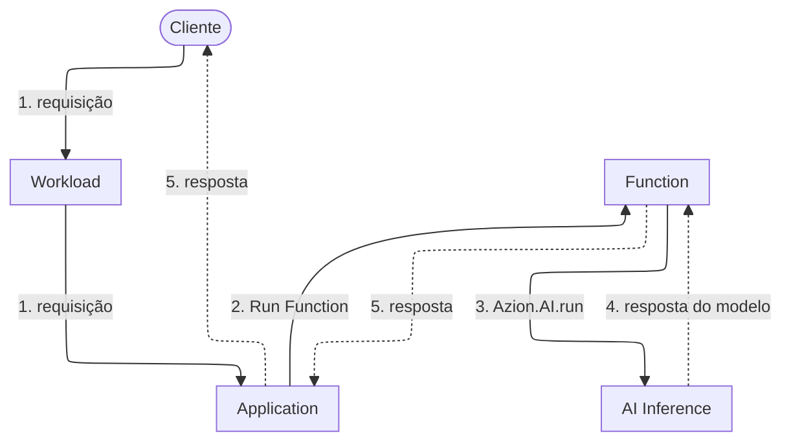

import DocButton from '~/components/webkit/DocButton.vue';
import DocCardGroup from '@aziontech/webkit/doc-card-group'
import DocCard from '@aziontech/webkit/doc-card'

**AI Inference** é um recurso da plataforma que executa modelos de AI open source na infraestrutura distribuída da Azion, em resposta às chamadas que as suas [Functions](/pt-br/documentacao/plataforma/functions/) enviam. Executar um modelo treinado sobre uma entrada se chama inferência: o modelo calcula uma saída a partir dos pesos que aprendeu no treinamento. Essa saída pode ser um texto gerado, um ranking ou um vetor de números que representa a entrada. Um modelo só responde depois que os pesos dele estão em memória, em hardware dimensionado para eles. Um serviço de inferência mantém os modelos em memória, então você não provisiona hardware para eles.

Uma Function passa um id de modelo e um corpo de requisição para `Azion.AI.run` e depois aguarda a resposta do modelo. Use AI Inference para gerar texto a partir de um prompt, extrair o texto de uma imagem, converter um documento em um vetor para recuperação ou ranquear um conjunto de documentos em relação a uma consulta.

<DocButton href="/pt-br/documentacao/plataforma/ai-inference/primeiros-passos/" label="Primeiros passos" size="medium" />
<DocButton href="/pt-br/documentacao/plataforma/ai-inference/referencia/" label="Referência de AI Inference" kind="secondary" size="medium" />

---

## Caminho da requisição

Uma Function chama um modelo enquanto trata uma requisição, então a requisição fica aberta até a resposta do modelo voltar. O diagrama acompanha uma requisição do cliente até o modelo e de volta.

As setas sólidas levam a requisição, e as setas pontilhadas levam a resposta. Cada rótulo começa com o número do seu passo abaixo.



1. A requisição chega a um data center perto do cliente por um domínio do seu [Workload](/pt-br/documentacao/plataforma/workloads/). O deployment desse Workload define a [Application](/pt-br/documentacao/plataforma/applications/) que a recebe.
2. Uma regra da Application executa a Function com o behavior _Run Function_.
3. A Function passa o id do modelo e o corpo da requisição para `Azion.AI.run`.
4. AI Inference executa o modelo e retorna a resposta dele para a Function.
5. A Function monta a resposta dela a partir da resposta do modelo, e a Application a entrega ao cliente.

Workloads recebe a requisição, Applications executa a regra e Functions executa o seu código no [Azion Runtime](/pt-br/documentacao/devtools/runtime/). Para ver qual lado desse caminho a Azion opera e qual lado é seu, consulte [Como AI Inference funciona](/pt-br/documentacao/plataforma/ai-inference/como-funciona/).

---

## Código da Function

Este código de Function envia uma requisição de chat a um modelo e lê o texto gerado:

```ts
const modelResponse = await Azion.AI.run("Qwen/Qwen3-30B-A3B-Instruct-2507-FP8", {
  "stream": false,
  "messages": [
    { "role": "system", "content": "You are a helpful assistant." },
    { "role": "user", "content": "Name three European capitals." }
  ]
})

const answer = modelResponse?.choices?.[0]?.message?.content
```

- `Azion.AI.run` recebe primeiro o id do modelo: a string à qual um modelo responde. Os ids não seguem um padrão único, então copie cada um da página do modelo em [Modelos de AI](/pt-br/documentacao/plataforma/ai-inference/modelos/).
- O corpo da requisição vem em segundo. `messages` guarda a conversa, e campos como `stream`, `max_tokens` e `temperature` controlam a saída. [Invocação de modelos](/pt-br/documentacao/plataforma/ai-inference/invocacao-de-modelos/) lista todos os campos que um corpo aceita.
- `Azion.AI.run` retorna uma promise. A Function a aguarda e encontra o texto gerado em `choices[0].message.content` do valor resolvido.
- O código não passa nenhum host, nenhuma URL base e nenhuma credencial: o id do modelo é o único endereço.

Um corpo de requisição ou um objeto de resposta escrito para o formato de chat completions da OpenAI é lido da mesma forma aqui, e só a chamada que o envia muda.

---

## Escopo e limites

- **Acesso**: nos planos Hobby e Pro, AI Inference está disponível sob solicitação, sujeito a aprovação. Para o acesso que cada plano dá, consulte [Limites do AI Inference](/pt-br/documentacao/plataforma/ai-inference/limites/).
- **Modelos**: o catálogo reúne large language models open source, vision language models que leem texto e imagens, um modelo de embedding e um reranker. Cada página de modelo declara o id a passar e as capacidades que o modelo suporta, e `Azion.AI.models()` retorna os ids que a sua conta pode chamar. Para a lista completa, consulte [Modelos de AI](/pt-br/documentacao/plataforma/ai-inference/modelos/).
- **Tamanho do contexto**: o contexto que um modelo aceita varia por modelo, de 8k a 131k tokens no catálogo. Confira a página do modelo que você chama antes de dimensionar um prompt.
- **Entrada**: todos os modelos aceitam texto. Um modelo que também aceita imagens lê cada imagem a partir de uma URL, dentro de uma parte de conteúdo da mensagem.
- **Streaming**: com `stream` definido como `true`, o modelo transmite a resposta em partes em vez de retorná-la inteira. O endpoint do AI Inference Starter Kit repassa essa transmissão como server-sent events, uma linha `data:` por parte, terminando com `data: [DONE]`.
- **Interfaces**: uma Function chama `Azion.AI.run`, que não recebe nenhuma credencial. Por HTTP, uma Application implantada a partir do template [AI Inference Starter Kit](/pt-br/documentacao/guias/desenvolvimento-de-aplicacoes/frameworks/ai-inference-starter-kit/) serve um endpoint compatível com OpenAI no domínio dela. O campo `model` do corpo da requisição seleciona o modelo, e o template não configura nenhuma autenticação na frente do endpoint. As duas interfaces carregam o corpo de requisição que [Invocação de modelos](/pt-br/documentacao/plataforma/ai-inference/invocacao-de-modelos/) documenta.
- **Teste local**: sob `azion dev`, `Azion.AI` é `undefined`, então teste as chamadas de modelo em uma Function publicada. Para o erro que a chamada local lança, consulte [API de AI Inference](/pt-br/documentacao/devtools/runtime/api-reference/ai/).
- **Gerenciamento**: o Azion Console não tem uma tela de AI Inference, e nem a API v4 da Azion nem a Azion CLI têm uma operação para AI Inference ou para os modelos dele. A entidade que você cria e gerencia é a Function que chama um modelo, pelas interfaces que [Functions](/pt-br/documentacao/plataforma/functions/) documenta.
- **Adaptação de modelos**: [LoRA Fine-Tune](/pt-br/documentacao/plataforma/ai-inference/lora-fine-tune/), uma extensão do AI Inference, adapta um modelo a uma tarefa com Low-Rank Adaptation. Cada página de modelo declara se o modelo a aceita.
- **Vetores**: [SQL Database](/pt-br/documentacao/plataforma/sql-database/) armazena e consulta os vetores que um modelo de embedding retorna. [Vector Search](/pt-br/documentacao/plataforma/sql-database/vector-search/) cobre a busca semântica que um fluxo de retrieval-augmented generation executa sobre eles.
- **Encerramento**: a Azion pode encerrar um modelo, sem aviso prévio, quando ele consome mais do que a memória máxima definida ou executa por mais tempo do que o tempo máximo permitido. Um modelo criado e não executado por mais de três dias pode ser desprovisionado. [Limites do AI Inference](/pt-br/documentacao/plataforma/ai-inference/limites/) cobre cada condição.
- **Termos dos modelos**: um modelo pode estar sujeito a termos de licença de terceiros, e você é responsável por cumpri-los e pela saída que o modelo gera. A Azion não verifica a precisão dessa saída.
- **Observabilidade**: como uma chamada de modelo roda dentro de uma Function em uma Application, o tráfego dela aparece onde aparece o tráfego dessa Application. [Real-Time Metrics](/pt-br/documentacao/plataforma/real-time-metrics/) o reporta, e [Real-Time Events](/pt-br/documentacao/plataforma/real-time-events/) carrega as requisições e os logs de console da Function, incluindo as mensagens `AIError`.
- **Cobrança**: [Preços](/pt-br/documentacao/fundamentos/precos/#ai-inference) informa como uma chamada de modelo é medida e cobrada.

---

## Próximos passos

<DocCardGroup cols={2}>
  <DocCard title="Primeiros passos" href="/pt-br/documentacao/plataforma/ai-inference/primeiros-passos/" label="Envie uma primeira requisição a um modelo sem escrever código." />
  <DocCard title="Como funciona" href="/pt-br/documentacao/plataforma/ai-inference/como-funciona/" label="Acompanhe uma requisição do seu domínio até o modelo e de volta." />
  <DocCard title="Modelos de AI" href="/pt-br/documentacao/plataforma/ai-inference/modelos/" label="Escolha um modelo e copie o id ao qual ele responde." />
  <DocCard title="Invocação de modelos" href="/pt-br/documentacao/plataforma/ai-inference/invocacao-de-modelos/" label="Encontre um campo da requisição com o padrão e os limites dele." />
  <DocCard title="Guias de AI Inference" href="/pt-br/documentacao/plataforma/ai-inference/guias/" label="Siga um guia ou uma arquitetura de referência." />
  <DocCard title="Limites" href="/pt-br/documentacao/plataforma/ai-inference/limites/" label="Confira quando a Azion encerra um modelo ou o desprovisiona." />
</DocCardGroup>
