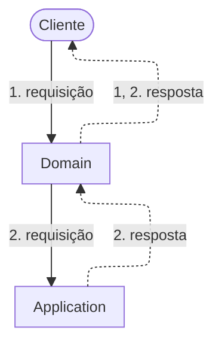

import DocButton from '~/components/webkit/DocButton.vue'
import DocCardGroup from '@aziontech/webkit/doc-card-group'
import DocCard from '@aziontech/webkit/doc-card'

O **Domains** é um Platform Resource que gera e gerencia os domínios pelos quais as requisições chegam às suas aplicações na Azion. Um domínio é o hostname que seus clientes requisitam, e cada domínio nomeia os hostnames que atende e a aplicação que os responde. Use o Domains para obter um Azion domain, listar os domínios personalizados que você possui, vincular um certificado digital para HTTPS ou pedir um certificado aos clientes com mTLS.

Cada domínio pode usar estes recursos:

- [Azion domain](/pt-br/documentacao/plataforma/domains/referencia/#ambiente) é o hostname que a Azion gera quando você cria uma aplicação, no formato `xxxx.map.azionedge.net`. Você pode criar mais de um domínio para uma aplicação.
- [Staging Network](/pt-br/documentacao/plataforma/domains/referencia/#ambiente) é um ambiente para testar uma aplicação antes de ela entrar em operação, com um Azion domain próprio no formato `xxxx.preview.azionedge.net`. Ele não afeta o ambiente de produção.
- [CNAME](/pt-br/documentacao/plataforma/domains/referencia/#cname) lista os domínios personalizados que você possui, para que um domínio responda aos seus hostnames. **CNAME Access Only** fecha o Azion domain às requisições.
- [Digital Certificate](/pt-br/documentacao/plataforma/domains/referencia/#certificado-digital) vincula um certificado TLS a um domínio que usa HTTPS. Você pode enviar o seu ou deixar a Azion gerenciar um certificado Let's Encrypt™.
- [mTLS](/pt-br/documentacao/plataforma/domains/referencia/#mtls) faz um domínio pedir um certificado a cada cliente durante o handshake TLS e validá-lo em relação a um certificado de CA confiável.

<DocButton href="/pt-br/documentacao/plataforma/domains/primeiros-passos/" label="Primeiros passos" size="medium" />
<DocButton href="/pt-br/documentacao/plataforma/domains/referencia/" label="Referência do Domains" kind="secondary" size="medium" />

## Caminho da requisição

Criar um domínio não envia tráfego a ele: uma requisição chega à sua aplicação somente quando nomeia um hostname que o domínio atende. Um domínio personalizado também precisa de um registro DNS no seu provedor de DNS que aponte o hostname para o domínio.

As setas contínuas carregam a requisição, e as setas pontilhadas carregam a resposta. Cada rótulo começa com o número do seu passo abaixo.

1. O cliente requisita um hostname que o domínio atende: o Azion domain dele ou um domínio personalizado cujo registro DNS aponta para ele.
2. O domínio passa a requisição para a aplicação que ele nomeia.

## Próximos passos

<DocCardGroup cols={2}>
  <DocCard title="Primeiros passos" href="/pt-br/documentacao/plataforma/domains/primeiros-passos/" label="Crie seu primeiro domínio e liste um hostname que você possui." />
  <DocCard title="Referência do Domains" href="/pt-br/documentacao/plataforma/domains/referencia/" label="Consulte os campos de um domínio, seus ambientes e suas configurações de mTLS." />
  <DocCard title="Limites" href="/pt-br/documentacao/plataforma/domains/limites/" label="Consulte o número de CNAMEs que um domínio aceita." />
  <DocCard title="Glossário" href="/pt-br/documentacao/plataforma/domains/glossario/" label="Confira o que Azion domain, domínio personalizado e Azion SAN significam." />
  <DocCard title="Aponte um domínio para um workload" href="/pt-br/documentacao/guias/plataforma/migracao/apontar-dominio-para-a-azion/" label="Crie o registro DNS que envia seu hostname para o seu domínio." />
  <DocCard title="Vincule um certificado a um domínio" href="/pt-br/documentacao/guias/seguranca-de-aplicacoes/tls-e-certificados/certificado-digital/#vincule-o-certificado-a-um-dominio-v3" label="Sirva HTTPS no seu hostname com um certificado que você seleciona no domínio." />
</DocCardGroup>
