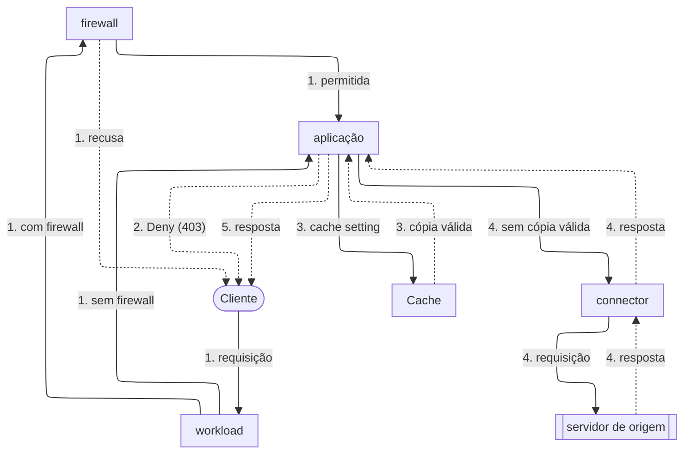

import DocButton from '~/components/webkit/DocButton.vue'
import DocCardGroup from '@aziontech/webkit/doc-card-group'
import DocCard from '@aziontech/webkit/doc-card'
import VersionRollingOut from '~/includes/snippets/versionRollingOut/pt/snippet.mdx'

<VersionRollingOut>[Applications | v3](/pt-br/documentacao/plataforma/applications/v3/)</VersionRollingOut>

**Applications** é um recurso da plataforma que executa um proxy reverso para os seus [Workloads](/pt-br/documentacao/plataforma/workloads/) na infraestrutura distribuída da Azion, a partir do data center mais próximo ao seu usuário. Um proxy reverso é um servidor na frente da sua origem, o servidor que guarda o seu conteúdo. O proxy pode responder a cada requisição com uma cópia em cache de uma resposta anterior da origem, adicionar ou remover headers, executar código ou encaminhar a requisição à sua origem. Toda requisição passa pelo proxy. Por isso, os seus clientes acessam um único domínio, e o proxy executa a lógica que cada origem teria de repetir.

Uma Application recebe as requisições dos Workloads cujo deployment a define. Em cada requisição, ela executa as suas regras. Uma regra pode definir o [Connector](/pt-br/documentacao/plataforma/connectors/) que encaminha a requisição à sua origem, decidir se a resposta é armazenada em cache ou executar uma Function. Use Applications para encaminhar cada path à sua origem, armazenar respostas em cache, adicionar ou remover headers, reescrever requisições, executar o seu próprio código nas requisições a que uma regra corresponde ou redimensionar e converter imagens sob demanda.

<DocButton href="/pt-br/documentacao/plataforma/applications/primeiros-passos/" label="Primeiros passos" size="medium" />
<DocButton href="/pt-br/documentacao/plataforma/applications/rules-engine/" label="Referência de Applications" kind="secondary" size="medium" />

---

## Estrutura da regra

Uma regra é a unidade de lógica de uma aplicação. Os critérios dela testam cada requisição, e os behaviors dela são executados sobre uma requisição que corresponde a eles. Para encaminhar toda requisição ao connector que alcança a sua origem, envie esta regra como corpo de `POST /v4/workspace/applications/<application-id>/request_rules`:

```json
{
  "name": "send-to-origin",
  "active": true,
  "criteria": [
    [
      {
        "variable": "${uri}",
        "conditional": "if",
        "operator": "starts_with",
        "argument": "/"
      }
    ]
  ],
  "behaviors": [
    {
      "type": "set_connector",
      "attributes": { "value": <connector-id> }
    }
  ]
}
```

- `criteria` guarda grupos de condições, e cada grupo começa com uma condição cujo `conditional` é `if`. Aqui, `${uri}` é a URI sem a query string. Todo path começa com `/`, então `starts_with` e `/` correspondem a toda requisição. Se a regra testar `${request_uri}`, que mantém a query string, no lugar de `${uri}`, a API a recusa com `400` e o erro `25047` enquanto [Application Accelerator](/pt-br/documentacao/plataforma/applications/application-accelerator/) está desativado.
- `behaviors` lista as ações que a regra executa sobre uma requisição que corresponde a ela. `set_connector` encaminha a requisição ao connector cujo ID está em `attributes.value`. Esse connector guarda o endereço da sua origem.
- `name` e `active` pertencem à própria regra.
- No Azion Console, a aba **Rules Engine** da aplicação monta a mesma regra a partir de **+ Rule**, _Request Phase_, um critério sobre `${uri}` e _Set Connector_.

Quando você envia a regra, a API responde `202` e a retorna com `order` igual a `0`. Esse valor é a posição da regra entre as regras da Request Phase da aplicação.

O modelo corresponde ao roteamento por path em um proxy reverso: cada critério é uma condição de correspondência, cada behavior é uma ação e um connector é o servidor de backend.

---

## Caminho da requisição

Criar uma aplicação não encaminha nenhuma requisição a ela: ela recebe somente as requisições dos workloads cujo deployment a define. Ela também só chega a uma origem por meio de uma regra que define um connector.

As setas sólidas levam a requisição, e as setas pontilhadas levam a resposta. Cada rótulo começa com o número do seu passo abaixo.



1. A requisição chega a um workload por um dos domínios dele, e o deployment do workload define a aplicação. No Azion Console, você a define no campo **Application** de **Deployment Settings**. Um [firewall](/pt-br/documentacao/plataforma/firewall/) que o deployment também define executa as suas regras primeiro e pode interromper a requisição ali.
2. As regras da Request Phase da aplicação são executadas em ordem. Quando um behavior encerra o processamento, como faz _Deny (403 Forbidden)_, a aplicação responde ao cliente e nenhuma regra posterior é executada.
3. Se uma regra com _Set Cache Policy_ aplicou um cache setting, [Cache](/pt-br/documentacao/plataforma/applications/cache/) procura uma cópia válida da resposta da origem. Quando Cache tem uma, essa cópia se torna a resposta, e a origem não recebe nenhuma requisição.
4. Caso contrário, o connector definido por uma regra com _Set Connector_ encaminha a requisição à origem. Se várias regras que correspondem à requisição carregam _Set Connector_, somente a última delas é executada.
5. Depois, as regras da Response Phase da aplicação são executadas sobre a resposta, e a resposta chega ao cliente.

Uma aplicação nova começa com Cache e [Functions](/pt-br/documentacao/plataforma/functions/) ativos, Application Accelerator e [Image Processor](/pt-br/documentacao/plataforma/applications/image-processor/) desativados e nenhuma regra.

Uma alteração não vale de imediato: ela se propaga, e a Azion não garante nenhum tempo de propagação. Até que o deployment de um workload novo se propague, o que pode levar vários minutos, o workload responde com o `404` de placeholder da Azion. Nesse intervalo, as respostas se alternam entre o placeholder e a aplicação, então repita a requisição até que elas concordem. Para o funcionamento das duas fases, a ordem das regras e dos behaviors e a propagação, consulte [Como Applications funciona](/pt-br/documentacao/plataforma/applications/como-funciona/).

---

## Recursos

Cache, Application Accelerator e Image Processor são produtos que agem sobre as requisições de uma aplicação. Cada um tem o seu próprio switch em [Main Settings](/pt-br/documentacao/plataforma/applications/main-settings/#produtos) › **Modules**.

### Cache

Cache armazena uma cópia de uma resposta da origem no data center que a buscou e responde às requisições seguintes pelo mesmo objeto com essa cópia. A cópia fica ali até que o seu tempo de vida (TTL) termine. Em uma aplicação nova, Cache já vem ativo. Ele não armazena nada até que uma regra com _Set Cache Policy_ aplique um cache setting, o objeto que guarda os TTLs. Use Cache para:

- Manter arquivos estáticos no data center mais próximo ao seu usuário
- Entregar arquivos de vídeo grandes em fragmentos
- Responder às requisições enquanto a origem está fora do ar
- Remover uma cópia assim que a origem muda

A [visão geral do Cache](/pt-br/documentacao/plataforma/applications/cache/) explica o que um cache setting guarda, como uma requisição chega a uma cópia armazenada e por onde começar.

### Application Accelerator

Application Accelerator permite que um cache setting diferencie duas requisições para a mesma URL por um argumento de query string, um cookie, o device group ou o método da requisição. Cache então mantém uma cópia separada para cada valor. O switch do Application Accelerator começa desativado em uma aplicação nova. Ative-o quando uma URL tem mais de uma resposta correta, por exemplo:

- Uma página personalizada
- Uma resposta de API que muda com a sua query string
- Um catálogo que difere por dispositivo
- Uma resposta a um `POST`

A [visão geral do Application Accelerator](/pt-br/documentacao/plataforma/applications/application-accelerator/) explica o que uma variação acrescenta à cache key, o que o switch libera e por onde começar.

### Image Processor

Image Processor constrói uma imagem nova, a imagem derivada, a partir de uma imagem na sua origem. Ele segue a query string `ims` da requisição, como `?ims=fit-in/400x400`, e nunca salva a imagem derivada como um ativo da conta. O switch dele começa desativado em uma aplicação nova. Mesmo ativo, ele processa somente as requisições que uma regra da Request Phase com _Optimize Images_ envia a ele. Ative-o quando as suas páginas precisam de uma imagem em vários tamanhos, recortes, qualidades ou formatos, como WEBP para os browsers que o aceitam. Nenhuma variante precisa, então, de um arquivo próprio para armazenar ou fazer upload.

A [visão geral do Image Processor](/pt-br/documentacao/plataforma/applications/image-processor/) explica como uma requisição se torna uma imagem derivada, o que `ims` aceita e por onde começar.

---

## Escopo e limites

- **Fases**: toda regra pertence a uma de duas fases. A Request Phase age sobre a requisição antes que exista uma resposta, e a Response Phase age sobre a resposta que o usuário recebe. Você escolhe a fase quando cria a regra e não pode mudá-la depois, e somente as regras da Request Phase podem escolher a origem e o cache setting. [Rules Engine para Applications](/pt-br/documentacao/plataforma/applications/rules-engine/#fases) lista as variáveis e os behaviors de cada fase e o produto de que cada um precisa.
- **Origens**: uma aplicação não guarda nenhuma origem própria, então duas regras com dois connectors podem encaminhar `/api/` para um servidor e todos os outros paths para outro. A origem por trás de um connector pode ser um servidor web na sua infraestrutura, um serviço em cloud ou um bucket do [Object Storage](/pt-br/documentacao/plataforma/object-storage/). [Use um bucket como origem de uma aplicação](/pt-br/documentacao/guias/desenvolvimento-de-aplicacoes/dados/bucket-como-connector/) mostra o caso do bucket. Por meio de [Load Balancer](/pt-br/documentacao/plataforma/connectors/load-balancer/), um connector pode distribuir o tráfego entre várias origens. Os connectors substituem as origens que as versões anteriores de Applications configuravam na aplicação.
- **Functions**: uma [instância de função](/pt-br/documentacao/plataforma/applications/functions-instances/) adiciona uma função de [Functions](/pt-br/documentacao/plataforma/functions/) à aplicação, com os seus próprios argumentos. Você a cria na aba **Functions Instances** da aplicação, e ela só é executada quando uma regra com _Run Function_ a invoca. Em uma aplicação nova, o switch **Functions** começa ativo. Somente funções Lua são executadas na Response Phase, como informa o formulário de instância no Azion Console: `Only Lua functions can be used in the Response phase.` Para os passos de adicionar a sua primeira função, consulte [Instancie uma função em uma aplicação](/pt-br/documentacao/guias/desenvolvimento-de-aplicacoes/primeiros-passos/instanciar-functions/).
- **Cache e imagens em código**: o código que lê ou grava entradas em cache é executado em uma função e usa a [Cache API](/pt-br/documentacao/devtools/runtime/api-reference/cache/), porque o próprio Cache não executa código. Uma função que processa imagens por conta própria usa a biblioteca WASM Image Processor, que é separada do produto Image Processor. [Onde Image Processor para](/pt-br/documentacao/plataforma/applications/image-processor/entrega-de-imagens/#onde-image-processor-para) explica a diferença.
- **Dispositivos**: um [device group](/pt-br/documentacao/plataforma/applications/device-groups/) é um nome e uma expressão regular que a aplicação compara com o header `User-Agent` de cada requisição. Os dois usos de um grupo precisam de Application Accelerator ativo: uma regra testa o grupo por meio de `${device_group}`, e um cache setting pode manter uma cópia por grupo. [Boas práticas de Applications](/pt-br/documentacao/plataforma/applications/boas-praticas/#defina-um-device-group-pelas-palavras-que-so-esse-dispositivo-envia) mostra como escrever uma expressão que corresponda somente aos dispositivos que você pretende alcançar.
- **WebSocket**: [WebSocket Proxy](/pt-br/documentacao/plataforma/applications/websocket/) é uma feature de Applications que transporta uma conexão WebSocket entre os seus usuários e a origem. A conexão abre com os headers `Upgrade: websocket` e `Connection: upgrade`. A Azion ativa a feature em uma conta somente mediante solicitação, e [Diretrizes de suporte](/pt-br/documentacao/suporte/) explica como pedir. Como a Azion recicla as conexões keepalive aproximadamente a cada 15 minutos, o cliente precisa reabrir uma conexão WebSocket quando ela se fecha.
- **Workloads**: um workload guarda os domínios, os protocolos e os certificados que servem a aplicação, então a aplicação não tem configurações de entrega próprias. [Teste uma aplicação pelo arquivo hosts](/pt-br/documentacao/guias/desenvolvimento-de-aplicacoes/primeiros-passos/testar-edge-application-atraves-do-arquivo-hosts/) mostra como requisitar uma aplicação no seu próprio domínio a partir de um dispositivo antes de alterar os registros DNS dele. _Redirect HTTP to HTTPS_ só funciona quando o workload tem HTTPS. Quando o connector recebe uma resposta 4xx ou 5xx da sua origem, [Custom Pages](/pt-br/documentacao/plataforma/workloads/#custom-pages) no workload define a página de erro que o cliente vê.
- **Interfaces**: no [Azion Console](https://console.azion.com), você cria e gerencia aplicações na página **Applications**. Cada aplicação tem cinco abas: **Main Settings**, **Device Groups**, **Cache Settings**, **Functions Instances** e **Rules Engine**. A ação de linha **Clone** da lista **Applications** cria uma aplicação separada com as configurações da original, como mostra [Clone uma aplicação](/pt-br/documentacao/guias/desenvolvimento-de-aplicacoes/primeiros-passos/clonar-applications/). [Azion API](https://api.azion.com/) serve as aplicações em `/v4/workspace/applications`. [Azion CLI](/pt-br/documentacao/devtools/cli/) as gerencia com comandos como `azion create application`, `azion update application` e `azion create rules-engine`. Você também pode criar e configurar aplicações com [`azion.config.js`](/pt-br/documentacao/devtools/cli/azion-config-js/), [Azion Lib](/pt-br/documentacao/devtools/azion-lib/application/) ou [Azion Terraform provider](/pt-br/documentacao/devtools/terraform/). Se a sua conta não migrou para a API v4, use [Applications | v3](/pt-br/documentacao/plataforma/applications/v3/).
- **Observabilidade**: ative **Debug Rules** em [Main Settings](/pt-br/documentacao/plataforma/applications/main-settings/#debug-rules), e [Real-Time Events](/pt-br/documentacao/plataforma/real-time-events/) e [Data Stream](/pt-br/documentacao/plataforma/data-stream/) mostram as regras que cada requisição executou, no campo `$traceback`. Debug Rules começa desativado em uma aplicação nova. Para verificar uma resposta, envie a requisição com `Pragma: azion-debug-cache`: a resposta informa o seu status de cache, como `HIT` ou `MISS`, no header `x-cache`. Em todas as requisições, [Real-Time Metrics](/pt-br/documentacao/plataforma/real-time-metrics/) mostra o tráfego de Cache e de [Tiered Cache](/pt-br/documentacao/plataforma/applications/cache/tiered-cache/). [Solucione problemas de Applications](/pt-br/documentacao/plataforma/applications/solucao-de-problemas/) lista as ferramentas e as consultas. Para um tráfego que difere do que você vê, consulte [Um problema aparece no tráfego, mas não nas respostas que você solicita](/pt-br/documentacao/plataforma/applications/solucao-de-problemas/#um-problema-aparece-no-trafego-mas-nao-nas-respostas-que-voce-solicita).
- **Limites**: uma aplicação aceita no máximo 200 regras, somando as duas fases. Cada regra tem de 1 a 5 grupos de 1 a 10 critérios, além de 1 a 10 behaviors. Sem Application Accelerator, um cache setting precisa de um **Max Age** de no mínimo 60 segundos. Um único objeto em cache pode chegar a 10 GB. [Limites de Applications](/pt-br/documentacao/plataforma/applications/limites/) lista cada limite, o que acontece quando ele é ultrapassado e os limites de cada produto.
- **Cobrança**: um produto que você ativa pode gerar custos que dependem do uso. A página [Preços da Azion](https://www.azion.com/pt-br/precos/) lista os planos e o uso que cada um inclui, e [Preços](/pt-br/documentacao/fundamentos/precos/) lista as tarifas e a métrica pela qual cada produto é cobrado.
- **Termos**: o [glossário de Applications](/pt-br/documentacao/plataforma/applications/glossario/) define as palavras que as páginas de Applications usam com um significado específico, como regra, fase, behavior, cache setting, cache key e imagem derivada.

---

## Próximos passos

<DocCardGroup cols={2}>
  <DocCard title="Primeiros passos" href="/pt-br/documentacao/plataforma/applications/primeiros-passos/" label="Encaminhe cada requisição de uma aplicação nova para a sua origem." />
  <DocCard title="Como funciona" href="/pt-br/documentacao/plataforma/applications/como-funciona/" label="Siga uma requisição por uma aplicação e veja onde cada produto age sobre ela." />
  <DocCard title="Rules Engine para Applications" href="/pt-br/documentacao/plataforma/applications/rules-engine/" label="Encontre uma variável, um operador ou um behavior, e o produto de que ele precisa." />
  <DocCard title="Guias e tutoriais" href="/pt-br/documentacao/plataforma/applications/guias/" label="Faça uma tarefa específica, de um device group a um template de framework." />
  <DocCard title="Limites" href="/pt-br/documentacao/plataforma/applications/limites/" label="Encontre um limite e o que acontece quando ele é ultrapassado." />
  <DocCard title="Solução de problemas" href="/pt-br/documentacao/plataforma/applications/solucao-de-problemas/" label="Descubra por que as requisições nunca chegam à origem ou por que uma regra não age." />
</DocCardGroup>
