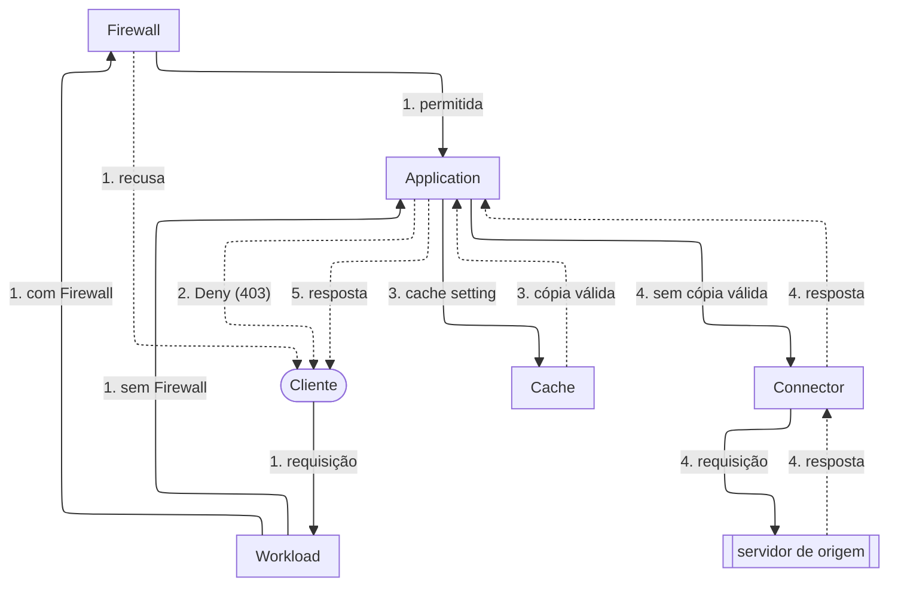

import DocButton from '~/components/webkit/DocButton.vue'
import DocCardGroup from '@aziontech/webkit/doc-card-group'
import DocCard from '@aziontech/webkit/doc-card'
import VersionRollingOut from '~/includes/snippets/versionRollingOut/pt/snippet.mdx'

<VersionRollingOut>[Applications | v3](/pt-br/documentacao/plataforma/applications/v3/)</VersionRollingOut>

**Applications** é um recurso da plataforma que processa as requisições recebidas pelos seus [Workloads](/pt-br/documentacao/plataforma/workloads/), a partir do data center mais próximo ao seu usuário. Uma Application pode executar funções serverless, atuar como proxy reverso para as suas origens ou combinar os dois. Ela também pode armazenar respostas com [Cache](/pt-br/documentacao/plataforma/applications/cache/), liberar quatro capacidades para o cache e as regras com [Application Accelerator](/pt-br/documentacao/plataforma/applications/application-accelerator/) e transformar imagens com [Image Processor](/pt-br/documentacao/plataforma/applications/image-processor/). Use Applications para executar uma [Function](/pt-br/documentacao/plataforma/functions/), definir o [Connector](/pt-br/documentacao/plataforma/connectors/) que chega a cada origem, adicionar ou remover headers ou reescrever requisições.

Cada Application pode usar estes recursos aninhados e features:

- [Cache](/pt-br/documentacao/plataforma/applications/cache/) permite que uma Application responda a uma requisição com uma cópia de uma resposta anterior da origem. Por exemplo, os seus arquivos estáticos ficam no data center mais próximo ao seu usuário.
- [Application Accelerator](/pt-br/documentacao/plataforma/applications/application-accelerator/) é a escolha certa quando uma URL tem mais de uma resposta correta, como uma página personalizada ou a resposta a um `POST`. Cache então guarda uma cópia separada por valor de argumento de query string, cookie, device group ou método.
- [Image Processor](/pt-br/documentacao/plataforma/applications/image-processor/) atende a uma página que precisa de uma imagem em vários tamanhos, recortes, qualidades ou formatos, como WEBP para navegadores que o aceitam. Cada variante sai de um arquivo único na origem, o único que você armazena e envia.
- [Device Groups](/pt-br/documentacao/plataforma/applications/device-groups/) permite que uma Application diferencie os dispositivos que enviam as suas requisições, para que uma regra ou um cache setting trate cada grupo de forma diferente. Ele precisa de Application Accelerator ativo na Application.
- [Rules Engine para Applications](/pt-br/documentacao/plataforma/applications/rules-engine/) é onde você escreve o que uma Application faz com cada requisição que recebe. Por exemplo, uma regra pode encaminhar `/api/` para uma origem enquanto uma segunda regra encaminha todos os outros paths para outra.
- [WebSocket Proxy](/pt-br/documentacao/plataforma/applications/websocket/) permite que uma Application transporte uma conexão WebSocket entre os seus usuários e a sua origem. A Azion o ativa em uma conta somente mediante solicitação.
- Uma [Function Instance](/pt-br/documentacao/plataforma/applications/functions-instances/) permite que uma Application execute uma das suas Functions. Por exemplo, a mesma Function pode ser executada em mais de uma Application, cada Function Instance com os seus próprios argumentos.

<DocButton href="/pt-br/documentacao/plataforma/applications/primeiros-passos/" label="Primeiros passos" size="medium" />
<DocButton href="/pt-br/documentacao/plataforma/applications/referencia/" label="Referência de Applications" kind="secondary" size="medium" />

---

## Caminho da requisição

Criar uma Application não lhe encaminha requisições: elas só chegam a ela depois que o deployment de um Workload define essa Application. A Application então só chega a uma origem por meio de uma regra que define um Connector. No lugar de uma origem, uma regra pode executar uma Function que constrói a resposta sem nenhum Connector.

O diagrama acompanha uma requisição que chega a uma origem. As setas sólidas levam a requisição, e as setas pontilhadas levam a resposta. Cada rótulo começa com o número do seu passo abaixo.

1. A requisição chega a um Workload por um dos domínios dele, e o Workload a encaminha para a Application. Quando o deployment do Workload também define um [Firewall](/pt-br/documentacao/plataforma/firewall/), o Firewall executa as suas regras primeiro e pode recusar a requisição.
2. A Application executa as suas regras da Request Phase em ordem. Quando um behavior, a ação que uma regra executa, encerra o processamento, como faz _Deny (403 Forbidden)_, a Application responde ao cliente e nenhuma regra posterior é executada.
3. Uma regra com _Set Cache Policy_ pode aplicar um cache setting, o conjunto de valores que diz ao Cache como armazenar e servir uma resposta. Cache então procura uma cópia válida da resposta da origem. Se Cache tem uma, essa cópia se torna a resposta, e a origem não recebe nenhuma requisição.
4. Caso contrário, o Connector que uma regra com _Set Connector_ define encaminha a requisição à origem. Se várias regras correspondentes carregam _Set Connector_, somente a última delas é executada.
5. A Application executa as suas regras da Response Phase sobre a resposta, e a resposta chega ao cliente.

---

## Próximos passos

<DocCardGroup cols={2}>
  <DocCard title="Primeiros passos" href="/pt-br/documentacao/plataforma/applications/primeiros-passos/" label="Encaminhe cada requisição de uma Application nova para a sua origem." />
  <DocCard title="Como funciona" href="/pt-br/documentacao/plataforma/applications/como-funciona/" label="Siga uma requisição por uma Application e veja onde Cache, Application Accelerator e Image Processor agem sobre ela." />
  <DocCard title="Main Settings" href="/pt-br/documentacao/plataforma/applications/main-settings/" label="Encontre os switches de uma Application, Debug Rules e as interfaces que a gerenciam." />
  <DocCard title="Guias e tutoriais" href="/pt-br/documentacao/plataforma/applications/guias/" label="Faça uma tarefa específica, de um device group a um template de framework." />
  <DocCard title="Boas práticas" href="/pt-br/documentacao/plataforma/applications/boas-praticas/" label="Configure um device group, WebSocket Proxy ou um recurso aninhado da forma recomendada." />
  <DocCard title="Limites" href="/pt-br/documentacao/plataforma/applications/limites/" label="Consulte onde uma Application para, um limite e o que acontece quando ele é ultrapassado." />
  <DocCard title="Solução de problemas" href="/pt-br/documentacao/plataforma/applications/solucao-de-problemas/" label="Descubra por que as requisições nunca chegam à origem ou por que uma regra não age." />
  <DocCard title="Glossário" href="/pt-br/documentacao/plataforma/applications/glossario/" label="Consulte uma palavra que as páginas de Applications usam com um sentido específico." />
</DocCardGroup>
