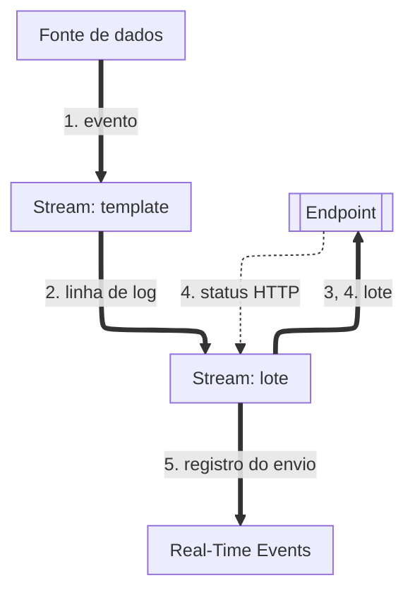

import DocButton from '~/components/webkit/DocButton.vue';
import DocCardGroup from '@aziontech/webkit/doc-card-group'
import DocCard from '@aziontech/webkit/doc-card'

**Data Stream** é um recurso da plataforma que envia os logs de eventos da conta e do tráfego dela ao seu endpoint. Um log stream é um fluxo de registros de log enviado a uma ferramenta que você opera. Essa ferramenta pode ser um sistema de gerenciamento de informações e eventos de segurança (SIEM). Use Data Stream para [enviar eventos do WAF ao SIEM](/pt-br/documentacao/guias/seguranca-de-aplicacoes/firewall-e-waf/integrar-siems/), [guardar logs de requisições em um data warehouse](/pt-br/documentacao/guias/plataforma/observabilidade/google-bigquery-endpoint/), auditar mudanças na conta ou [depurar Functions](/pt-br/documentacao/guias/plataforma/observabilidade/debugging-functions-data-stream/).

Cada stream do Data Stream combina uma parte de cada um destes tipos:

- [Fontes de dados](/pt-br/documentacao/plataforma/data-stream/fontes-de-dados-e-variaveis/) permitem escolher os eventos que um stream coleta: mudanças na conta, requisições às suas Applications, mensagens das suas Functions ou requisições que o WAF analisou. *WAF Events* precisa de um Firewall com WAF, e cada fonte oferece as próprias variáveis.
- [Templates](/pt-br/documentacao/plataforma/data-stream/templates-e-payload/) definem quais variáveis cada linha de log carrega e sob quais chaves. A Azion fornece cinco templates predefinidos, e você escreve um template personalizado para escolher as suas próprias variáveis.
- [Endpoints](/pt-br/documentacao/plataforma/data-stream/endpoints/) definem para onde um stream entrega as linhas de log, como um servidor HTTP ou um bucket. Um stream envia para um endpoint de qualquer um dos 11 tipos, então enviar os mesmos eventos a dois endpoints exige dois streams.

<DocButton href="/pt-br/documentacao/plataforma/data-stream/primeiros-passos/" label="Primeiros passos" size="medium" />
<DocButton href="/pt-br/documentacao/plataforma/data-stream/referencia/" label="Referência de Data Stream" kind="outlined" size="medium" />

---

## Caminho do evento

Um stream não envia cada evento quando ele acontece: renderiza os eventos como linhas de log e os envia ao endpoint em lotes.

Salvar um stream como ativo é a única etapa de ativação de que ele precisa. Depois que você cria ou ativa um stream, ele pode levar vários minutos para começar a coletar eventos. Ele não envia os eventos de antes disso.

As setas grossas levam os dados do stream, e a seta pontilhada leva a resposta do endpoint. Cada rótulo começa com o número da etapa correspondente abaixo.

1. A fonte de dados registra um evento. O stream mantém o evento quando ele fica dentro da taxa de sampling ou do filtro de workloads dele.
2. O template transforma o evento em uma linha de log, na qual cada chave recebe o valor de uma variável do data set do template, como `"status": "$status"`.
3. A linha de log entra em um lote. O lote fecha ao atingir uma contagem de linhas ou um limite de tempo, o que acontecer primeiro, conforme [Limites de Data Stream](/pt-br/documentacao/plataforma/data-stream/limites/#limites-padrao).
4. O stream envia o lote ao endpoint, e o endpoint responde com um status HTTP. Quando o endpoint está indisponível ou responde com um erro, as linhas de log desse envio não chegam a ele.
5. [Real-Time Events](/pt-br/documentacao/plataforma/real-time-events/fontes-de-dados/#data-stream) registra o envio com um código de status, o número de linhas de log e o tamanho em bytes.

Salvar um stream valida o formato dos campos dele e não contata o endpoint. Os primeiros registros de envio no Real-Time Events mostram se o endpoint aceita os lotes. Para cada etapa em detalhe, consulte [Como o Data Stream funciona](/pt-br/documentacao/plataforma/data-stream/como-funciona/).

---

## Próximos passos

<DocCardGroup cols={2}>
  <DocCard title="Primeiros passos" href="/pt-br/documentacao/plataforma/data-stream/primeiros-passos/" label="Envie os seus primeiros logs para um bucket." />
  <DocCard title="Como funciona" href="/pt-br/documentacao/plataforma/data-stream/como-funciona/" label="Acompanhe um evento da fonte de dados até o seu endpoint." />
  <DocCard title="Configurações do stream" href="/pt-br/documentacao/plataforma/data-stream/configuracoes-do-stream/" label="Consulte cada campo de um stream no Azion Console e na API." />
  <DocCard title="Guias e tutoriais de Data Stream" href="/pt-br/documentacao/plataforma/data-stream/guias/" label="Conclua uma tarefa específica com um stream." />
  <DocCard title="Boas práticas" href="/pt-br/documentacao/plataforma/data-stream/boas-praticas/" label="Defina o escopo e o formato dos streams para que vários rodem juntos." />
  <DocCard title="Limites" href="/pt-br/documentacao/plataforma/data-stream/limites/" label="Consulte um tamanho de lote, um limite de campo ou uma regra de sampling." />
  <DocCard title="Solução de problemas" href="/pt-br/documentacao/plataforma/data-stream/solucao-de-problemas/" label="Descubra por que um stream não envia nada ou um endpoint não recebe logs." />
  <DocCard title="Glossário" href="/pt-br/documentacao/plataforma/data-stream/glossario/" label="Consulte um termo das páginas de Data Stream." />
</DocCardGroup>
