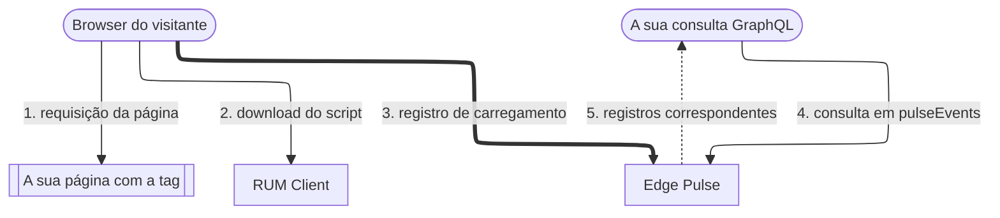

import DocButton from '~/components/webkit/DocButton.vue'
import DocCardGroup from '@aziontech/webkit/doc-card-group'
import DocCard from '@aziontech/webkit/doc-card'

**Edge Pulse** é um recurso da plataforma que coleta medições de carregamento de página nos browsers das pessoas que visitam as suas páginas. O [monitoramento de usuários reais](https://www.azion.com/pt-br/learning/observability/o-que-e-monitoramento-tempo-real/) mede um site nos dispositivos dos visitantes: um script em cada página informa como a visita carregou, sem teste agendado. Use Edge Pulse para comparar o tempo de carregamento das suas páginas, ver os tipos de conexão dos visitantes e achar páginas alcançadas por redirecionamento.

Edge Pulse chega às suas páginas por meio de um script:

- A [tag JavaScript do Edge Pulse](/pt-br/documentacao/plataforma/edge-pulse/tag-javascript/) mede os carregamentos da página em que você a coloca, em uma de duas formas do Azion Console. As duas formas carregam o script de maneiras diferentes, o que importa em uma página com Content Security Policy.

<DocButton href="/pt-br/documentacao/plataforma/edge-pulse/primeiros-passos/" label="Primeiros passos" size="medium" />
<DocButton href="/pt-br/documentacao/plataforma/edge-pulse/referencia/" label="Referência de Edge Pulse" kind="outlined" size="medium" />

---

## Caminho da requisição

Uma página com a tag não informa cada visita: um browser envia no máximo um registro a cada 30 minutos para cada esquema e host. Edge Pulse só recebe um registro de uma página que carrega a tag.

O diagrama acompanha um carregamento de página até uma consulta ler o registro dele. As setas contínuas levam uma requisição, a seta grossa leva o registro de carregamento da página e as setas pontilhadas levam a resposta. Cada rótulo começa com o número da etapa correspondente na lista.

1. O browser de um visitante carrega uma página sua que carrega a tag JavaScript do Edge Pulse.
2. A tag faz o browser baixar o RUM Client, o script que faz a medição. A medição começa pelo menos 2 segundos depois do evento load, então uma visita que termina antes não envia nada.
3. Passados 30 minutos desde o último registro desse browser para o mesmo esquema e host, o RUM Client envia um registro de carregamento. O horário desse último registro fica no local storage do browser, então uma janela privada recomeça a contagem. O registro leva o endereço da página, os valores de Navigation Timing, a estimativa de conexão e o ID que a tag tem no endereço.
4. Você envia uma consulta GraphQL no dataset `pulseEvents` ao endpoint da API GraphQL do Real-Time Events, com um token da sua conta.
5. A API responde com os registros correspondentes. Em um teste em uma conta, ela retornou os registros com o client ID dessa conta, cerca de um minuto após o envio pelo browser.

---

## Próximos passos

<DocCardGroup cols={2}>
  <DocCard title="Primeiros passos" href="/pt-br/documentacao/plataforma/edge-pulse/primeiros-passos/" label="Copie a tag, adicione-a às suas páginas e veja onde as medições são lidas." />
  <DocCard title="Como funciona" href="/pt-br/documentacao/plataforma/edge-pulse/como-funciona/" label="Acompanhe uma medição desde a página com a tag até a consulta que a lê." />
  <DocCard title="Consulte as medições do Edge Pulse com GraphQL" href="/pt-br/documentacao/guias/plataforma/observabilidade/consultar-medicoes-do-edge-pulse-com-graphql/" label="Escreva as consultas que leem os tempos de carregamento por página." />
  <DocCard title="Campos da API GraphQL do Real-Time Events" href="/pt-br/documentacao/devtools/graphql/campos-gql-real-time-events/" label="Consulte os campos de pulseEvents e os argumentos que uma consulta aceita." />
  <DocCard title="Preços" href="/pt-br/documentacao/fundamentos/precos/#edge-pulse" label="Veja quais planos incluem Edge Pulse." />
  <DocCard title="Glossário" href="/pt-br/documentacao/plataforma/edge-pulse/glossario/" label="Consulte uma palavra que as páginas de Edge Pulse usam com um sentido específico." />
</DocCardGroup>
